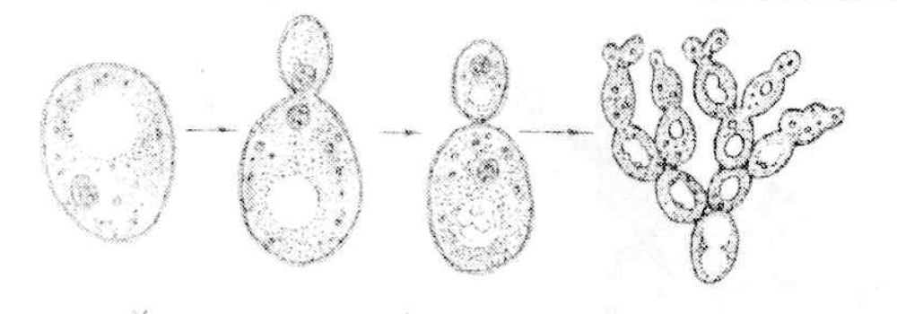
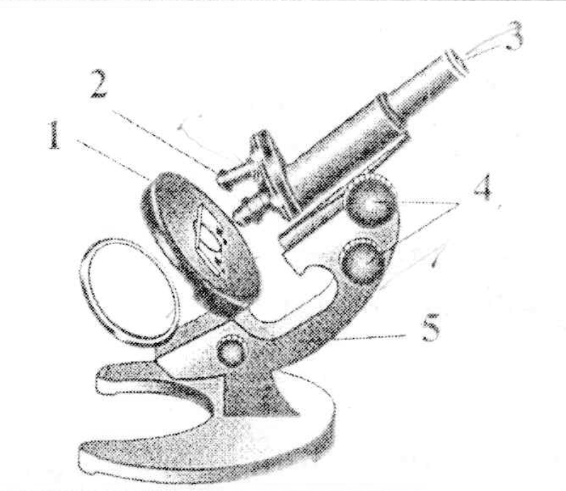
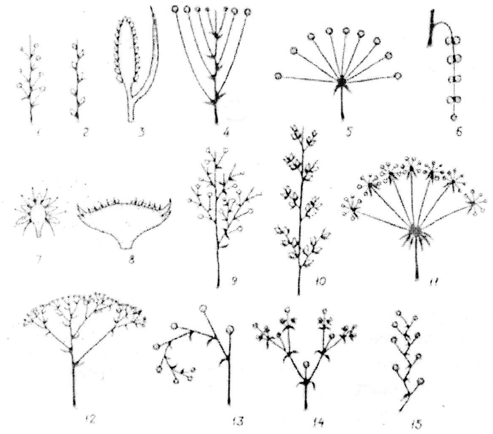

# Олимпиада 7 класса — Городской этап · 2014/2015 · теоретическая часть

Олимпиада `g7` из тренажёра «Олимпиада под микроскопом». Вопросов: 35. Каждый вопрос: условие (с рисунками), ключ и допустимые ответы, эталонный ответ, разбор по шагам 3–8 (алгоритм, объяснение и разбор вариантов, ловушки, как запомнить, схема, олимпиадный горизонт). Схемы в разборах здесь заменены подписями; сами схемы — в PDF-версии.

---

### [g7-q1] № 1

Раздел: Задание 1. Выбор одного ответа из четырёх. Тип: один ответ. ID: `g7-p1-s1-q1`. На сайте: `#g7-q1`.

**Условие.** Таксономическая категория, объединяющая родственные порядки растений:

Варианты:
- А) семейство
- Б) класс
- В) род
- Г) отдел

**Ключ:** Б) класс

**Эталонный ответ (карточка «Правильный ответ» на сайте):**

Б) класс.

**Разбор (шаги 3–8):**
**Шаг 1. Что спрашивают.** Систематика — это «лестница» групп: каждая следующая ступень объединяет несколько групп предыдущей. Нужно найти ступень, которая стоит сразу над порядком.

**Шаг 2. Выстраиваем лестницу у растений** (от меньшей группы к большей):

**вид → род → семейство → порядок → класс → отдел → царство**

*Лестница систематики растений (внизу — пример: шиповник коричный)*
[Схема: без подписи]

**Шаг 3. Разбираем каждый вариант.**

| Вариант | Итог | Почему |
|---|---|---|
| А) семейство | ✘ | Стоит ниже порядка: это порядок объединяет семейства, а не наоборот. |
| Б) класс | ✔ | Ближайшая ступень над порядком: класс объединяет родственные порядки. |
| В) род | ✘ | Ещё ниже — объединяет виды. |
| Г) отдел | ✘ | Стоит над классом и объединяет классы, а не порядки. |

**Шаг 4. Вывод.** Порядки объединяются в класс.

**Внимание.** Частая ошибка (на листе обведён именно «отдел»): ученик помнит, что «отдел — большая группа», и выбирает его. Но вопрос не про «большую группу», а про ту, что непосредственно объединяет порядки. Отдел тоже содержит порядки, но через ступень — внутри классов. /  Вторая ловушка — путаница с животными: у животных вместо «отдела» — **тип**, а вместо «порядка» — **отряд**.

**Как запомнить.** Первые буквы ступеней (В-Р-С-П-К-О-Ц): «**В**ася **Р**ыжий **С**пал, **П**отом **К**упил **О**гурцов **Ц**елую корзину». У животных: вид → род → семейство → **отряд** → класс → **тип** → царство.

---

### [g7-q2] № 2

Раздел: Задание 1. Выбор одного ответа из четырёх. Тип: один ответ. ID: `g7-p1-s1-q2`. На сайте: `#g7-q2`.

**Условие.** При обследовании заплесневевших продуктов учёный сфотографировал организм, который вызвал повреждения. Что это за организм?

*(На фотографии под микроскопом: длинная нить-ножка с поперечными перегородками, на верхушке она ветвится на несколько «пальцев», и на каждом сидят цепочки мелких шариков — похоже на кисточку.)*

Варианты:
- А) мукор
- Б) пеницилл
- В) аспергилл
- Г) дрожжи

**Ключ:** Б) пеницилл

**Эталонный ответ (карточка «Правильный ответ» на сайте):**

Б) пеницилл.

**Разбор (шаги 3–8):**
**Шаг 1. Что спрашивают.** Нужно узнать гриб по форме органа, на котором образуются споры. У каждой плесени он свой, и именно по нему их различают под микроскопом.

**Шаг 2. Сравниваем четыре гриба.**

*Как отличить четыре гриба под микроскопом*
[Схема: без подписи]

| Вариант | Итог | Почему |
|---|---|---|
| А) мукор («белая плесень») | ✘ | На конце нити — один шарик (спорангий), внутри которого споры. Мицелий без перегородок (одна огромная клетка). На фото шарика нет — есть ветвящаяся «кисть». |
| Б) пеницилл («зелёная, сизая плесень») | ✔ | Нить с перегородками, на конце ветвится, как кисточка художника, на каждой веточке — цепочки спор. Это ровно то, что на фото. |
| В) аспергилл | ✘ | Тоже нить с перегородками, но на конце — вздутая головка, от которой во все стороны лучами расходятся цепочки спор (похоже на лейку или одуванчик). На фото вздутия нет. |
| Г) дрожжи | ✘ | Одиночные овальные клетки, размножаются почкованием, нитей не образуют вовсе. |

**Шаг 3. Вывод.** Ветвящаяся «кисточка» с цепочками спор — признак пеницилла (его латинское название *Penicillium* и значит «кисточка»).

**Внимание.** Чаще всего путают пеницилл и аспергилл: у обоих споры в цепочках. Различие — в «основании» цепочек: у пеницилла — веточки-пальцы (кисть), у аспергилла — круглое вздутие (лейка).

**Как запомнить.** **Пеницилл = пенал с кисточками** (Penicillium — от латинского «кисточка», как английское *pencil*). **Аспергилл = лейка** (aspergillum — сосуд для окропления водой). **Мукор = мячик** на палочке. Из пеницилла получают первый антибиотик — пенициллин.

---

### [g7-q3] № 3

Раздел: Задание 1. Выбор одного ответа из четырёх. Тип: один ответ. ID: `g7-p1-s1-q3`. На сайте: `#g7-q3`.

**Условие.** Стенка бактериальной клетки содержит:

Варианты:
- А) фибрин
- Б) муреин
- В) целлюлозу
- Г) хитин

**Ключ:** Б) муреин

**Эталонный ответ (карточка «Правильный ответ» на сайте):**

Б) муреин.

**Разбор (шаги 3–8):**
**Шаг 1. Что спрашивают.** У разных царств клеточная стенка построена из разных веществ. Нужно вспомнить вещество именно бактерий.

**Шаг 2. Сравнительная таблица.**

| Организмы | Есть ли клеточная стенка | Из чего построена |
|---|---|---|
| Бактерии | есть | муреин |
| Растения | есть | целлюлоза (клетчатка) |
| Грибы | есть | хитин |
| Животные | нет | — (только мембрана; хитин у насекомых — в наружном покрове тела, а не в стенке клетки) |

| Вариант | Итог | Почему |
|---|---|---|
| А) фибрин | ✘ | Это белок крови человека и животных: из него образуется сгусток при свёртывании крови. К клеточной стенке отношения не имеет. |
| Б) муреин | ✔ | Особое вещество, которое есть только у бактерий. |
| В) целлюлоза | ✘ | Основа стенки клеток растений. |
| Г) хитин | ✘ | Основа стенки клеток грибов (и наружного скелета членистоногих). |

**Шаг 3. Вывод.** Стенка бактерий содержит муреин.

**Внимание.** На листе обведена «целлюлоза» — это очень частая ошибка: «раз у бактерий есть стенка, как у растений, значит, и вещество то же». Нет: есть клеточная стенка — ещё не значит целлюлоза. Каждое царство «строит стенку из своего материала».

**Как запомнить.** **М**уреин — у **М**икробов (бактерий). **Ц**еллюлоза — у **Ц**ветов (растений). **Х**итин — у **Х**рустящих грибов и жуков.

---

### [g7-q4] № 4

Раздел: Задание 1. Выбор одного ответа из четырёх. Тип: один ответ. ID: `g7-p1-s1-q4`. На сайте: `#g7-q4`.

**Условие.** Монокарпические растения в течение жизни:

Варианты:
- А) цветут и плодоносят много раз
- Б) цветут и плодоносят один раз
- В) цветут и плодоносят много раз за один вегетационный период
- Г) не цветут и не плодоносят

**Ключ:** Б) цветут и плодоносят один раз

**Эталонный ответ (карточка «Правильный ответ» на сайте):**

Б) цветут и плодоносят один раз.

**Разбор (шаги 3–8):**
**Шаг 1. Разбираем слово.** «Моно» — один, «карпос» — плод. Монокарпическое растение — то, которое плодоносит один раз за жизнь и после этого погибает. Противоположность — поликарпические («поли» — много).

**Шаг 2. Разбираем каждый вариант.**

| Вариант | Итог | Почему |
|---|---|---|
| А) много раз | ✘ | Это поликарпические растения: яблоня, дуб, земляника, сирень. |
| Б) один раз | ✔ | Точный смысл слова «монокарпические». |
| В) много раз за один сезон | ✘ | Отвлекающий вариант: многократное цветение за лето (ремонтантность, как у некоторых сортов малины и земляники) — это особенность поликарпиков. |
| Г) не цветут и не плодоносят | ✘ | Так «живут» мхи и папоротники, но к термину «монокарпические» это не относится: в нём есть «карпос» — плод. |

Внимание.
Монокарпик —
не обязательно
однолетник! Монокарпиками бывают:
- однолетние растения — горох, подсолнечник, укроп;
- двулетние — морковь, капуста, свёкла (первый год копят запасы, на второй цветут и погибают);
- многолетние — бамбук и агава живут десятки лет, но цветут один раз в жизни и после этого отмирают.

**Как запомнить.** **Моно**рельс — одна рельса, **моно**лог — говорит один, **моно**карпик — один раз плоды.

---

### [g7-q5] № 5

Раздел: Задание 1. Выбор одного ответа из четырёх. Тип: один ответ. ID: `g7-p1-s1-q5`. На сайте: `#g7-q5`.

**Условие.** Разнообразие окраски водорослей обусловлено:

Варианты:
- А) приспособлением к поглощению света с разной длиной волны
- Б) привлечением животных
- В) маскировкой
- Г) особенностями размножения

**Ключ:** А) приспособлением к поглощению света с разной длиной волны

**Эталонный ответ (карточка «Правильный ответ» на сайте):**

А) приспособлением к поглощению света с разной длиной волны.

**Разбор (шаги 3–8):**
**Шаг 1. Что спрашивают.** Почему одни водоросли зелёные, другие бурые, третьи красные? Надо связать цвет с главной функцией водоросли — фотосинтезом.

**Шаг 2. Как свет идёт в воде.** Солнечный свет состоит из лучей разного цвета (разной длины волны). Вода поглощает их неодинаково: красные лучи гаснут уже в верхних метрах, а сине-зелёные проникают глубже всех. Поэтому на глубине водоросли «вынуждены» ловить другой свет, и для этого у них есть дополнительные пигменты, которые и меняют окраску.

*Чем глубже, тем «краснее» водоросли: их пигменты подстраиваются под свет, который туда доходит*
[Схема: без подписи]

| Глубина | Какие водоросли | Какой свет ловят |
|---|---|---|
| мелководье | зелёные (улотрикс, хламидомонада) | красный и синий — хлорофиллом |
| средняя | бурые (ламинария, фукус) | зелёный — бурым пигментом |
| большая (до 100–200 м) | красные (порфира, филлофора) | сине-зелёный — красным пигментом |

| Вариант | Итог | Почему |
|---|---|---|
| А) поглощение света разной длины волны | ✔ | Пигменты водорослей настроены на тот свет, который доходит до их глубины, — это нужно для фотосинтеза. |
| Б) привлечение животных | ✘ | Так работает яркая окраска цветков наземных растений (опылители). Водорослям опылители не нужны: у них нет цветков. |
| В) маскировка | ✘ | Маскировка нужна тем, кто прячется от хищников или подкрадывается к добыче, — то есть животным. Водоросли от хищников не прячутся. |
| Г) особенности размножения | ✘ | Размножение с окраской не связано: и зелёные, и бурые, и красные водоросли размножаются похожими способами (спорами, половым путём). |

**Внимание.** Ловушка — перенос «животных» причин окраски (маскировка, привлечение) на растения. Для любого растения и водоросли цвет — это прежде всего **пигменты фотосинтеза**.

**Как запомнить.** «Чем глубже — тем краснее»: **З**елёные — **Б**урые — **К**расные, сверху вниз, как цвета светофора наоборот (снизу красный).

---

### [g7-q6] № 6

Раздел: Задание 1. Выбор одного ответа из четырёх. Тип: один ответ. ID: `g7-p1-s1-q6`. На сайте: `#g7-q6`.

**Условие.** Если жук-опылитель по круговой траектории будет ползти по цветку растения из сем. Бобовые (Мотыльковые), то он встретит лепестки венчика в следующем порядке:

Варианты:
- А) два сросшихся лепестка (парус) – весло – лодочка – весло
- Б) весло – два сросшихся лепестка (лодочка) – весло – парус
- В) два сросшихся лепестка (лодочка) – весло – весло – парус
- Г) парус – два сросшихся лепестка (вёсла) – лодочка

**Ключ:** Б) весло – два сросшихся лепестка (лодочка) – весло – парус

**Эталонный ответ (карточка «Правильный ответ» на сайте):**

Б) весло – два сросшихся лепестка (лодочка) – весло – парус.

**Разбор (шаги 3–8):**
**Шаг 1. Вспоминаем строение венчика** гороха, фасоли, клевера. Он похож на бабочку (мотылька), поэтому семейство называют Мотыльковые. Лепестков 5:

- **парус** (флаг) — 1 самый крупный лепесток сверху;
- **вёсла** (крылья) — 2 боковых лепестка, слева и справа;
- **лодочка** — 2 нижних лепестка, сросшиеся между собой (в ней спрятаны тычинки и пестик).

**Шаг 2. Обходим цветок по кругу.** Лепестки расположены по кругу так: парус — весло — лодочка — весло — снова парус. Значит, между двумя вёслами с одной стороны стоит лодочка, а с другой — парус. Два весла никогда не идут подряд.

*Венчик мотылькового типа (вид спереди) и круговой путь жука*
[Схема: без подписи]

**Шаг 3. Разбираем каждый вариант.**

| Вариант | Итог | Почему |
|---|---|---|
| А) два сросшихся (парус) – весло – лодочка – весло | ✘ | Порядок по кругу верный, но парус назван сросшимся: парус — один лепесток, сросшиеся — у лодочки. |
| Б) весло – два сросшихся (лодочка) – весло – парус | ✔ | Порядок по кругу правильный, и сросшимися верно названы лепестки лодочки. |
| В) два сросшихся (лодочка) – весло – весло – парус | ✘ | Два весла подряд — так не бывает: вёсла разделены лодочкой и парусом. |
| Г) парус – два сросшихся (вёсла) – лодочка | ✘ | Вёсла не срастаются, а лодочка — не один лепесток; к тому же названо только 3 части вместо 4. |

**Внимание.** Обычно путают, какие лепестки сросшиеся. Сросшиеся — всегда **лодочка** (2 нижних). А в олимпиадных вариантах сросшимся часто называют парус или вёсла — это ловушка. Прежде чем проверять порядок, проверь подписи в скобках!

**Как запомнить.** Представь **лодку**: сверху надут один большой **парус**, по бокам два **весла**, внизу — сама **лодочка** (корпус лодки цельный, поэтому её лепестки сросшиеся).

---

### [g7-q7] № 7

Раздел: Задание 1. Выбор одного ответа из четырёх. Тип: один ответ. ID: `g7-p1-s1-q7`. На сайте: `#g7-q7`.

**Условие.** По внутреннему строению слоевища лишайники подразделяются на:

Варианты:
- А) гомеомерные и гетеромерные
- Б) трубчатые и пластинчатые
- В) мономерные и полимерные
- Г) накипные, листоватые и кустистые

**Ключ:** А) гомеомерные и гетеромерные

**Эталонный ответ (карточка «Правильный ответ» на сайте):**

А) гомеомерные и гетеромерные.

**Разбор (шаги 3–8):**
**Шаг 1. Ключевое слово — «внутреннему».** Лишайники делят на группы двумя разными способами: по внешнему виду и по внутреннему строению (как они выглядят на срезе под микроскопом). Спрашивают про второй способ.

**Шаг 2. Две классификации.**

| По чему делят | Группы | Что это значит |
|---|---|---|
| по **внешнему виду** слоевища | накипные, листоватые, кустистые | корочка на камне/коре; пластинка-«листик»; кустик или «бородка» |
| по **внутреннему строению** слоевища | гомеомерные и гетеромерные | водоросли разбросаны по всему слоевищу равномерно / лежат отдельным слоем |

*Срезы слоевища: водоросли разбросаны (слева) или собраны в слой (справа)*
[Схема: без подписи]

**Шаг 3. Разбираем каждый вариант.**

| Вариант | Итог | Почему |
|---|---|---|
| А) гомеомерные и гетеромерные | ✔ | Это и есть деление по внутреннему строению: «гомео» — одинаковый (однородный срез), «гетеро» — разный (срез из слоёв). |
| Б) трубчатые и пластинчатые | ✘ | Так делят шляпочные грибы по нижней стороне шляпки (подберёзовик — трубчатый, сыроежка — пластинчатый). |
| В) мономерные и полимерные | ✘ | Такой классификации лишайников нет — термины из химии. |
| Г) накипные, листоватые и кустистые | ✘ | Верная классификация, но по внешнему виду, а не по внутреннему строению. |

**Внимание.** На листе обведён вариант Г — это самая частая ошибка в этом вопросе. Он «знакомый» из учебника, поэтому рука сама тянется к нему. Всегда ищи в условии уточняющее слово: **внутреннее** строение → гомео-/гетеромерные; **внешний** вид → накипные/листоватые/кустистые.

**Как запомнить.** «**Гомо**генизированное молоко» — однородное, везде одинаковое → гомеомерный лишайник. «**Гетеро**» — разный, как слоёный пирог → гетеромерный. Внешние формы: **Н-Л-К** — «**Н**а **Л**есной **К**оре»: накипные, листоватые, кустистые.

---

### [g7-q8] № 8

Раздел: Задание 1. Выбор одного ответа из четырёх. Тип: один ответ. ID: `g7-p1-s1-q8`. На сайте: `#g7-q8`.

**Условие.** Гифы гриба снабжают организм лишайника:

Варианты:
- А) водой и органическими веществами
- Б) водой и минеральными веществами
- В) исключительно водой
- Г) кислородом и углекислым газом

**Ключ:** Б) водой и минеральными веществами

**Эталонный ответ (карточка «Правильный ответ» на сайте):**

Б) водой и минеральными веществами.

**Разбор (шаги 3–8):**
**Шаг 1. Что такое лишайник.** Лишайник — это «союз» (симбиоз) двух организмов: **гриба** и **водоросли** (или цианобактерии). Каждый партнёр делает для другого то, чего тот сам не умеет.

**Шаг 2. Кто что умеет.**

*Взаимная выгода гриба и водоросли в лишайнике*
[Схема: без подписи]

| Вариант | Итог | Почему |
|---|---|---|
| А) водой и органическими веществами | ✘ | Органические вещества гриб сам создавать не умеет — у него нет хлорофилла. Их делает водоросль и отдаёт грибу. |
| Б) водой и минеральными веществами | ✔ | Гифы, как корни, впитывают воду из дождя, росы, тумана вместе с растворёнными минеральными солями. |
| В) исключительно водой | ✘ | Неполный ответ: с водой всегда приходят и минеральные соли. Слово «исключительно» — признак неверного варианта. |
| Г) кислородом и углекислым газом | ✘ | Газы проникают в слоевище сами; к тому же кислород в лишайнике выделяет при фотосинтезе водоросль. |

**Внимание.** Типичная ошибка — вариант А: путают, кто кормит кого органикой. Правило простое: **органику делает только тот, у кого есть хлорофилл**, то есть водоросль. Гриб — «водопровод», водоросль — «кухня». /  И ещё: слова «исключительно», «только», «всегда» в вариантах ответа биологических тестов часто сигналят о неверном ответе.

**Как запомнить.** Гриб в лишайнике — как корень у растения: **корень даёт воду и соли**. Водоросль — как лист: **лист даёт сахар**.

---

### [g7-q9] № 9

Раздел: Задание 1. Выбор одного ответа из четырёх. Тип: один ответ. ID: `g7-p1-s1-q9`. На сайте: `#g7-q9`.

**Условие.** У моховидных располагается:

Варианты:
- А) гаметофит на спорофите
- Б) спорофит на женском гаметофите
- В) спорофит на мужском гаметофите
- Г) спорофит на женском или обоеполом гаметофите

**Ключ:** Г) спорофит на женском или обоеполом гаметофите

**Эталонный ответ (карточка «Правильный ответ» на сайте):**

Г) спорофит на женском или обоеполом гаметофите.

**Разбор (шаги 3–8):**
**Шаг 1. Вспоминаем два поколения.** В жизни мха чередуются два поколения:

- **гаметофит** — образует гаметы (сперматозоиды и яйцеклетки). У мхов это и есть привычное зелёное растение со стебельком и листочками;
- **спорофит** — образует споры. У мхов это коробочка на ножке, которая вырастает на верхушке зелёного растения.

**Шаг 2. Откуда берётся коробочка.** Яйцеклетка находится в архегонии на верхушке растения. Сперматозоид подплывает к ней в капле воды, происходит оплодотворение, и из зиготы вырастает спорофит — прямо там, где была яйцеклетка. Значит, коробочка сидит на том растении, которое несло яйцеклетку.

**Шаг 3. Какое это растение.** У части мхов растения раздельнополые (например, кукушкин лён: есть женские и мужские растения) — тогда коробочка сидит на **женском**. Но у многих мхов на одном растении образуются и яйцеклетки, и сперматозоиды (такие растения называют **обоеполыми**; например, фунария) — тогда коробочка сидит на обоеполом растении.

*Спорофит мха (коробочка) всегда вырастает на гаметофите, который нёс яйцеклетку*
[Схема: без подписи]

| Вариант | Итог | Почему |
|---|---|---|
| А) гаметофит на спорофите | ✘ | Наоборот: у мхов главное, крупное, зелёное поколение — гаметофит, а спорофит «сидит» на нём и питается за его счёт. |
| Б) спорофит на женском гаметофите | ✘ (неполный) | Верно для раздельнополых мхов (кукушкин лён), но не учитывает мхи с обоеполыми растениями. |
| В) спорофит на мужском гаметофите | ✘ | На мужском растении нет яйцеклеток, значит, из него не может вырасти коробочка. |
| Г) спорофит на женском или обоеполом гаметофите | ✔ | Охватывает все случаи: коробочка всегда там, где была яйцеклетка, а яйцеклетки бывают и на женских, и на обоеполых растениях. Это «наиболее полный» ответ. |

**Внимание.** Большинство школьников уверенно выбирают Б, потому что в учебнике разбирают кукушкин лён. Вариант Б не ошибочный, но неполный — а по условию надо выбрать «наиболее полный и правильный». Если один вариант включает в себя другой и добавляет ещё верные случаи, выбирай его. /  Вторая ловушка — вариант А: у **мхов** главное поколение — гаметофит, а у **папоротников, хвощей, плаунов, голосеменных и цветковых** — спорофит. Мхи — единственная группа высших растений, где «главный» — гаметофит.

**Как запомнить.** «Мох — мама, коробочка — малыш на руках у мамы». Малыш (спорофит) сидит на той, кто его «родил» — на растении с яйцеклеткой (женском или обоеполом).

---

### [g7-q10] № 10

Раздел: Задание 1. Выбор одного ответа из четырёх. Тип: один ответ. ID: `g7-p1-s1-q10`. На сайте: `#g7-q10`.

**Условие.** Об усложнении папоротников в процессе эволюции по сравнению со мхами свидетельствует:

Варианты:
- А) чередование поколений при размножении
- Б) фотосинтез
- В) образование корней и проводящих тканей
- Г) размножение спорами

**Ключ:** В) образование корней и проводящих тканей

**Эталонный ответ (карточка «Правильный ответ» на сайте):**

В) образование корней и проводящих тканей.

**Разбор (шаги 3–8):**
**Шаг 1. Как искать «усложнение».** Признак усложнения — то, что есть у папоротников, но нет у мхов. Всё, что есть у обеих групп, — это общий признак, а не усложнение.

**Шаг 2. Сравниваем.**

| Признак | Мхи | Папоротники | Это усложнение? |
|---|---|---|---|
| чередование поколений | есть | есть | нет — общее |
| фотосинтез | есть | есть | нет — общее (и у водорослей тоже) |
| размножение спорами | есть | есть | нет — общее |
| корни | нет, только ризоиды (нити-выросты) | есть (придаточные корни на корневище) | да |
| проводящие ткани (ксилема, флоэма) | нет настоящих | есть | да |
| главное поколение | гаметофит | спорофит | да (но в вариантах этого нет) |

| Вариант | Итог | Почему |
|---|---|---|
| А) чередование поколений | ✘ | Есть и у мхов — общий признак всех высших растений. |
| Б) фотосинтез | ✘ | Есть у всех растений и водорослей. |
| В) корни и проводящие ткани | ✔ | Появились у папоротникообразных; благодаря им папоротники вырастают крупнее (древовидные папоротники — до 20 м), а мхи остаются низкими. |
| Г) размножение спорами | ✘ | Мхи тоже размножаются спорами. |

**Внимание.** Ошибаются, выбирая признак, который «верен для папоротников» (А, Б, Г — всё это у папоротников правда есть!). Но вопрос не «что есть у папоротников», а «что отличает и усложняет их по сравнению со мхами». Проверяй каждый вариант вопросом: «А у мхов это есть?» Если есть — это не усложнение.

**Как запомнить.** Мох — «низенький, потому что без труб»: нет корней и сосудов, воду тянет всей поверхностью. Папоротник — «с водопроводом»: корни + проводящие ткани, поэтому может быть высоким.

---

### [g7-q11] № 11

Раздел: Задание 1. Выбор одного ответа из четырёх. Тип: один ответ. ID: `g7-p1-s1-q11`. На сайте: `#g7-q11`.

**Условие.** Семязачатки у сосны обыкновенной расположены на:

Варианты:
- А) чешуях мужских шишек
- Б) чешуях женских шишек
- В) листьях
- Г) стеблях

**Ключ:** Б) чешуях женских шишек

**Эталонный ответ (карточка «Правильный ответ» на сайте):**

Б) на чешуях женских шишек.

**Разбор (шаги 3–8):**
**Шаг 1. Что такое семязачаток.** Семязачаток — это то, из чего после оплодотворения развивается **семя**. В нём находится яйцеклетка. Значит, искать его надо в женских органах.

**Шаг 2. Шишки сосны.** У сосны два вида шишек:

- **мужские** — мелкие, желтоватые, собраны группами у основания молодых побегов; на их чешуях — пыльцевые мешки с пыльцой;
- **женские** — красноватые, на верхушках молодых побегов; на каждой семенной чешуе сверху лежат **два семязачатка**. Они ничем не прикрыты — поэтому растение и называется **голосеменным**.

*Чешуя женской шишки сосны: сначала с семязачатками, потом с семенами*
[Схема: без подписи]

| Вариант | Итог | Почему |
|---|---|---|
| А) чешуях мужских шишек | ✘ | Там пыльцевые мешки с пыльцой, а не семязачатки. |
| Б) чешуях женских шишек | ✔ | По 2 семязачатка на каждой семенной чешуе. |
| В) листьях | ✘ | Листья сосны — хвоинки, они фотосинтезируют и семязачатков не несут. |
| Г) стеблях | ✘ | Шишка сидит на побеге, но семязачатки — не на самом стебле, а на чешуях шишки. |

**Внимание.** Шишки бывают и мужские, и женские — и семена у школьников часто «прописаны» сразу на всех шишках. Запомни: семена — это «дети», их несёт только **женская** шишка. После опыления шишка растёт, твердеет, и семена созревают лишь через полтора года — ещё один любимый вопрос олимпиад.

**Как запомнить.** «Голо-семенные» — семена лежат **голые**, на открытой ладошке-чешуе. «Покрыто-семенные» — семена **покрыты** плодом (см. вопрос 12).

---

### [g7-q12] № 12

Раздел: Задание 1. Выбор одного ответа из четырёх. Тип: один ответ. ID: `g7-p1-s1-q12`. На сайте: `#g7-q12`.

**Условие.** Семязачатки цветковых растений образуются:

Варианты:
- А) на поверхности завязи
- Б) внутри завязи
- В) внутри цветоложа
- Г) в пыльниках тычинок

**Ключ:** Б) внутри завязи

**Эталонный ответ (карточка «Правильный ответ» на сайте):**

Б) внутри завязи.

**Разбор (шаги 3–8):**
**Шаг 1. Где в цветке женские органы.** Женская часть цветка — **пестик**. Он состоит из рыльца (ловит пыльцу), столбика и **завязи** — расширенной нижней части. Внутри завязи — полость, в которой и сидят семязачатки.

**Шаг 2. Что из чего получается.** После оплодотворения семязачаток превращается в **семя**, а стенка завязи — в стенку **плода**. Семена оказываются спрятаны внутри плода — поэтому цветковые растения называют **покрытосеменными**.

*Продольный разрез пестика*
[Схема: без подписи]

| Вариант | Итог | Почему |
|---|---|---|
| А) на поверхности завязи | ✘ | Открыто, «на поверхности», семязачатки лежат у голосеменных (на чешуе), а не у цветковых. |
| Б) внутри завязи | ✔ | Они закрыты стенкой завязи — главный признак покрытосеменных. |
| В) внутри цветоложа | ✘ | Цветоложе — это основание цветка, к которому прикрепляются его части. Оно может срастаться с завязью (вопрос 18), но семязачатки образуются в полости завязи, а не в цветоложе. |
| Г) в пыльниках тычинок | ✘ | Пыльник — мужская часть, в нём образуется пыльца. |

**Внимание.** Не путай **семязачаток** (женское, в завязи) и **пыльцу** (мужское, в пыльнике). А ещё не путай «завязь» и «завязавшийся плод» в бытовом смысле: завязь — это часть пестика ещё до оплодотворения.

**Как запомнить.** Завязь — «шкатулка», семязачатки — «жемчужины» внутри. Из шкатулки получается плод, из жемчужин — семена.

---

### [g7-q13] № 13

Раздел: Задание 1. Выбор одного ответа из четырёх. Тип: один ответ. ID: `g7-p1-s1-q13`. На сайте: `#g7-q13`.

**Условие.** Ткани растений, выполняющие опорную функцию, — это:

Варианты:
- А) эпидерма, пробка
- Б) ксилема, флоэма
- В) склеренхима, колленхима
- Г) камбий, мезофилл

**Ключ:** В) склеренхима, колленхима

**Эталонный ответ (карточка «Правильный ответ» на сайте):**

В) склеренхима, колленхима.

**Разбор (шаги 3–8):**
**Шаг 1. Пять групп тканей растений.** Каждой паре в вариантах соответствует своя группа — нужно найти ту, которая называется **механическими** (опорными).

| Группа тканей | Примеры | Функция |
|---|---|---|
| покровные | эпидерма (кожица), пробка | защита от высыхания, повреждений |
| проводящие | ксилема (древесина), флоэма (луб) | передвижение воды и веществ |
| механические | склеренхима, колленхима | опора, прочность |
| образовательные | камбий, верхушечная меристема | деление клеток, рост |
| основные | мезофилл листа (фотосинтез), запасающая паренхима | фотосинтез, запасание |

**Шаг 2. Две механические ткани.**

- **Колленхима** — живые клетки с утолщёнными уголками оболочки. Прочная, но гибкая, поэтому встречается в растущих органах: черешках листьев, молодых стеблях (жилки черешка сельдерея — это колленхима).
- **Склеренхима** — клетки с толстыми одревесневшими оболочками, обычно мёртвые. Это волокна (лён, конопля) и каменистые клетки (скорлупа ореха, «песчинки» в мякоти груши).

| Вариант | Итог | Почему |
|---|---|---|
| А) эпидерма, пробка | ✘ | Покровные ткани — защита. |
| Б) ксилема, флоэма | ✘ | Проводящие ткани. (В их составе есть опорные волокна, но сами по себе это ткани проведения.) |
| В) склеренхима, колленхима | ✔ | Обе — механические ткани. |
| Г) камбий, мезофилл | ✘ | Камбий — образовательная ткань, мезофилл — основная (фотосинтезирующая). |

**Внимание.** Ловушка — вариант Б: «древесина твёрдая, значит, опорная». Древесина (ксилема) действительно прочная, но её главная функция — проведение воды. Твёрдость ей дают как раз включённые в неё волокна склеренхимы.

**Как запомнить.** «**Склер**о» — по-гречески «твёрдый» (склероз — затвердение). «**Колла**» — клей: колленхима как гибкий клеевой каркас. Обе «-енхимы» держат растение.

---

### [g7-q14] № 14

Раздел: Задание 1. Выбор одного ответа из четырёх. Тип: один ответ. ID: `g7-p1-s1-q14`. На сайте: `#g7-q14`.

**Условие.** Элементами ксилемы являются:

Варианты:
- А) трахеиды
- Б) сосуды
- В) ситовидные трубки
- Г) сосуды, трахеиды

**Ключ:** Г) сосуды, трахеиды

**Эталонный ответ (карточка «Правильный ответ» на сайте):**

Г) сосуды, трахеиды.

**Разбор (шаги 3–8):**
**Шаг 1. Две проводящие ткани.**

|  | Ксилема (древесина) | Флоэма (луб) |
|---|---|---|
| что проводит | воду с минеральными солями | органические вещества (сахара) |
| куда | от корней вверх | от листьев ко всем органам |
| проводящие элементы | сосуды и трахеиды (мёртвые клетки) | ситовидные трубки с клетками-спутницами (живые) |

**Шаг 2. Сосуды и трахеиды.** Обе — мёртвые полые клетки-«трубки». **Трахеиды** — узкие, длинные, с заострёнными концами; вода переходит из одной в другую через поры. **Сосуды** — длинные трубы из клеток, у которых растворились поперечные стенки. У голосеменных (сосна, ель) в ксилеме почти только трахеиды, у цветковых есть и то, и другое.

| Вариант | Итог | Почему |
|---|---|---|
| А) трахеиды | ✘ (неполный) | Верно, но это лишь часть ответа. |
| Б) сосуды | ✘ (неполный) | Тоже верно, но тоже лишь часть. |
| В) ситовидные трубки | ✘ | Это элементы флоэмы. |
| Г) сосуды, трахеиды | ✔ | Наиболее полный ответ: оба проводящих элемента ксилемы. |

**Внимание.** Здесь две ловушки: 1) выбрать А или Б и забыть, что требуется «наиболее полный» ответ; 2) перепутать ксилему и флоэму и выбрать ситовидные трубки.

**Как запомнить.** «**Кс**илема — **к с**олнцу»: вода поднимается вверх по сосудам и трахеидам. «**Ф**лоэма — **ф**ильтр-сито»: ситовидные трубки разносят сахар. Сито = ситовидные = флоэма.

---

### [g7-q15] № 15

Раздел: Задание 1. Выбор одного ответа из четырёх. Тип: один ответ. ID: `g7-p1-s1-q15`. На сайте: `#g7-q15`.

**Условие.** Зона корня, где происходит митотическое деление клеток, обеспечивающее рост корня в длину, — это зона:

Варианты:
- А) всасывания
- Б) деления
- В) растяжения
- Г) проведения

**Ключ:** Б) деления

**Эталонный ответ (карточка «Правильный ответ» на сайте):**

Б) деления.

**Разбор (шаги 3–8):**
**Шаг 1. Ключевые слова.** «Митотическое деление клеток». Митоз — это способ деления клетки, при котором из одной получаются две такие же. Ищем зону, где клетки делятся.

**Шаг 2. Зоны корня** (от кончика вверх):

*Зоны кончика корня*
[Схема: без подписи]

| Вариант | Итог | Почему |
|---|---|---|
| А) всасывания | ✘ | Здесь корневые волоски поглощают воду; клетки уже не делятся. |
| Б) деления | ✔ | Клетки образовательной ткани постоянно делятся митозом, увеличивая их число. |
| В) растяжения | ✘ | Клетки здесь не делятся, а увеличиваются в длину (растягиваются) — это тоже даёт рост, но не делением. |
| Г) проведения | ✘ | Проводит воду вверх и укрепляет корень; деления клеток нет. |

**Внимание.** Вопрос с ловушкой в словах «рост корня в длину»: многие помнят, что «зона растяжения — зона роста», и выбирают В. На самом деле в длину корень растёт за счёт **двух** зон: в зоне деления клеток становится больше, в зоне растяжения они становятся длиннее. Но в условии прямо сказано «**деление** клеток» — значит, зона деления.

**Как запомнить.** Снизу вверх — «**Ч**асто **Д**ети **Р**астут **В**ыше **П**апы»: Чехлик → Деление → Растяжение → Всасывание → Проведение.

---

### [g7-q16] № 16

Раздел: Задание 1. Выбор одного ответа из четырёх. Тип: один ответ. ID: `g7-p1-s1-q16`. На сайте: `#g7-q16`.

**Условие.** Личинка жука-щелкуна (проволочник) внедряется в зрелый корнеплод моркови. В каком порядке ей попадутся ткани корнеплода?

Варианты:
- А) эпидерма – кора – эндодерма – перицикл – флоэма – ксилема
- Б) перидерма – флоэма – камбий – ксилема
- В) перидерма – флоэма – камбий – ксилема – сердцевина
- Г) эпидерма – эндодерма – кора – перицикл – флоэма – ксилема

**Ключ:** Б) перидерма – флоэма – камбий – ксилема

**Эталонный ответ (карточка «Правильный ответ» на сайте):**

Б) перидерма – флоэма – камбий – ксилема.

**Разбор (шаги 3–8):**
**Шаг 1. Ключевое слово — «зрелый».** У молодого корня первичное строение (эпидерма, кора, эндодерма, перицикл, в центре — ксилема и флоэма). Но корнеплод моркови — это корень, сильно утолщённый за счёт работы **камбия**, то есть корень вторичного строения. При утолщении эпидерма и первичная кора разрываются и слущиваются, а снаружи образуется пробковый слой — **перидерма**.

**Шаг 2. Разрежем морковку поперёк.** Снаружи внутрь видно:

*Поперечный срез корнеплода моркови и путь проволочника*
[Схема: без подписи]

**Шаг 3. Разбираем каждый вариант.**

| Вариант | Итог | Почему |
|---|---|---|
| А) эпидерма – кора – эндодерма – перицикл – флоэма – ксилема | ✘ | Это верный порядок, но для молодого корня первичного строения. У зрелого корнеплода эпидермы и эндодермы уже нет. |
| Б) перидерма – флоэма – камбий – ксилема | ✔ | Точно соответствует вторичному строению корнеплода моркови. |
| В) … – ксилема – сердцевина | ✘ | У корня моркови (как у большинства корней двудольных) нет сердцевины: центр занят ксилемой. Сердцевина есть в **стебле** (вопрос 17). |
| Г) эпидерма – эндодерма – кора – … | ✘ | Перепутан порядок: эндодерма — внутренний слой коры, она не может лежать снаружи от коры. И снова это первичное строение. |

**Внимание.** Самая коварная ловушка — вариант В. «Сердцевинкой» моркови в быту называют жёлтую середину, но с точки зрения ботаники это **ксилема**. Правило: **сердцевина — в стебле, в корне её нет**. /  Вторая ловушка — вариант А: он «правильный по учебнику», но для молодого корня. Читай условие: **зрелый** корнеплод → вторичное строение → перидерма и камбий.

**Как запомнить.** «**П**апа **Ф**ёдор **К**упил **К**алач»: **П**еридерма → **Ф**лоэма → **К**амбий → **К**силема. Флоэма всегда снаружи от камбия, ксилема — внутри (так и в стволе дерева: луб снаружи, древесина внутри).

---

### [g7-q17] № 17

Раздел: Задание 1. Выбор одного ответа из четырёх. Тип: один ответ. ID: `g7-p1-s1-q17`. На сайте: `#g7-q17`.

**Условие.** Количество камбиальных колец в стволе 10-летнего дерева:

Варианты:
- А) 1
- Б) 10
- В) 100
- Г) 5

**Ключ:** А) 1

**Эталонный ответ (карточка «Правильный ответ» на сайте):**

А) 1.

**Разбор (шаги 3–8):**
**Шаг 1. Что такое камбий.** Камбий — тонкий слой делящихся клеток (образовательная ткань) между лубом и древесиной. На поперечном срезе ствола он выглядит как одно кольцо.

**Шаг 2. Что делает камбий.** Каждый год он откладывает внутрь новый слой древесины, а наружу — новый слой луба. Слой древесины, отложенный за год, — это **годичное кольцо**. Сам же камбий при этом не размножается в кольцах: он один и просто «отодвигается» наружу по мере роста ствола.

*Срез ствола 10-летнего дерева: годичных колец 10, а камбий один*
[Схема: без подписи]

| Вариант | Итог | Почему |
|---|---|---|
| А) 1 | ✔ | Камбий в стволе — один непрерывный слой, сколько бы лет ни было дереву. |
| Б) 10 | ✘ | 10 — это число годичных колец древесины, а не колец камбия. |
| В) 100 | ✘ | Ни с чем не связанное число. |
| Г) 5 | ✘ | Ни с чем не связанное число. |

**Внимание.** Классическая ловушка: путают **камбиальное** кольцо и **годичные** кольца. Годичных колец столько, сколько лет дереву; камбиальное — всегда одно. Камбий — «станок», а годичные кольца — то, что этот станок «напечатал» за 10 лет.

**Как запомнить.** «Один принтер — много страниц»: камбий (принтер) один, годичные кольца (страницы) прибавляются каждый год. По срезу пня возраст дерева считают по годичным кольцам.

---

### [g7-q18] № 18

Раздел: Задание 1. Выбор одного ответа из четырёх. Тип: один ответ. ID: `g7-p1-s1-q18`. На сайте: `#g7-q18`.

**Условие.** Определите тип завязи в зависимости от её положения относительно места прикрепления других частей цветка:

*(На рисунке — продольный разрез цветка: внизу — вздутое основание с полостью, в которой лежит семязачаток; лепестки, чашелистики и тычинки прикреплены на верхушке этого вздутия, из его центра вверх выходит столбик.)*

Варианты:
- А) верхняя
- Б) полунижняя
- В) нижняя
- Г) верхняя, окружённая стенками гипантия

**Ключ:** В) нижняя

**Эталонный ответ (карточка «Правильный ответ» на сайте):**

В) нижняя.

**Разбор (шаги 3–8):**
**Шаг 1. Как определять тип завязи.** Мысленно проведи линию через место, где к цветку прикреплены лепестки и тычинки. Затем посмотри, где завязь относительно этой линии:

- завязь **выше** линии и свободна — **верхняя**;
- завязь **наполовину** погружена в цветоложе — **полунижняя**;
- завязь **целиком ниже** линии и срослась с цветоложем — **нижняя**;
- завязь сидит на дне чаши-**гипантия**, не срастаясь с её стенками, а лепестки прикреплены к краю чаши — **верхняя в гипантии**.

*Четыре типа завязи (рисунок из условия — тип В)*
[Схема: без подписи]

**Шаг 2. Смотрим на рисунок из условия.** Семязачаток лежит в полости внутри вздутого основания цветка. Лепестки, чашелистики и тычинки прикреплены сверху этого вздутия. Стенка завязи срослась с цветоложем — между ними нет никакого просвета (пунктир на рисунке показывает полость завязи внутри общей стенки). Значит, завязь целиком ниже места прикрепления остальных частей цветка — завязь **нижняя**.

| Вариант | Итог | Почему |
|---|---|---|
| А) верхняя | ✘ | Верхняя завязь была бы выше места прикрепления лепестков, свободно стоя на цветоложе. На рисунке лепестки прикреплены выше завязи. |
| Б) полунижняя | ✘ | Лепестки крепились бы примерно на середине завязи, а её верхняя половина выступала бы наружу. |
| В) нижняя | ✔ | Завязь целиком погружена в цветоложе и срослась с ним, остальные части цветка сидят над ней. |
| Г) верхняя в гипантии | ✘ | Тогда завязь свободно стояла бы на дне открытой «чаши», и между её стенкой и стенкой чаши был бы просвет. На рисунке стенки срослись в одну, а сверху «чаша» закрыта. |

**Внимание.** Чаще всего путают **нижнюю** завязь и **верхнюю в гипантии** (В и Г): в обоих случаях завязь «внизу, в чашечке». Отличие: в гипантии завязь не срастается с чашей и видна в ней, как ягода в бокале, а нижняя завязь срослась со стенкой так, что они единое целое. Подсказка из жизни: у яблока (нижняя завязь) на верхушке плода остаются засохшие чашелистики — «попка» яблока; у вишни (гипантий) ничего подобного на ягоде нет.

**Как запомнить.** Называют завязь «от лица лепестков»: если лепестки прикреплены **под** завязью, завязь «наверху» — верхняя; если лепестки **над** завязью, завязь «внизу» — нижняя. Яблоко, огурец, тыква, банан — всё с «попкой» от цветка на верхушке плода — нижняя завязь.

---

### [g7-q19] № 19

Раздел: Задание 1. Выбор одного ответа из четырёх. Тип: один ответ. ID: `g7-p1-s1-q19`. На сайте: `#g7-q19`.

**Условие.** У всех перечисленных растений подземные запасающие органы — клубни. В каком случае анатомическое строение клубня будет наиболее сильно отличаться от остальных?

Варианты:
- А) картофель
- Б) георгин
- В) топинамбур
- Г) бегония клубневая

**Ключ:** Б) георгин

**Эталонный ответ (карточка «Правильный ответ» на сайте):**

Б) георгин.

**Разбор (шаги 3–8):**
**Шаг 1. Что такое «анатомическое строение».** Это внутреннее строение органа (какие ткани и как расположены). Оно зависит от того, из какого органа клубень произошёл: из **стебля** или из **корня**. Значит, нужно найти единственный клубень другого происхождения.

**Шаг 2. Происхождение клубней.**

| Растение | Из чего клубень | Признаки |
|---|---|---|
| картофель | стебель (утолщённый конец подземного побега-столона) | есть глазки (почки) по всей поверхности, в центре — сердцевина |
| топинамбур («земляная груша») | стебель (как у картофеля) | есть глазки, сердцевина |
| бегония клубневая | стебель (утолщённое основание стебля над корнями) | почки на верхушке, строение стеблевое |
| георгин | корень (утолщённые придаточные корни — корнеклубни) | почек на клубне нет, нет сердцевины, строение корня |

*Стеблевой клубень (слева) и корневые клубни (справа)*
[Схема: без подписи]

| Вариант | Итог | Почему |
|---|---|---|
| А) картофель | ✘ | Стеблевой клубень — такой же по происхождению, как у топинамбура и бегонии. |
| Б) георгин | ✔ | Единственный, у которого «клубни» — это утолщённые корни; внутреннее строение у них корневое, а у остальных — стеблевое. |
| В) топинамбур | ✘ | Стеблевой клубень, очень похож на картофельный. |
| Г) бегония клубневая | ✘ | Клубень образуется из утолщённого основания стебля, то есть тоже стеблевой. |

**Внимание.** Ловушка — «картофель самый привычный, значит, он и особенный». Помни: все клубни, на которых есть **почки-глазки**, — это **побеги**. Почки-«глазки» в пазухах листьев бывают только на побегах. (Придаточные почки иногда появляются и на корнях — у осины, малины, — но на корневых клубнях георгина почек нет.) Поэтому георгины делят так, чтобы к каждому клубню остался кусочек стебля с почкой — иначе клубень не прорастёт.

**Как запомнить.** «Есть глазки — значит, стебель». Георгин — «гроздь морковок»: его клубни — как пучок корнеплодов.

---

### [g7-q20] № 20

Раздел: Задание 1. Выбор одного ответа из четырёх. Тип: один ответ. ID: `g7-p1-s1-q20`. На сайте: `#g7-q20`.

**Условие.** Способ распространения плодов и семян с помощью птиц — это:

Варианты:
- А) гидрохория
- Б) зоохория
- В) орнитохория
- Г) анемохория

**Ключ:** В) орнитохория

**Эталонный ответ (карточка «Правильный ответ» на сайте):**

В) орнитохория.

**Разбор (шаги 3–8):**
**Шаг 1. Разбираем слова.** «Хория» (от греческого «перемещаться, распространяться»). Первая часть слова говорит, кто или что переносит семена.

| Термин | Корень слова | Кто переносит | Примеры |
|---|---|---|---|
| анемохория | «анемос» — ветер | ветер | одуванчик, клён, берёза |
| гидрохория | «гидро» — вода | вода | кокосовая пальма, кувшинка |
| зоохория | «зоон» — животное | животные вообще | все случаи ниже + репейник на шерсти |
| орнитохория | «орнис» — птица | птицы | рябина, черёмуха, омела |
| мирмекохория | «мирмекс» — муравей | муравьи | фиалка, чистотел |
| автохория | «авто» — сам | само растение | недотрога, акация жёлтая |

| Вариант | Итог | Почему |
|---|---|---|
| А) гидрохория | ✘ | Перенос водой. |
| Б) зоохория | ✘ (слишком общий) | Перенос любыми животными. Птицы — тоже животные, поэтому вариант не ошибочный, но не точный: это более широкое понятие. |
| В) орнитохория | ✔ | Точный термин именно для переноса птицами. |
| Г) анемохория | ✘ | Перенос ветром. |

**Внимание.** Ловушка — вариант Б. Орнитохория — частный случай зоохории (как «берёза» — частный случай «дерева»). Если спрашивают конкретно про птиц, а в ответах есть специальный термин для птиц, выбираем его — он точнее.

**Как запомнить.** **Орнит**ология — наука о птицах → **орнит**охория. **Анемо**метр — прибор, измеряющий скорость ветра → **анемо**хория. **Гидро**станция — на воде → **гидро**хория. **Зоо**парк — животные → **зоо**хория.

---

### [g7-q21] № 1

Раздел: Задание 2. Один ответ из пяти с предварительным множественным выбором. Тип: один ответ. ID: `g7-p1-s2-q1`. На сайте: `#g7-q21`.

**Условие.** Выберите признаки, характеризующие ландыш майский:

Пункты:
- 1) жилкование листьев дуговое
- 2) корневая система стержневая
- 3) проводящие пучки без камбия
- 4) в проводящих пучках есть камбий
- 5) плод ягода
- 6) плод стручок
- 7) семена с эндоспермом
- 8) опыление перекрёстное
- 9) ветроопыляемое

Варианты:
- А) 2, 4, 5, 7, 8
- Б) 1, 4, 5, 9
- В) 1, 3, 6, 8
- Г) 1, 3, 5, 7, 8
- Д) 3, 5, 7, 9

**Ключ:** Г) 1, 3, 5, 7, 8

**Эталонный ответ (карточка «Правильный ответ» на сайте):**

Г) 1, 3, 5, 7, 8.

**Разбор (шаги 3–8):**
**Шаг 1. К какому классу относится ландыш.** Ландыш майский — **однодольное** растение (семейство Лилейные / Спаржевые). Большая часть признаков в списке — это признаки однодольных или двудольных, поэтому сначала вспоминаем их отличия.

| Признак | Однодольные (ландыш) | Двудольные |
|---|---|---|
| семядолей в зародыше | одна | две |
| жилкование листьев | дуговое или параллельное | сетчатое |
| корневая система | мочковатая | стержневая |
| камбий в пучках | нет | есть |
| число частей цветка | кратно 3 | кратно 4 или 5 |

*Жилкование листа: жилки идут дугами от основания к верхушке (слева) или ветвятся сеточкой (справа)*
[Схема: без подписи]

**Шаг 2. Проверяем каждый из 9 признаков.**

| Признак | Итог | Почему |
|---|---|---|
| 1) жилкование дуговое | ✔ | Типично для однодольных; у ландыша жилки идут дугами вдоль листа. |
| 2) корневая система стержневая | ✘ | У однодольных — мочковатая; у ландыша от корневища отходят придаточные корни. |
| 3) пучки без камбия | ✔ | У однодольных камбия в пучках нет, поэтому их стебли не утолщаются. |
| 4) в пучках есть камбий | ✘ | Признак двудольных. (Признаки 3 и 4 взаимоисключающие — подходит только один.) |
| 5) плод ягода | ✔ | Красная ягода (ядовитая!). |
| 6) плод стручок | ✘ | Стручок — у капустных (крестоцветных): капуста, редька, пастушья сумка. |
| 7) семена с эндоспермом | ✔ | У однодольных запас питательных веществ семени — в эндосперме (как у пшеницы, кукурузы). |
| 8) опыление перекрёстное | ✔ | Пыльца переносится насекомыми с цветков одного растения на цветки другого. |
| 9) ветроопыляемое | ✘ | Ландыш опыляется насекомыми (пчёлы, шмели): у него белые душистые цветки с нектаром. Ветроопыляемые цветки, наоборот, мелкие, невзрачные, без запаха. |

Верные признаки: **1, 3, 5, 7, 8**.

**Шаг 3. Ищем этот набор среди вариантов — и проверяем методом исключения.** Удобный приём: достаточно найти в варианте хотя бы один неверный признак, и вариант отпадает.

| Вариант | Неверный признак в нём | Итог |
|---|---|---|
| А) 2, 4, 5, 7, 8 | 2 (стержневая), 4 (камбий) | ✘ |
| Б) 1, 4, 5, 9 | 4 (камбий), 9 (ветроопыление) | ✘ |
| В) 1, 3, 6, 8 | 6 (стручок) | ✘ |
| Г) 1, 3, 5, 7, 8 | нет — все признаки верные, и это все верные признаки | ✔ |
| Д) 3, 5, 7, 9 | 9 (ветроопыление); к тому же не хватает 1 и 8 | ✘ |

**Внимание.** 1) Ошибаются в признаке 9: «ландыш растёт в лесу, где ветер, значит, ветроопыляемый». Нет: крупные белые, душистые цветки — признак насекомоопыляемых. 2) Признак 7 часто считают неверным, потому что «у фасоли эндосперма нет». Но фасоль — двудольное; у однодольных, к которым относится ландыш, семена с эндоспермом. 3) Не выбирай вариант, проверив только начало списка: в варианте Б первые признаки «1, 4» выглядят наполовину верно, но 4 и 9 его сразу выбрасывают.

**Как запомнить признаки однодольных.** «**Одна** семядоля — **дуга** на листе, **мочалка** из корней, **без камбия** в стебле, **тройки** в цветке». Знакомые однодольные: ландыш, тюльпан, лук, пшеница, кукуруза, рожь, орхидеи.

---

### [g7-q22] № 2

Раздел: Задание 2 (продолжение). Один ответ с предварительным множественным выбором. Тип: один ответ. ID: `g7-p2-s1-q1`. На сайте: `#g7-q22`.

**Условие.** Одним из способов удлинения растений является вставочный рост. Он характерен для:

Пункты:
- 1) сосны обыкновенной
- 2) бамбука травянистого
- 3) ржи посевной
- 4) ромашки пахучей
- 5) полыни горькой
- 6) пырея ползучего
- 7) мать-и-мачехи обыкновенной

Варианты:
- А) 1, 2, 3, 6
- Б) 1, 3, 6
- В) 2, 3, 6
- Г) 4, 5, 7
- Д) 1, 4, 5, 7

**Ключ:** В) 2, 3, 6

**Эталонный ответ (карточка «Правильный ответ» на сайте):**

В) 2, 3, 6.

**Разбор (шаги 3–8):**
**Шаг 1. Что такое вставочный рост.** Обычно стебель растёт **верхушкой**: на кончике побега есть верхушечная почка с образовательной тканью, она и «надстраивает» стебель сверху. Но у **злаков** есть ещё один способ: участки образовательной ткани сохраняются у основания каждого междоузлия, прямо над узлом. Каждое междоузлие растёт само, «снизу», — как будто между уже готовыми кусками стебля вставляются новые. Это и есть **вставочный** (интеркалярный) рост.

*Красным показаны участки, за счёт которых стебель растёт в длину*
[Схема: без подписи]

**Шаг 2. Проверяем каждое растение.**

| Растение | Итог | Почему |
|---|---|---|
| 1) сосна обыкновенная | ✘ | Хвойное дерево, стебель растёт верхушечной почкой (каждый год — новая «мутовка» веток сверху). |
| 2) бамбук травянистый | ✔ | Бамбук — злак! Стебель-соломина с узлами, растёт вставочно (некоторые виды — до метра в сутки). |
| 3) рожь посевная | ✔ | Злак, стебель-соломина с узлами. |
| 4) ромашка пахучая | ✘ | Двудольное (сложноцветные), верхушечный рост. |
| 5) полынь горькая | ✘ | Двудольное (сложноцветные), верхушечный рост. |
| 6) пырей ползучий | ✔ | Злак (сорняк с длинным корневищем), вставочный рост. |
| 7) мать-и-мачеха | ✘ | Двудольное (сложноцветные), верхушечный рост. |

Вставочный рост у растений **2, 3, 6** — все три злаки. Ищем вариант: это **В**. Проверка методом исключения: в вариантах А, Б, Д есть сосна (1), в Г и Д — сложноцветные (4, 5, 7).

**Внимание.** Главная ловушка — **бамбук**: его воспринимают как «дерево», а это гигантская трава из семейства Злаки. Отсюда и подсказка в условии — «бамбук травянистый». Вторая ловушка — сосна в вариантах А и Б: у неё тоже есть «ярусы» веток, но это следы верхушечного роста, а не вставочного.

**Как запомнить.** «**Злак = соломинка с коленцами**». Если у стебля есть узлы-коленца, как у соломинки для коктейля, и он полый — это злак, и он растёт вставочно. Поэтому трава на газоне быстро отрастает после стрижки: её «точки роста» внизу, у земли, и газонокосилка их не срезает.

---

### [g7-q23] № 3

Раздел: Задание 2 (продолжение). Один ответ с предварительным множественным выбором. Тип: один ответ. ID: `g7-p2-s1-q2`. На сайте: `#g7-q23`.

**Условие.** Какой вид размножения характерен для данного организма?

(файл: `assets/img/g7-drozhzhi-pochkovanie.png`, ссылка: https://raw.githubusercontent.com/metalinjector/biology-tests/claude/intelligent-heisenberg-9woyvy/assets/img/g7-drozhzhi-pochkovanie.png)
*Рисунок из условия: на клетке вырастает маленький выступ, он увеличивается, и в конце получаются ветвящиеся цепочки клеток*

Пункты:
- 1) бесполый
- 2) половой
- 3) деление пополам
- 4) вегетативно
- 5) почкованием

Варианты:
- А) 1, 2, 4
- Б) 1, 3, 4, 5
- В) 1, 2, 5
- Г) 1, 3, 5

**Ключ:** В) 1, 2, 5

**Эталонный ответ (карточка «Правильный ответ» на сайте):**

В) 1, 2, 5.

**Разбор (шаги 3–8):**
**Шаг 1. Узнаём организм.** Одиночные овальные клетки, на которых вырастает маленькая «дочка», а потом образуются цепочки, — это **дрожжи** (одноклеточные грибы). На рисунке показано **почкование**: на материнской клетке появляется выпячивание (почка), в него переходит копия ядра, почка растёт и отделяется или остаётся прикреплённой — так получаются цепочки.

*Почкование и деление пополам — разные способы*
[Схема: без подписи]

**Шаг 2. Проверяем каждый способ размножения.**

| Способ | Итог | Почему |
|---|---|---|
| 1) бесполый | ✔ | Почкование — форма бесполого размножения: потомок образуется из одной клетки без слияния гамет. |
| 2) половой | ✔ | У дрожжей есть и половой процесс: две клетки сливаются, затем в клетке-«сумке» образуются споры (дрожжи относятся к сумчатым грибам). На рисунке этого нет, но вопрос — о том, что характерно для организма. |
| 3) деление пополам | ✘ | При делении пополам получаются две одинаковые клетки. На рисунке клетки разного размера: большая мать и маленькая почка. |
| 4) вегетативно | ✘ | Вегетативное размножение — размножение частями тела многоклеточного организма (черенком, клубнем, усом). Дрожжи одноклеточные, для них этот термин не применяют. |
| 5) почкованием | ✔ | Именно это изображено на рисунке. |

**Шаг 3. Метод исключения по вариантам.** Признак 3 (деление пополам) точно неверен — значит, отпадают **Б** и **Г**. Признак 5 (почкование) точно верен — значит, отпадает **А**, где его нет. Остаётся **В) 1, 2, 5**.

**Внимание.** На листе обведён вариант Б — в нём «деление пополам». Это самая частая ошибка: любое размножение одноклеточных считают «делением пополам». Смотри на размер клеток: **равные половинки — деление**, **большая мать и маленькая дочка — почкование**. Вторая ловушка — «вегетативно»: этот термин относится к многоклеточным (растениям), а не к одноклеточным дрожжам.

**Как запомнить.** Почкование — как **почка на ветке**: маленький бугорок вырастает на «взрослом» и постепенно становится самостоятельным. Почкованием размножаются **дрожжи** и **гидра**.

---

### [g7-q24] № 4

Раздел: Задание 2 (продолжение). Один ответ с предварительным множественным выбором. Тип: один ответ. ID: `g7-p2-s1-q3`. На сайте: `#g7-q24`.

**Условие.** Надземный тип прорастания семян характерен для:

Пункты:
- 1) фасоли
- 2) гороха
- 3) дыни
- 4) клёна
- 5) овса

Варианты:
- А) 1, 2, 4
- Б) 2, 3, 5
- В) 1, 3, 4
- Г) 2, 4, 5

**Ключ:** В) 1, 3, 4

**Эталонный ответ (карточка «Правильный ответ» на сайте):**

В) 1, 3, 4.

**Разбор (шаги 3–8):**
**Шаг 1. Два типа прорастания.**

- **Надземное**: при прорастании удлиняется подсемядольное колено (часть стебелька под семядолями), оно изгибается петлёй и выносит семядоли на поверхность. Семядоли зеленеют и какое-то время фотосинтезируют, как первые листья.
- **Подземное**: подсемядольное колено почти не растёт, семядоли остаются в почве внутри кожуры и только отдают запасы, а наверх выходит надсемядольная часть побега.

*Надземное (фасоль, тыква, огурец, дыня, клён) и подземное (горох, дуб, пшеница, овёс) прорастание*
[Схема: без подписи]

**Шаг 2. Проверяем каждое растение.**

| Растение | Итог | Почему |
|---|---|---|
| 1) фасоль | ✔ | Толстые семядоли выходят на поверхность (их легко увидеть у проростка в стакане). |
| 2) горох | ✘ | Семядоли остаются в почве — подземное прорастание. |
| 3) дыня | ✔ | Тыквенные (дыня, тыква, огурец) выносят семядоли наверх — первые два гладких «листочка» у рассады огурца и есть семядоли. |
| 4) клён | ✔ | Всходы клёна с двумя длинными узкими зелёными семядолями над землёй. |
| 5) овёс | ✘ | Злак: семядоля (щиток) остаётся в зерновке в почве. |

Надземное прорастание: **1, 3, 4** → вариант **В**.

**Внимание.** Главная ловушка — **фасоль и горох**: оба бобовые, оба с крупными семядолями, поэтому кажется, что прорастают одинаково. Нет: фасоль — надземно, горох — подземно. Это любимая пара для вопросов олимпиад.

**Как запомнить.** «**Фасоль выносит флаги**»: Ф-Ф — фасоль поднимает семядоли, как флаги, над землёй. «**Горох в горшке сидит**»: Г-Г — семядоли гороха остаются в земле. Можно проверить дома: прорасти фасоль и горох в баночке с землёй.

---

### [g7-q25] № 5

Раздел: Задание 2 (продолжение). Один ответ с предварительным множественным выбором. Тип: один ответ. ID: `g7-p2-s1-q4`. На сайте: `#g7-q25`.

**Условие.** К листопадным растениям относятся:

Пункты:
- 1) кипарис
- 2) лиственница
- 3) гинкго
- 4) вяз
- 5) тополь
- 6) кедр

Варианты:
- А) 2, 3, 4, 5
- Б) 1, 2, 4, 5
- В) 2, 3, 6
- Г) 1, 3, 6
- Д) 1, 3, 4, 5

**Ключ:** А) 2, 3, 4, 5

**Эталонный ответ (карточка «Правильный ответ» на сайте):**

А) 2, 3, 4, 5.

**Разбор (шаги 3–8):**
**Шаг 1. Что значит «листопадное».** Листопадное растение сбрасывает все листья на неблагоприятный сезон (у нас — на зиму) и стоит голым. Вечнозелёное тоже сбрасывает листья, но постепенно, по несколько, и никогда не остаётся без них.

**Шаг 2. Проверяем каждое растение.**

| Растение | Итог | Почему |
|---|---|---|
| 1) кипарис | ✘ | Вечнозелёное хвойное (южные страны, Крым, Кавказ). |
| 2) лиственница | ✔ | Единственное наше хвойное, которое на зиму сбрасывает всю хвою — отсюда и название «лиственница». |
| 3) гинкго | ✔ | Голосеменное с веерообразными листьями; осенью листья желтеют и опадают. |
| 4) вяз | ✔ | Обычное лиственное дерево, листья опадают на зиму. |
| 5) тополь | ✔ | Лиственное дерево, листопадное. |
| 6) кедр | ✘ | Вечнозелёное хвойное (и настоящий кедр, и «сибирский кедр» — кедровая сосна). |

Листопадные: **2, 3, 4, 5** → вариант **А**.

**Внимание.** Две ловушки: 1) **лиственница** — хвойное, но листопадное (многие думают, что все хвойные вечнозелёные); 2) **гинкго** — голосеменное, «родственник хвойных», но тоже листопадное. А вот лиственные деревья, наоборот, бывают вечнозелёными — например, лавр, магнолия, самшит.

**Как запомнить.** «Хвойное — не значит вечнозелёное, лиственное — не значит листопадное». Лиственн-**ица** «**листается**» — сбрасывает хвою, как дерево листья.

---

### [g7-q26] № 1

Раздел: Задание 3. Вставить пропущенное слово. Тип: вписать слово или число. ID: `g7-p2-s2-q1`. На сайте: `#g7-q26`.

**Условие.** Корень, развивающийся из зародышевого корешка, называется ……, а растущий от стебля — ……

**Пропуск 1:** эталон «главным»; принимаются ответы по шаблонам ['^главн(ым|ый|ой|ая|ое)$']
**Пропуск 2:** эталон «придаточным»; принимаются ответы по шаблонам ['^придаточн(ым|ый|ой|ая|ое)$']
  - подсказка на ответ по шаблону `^придат`: «Придаток» — бытовое слово. Нужен термин в той же форме, что и первое слово.
  - подсказка на ответ по шаблону `^боков`: Боковые корни растут от других корней, а здесь корень растёт от стебля.

**Эталонный ответ (карточка «Правильный ответ» на сайте):**

главным; придаточным.

**Разбор (шаги 3–8):**
**Шаг 1. Три вида корней** — их различают по тому, откуда корень вырастает:

| Вид корня | Откуда растёт | Пример |
|---|---|---|
| главный | из зародышевого корешка семени (он у растения один) | длинный центральный корень одуванчика, морковки |
| боковые | от других корней (главного или придаточных) | тонкие корни, отходящие в стороны от главного |
| придаточные | от стебля (иногда от листьев) | корни у черенка в воде, у основания стебля пшеницы, у столона земляники |

*Главный, боковые и придаточные корни*
[Схема: без подписи]

**Внимание.** На листе вторым словом написано «придаток» — так нельзя: это не биологический термин, а бытовое слово. Нужно **прилагательное в той же форме**, что и первое: «называется **главным**, а растущий от стебля — **придаточным**». В заданиях «вставьте пропущенное слово» за неверную форму или ненаучное слово балл часто не засчитывают. /  Вторая ловушка — путают **боковые** и **придаточные**: боковые растут от корня, придаточные — от стебля.

**Как запомнить.** «При-даточный — **при-ставлен к стеблю**», «**бок**овой — растёт из **бок**а корня». У однодольных (пшеница, лук) главный корень рано отмирает, и вся мочковатая система состоит из придаточных корней.

---

### [g7-q27] № 2

Раздел: Задание 3. Вставить пропущенное слово. Тип: вписать слово или число. ID: `g7-p2-s2-q2`. На сайте: `#g7-q27`.

**Условие.** Гаметофит у мхов развивается из ……, а спорофит из — зиготы.

**Пропуск 1:** эталон «споры»; принимаются ответы по шаблонам ['^(споры|спор|спора|из споры)$']
  - подсказка на ответ по шаблону `^зигот`: Из зиготы у мхов вырастает спорофит, а не гаметофит.
  - подсказка на ответ по шаблону `^(протонем|предросток)`: Протонема — промежуточная стадия. А сама она из чего вырастает?

**Эталонный ответ (карточка «Правильный ответ» на сайте):**

споры.

**Разбор (шаги 3–8):**
**Шаг 1. Вспоминаем цикл развития мха** (кукушкин лён). Каждое поколение даёт начало другому:

*Цикл развития мха: из споры — гаметофит, из зиготы — спорофит*
[Схема: без подписи]

**Шаг 2. Отвечаем.** Спора, попав во влажную почву, прорастает в зелёную нить — протонему, а на ней вырастают зелёные растения мха, то есть гаметофиты. Значит, гаметофит развивается из **споры**.

**Внимание.** Не путай пары: **спора → гаметофит**, **зигота → спорофит**. Названия «перекрещены»: из споры вырастает НЕ спорофит! Это кажется нелогичным, поэтому здесь часто ошибаются.

**Как запомнить.** Название поколения говорит не о том, из чего оно выросло, а о том, что оно производит: спорофит производит споры, гаметофит — гаметы. А вырастает каждое из «продукции» другого: гаметофит — из споры, спорофит — из зиготы (слияния гамет).

---

### [g7-q28] № 3

Раздел: Задание 3. Вставить пропущенное слово. Тип: вписать слово или число. ID: `g7-p2-s2-q3`. На сайте: `#g7-q28`.

**Условие.** На поперечном срезе древесного растения выделяют пробку, луб, ……, древесину и сердцевину.

**Пропуск 1:** эталон «камбий»; принимаются ответы по шаблонам ['^камби(й|я|ем|ального кольца|альное кольцо)$']
  - подсказка на ответ по шаблону `^кор`: Кора — это всё, что снаружи от камбия (пробка и луб). Что лежит между лубом и древесиной?

**Эталонный ответ (карточка «Правильный ответ» на сайте):**

камбий.

**Разбор (шаги 3–8):**
**Шаг 1. Слои ствола снаружи внутрь.**

| Слой | Ткань | Функция |
|---|---|---|
| пробка | покровная | защита |
| луб | проводящая (флоэма) + лубяные волокна | проведение органических веществ вниз |
| камбий | образовательная | деление клеток: рост ствола в толщину |
| древесина | проводящая (ксилема) + механическая | проведение воды вверх, опора |
| сердцевина | основная (запасающая) | запас питательных веществ |

**Шаг 2.** Между лубом и древесиной лежит один тонкий слой делящихся клеток — **камбий** (подробно — вопрос 17 первой части: камбий всегда одно кольцо).

**Внимание.** Иногда пишут «кора». Кора — это общее название для всего, что снаружи от камбия (пробка + луб), а между лубом и древесиной — только камбий. Порядок слоёв на олимпиадах спрашивают постоянно, особенно «где камбий» и «где луб».

**Как запомнить.** Снаружи внутрь: «**П**апа **Л**юбит **К**ушать **Д**омашние **С**ырники» — **П**робка, **Л**уб, **К**амбий, **Д**ревесина, **С**ердцевина.

---

### [g7-q29] № 4

Раздел: Задание 3. Вставить пропущенное слово. Тип: вписать слово или число. ID: `g7-p2-s2-q4`. На сайте: `#g7-q29`.

**Условие.** Участок стебля, от которого отходит ……, называется узел.

**Пропуск 1:** эталон «лист»; принимаются ответы по шаблонам ['^(лист|листья|листок|листа)$']
  - подсказка на ответ по шаблону `^почк`: Почка сидит в пазухе листа. А что прикреплено к самому узлу?

**Эталонный ответ (карточка «Правильный ответ» на сайте):**

лист.

**Разбор (шаги 3–8):**
**Шаг 1. Части побега.** Побег = стебель + листья + почки. На стебле чередуются:

- **узел** — место, где к стеблю прикреплён **лист** (или несколько листьев);
- **междоузлие** — участок стебля между двумя соседними узлами;
- **пазуха листа** — угол между листом и стеблем, в ней сидит **пазушная почка**.

*Узлы и междоузлие побега*
[Схема: без подписи]

**Внимание.** Не путай узел и **пазуху**: пазуха — это угол между листом и стеблем, а узел — участок самого стебля. Отходит от узла именно **лист** (почка находится в пазухе листа).

**Как запомнить.** Узел — «**узелок, к которому привязан лист**». У злаков узлы хорошо видны как утолщения-«коленца» на соломине (см. задание 2, № 2).

---

### [g7-q30] № 5

Раздел: Задание 3. Вставить пропущенное слово. Тип: вписать слово или число. ID: `g7-p2-s2-q5`. На сайте: `#g7-q30`.

**Условие.** Плод, у которого …… деревянистый и семя лежит свободно, называется орех.

**Пропуск 1:** эталон «околоплодник»; принимаются ответы по шаблонам ['^(околоплодник|перикарпий)$']
  - подсказка на ответ по шаблону `^(скорлуп|кожур)`: Это бытовое слово (или оболочка семени). Нужен термин для стенки плода.

**Эталонный ответ (карточка «Правильный ответ» на сайте):**

околоплодник.

**Разбор (шаги 3–8):**
**Шаг 1. Из чего состоит плод.** Любой плод = **околоплодник** (стенка плода, разросшаяся стенка завязи) + **семя** (или семена) внутри. Плоды различают по тому, какой околоплодник (сочный или сухой, твёрдый или кожистый) и как семя с ним связано.

**Шаг 2. Сравниваем похожие плоды.**

| Плод | Околоплодник | Семя | Примеры |
|---|---|---|---|
| орех | деревянистый, твёрдый | одно, лежит свободно | лещина (фундук) |
| семянка | кожистый | одно, лежит свободно | подсолнечник, одуванчик |
| зерновка | тонкий, плёнчатый | одно, срослось с околоплодником | пшеница, рожь, кукуруза |
| костянка | трёхслойный: снаружи кожица, затем мякоть, внутри — твёрдая «косточка» | одно, внутри косточки | вишня, слива, **грецкий орех**, кокос |

**Шаг 3.** В пропуске должно стоять название той части плода, которая бывает деревянистой: это **околоплодник**.

**Внимание.** Пропуск остался незаполненным — значит, слово «околоплодник» не вспомнилось. Его надо знать: в описаниях всех плодов фигурирует именно околоплодник. /  И ещё ловушка: в быту «орехом» называют многое, но ботанически **грецкий орех** и **кокос** — это костянки, **арахис** — боб, **кедровый орех** — семя (у голосеменных плодов нет вообще!). Настоящий орех — лещина.

**Как запомнить.** «**Около-плод-ник**» — то, что **около** семени, его «одёжка». У ореха лещины одёжка деревянная, а семя внутри болтается свободно — вспомни, как ядрышко фундука легко вынимается из скорлупы.

---

### [g7-q31] № 4.1

Раздел: Задание 4. Установить соответствие. Тип: соответствие. ID: `g7-p2-s3-q1`. На сайте: `#g7-q31`.

**Условие.** Соотнесите тип листорасположения и его определение:

Левый столбец (Тип):
- А: Мутовчатое
- Б: Очередное
- В: Супротивное

Правый столбец (Определение):
- 1: Листорасположение, при котором к каждому узлу стебля прикрепляется один лист.
- 2: Листорасположение, при котором в каждом узле стебля находится два листа, расположенных напротив друг друга.
- 3: Листорасположение, при котором в каждом узле стебля находится несколько листьев.

**Ключ (соответствие):**
- А: Мутовчатое → 3: Листорасположение, при котором в каждом узле стебля находится несколько листьев.
- Б: Очередное → 1: Листорасположение, при котором к каждому узлу стебля прикрепляется один лист.
- В: Супротивное → 2: Листорасположение, при котором в каждом узле стебля находится два листа, расположенных напротив друг друга.

**Эталонный ответ (карточка «Правильный ответ» на сайте):**

А–3, Б–1, В–2.

**Разбор (шаги 3–8):**
**Шаг 1. Считаем листья в одном узле** — это и определяет тип.

*Типы листорасположения: очередное (берёза, яблоня), супротивное (клён, сирень, мята), мутовчатое (вороний глаз, элодея, олеандр)*
[Схема: без подписи]

| Тип | Номер | Почему |
|---|---|---|
| А) Мутовчатое | 3 | В узле несколько (3 и более) листьев, они окружают стебель «колечком» — мутовкой. |
| Б) Очередное | 1 | В каждом узле один лист; листья идут «по очереди» по спирали вокруг стебля. |
| В) Супротивное | 2 | Два листа в узле, один напротив («супротив») другого. |

**Внимание.** На листе линии от «Очередное» и «Супротивное» проведены нечётко и обе подходят к пункту 1, а к пункту 2 не ведёт ни одна — похоже, эти два ответа перепутаны. В матрице лучше писать цифрами (А3, Б1, В2), а не стрелками: так не будет двусмысленности.

**Как запомнить.** «**Супротив**» — старинное слово «напротив» (как «супротивник» — противник, стоящий напротив). «**Очередное**» — листья стоят **в очередь** по одному. «**Мутовка**» — деревянная палочка с лучиками на конце для взбивания; листья торчат из узла так же, во все стороны.

---

### [g7-q32] № 4.2

Раздел: Задание 4. Установить соответствие. Тип: соответствие. ID: `g7-p2-s3-q2`. На сайте: `#g7-q32`.

**Условие.** Соотнесите структуру и то, что образуется из неё после двойного оплодотворения:

Левый столбец (Структура):
- А: Завязь
- Б: Семязачаток
- В: Покров семязачатка
- Г: Зигота
- Д: Триплоидная клетка

Правый столбец (Что образуется):
- 1: Кожура семени.
- 2: Эндосперм семени.
- 3: Зародыш семени.
- 4: Плод.
- 5: Семя.

**Ключ (соответствие):**
- А: Завязь → 4: Плод.
- Б: Семязачаток → 5: Семя.
- В: Покров семязачатка → 1: Кожура семени.
- Г: Зигота → 3: Зародыш семени.
- Д: Триплоидная клетка → 2: Эндосперм семени.

**Эталонный ответ (карточка «Правильный ответ» на сайте):**

А–4, Б–5, В–1, Г–3, Д–2.

**Разбор (шаги 3–8):**
**Шаг 1. Что такое двойное оплодотворение** (открыл русский учёный С. Г. Навашин в 1898 г.). Пыльцевая трубка приносит в семязачаток **два спермия**:

- первый спермий (n) сливается с **яйцеклеткой** (n) → **зигота** (2n) → из неё развивается **зародыш**;
- второй спермий (n) сливается с **центральной клеткой** (2n) → **триплоидная клетка** (3n) → из неё развивается **эндосперм** (запас питательных веществ).

*Схема семязачатка в завязи и что из чего образуется*
[Схема: без подписи]

| Структура | Номер | Что образуется |
|---|---|---|
| А) Завязь | 4 | плод (стенка завязи становится околоплодником) |
| Б) Семязачаток | 5 | семя (весь семязачаток целиком) |
| В) Покров семязачатка | 1 | кожура семени |
| Г) Зигота | 3 | зародыш семени |
| Д) Триплоидная клетка | 2 | эндосперм семени |

**Внимание.** На листе всё верно. Самые частые ошибки в этом задании: 1) путают **завязь → плод** и **семязачаток → семя** (запомни: завязь больше, она снаружи, значит, и плод снаружи семени); 2) путают, какой спермий что даёт. Подсказка — по числу хромосом: 3n (триплоидная) может получиться только из 2n + n, то есть из центральной клетки; это эндосперм.

**Как запомнить.** Цепочка «большое → большое, малое → малое»: **завязь → плод**, **семязачаток → семя**, **покров → кожура**, **зигота → зародыш** (З–З), **3n → эндосперм** («три» — «трапеза», запас еды для зародыша).

---

### [g7-q33] № 4.3

Раздел: Задание 4. Установить соответствие. Тип: соответствие. ID: `g7-p2-s3-q3`. На сайте: `#g7-q33`.

**Условие.** Соотнесите названия элементов строения микроскопа (А–Ж) с их цифровыми обозначениями на рисунке (1–5).

(файл: `assets/img/g7-mikroskop.png`, ссылка: https://raw.githubusercontent.com/metalinjector/biology-tests/claude/intelligent-heisenberg-9woyvy/assets/img/g7-mikroskop.png)
*Рисунок из условия. Цифра 3 на скане видна слабо: она стоит справа вверху, у самого конца трубки.*

Левый столбец (Обозначение):
- 1: Цифра 1
- 2: Цифра 2
- 3: Цифра 3
- 4: Цифра 4
- 5: Цифра 5

Правый столбец (Название (двум названиям номера не достанется)):
- А: Зеркало
- Б: Винт
- В: Штатив
- Г: Предметный столик
- Д: Окуляр
- Е: Объектив
- Ж: Тубус

**Ключ (соответствие):**
- 1: Цифра 1 → Г: Предметный столик
- 2: Цифра 2 → Е: Объектив
- 3: Цифра 3 → Д: Окуляр
- 4: Цифра 4 → Б: Винт
- 5: Цифра 5 → В: Штатив

**Эталонный ответ (карточка «Правильный ответ» на сайте):**

1 — Г, 2 — Е, 3 — Д, 4 — Б, 5 — В (А и Ж на рисунке не обозначены).

**Разбор (шаги 3–8):**
**Шаг 1. Важная особенность задания.** Названий 7, а цифр на рисунке только 5. Значит, двум названиям номер не достанется. Это специально, чтобы проверить, разбираешься ли ты, а не подбираешь ли «по одному».

**Шаг 2. Идём по цифрам рисунка.**

| Номер на рисунке | Что это | Как узнать |
|---|---|---|
| 1 | Г) предметный столик | Линия ведёт к круглой площадке, на которой лежит стёклышко-препарат с зажимами. Сюда кладут то, что рассматривают («предмет»). |
| 2 | Е) объектив | Короткие трубки с линзами под тубусом, направленные на столик, — они ближе всего к объекту. |
| 3 | Д) окуляр | Верхний конец тубуса, к которому прикладывают глаз. |
| 4 | Б) винт | Две круглые ручки на штативе: макровинт и микровинт для наводки на резкость. |
| 5 | В) штатив | Изогнутая «рука», на которой держатся все части. |
| нет номера | А) зеркало | Пустое кольцо слева под столиком — это оправа зеркала, но цифры у неё нет. |
| нет номера | Ж) тубус | Длинная труба между окуляром и объективами — цифры у неё тоже нет. |

**Внимание.** На листе три ошибки: зеркало записано под цифрой 1, столик — под 2, объектив — под 3. Так получилось, потому что кольцо зеркала и круглый столик расположены рядом и похожи. Правило: **зеркало всегда ниже столика** и отражает свет вверх через отверстие в столике; **столик** — то, на чём лежит препарат. А окуляр и объектив различаются по положению: окуляр — у глаза (сверху), объектив — у объекта (снизу, над столиком).

**Как запомнить.** **Окуляр** — от латинского «oculus» — глаз (как «очки», «окулист»). **Объектив** — смотрит на **объект**. **Тубус** — «труба» (как тюбик). Путь света снизу вверх: зеркало → отверстие в столике → препарат → объектив → тубус → окуляр → глаз. Увеличение микроскопа = увеличение окуляра × увеличение объектива (например, 10 × 40 = 400 раз).

---

### [g7-q34] № 5

Раздел: Задание 5. Соцветия. Тип: заполнить таблицу. ID: `g7-p2-s4-q1`. На сайте: `#g7-q34`.

**Условие.** Рассмотрите рисунок, на котором изображены схемы строения соцветий, и выполните задания.

*Указание на сайте:* Для каждой схемы выбери название (5.1) и группу (5.2).

(файл: `assets/img/g7-socvetiya.png`, ссылка: https://raw.githubusercontent.com/metalinjector/biology-tests/claude/intelligent-heisenberg-9woyvy/assets/img/g7-socvetiya.png)
*Рисунок из условия: схемы соцветий 1–15. На скане бледно пропечатаны номера 1, 7 и 8; порядок такой: верхний ряд слева направо — 1–6, средний — 7–11, нижний — 12–15.*

**5.1.** Впишите в таблицу матрицы ответов названия соцветий.

**5.2.** По одной из классификаций соцветия можно разделить на две группы: цимозные и ботрические. Какие из предложенных соцветий относятся к ботрическим, а какие к цимозным? Отметьте в таблице матрицы ответов данные соцветия значком «Х».

Строки: 1; 2; 3; 4; 5; 6; 7; 8; 9; 10; 11; 12; 13; 14; 15

- 1 — name: кисть; kind: ботрическое
- 2 — name: колос; kind: ботрическое
- 3 — name: початок; kind: ботрическое
- 4 — name: щиток; kind: ботрическое
- 5 — name: зонтик; kind: ботрическое
- 6 — name: серёжка; kind: ботрическое
- 7 — name: головка; kind: ботрическое
- 8 — name: корзинка; kind: ботрическое
- 9 — name: метёлка (сложная кисть); kind: ботрическое
- 10 — name: сложный колос; kind: ботрическое
- 11 — name: сложный зонтик; kind: ботрическое
- 12 — name: сложный щиток; kind: ботрическое
- 13 — name: завиток; kind: цимозное
- 14 — name: дихазий (развилина); kind: цимозное
- 15 — name: извилина; kind: цимозное

**Эталонный ответ (карточка «Правильный ответ» на сайте):**

ботрические: 1–12; цимозные: 13, 14, 15.

**Разбор (шаги 3–8):**
**Шаг 1. Как определять соцветие — три вопроса к схеме.**

1. **Ось** длинная или короткая? Если короткая — плоская (корзинка), шаровидная (головка) или «точка» (зонтик)? Если длинная — тонкая или толстая (початок)? Висит (серёжка)?
2. Цветки **сидячие** (без ножки) или на **цветоножках**? Ножки одной длины или разной?
3. Соцветие **простое** (на оси сидят цветки) или **сложное** (на оси сидят маленькие соцветия)?

**Шаг 2. Называем каждое соцветие (задание 5.1).**

| № | Название | Как узнать на схеме | Примеры |
|---|---|---|---|
| 1 | кисть | длинная ось, цветки на цветоножках примерно одинаковой длины | черёмуха, ландыш, капуста |
| 2 | колос | длинная ось, цветки сидячие (без ножек) | подорожник |
| 3 | початок | как колос, но ось толстая, мясистая; рядом — лист-покрывало | кукуруза (женские), белокрыльник, аир |
| 4 | щиток | цветоножки отходят в разных местах оси, нижние длиннее, верхние короче — все цветки на одном уровне | груша, боярышник |
| 5 | зонтик | ось укорочена в «точку», из неё веером цветоножки одинаковой длины | вишня, примула, лук |
| 6 | серёжка | свисающая ось с сидячими мелкими цветками | берёза, ольха, тополь, лещина |
| 7 | головка | ось укорочена и утолщена в шарик, цветки сидячие | клевер |
| 8 | корзинка | ось расширена в плоское или выпуклое ложе, сверху сидячие цветки, по краю — обёртка | подсолнечник, ромашка, одуванчик |
| 9 | метёлка (сложная кисть) | на длинной оси — ветвящиеся веточки-кисти, нижние длиннее, форма пирамидки | сирень, овёс, виноград |
| 10 | сложный колос | на оси сидят маленькие колоски | пшеница, рожь, ячмень |
| 11 | сложный зонтик | из одной точки выходят лучи, а на концах — маленькие зонтики | морковь, укроп, петрушка |
| 12 | сложный щиток | ветвящиеся веточки на разной высоте, все цветки собраны в плоскую «шапку» | рябина |
| 13 | завиток (монохазий) | ось заканчивается цветком, а боковая ветвь закручена в одну сторону, как улитка | незабудка, медуница, окопник |
| 14 | дихазий (развилина) | ось заканчивается цветком, под ним две ветви напротив друг друга, и каждая снова делится так же | гвоздика, звездчатка (мокрица) |
| 15 | извилина (монохазий) | ось заканчивается цветком, ниже по одной ветви, которые отходят поочерёдно в разные стороны — зигзагом | встречается реже; примеры на олимпиадах обычно не спрашивают |

**Шаг 3. Ботрические и цимозные (задание 5.2).** Главное различие — чем заканчивается главная ось и в каком порядке распускаются цветки.

*Ботрическое: снизу вверх, верхушка растёт дальше. Цимозное: первым цветёт верхний цветок на конце оси, дальше — боковые ветви*
[Схема: без подписи]

|  | Ботрические (рацемозные) | Цимозные |
|---|---|---|
| верхушка главной оси | долго растёт, не заканчивается цветком | заканчивается цветком |
| первым распускается | нижний (или крайний) цветок; дальше — к верхушке (к центру) | верхушечный цветок; дальше — цветки на боковых ветвях ниже него |
| на рисунке | 1–12 | 13, 14, 15 |

**Матрица к заданию 5 (заполненная).**

| № | Название (5.1) | Ботрические (5.2) | Цимозные (5.2) |
|---|---|---|---|
| 1 | кисть | Х |  |
| 2 | колос | Х |  |
| 3 | початок | Х |  |
| 4 | щиток | Х |  |
| 5 | зонтик | Х |  |
| 6 | серёжка | Х |  |
| 7 | головка | Х |  |
| 8 | корзинка | Х |  |
| 9 | метёлка (сложная кисть) | Х |  |
| 10 | сложный колос | Х |  |
| 11 | сложный зонтик | Х |  |
| 12 | сложный щиток | Х |  |
| 13 | завиток |  | Х |
| 14 | дихазий (развилина) |  | Х |
| 15 | извилина |  | Х |

Внимание.
Чаще всего путают:
- **кисть и колос** (1 и 2) — смотри на ножки: есть ножки — кисть, нет — колос;
- **щиток и зонтик** (4 и 5) — смотри, откуда выходят цветоножки: из одной точки — зонтик, из разных мест оси — щиток;
- **колос и серёжку** (2 и 6) — серёжка свисает вниз;
- **головку и корзинку** (7 и 8) — корзинка широкая и плоская, с обёрткой; головка — шарик;
- **сложные соцветия** — их по ошибке называют простыми: если на «концах» не цветки, а маленькие соцветия, то это сложное соцветие;
- в 5.2 «сложное» и «цимозное» — не одно и то же: сложный зонтик, сложный колос и метёлка — ботрические. Цимозные узнаются по **цветку на самом конце главной оси**.

**Как запомнить.** «**Кисть** — как кисточка винограда, **колос** — у колоска ножек нет, **щиток** — плоский, как щит, **зонтик** — спицы из одной точки, **серёжка** висит, как серёжка в ухе, **корзинка** — плоская, как донце корзины».  /  Ботрические (от греческого «гроздь») — «растут дальше», цимозные — «**Ц**имозное: **Ц**веток на **Ц**арском месте» — на самой верхушке оси, и он **цветёт первым**.

---

### [g7-q35] № 6

Раздел: Задание 6. Промыслы и вред деревьям. Тип: соответствие. ID: `g7-p2-s5-q1`. На сайте: `#g7-q35`.

**Условие.** Издавна крестьяне заготавливали берёзовый сок, ивовые прутья, липовое лыко, бересту, смолу сосны (живицу). По степени нанесённого деревьям ущерба разделите эти промыслы на группы. Заполните таблицу матрицы ответов, свой ответ обоснуйте.

*Указание на сайте:* Раздели промыслы на три группы по вреду для дерева.

Левый столбец (Промысел):
- берёзовый сок: берёзовый сок
- ивовые прутья: ивовые прутья
- липовое лыко: липовое лыко
- береста: береста
- смола сосны (живица): смола сосны (живица)

Правый столбец (Группа по ущербу):
- 1: 1 — почти не вредят
- 2: 2 — ослабляют, но не губят
- 3: 3 — губят дерево

**Ключ (соответствие):**
- берёзовый сок: берёзовый сок → 2: 2 — ослабляют, но не губят
- ивовые прутья: ивовые прутья → 1: 1 — почти не вредят
- липовое лыко: липовое лыко → 3: 3 — губят дерево
- береста: береста → 1: 1 — почти не вредят
- смола сосны (живица): смола сосны (живица) → 2: 2 — ослабляют, но не губят

**Эталонный ответ (карточка «Правильный ответ» на сайте):**

1) почти без вреда: ивовые прутья, береста; 2) ослабляют: берёзовый сок, живица; 3) губят: липовое лыко.

**Разбор (шаги 3–8):**
**Шаг 1. Ключ к заданию — какую ткань дерева затрагивает промысел.** Вред зависит от того, насколько важна для дерева повреждённая ткань и может ли она восстановиться. Вспомним строение ствола (задание 3, № 3):

*Какие ткани ствола затрагивает каждый промысел*
[Схема: без подписи]

**Шаг 2. Разбираем каждый промысел.**

| Промысел | Что повреждается | Последствия для дерева |
|---|---|---|
| ивовые прутья | молодые побеги | Ива очень легко восстанавливается: из спящих почек вырастают новые побеги (ивы даже специально обрезают «на пень» — от этого они гуще ветвятся). Ствол, луб и корни не задеты. |
| береста | наружная пробка берёзы | Если снимать аккуратно только верхний слой, не задевая луб и камбий, дерево выживает. Но белая береста на этом месте больше не нарастает — образуется тёмная грубая корка, и в «голом» месте дерево хуже защищено от грибов и насекомых. |
| берёзовый сок | древесина (сверлят отверстие) | Дерево теряет часть питательных веществ, которые весной поднимаются к почкам, а через отверстие внутрь проникают грибы и бактерии. Ослабляет, но при правильном сборе (немного сока с крупного дерева, рану замазывают) дерево выживает. |
| живица (подсочка сосны) | кора и наружные слои древесины (наносят надрезы) | Многолетние надрезы сильно ослабляют сосну, она хуже растёт и болеет. Поэтому подсочку обычно ведут в лесах, которые через несколько лет всё равно пойдут под рубку. |
| липовое лыко | луб (флоэма) вместе с корой, полосой вокруг ствола | Луб снимают со ствола целиком, кольцом. По лубу сахара из листьев идут к корням — без него корни голодают и гибнут, а вслед за ними гибнет и всё дерево. Лыко драли с молодых лип, и после этого липа погибала. |

**Шаг 3. Делим на группы.**

| Группа по ущербу | Промыслы | Обоснование |
|---|---|---|
| 1) практически не вредят (дерево полностью восстанавливается) | ивовые прутья; береста (при аккуратном снятии) | Затрагиваются только побеги, которые отрастают, или только наружная покровная ткань; живые ткани ствола — луб и камбий — целы. |
| 2) ослабляют дерево, но не губят | берёзовый сок; живица | Повреждается древесина, дерево теряет запасы или смолу, через раны проникает инфекция; при умеренном сборе дерево остаётся жить. |
| 3) губят дерево | липовое лыко | Снимается луб — нарушается ток органических веществ к корням, корни погибают, затем гибнет всё дерево. |

Внимание.
- Самая частая ошибка — путают **бересту и лыко**. Береста — это наружная пробка (мёртвая покровная ткань), лыко — луб, живая проводящая ткань. Поэтому снятие бересты дерево переживает, а снятие лыка — нет.
- Если в матрице ответов только две колонки («наносит вред» / «губит»), то группы 1 и 2 объединяются, а лыко — отдельно как единственный промысел, который губит дерево.
- В задании «обоснуйте» мало написать ответ — нужно назвать **ткань** и её **функцию**: «снимается луб → не идут органические вещества к корням → дерево гибнет». За обоснование дают отдельные баллы.

**Как запомнить.** «**Лыко = луб**» — и слова похожи. Есть старое выражение «**ободрать как липку**»: липу «обдирали» дочиста, снимая лыко, — и она погибала. А «**не лыком шит**» — значит не простак: из лыка плели лапти, самую дешёвую обувь.

---

## Памятки олимпиады

### Памятка: Как устроен разбор

**Как устроен разбор.** Для каждого вопроса: сначала полностью переписано условие со всеми вариантами, потом «Решение»: что именно спрашивают → разбор каждого варианта (почему верно или неверно) → вывод → типичная ошибка → как запомнить → рисунок (где он помогает) → ответ.

| Как выглядит | Что означает |
|---|---|
| ✔ верно — синий, голубая строка | правильный вариант ответа |
| ✘ неверно — серый | неправильный вариант (рядом объяснено, почему) |
| ▌Внимание — красная рамка | место, где чаще всего ошибаются |
| ▌Как запомнить — золотистая рамка | приём, схема или подсказка для запоминания |

**О карандашных пометках на листе.** На скане карандашом обведены некоторые варианты. В вопросах **2, 4, 5** обведено верно, а в вопросах **1** (обведено «отдел»), **3** («целлюлоза») и **7** («накипные, листоватые и кустистые») — **неверно**. Эти три вопроса — как раз классические ловушки, они разобраны особенно подробно.

**Главное правило олимпиадных тестов.** В условии сказано: выбрать ответ «наиболее полный и правильный». Значит, если подходят два варианта, а один из них шире и точнее (например, «сосуды, трахеиды» против просто «сосуды»), выбирать нужно более полный.

### Вторая часть

**Как устроен разбор.** Как и в первой части: полное условие → «Решение»: что спрашивают → разбор каждого варианта или пункта → вывод → типичная ошибка → как запомнить → рисунок → ответ.

| Как выглядит | Что означает |
|---|---|
| ✔ верно — синий, голубая строка | правильный вариант или пункт |
| ✘ неверно — серый | неправильный вариант (рядом объяснено, почему) |
| ▌Внимание — красная рамка | место, где чаще всего ошибаются |
| ▌Как запомнить — золотистая рамка | приём, схема или подсказка для запоминания |

**Карандашные пометки на листе — что верно, что нет.**

| Задание | На листе | Оценка |
|---|---|---|
| 2, № 2 | В | верно |
| 2, № 3 | Б | **неверно** — правильно В (у дрожжей нет деления пополам) |
| 2, № 4 | В | верно |
| 2, № 5 | А | верно |
| 3, № 1 | «главным», «придаток» | первое верно; второе надо писать термином — **придаточным** |
| 3, № 2–4 | споры, камбий, лист | верно |
| 3, № 5 | прочерк | не заполнено — правильно **околоплодник** |
| 4.1 | линии | линии к Б и В нечёткие: обе подходят к пункту 1, к пункту 2 не ведёт ни одна. Правильно: А–3, Б–1, В–2 |
| 4.2 | Г3, Б5, Д2, В1, А4 | всё верно |
| 4.3 | А–1, Б–4, В–5, Г–2, Е–3 | **три ошибки**: 1 — столик (а не зеркало), 2 — объектив, 3 — окуляр |

### Памятка: Главные ловушки

### Главные ловушки этой олимпиады — короткая памятка

| Ловушка | Где встретилась | Как не попасться |
|---|---|---|
| «Наиболее полный» ответ | № 9 (женском или обоеполом), № 14 (сосуды и трахеиды) | Если один вариант включает другой и добавляет верное — выбирай его. |
| Общее понятие вместо точного | № 20 (зоохория вместо орнитохории) | Есть специальный термин — выбирай его. |
| Уточняющее слово в условии | № 7 («внутреннему»), № 15 («деление»), № 16 («зрелый») | Подчеркни в условии слово, которое сужает вопрос, и проверь каждый вариант по нему. |
| Знакомый, но «не тот» список | № 7 (накипные…), № 16 (первичное строение корня) | Знакомое из учебника ≠ ответ на этот вопрос. |
| «Есть у обоих — не отличие» | № 10 (фотосинтез, споры, чередование поколений) | Спроси себя: «А у второй группы это есть?» |
| Путаница соседних понятий | № 1 (класс/отдел), № 3 (муреин/целлюлоза), № 17 (камбий/годичные кольца), № 18 (нижняя/гипантий) | Учи понятия парами и сравнивай их отличия (таблицы и рисунки выше). |
| «Бытовое» слово ≠ научное | № 16 («сердцевинка» моркови — это ксилема) | Сердцевина есть в стебле, в корне её нет. |
| Слова «только», «исключительно» | № 8 («исключительно водой») | В биологии такие категоричные варианты чаще всего неверны. |

### Главные ловушки второй части — короткая памятка

| Ловушка | Где встретилась | Как не попасться |
|---|---|---|
| Растение «маскируется» под другую группу | бамбук — злак (2.2); лиственница и гинкго — листопадные (2.5) | Вспоминай семейство и тип растения, а не внешний вид. |
| Похожие процессы с разными названиями | почкование ≠ деление пополам (2.3); боковые ≠ придаточные корни (3.1) | Ищи конкретный признак: равные ли клетки; от корня или от стебля. |
| Пары-«близнецы» | фасоль/горох (2.4); береста/лыко (6); щиток/зонтик, кисть/колос (5) | Учи такие пары вместе и запоминай одно различие. |
| Слова крест-накрест | спора → гаметофит, зигота → спорофит (3.2) | Название поколения — по тому, что оно производит. |
| Бытовое слово вместо термина | «придаток» (3.1), «орех» в быту (3.5) | Вписывай научный термин в нужной грамматической форме. |
| Номеров меньше, чем названий | микроскоп: 7 названий, 5 цифр (4.3) | Двум названиям номер не достанется — не подбирай «каждому по цифре». |
| «Обоснуйте» | задание 6 | Называй ткань и её функцию — за это дают отдельные баллы. |

### Памятка: Ключ ответов

### Итоговая матрица ответов

**Задание 1**

| № | 1 | 2 | 3 | 4 | 5 | 6 | 7 | 8 | 9 | 10 |
|---|---|---|---|---|---|---|---|---|---|---|
| **Ответ** | Б | Б | Б | Б | А | Б | А | Б | Г | В |
| № | 11 | 12 | 13 | 14 | 15 | 16 | 17 | 18 | 19 | 20 |
| **Ответ** | Б | Б | В | Г | Б | Б | А | В | Б | В |

**Задание 2:** № 1 — **Г**.

### Итоговая матрица ответов (вторая часть)

| Задание | Ответ |
|---|---|
| Задание 2, № 2 | **В** (2, 3, 6) |
| Задание 2, № 3 | **В** (1, 2, 5) |
| Задание 2, № 4 | **В** (1, 3, 4) |
| Задание 2, № 5 | **А** (2, 3, 4, 5) |
| Задание 3 | 1 — главным; придаточным; 2 — споры; 3 — камбий; 4 — лист; 5 — околоплодник |
| Задание 4.1 | А–3, Б–1, В–2 |
| Задание 4.2 | А–4, Б–5, В–1, Г–3, Д–2 |
| Задание 4.3 | 1–Г, 2–Е, 3–Д, 4–Б, 5–В; зеркало и тубус не обозначены |
| Задание 5.1 | 1 кисть, 2 колос, 3 початок, 4 щиток, 5 зонтик, 6 серёжка, 7 головка, 8 корзинка, 9 метёлка, 10 сложный колос, 11 сложный зонтик, 12 сложный щиток, 13 завиток, 14 дихазий, 15 извилина |
| Задание 5.2 | ботрические: 1–12; цимозные: 13, 14, 15 |
| Задание 6 | почти без вреда — ивовые прутья, береста; ослабляют — берёзовый сок, живица; губят — липовое лыко |
