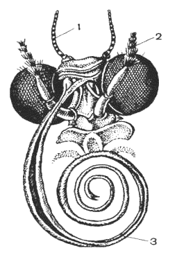
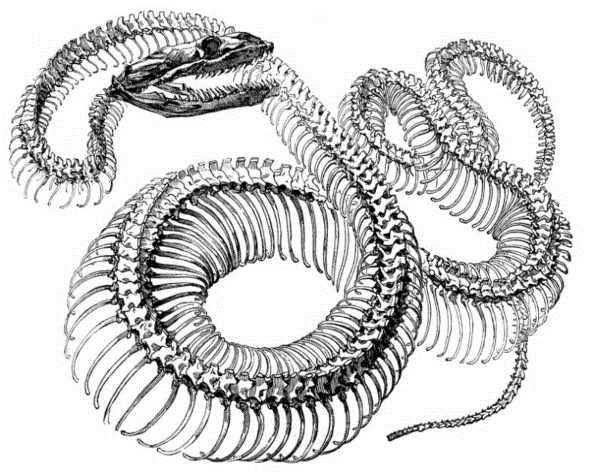
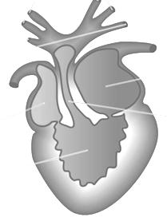
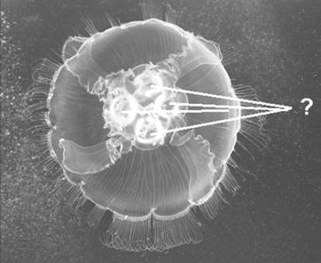
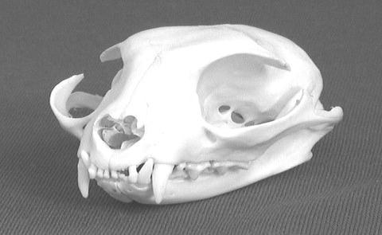

# Олимпиада 8 класса, 2016 — Олимпиадные задания · 2016 · 30 тестов, рисунки, задачи и «исключения» (часть 1 из 2)

Олимпиада `n16` из тренажёра «Олимпиада под микроскопом». Вопросов: 40. Каждый вопрос: условие (с рисунками), ключ и допустимые ответы, эталонный ответ, разбор по шагам 3–8 (алгоритм, объяснение и разбор вариантов, ловушки, как запомнить, схема, олимпиадный горизонт). Схемы в разборах здесь заменены подписями; сами схемы — в PDF-версии.

---

### [n16-q1] № 1 · Тест 1 · Где растение хранит крахмал

Раздел: Задание 1 — Тесты (№ 1–30). Тип: один ответ. ID: `n16-q1`. На сайте: `#n16-q1`.

**Условие.** Запасное вещество крахмал накапливается у растений в:

Варианты:
- а) бесцветных пластидах
- б) вакуолях
- в) цитоплазме
- г) клеточной стенке

**Ключ:** а) бесцветных пластидах

**Эталонный ответ (карточка «Правильный ответ» на сайте):**

**а) в бесцветных пластидах** — лейкопластах, которые запасают крахмал (амилопластах).

**Разбор (шаги 3–8):**
#### 3. Алгоритм олимпиадного мышления
**Маркеры в условии.** «Запасное вещество» и «крахмал». Спрашивают не где крахмал *образуется* при фотосинтезе, а где он *накапливается про запас*.

**Логическая цепочка:**

1. Крахмал — нерастворимый полимер глюкозы. Растворимые вещества клетка держит в клеточном соке, а нерастворимые зёрна — в органоидах.
2. У растений крахмал строят и хранят **пластиды**: на свету в хлоропластах откладывается временный (ассимиляционный) крахмал, а в клубнях, корнях и семенах — запасной крахмал в **лейкопластах** (бесцветных пластидах).
3. Из вариантов пластиды названы только в «а» — проверяем остальные: вакуоль, цитоплазма и клеточная стенка крахмал про запас не копят.

#### 4. Послойное объяснение и разбор вариантов
**Суть в двух предложениях.** Запасной крахмал растений лежит в бесцветных пластидах — лейкопластах, которые специализируются на нём и называются амилопластами. Именно их крахмальные зёрна синеют от йода на срезе клубня картофеля.

**Механизм.** Днём хлоропласты листа делают сахара. Часть их сразу превращается во временный крахмал в самом хлоропласте, а ночью он снова распадается до сахаров. Сахароза по флоэме идёт в клубень или семя, там её забирают лейкопласты и складывают слоями в крахмальное зерно. Зерно растёт, как луковица, — слой за слоем вокруг центра.

**Разбор неверных вариантов:**

- **б) вакуолях** — в клеточном соке вакуоли хранятся *растворимые* вещества: сахара (у сахарной свёклы — сахароза), органические кислоты, соли, пигменты-антоцианы. Вариант включён потому, что «вакуоль — склад клетки» звучит знакомо. Был бы верен для вопроса «Где растение запасает сахарозу или инулин?» (инулин георгина и топинамбура тоже растворён в вакуолях).
- **в) цитоплазме** — так хранится **гликоген** у животных и грибов: гранулы прямо в цитоплазме. Включён как ловушка «запасной углевод — в цитоплазме». Был бы верен для вопроса о запасах гликогена в клетках печени.
- **г) клеточной стенке** — стенка растительной клетки построена из **целлюлозы**. Она тоже полимер глюкозы, но *строительный*, а не запасной: растение не может пустить её «в еду». Был бы верен вопрос «Из какого полисахарида построена клеточная стенка растений?».

#### 5. Типичные ошибки и ловушки
- **Крахмал ≠ целлюлоза.** Оба собраны из глюкозы, но крахмал — запас, целлюлоза — каркас.
- **Растворимое — в вакуоли, нерастворимое — в пластидах.** Сахара и инулин — в клеточном соке, крахмальные зёрна — в лейкопластах.
- **Исключения, которые любят составители:** у красных водорослей «багрянковый крахмал» лежит прямо в цитоплазме, а не в пластидах  [олимпиадный уровень] ; у грибов и животных запасной углевод — гликоген.

!

Запомни: запасной крахмал растений — в лейкопластах (амилопластах); гликоген животных и грибов — в цитоплазме.

#### 6. Как запомнить
**Этимология:** *лейкопласт* — греч. leukos «белый» + plastos «вылепленный»; *амилопласт* — amylon «крахмал».

**Мини-таблица «где что лежит»:**

| Вещество | Где хранится | У кого |
|---|---|---|
| запасной крахмал | лейкопласты (амилопласты) | растения |
| временный крахмал | хлоропласты | листья на свету |
| сахароза, инулин | вакуоль (клеточный сок) | свёкла, георгин |
| гликоген | цитоплазма (гранулы) | животные, грибы |
| целлюлоза | клеточная стенка (каркас, не запас) | растения |

**Проверка дома:** капля йода на срез картофеля — синие точки и есть крахмальные зёрна в амилопластах.

#### 7. Визуализация
[Схема в разборе: Путь крахмала: от листа к клубню]
*Подпись к схеме: Крахмал «переезжает» в растворимом виде (сахароза) и снова собирается в зерно в бесцветной пластиде.*

#### 8. Олимпиадный горизонт
- **Амилопласты в корневом чехлике** работают как «отвесы» (статолиты): тяжёлые крахмальные зёрна оседают вниз, и корень понимает, где низ, — это основа положительного геотропизма.
- **Форма крахмальных зёрен** у каждого растения своя (у картофеля — крупные со смещённым центром, у пшеницы — линзовидные, у риса — мелкие многогранные). По ним под микроскопом проверяют состав муки.
- **Пластиды превращаются друг в друга:** клубень картофеля на свету зеленеет — лейкопласты становятся хлоропластами.

---

### [n16-q2] № 2 · Тест 2 · Как пенициллин убивает бактерии

Раздел: Задание 1 — Тесты (№ 1–30). Тип: один ответ. ID: `n16-q2`. На сайте: `#n16-q2`.

**Условие.** Пенициллин подавляет у бактерий:

Варианты:
- а) синтез ДНК
- б) синтез РНК
- в) синтез белка
- г) синтез клеточной стенки

**Ключ:** г) синтез клеточной стенки

**Эталонный ответ (карточка «Правильный ответ» на сайте):**

**г) синтез клеточной стенки** — точнее, сшивание её главного вещества муреина (пептидогликана).

**Разбор (шаги 3–8):**
#### 3. Алгоритм олимпиадного мышления
**Маркеры в условии.** «Пенициллин» и «у бактерий». Нужно вспомнить, на что «нацелен» этот антибиотик.

**Логическая цепочка:**

1. Хороший антибиотик бьёт по тому, что есть у бактерии, но нет у человека, — иначе он отравил бы и нас.
2. Уникальная структура бактерий — **клеточная стенка из муреина**. У клеток человека стенки нет вовсе.
3. Пенициллин мешает бактерии сшивать молекулы муреина, когда она растёт. Стенка слабеет, вода входит в клетку, и бактерия лопается → «г».

#### 4. Послойное объяснение и разбор вариантов
**Суть в двух предложениях.** Пенициллин блокирует ферменты, которые «сшивают» сетку муреина в клеточной стенке бактерии. Растущая бактерия со слабой стенкой не выдерживает давления воды изнутри и разрушается.

**Механизм.** Муреин — сетка из длинных цепочек сахаров, соединённых короткими белковыми мостиками. При росте бактерия всё время разрезает и снова сшивает эту сетку. Пенициллин похож на кусочек мостика и «занимает» сшивающий фермент. Новые мостики не образуются, сетка становится дырявой, и под напором осмотического давления клетка лопается. Поэтому пенициллин действует только на **растущие** бактерии.

**Разбор неверных вариантов:**

- **а) синтез ДНК** — копирование ДНК бактерий подавляют другие препараты (хинолоны, например ципрофлоксацин)  [олимпиадный уровень] . Вариант включён потому, что «ДНК — главная молекула», и кажется, что бить надо по ней.
- **б) синтез РНК** — так действует рифампицин, один из главных препаратов против туберкулёза  [олимпиадный уровень] . Был бы верен в вопросе про рифампицин.
- **в) синтез белка** — на бактериальные рибосомы действуют стрептомицин, тетрациклин, хлорамфеникол (левомицетин). Ловушка: это тоже антибиотики, и многие помнят, что «антибиотики мешают делать белок». Но пенициллин — не из этой группы.

#### 5. Типичные ошибки и ловушки
- **«Все антибиотики действуют одинаково»** — нет: разные группы бьют по разным мишеням (стенка, рибосомы, ДНК, РНК).
- **Антибиотики не действуют на вирусы**: у вирусов нет ни клеточной стенки, ни своих рибосом.
- **Почему пенициллин безопасен для нас:** у клеток человека нет муреиновой стенки — мишени просто нет. А у грибов и растений стенка из других веществ (хитин, целлюлоза).

!

Запомни: пенициллин «пробивает стенку» — мешает бактерии строить муреиновую клеточную стенку.

#### 6. Как запомнить
**История:** в 1928 году Александр Флеминг заметил, что вокруг плесени *Penicillium* на чашке с бактериями образовалась «пустая» зона. Плесень выделяла вещество, убивающее бактерии, — его назвали пенициллином.

**Ассоциация:** бактерия — воздушный шарик в сетке. Пенициллин мешает чинить сетку, шарик раздувается и лопается.

**Мишени антибиотиков:**

| Мишень | Пример препарата |
|---|---|
| клеточная стенка | пенициллин |
| рибосомы (белок) | стрептомицин, тетрациклин |
| синтез РНК | рифампицин |
| синтез ДНК | ципрофлоксацин |

#### 7. Визуализация
[Схема в разборе: Как пенициллин убивает растущую бактерию]
*Подпись к схеме: Пенициллин действует только на растущие бактерии: именно они перестраивают стенку.*

#### 8. Олимпиадный горизонт
- **Устойчивость к антибиотикам:** некоторые бактерии выделяют фермент пенициллиназу, разрушающий пенициллин. Поэтому антибиотики пьют строго по назначению врача и полным курсом.
- **Лизоцим** — фермент слёз и слюны — тоже разрушает муреин, это «встроенный антибиотик» человека.
- **Микоплазмы** — бактерии без клеточной стенки, поэтому пенициллин на них не действует вовсе  [олимпиадный уровень] .

---

### [n16-q3] № 3 · Тест 3 · Окучивание и пикировка

Раздел: Задание 1 — Тесты (№ 1–30). Тип: один ответ. ID: `n16-q3`. На сайте: `#n16-q3`.

**Условие.** Если сравнить агротехнические приемы окучивание и пикировку, то можно утверждать, что:

Варианты:
- а) при окучивании удаляется верхушка главного корня, а при пикировке удаляются боковые корни
- б) после пикировки усиленно растет главный корень вглубь почвы, а после окучивания — растут боковые и придаточные корни
- в) при окучивании присыпают почву к стеблю растения, а при пикировке удаляют верхушку главного корня
- г) при окучивании удаляют верхушку главного корня растения, а во время пикировки присыпают почву к стеблю растения, что дает усиленный рост придаточных корней

**Ключ:** в) при окучивании присыпают почву к стеблю растения, а при пикировке удаляют верхушку главного корня

**Эталонный ответ (карточка «Правильный ответ» на сайте):**

**в) при окучивании присыпают почву к стеблю растения, а при пикировке удаляют верхушку главного корня.**

**Разбор (шаги 3–8):**
#### 3. Алгоритм олимпиадного мышления
**Маркеры в условии.** Два приёма — их надо сначала определить по отдельности, а потом проверить каждую половинку каждого варианта.

**Логическая цепочка:**

1. **Окучивание** — подгребают (присыпают) влажную землю к основанию стебля: картофель, капуста, томат. Слово само подсказывает: «куча» земли у стебля.
2. **Пикировка** — пересадка сеянцев, при которой прищипывают кончик главного корня (примерно на треть). Без верхушки главный корень перестаёт уходить вглубь, и растут боковые корни.
3. Ищем вариант, где обе половинки верны → «в». Варианты «а» и «г» перепутали действия, «б» перепутал результат.

#### 4. Послойное объяснение и разбор вариантов
**Суть в двух предложениях.** При окучивании землю присыпают к стеблю, и на засыпанной части стебля образуются придаточные корни (а у картофеля — подземные побеги-столоны с клубнями). При пикировке удаляют кончик главного корня, и корневая система разрастается вширь за счёт боковых корней.

**Механизм.** Кончик корня — это зона деления и «главный командир» корня: он подавляет рост боковых корней (верхушечное доминирование). Убрав его, мы снимаем запрет — боковые корни растут в верхнем, самом плодородном слое почвы. При окучивании засыпанный влажной землёй стебель оказывается в темноте и влаге, и из его тканей (из перицикла и камбия у основания) закладываются придаточные корни.

**Разбор неверных вариантов:**

- **а)** — обе части неверны: при окучивании корень не трогают, а при пикировке удаляют не боковые корни, а *верхушку главного*. Вариант проверяет, знаешь ли ты, *что именно* отщипывают.
- **б)** — результат пикировки перевёрнут: после неё главный корень, наоборот, *перестаёт* расти вглубь. Вторая половина про окучивание почти верна (растут придаточные корни), и это делает вариант коварным — «полуправда».
- **г)** — определения просто поменяли местами. Если бы приёмы назывались наоборот, вариант был бы идеальным.

#### 5. Типичные ошибки и ловушки
- **Читай каждую половинку.** В заданиях-сравнениях часто одна часть верна, другая — нет.
- **Пикировка ≠ прищипка.** Прищипка — удаление верхушки *побега* (стимулирует ветвление стебля), пикировка — верхушки *главного корня*.
- **Пасынкование** — удаление боковых побегов (пасынков) у томатов, это ещё один приём-«двойник».

!

Запомни: окучивание — земля к стеблю → придаточные корни; пикировка — без кончика главного корня → боковые корни.

#### 6. Как запомнить
**Этимология:** *пикировка* — от франц. piquer «колоть, втыкать»: сеянцы пересаживали в лунки, сделанные заострённым колышком. *Окучивание* — «окучить», насыпать кучу.

**Мини-таблица:**

| Приём | Что делают | Что получают |
|---|---|---|
| окучивание | присыпают землю к стеблю | придаточные корни, у картофеля — больше столонов и клубней |
| пикировка | прищипывают кончик главного корня | разветвлённую мочку боковых корней |
| прищипка | удаляют верхушку побега | кустистость, ветвление стебля |
| пасынкование | удаляют боковые побеги | крупнее плоды на главном стебле |

#### 7. Визуализация
[Схема в разборе: Два приёма — два разных действия]
*Подпись к схеме: Сравни: окучивание работает со стеблем, пикировка — с главным корнем.*

#### 8. Олимпиадный горизонт
- **Почему окученный картофель даёт больше урожая:** засыпанная часть стебля образует новые столоны, а земля закрывает клубни от света — на свету в них накапливается ядовитый соланин, и они зеленеют.
- **Тот же принцип в природе:** у растений, засыпанных песком (дюны), на стебле вырастают придаточные корни — так ива и тростник закрепляют пески.
- Подробнее про агротехнические приёмы — в олимпиаде 2018/2019 (практическое задание 1).

---

### [n16-q4] № 4 · Тест 4 · Кто не вызывает болезней человека

Раздел: Задание 1 — Тесты (№ 1–30). Тип: один ответ. ID: `n16-q4`. На сайте: `#n16-q4`.

**Условие.** Возбудители заболеваний человека
не встречаются
среди:

Варианты:
- а) лишайников
- б) водорослей
- в) простейших
- г) грибов

**Ключ:** а) лишайников

**Эталонный ответ (карточка «Правильный ответ» на сайте):**

**а) лишайников.**

**Разбор (шаги 3–8):**
#### 3. Алгоритм олимпиадного мышления
**Маркеры в условии.** «**Не** встречаются» — ищем группу, среди которой нет ни одного возбудителя болезней человека.

**Логическая цепочка:**

1. Вспомним по примеру болезни на каждую группу.
2. Простейшие — малярия, дизентерия, лямблиоз → встречаются.
3. Грибы — молочница (кандидоз), стригущий лишай, аспергиллёз → встречаются.
4. Водоросли — редкая болезнь прототекоз вызывается бесцветной водорослью; кроме того, ядовитые «цветения» воды → хотя бы единичные случаи есть.
5. Лишайники — симбиоз гриба и водоросли, живут на камнях и коре, паразитов человека среди них нет → «а».

#### 4. Послойное объяснение и разбор вариантов
**Суть в двух предложениях.** Лишайник — самостоятельный «союз» гриба и водоросли, который питается за счёт фотосинтеза водоросли и не может жить внутри организма человека. Поэтому среди лишайников нет возбудителей болезней.

**Механизм.** Чтобы стать возбудителем, организм должен уметь жить внутри хозяина: питаться его тканями, размножаться при температуре тела, обходить иммунитет. Лишайнику нужен свет для фотосинтеза водоросли и медленный рост на поверхности — внутри человека он существовать не может.

**Разбор неверных вариантов:**

- **б) водорослей** — водоросли почти не вызывают болезней, но редкое исключение есть: бесцветная водоросль *Prototheca* вызывает прототекоз кожи и суставов  [олимпиадный уровень] . Вариант включён как правдоподобный: «водоросли же безобидны».
- **в) простейших** — классические возбудители: малярийный плазмодий, дизентерийная амёба, лямблия, трипаносома (сонная болезнь), трихомонада.
- **г) грибов** — дрожжеподобные грибы *Candida* (молочница), грибы-дерматофиты (стригущий лишай, грибок стопы), плесневые *Aspergillus*.

#### 5. Типичные ошибки и ловушки
- **«Лишай» ≠ «лишайник»!** Кожные болезни «стригущий лишай» (вызывает гриб) и «опоясывающий лишай» (вызывает вирус) лишь похожи названием на лишайники. Само растение-лишайник тут ни при чём.
- **Отравление ≠ болезнь-инфекция.** Токсины цианобактерий при «цветении» воды отравляют, но не размножаются в теле.

!

Запомни: возбудители есть среди бактерий, вирусов, простейших, грибов (и даже редкие среди водорослей), но не среди лишайников.

#### 6. Как запомнить
**Ассоциация:** лишайник — «дом на камне»: он не может переехать внутрь человека, ему нужен свет.

**Мини-таблица «группа → пример болезни»:**

| Группа | Пример болезни |
|---|---|
| простейшие | малярия, амёбная дизентерия, лямблиоз |
| грибы | молочница, стригущий лишай |
| водоросли | прототекоз (редко) |
| лишайники | — |

#### 7. Визуализация
[Схема в разборе: Где встречаются возбудители болезней человека]
*Подпись к схеме: Лишайники — единственная группа из списка без возбудителей.*

#### 8. Олимпиадный горизонт
- **Лишайники полезны для медицины:** из них получают усниновую кислоту — природный антибиотик.
- **Лишайники — индикаторы чистоты воздуха:** они погибают от сернистого газа, поэтому в загрязнённых городах их почти нет.
- **Олений мох (ягель)** — лишайник, главный зимний корм северных оленей.

---

### [n16-q5] № 5 · Тест 5 · Ротовой аппарат бабочки

Раздел: Задание 1 — Тесты (№ 1–30). Тип: один ответ. ID: `n16-q5`. На сайте: `#n16-q5`.

**Условие.** Ротовой аппарат насекомого, изображенный на рисунке справа:

(файл: `assets/img/n16-t05-rot.png`, ссылка: https://raw.githubusercontent.com/metalinjector/biology-tests/claude/intelligent-heisenberg-9woyvy/assets/img/n16-t05-rot.png)
*Рисунок из бланка: голова насекомого (1, 2, 3 — обозначения на рисунке).*

Варианты:
- а) грызуще-лижущий
- б) колющий
- в) жалящий
- г) сосущий

**Ключ:** г) сосущий

**Эталонный ответ (карточка «Правильный ответ» на сайте):**

**г) сосущий** — хоботок бабочки, свёрнутый спиралью.

**Разбор (шаги 3–8):**
#### 3. Алгоритм олимпиадного мышления
**Маркеры на рисунке.** Усики (1), мохнатые членистые губные щупики (2), два огромных фасеточных глаза по бокам головы (на рисунке без номера) и длинный тонкий хоботок, свёрнутый в спираль, как пружина (3).

**Логическая цепочка:**

1. Спирально свёрнутый хоботок бывает только у бабочек (отряд Чешуекрылые).
2. Бабочки пьют жидкую пищу — нектар, сок, воду — и ничего не прокалывают: хоботок работает как трубочка.
3. Такой ротовой аппарат называется **сосущим** → «г».

#### 4. Послойное объяснение и разбор вариантов
**Суть в двух предложениях.** У бабочек ротовой аппарат сосущий: нижние челюсти сильно вытянуты и сцеплены в длинную трубку-хоботок. В покое хоботок свёрнут спиралью под головой, а при питании разворачивается и опускается в цветок.

**Механизм.** Каждая из двух нижних челюстей бабочки превратилась в длинный желобок. Желобки сцепляются крючочками и щетинками — получается трубка. Нектар поднимается по ней за счёт работы мышц глотки (как насос). Верхних челюстей (жвал) у большинства бабочек нет — грызть им нечем.

**Разбор неверных вариантов:**

- **а) грызуще-лижущий** — у пчёл и шмелей: жвалами они грызут воск и строят соты, а хоботком из нижних челюстей и нижней губы слизывают нектар. Хоботок пчелы короткий и спиралью не сворачивается.
- **б) колющий** — правильное название «колюще-сосущий»: комары, клопы, тли, цикады прокалывают покровы острыми стилетами. На рисунке нет стилетов, есть мягкий свёрнутый хоботок.
- **в) жалящий** — такого типа ротового аппарата нет вообще! Жало у пчёл и ос — видоизменённый яйцеклад на конце брюшка, а не часть рта. Вариант — чистая ловушка на слово.

#### 5. Типичные ошибки и ловушки
- **Хоботок бабочки не колет.** Ловушка «длинный хоботок → колющий» (как у комара). У комара хоботок прямой, внутри — стилеты.
- **«Жалящий ротовой аппарат» не существует** — жало находится на брюшке.
- **Исключение-любимчик:** у некоторых бабочек (павлиноглазки, коконопряды) хоботок недоразвит — взрослые не питаются и живут за счёт запасов гусеницы.

!

Запомни: свёрнутый спиралью хоботок = бабочка = сосущий ротовой аппарат.

#### 6. Как запомнить
**Мини-таблица типов ротового аппарата:**

| Тип | Пример | Признак |
|---|---|---|
| грызущий | таракан, жук, кузнечик | мощные жвалы |
| грызуще-лижущий | пчела, шмель | жвалы + хоботок |
| колюще-сосущий | комар, клоп, тля | острые стилеты |
| сосущий | бабочки | хоботок свёрнут спиралью |
| лижущий | комнатная муха | подушечка-губа на конце хоботка |

**Ассоциация:** хоботок бабочки — «скрученная коктейльная трубочка».

#### 7. Визуализация
[Схема в разборе: Как устроен хоботок бабочки]
*Подпись к схеме: Хоботок бабочки — это две вытянутые нижние челюсти, сцепленные в трубку.*

#### 8. Олимпиадный горизонт
- **Предсказание Дарвина:** увидев мадагаскарскую орхидею с нектарником длиной около 30 см, Дарвин предсказал бабочку с таким же длинным хоботком. Бражника с хоботком нужной длины открыли через сорок лет.
- **Эволюция ротовых аппаратов:** все типы произошли от исходного грызущего (как у таракана) — менялись форма и функция одних и тех же частей.
- Подробнее о типах ротового аппарата — в олимпиаде 2018/2019 (практическое задание 2).

---

### [n16-q6] № 6 · Тест 6 · Кто здесь не членистоногое

Раздел: Задание 1 — Тесты (№ 1–30). Тип: один ответ. ID: `n16-q6`. На сайте: `#n16-q6`.

**Условие.** Из перечисленных животных к членистоногим
не относится
:

Варианты:
- а) трубочник
- б) палочник
- в) ручейник
- г) мокрица

**Ключ:** а) трубочник

**Эталонный ответ (карточка «Правильный ответ» на сайте):**

**а) трубочник** — это малощетинковый кольчатый червь.

**Разбор (шаги 3–8):**
#### 3. Алгоритм олимпиадного мышления
**Маркеры в условии.** «**Не** относится» — три названия должны оказаться членистоногими, одно — нет.

**Логическая цепочка:**

1. Палочник — насекомое, похожее на сухую веточку (отряд Привиденьевые).
2. Ручейник — насекомое, похожее на мелкую моль; его личинки живут в воде в «домиках» из песчинок.
3. Мокрица — ракообразное (отряд Равноногие), одно из немногих, живущих на суше.
4. Трубочник — тонкий красный червь, который живёт в иле, высунув хвост из трубочки, — кольчатый червь → «а».

#### 4. Послойное объяснение и разбор вариантов
**Суть в двух предложениях.** Трубочник (*Tubifex*) — малощетинковый кольчатый червь, родственник дождевого червя. У него нет членистых конечностей и хитинового покрова, поэтому к членистоногим он не относится.

**Механизм — как отличить.** Членистоногие: хитиновый наружный скелет, членистые конечности, линька. Кольчатые черви: мягкое тело из одинаковых колец-сегментов, щетинки вместо ног, кожно-мускульный мешок. У трубочника красная кровь с гемоглобином — поэтому скопления трубочников на дне выглядят как красный «ковёр».

**Разбор неверных вариантов:**

- **б) палочник** — насекомое: 3 отдела тела, 3 пары ног, усики. Ловушка: тело тонкое, как у червя-«палочки».
- **в) ручейник** — насекомое с полным превращением. Его личинка в домике из камешков похожа на червяка — отсюда путаница.
- **г) мокрица** — ракообразное: 7 пар одинаковых ходильных ног, дышит жабрами на брюшных ножках, поэтому живёт в сырых местах. Ловушка: «рак не может жить на суше».

#### 5. Типичные ошибки и ловушки
- **Название обманывает.** «Трубочник» звучит как насекомое, «палочник» — как червь. Определяй не по названию, а по строению.
- **Мокрица — не насекомое**, а ракообразное: ног у неё 7 пар, а не 3.

!

Запомни: трубочник — кольчатый червь (малощетинковые), палочник и ручейник — насекомые, мокрица — ракообразное.

#### 6. Как запомнить
**Мини-таблица:**

| Животное | Группа | Главный признак |
|---|---|---|
| трубочник | кольчатые черви | мягкое кольчатое тело, щетинки |
| палочник | насекомые | 3 пары ног, тело-«веточка» |
| ручейник | насекомые | крылья в волосках, личинка в домике |
| мокрица | ракообразные | 7 пар ног, жабры |

**Ассоциация:** трубочник «живёт в трубочке из ила, как червяк в норке».

#### 7. Визуализация
[Схема в разборе: Как отличить членистоногое от кольчатого червя]
*Подпись к схеме: Членистые ноги и хитин — главные признаки членистоногих.*

#### 8. Олимпиадный горизонт
- **Трубочник — индикатор загрязнения:** он выдерживает недостаток кислорода и массово размножается в загрязнённом иле.
- **Трубочника продают как корм для аквариумных рыб.**
- **Родство с кольчатыми червями.** В школьных учебниках пишут, что членистоногие произошли от древних кольчатых червей. Современные молекулярные данные показывают, что эти группы — лишь дальние родственники, а сходство сегментированного тела, возможно, возникло независимо  [олимпиадный уровень] .

---

### [n16-q7] № 7 · Тест 7 · Скелет змеи

Раздел: Задание 1 — Тесты (№ 1–30). Тип: один ответ. ID: `n16-q7`. На сайте: `#n16-q7`.

**Условие.** На рисунке представлен скелет позвоночного животного. В его строении нельзя обнаружить:

(файл: `assets/img/n16-t07-skelet.png`, ссылка: https://raw.githubusercontent.com/metalinjector/biology-tests/claude/intelligent-heisenberg-9woyvy/assets/img/n16-t07-skelet.png)
*Рисунок из бланка: скелет позвоночного животного.*

Варианты:
- а) черепную коробку
- б) грудную клетку
- в) шейные позвонки
- г) ребра

**Ключ:** б) грудную клетку

**Эталонный ответ (карточка «Правильный ответ» на сайте):**

**б) грудную клетку** — у змей нет грудины, рёбра не замкнуты.

**Разбор (шаги 3–8):**
#### 3. Алгоритм олимпиадного мышления
**Маркеры на рисунке.** Очень длинный позвоночник с сотнями рёбер, нет конечностей и их поясов, череп с широко расставленными челюстями — это **змея**.

**Логическая цепочка:**

1. Грудная клетка = грудные позвонки + рёбра + **грудина**. Рёбра замыкаются на грудине спереди.
2. У змей грудины нет: рёбра свободно заканчиваются в мышцах живота.
3. Значит, рёбра есть, а замкнутой грудной клетки нет → «б».
4. Проверяем остальное: череп есть; рёбра есть; первые позвонки (атлант и эпистрофей) — шейные, хотя отдельный шейный отдел у змей не выражен.

#### 4. Послойное объяснение и разбор вариантов
**Суть в двух предложениях.** У змеи позвоночник делится только на туловищный и хвостовой отделы, а рёбра, хотя их очень много, не соединяются с грудиной — грудины нет. Поэтому грудной клетки как замкнутого «короба» у змеи нет.

**Механизм.** Отсутствие грудины — приспособление к питанию: свободные концы рёбер расходятся, и змея может проглотить добычу толще себя. Рёбра ещё и помогают ползти: к ним крепятся мышцы, которые двигают брюшные щитки.

**Разбор неверных вариантов:**

- **а) черепную коробку** — череп у змеи есть и очень подвижен: кости челюстей соединены связками, нижняя челюсть «раздвигается».
- **в) шейные позвонки** — самый коварный вариант. Отдельной «шеи» у змеи не видно, и кажется, что шейных позвонков нет. Но первые два позвонка — атлант и эпистрофей — есть, они соединяют позвоночник с черепом. Не выражен отдел, а не позвонки.
- **г) рёбра** — их у змей больше всего среди наземных позвоночных: до 200–300 пар.

#### 5. Типичные ошибки и ловушки
- **«Много рёбер = есть грудная клетка»** — неверно. Грудная клетка — это рёбра, замкнутые грудиной.
- **«Нет шеи = нет шейных позвонков»** — неверно: атлант и эпистрофей у змей есть.
- **Исключения:** у черепах рёбра срослись с панцирем; у безногих ящериц, как и у змей, грудина бывает редуцирована.

!

Запомни: у змей нет грудины, поэтому нет и грудной клетки, хотя рёбер сотни.

#### 6. Как запомнить
**Формула:** грудная клетка = позвонки + рёбра + грудина. Нет грудины — нет клетки.

**Сравнение «ящерица — змея»:**

| Признак | Ящерица | Змея |
|---|---|---|
| отделы позвоночника | шейный, грудной, поясничный, крестцовый, хвостовой | туловищный и хвостовой |
| грудина | есть | нет |
| грудная клетка | есть | нет |
| пояса конечностей | есть | нет (у удавов — остатки таза) |

#### 7. Визуализация
[Схема в разборе: Почему у змеи нет грудной клетки]
*Подпись к схеме: Свободные концы рёбер позволяют змее заглатывать крупную добычу.*

#### 8. Олимпиадный горизонт
- **У удавов и питонов** сохранились остатки тазового пояса и задних конечностей — коготки по бокам клоаки. Это доказательство происхождения змей от ящериц с ногами.
- **Сложный вопрос-ловушка:** «У каких позвоночных нет грудной клетки?» — у рыб (грудины нет вообще), у земноводных (у лягушки есть грудина, но рёбер почти нет) и у змей (рёбра есть, грудины нет).
- **Подвижная нижняя челюсть** змей соединена эластичной связкой: две её половинки могут двигаться независимо.

---

### [n16-q8] № 8 · Тест 8 · Груминг у крыс

Раздел: Задание 1 — Тесты (№ 1–30). Тип: один ответ. ID: `n16-q8`. На сайте: `#n16-q8`.

**Условие.** Груминг у крыс является важным элементом поведения:

Варианты:
- а) исследовательского
- б) полового
- в) комфортного
- г) агрессивного

**Ключ:** в) комфортного

**Эталонный ответ (карточка «Правильный ответ» на сайте):**

**в) комфортного** — это уход за телом.

**Разбор (шаги 3–8):**
#### 3. Алгоритм олимпиадного мышления
**Маркеры в условии.** «Груминг» — от англ. groom «чистить, ухаживать». Значит, речь о чистке шерсти.

**Логическая цепочка:**

1. Вспоминаем формы поведения: исследовательское (знакомство с новым), половое (размножение), агрессивное (нападение, угроза), **комфортное** (уход за телом и отдых).
2. Груминг — вылизывание и расчёсывание шерсти, умывание лапками. Это забота о своём теле.
3. Уход за телом относится к **комфортному** поведению → «в».

#### 4. Послойное объяснение и разбор вариантов
**Суть в двух предложениях.** Комфортное поведение — всё, что животное делает для ухода за телом и поддержания его в порядке: чистка, вылизывание, купание, потягивание, почёсывание. Груминг крысы — классический пример.

**Механизм.** Крыса умывает морду передними лапками, вылизывает шерсть и расчёсывает её зубами. Так удаляются грязь и паразиты, а шерсть распределяет жировую смазку и лучше держит тепло. Груминг ещё и успокаивает: после стресса крысы умываются дольше.

**Разбор неверных вариантов:**

- **а) исследовательского** — исследование — это обнюхивание, осмотр нового места, вставание на задние лапы. Груминг не даёт новой информации о мире.
- **б) полового** — к нему относятся ухаживание и спаривание. Груминг партнёра бывает в брачный период, но сам по себе это уход за телом.
- **г) агрессивного** — угрозы, драки, защита территории. Наоборот: груминг партнёра у животных часто *снижает* агрессию.

#### 5. Типичные ошибки и ловушки
- **Взаимный (социальный) груминг** у приматов и крыс тоже относится к уходу за телом, но выполняет ещё и общественную роль — укрепляет дружеские связи в группе.
- **Не путай комфортное поведение с пищевым или оборонительным.**

!

Запомни: груминг — чистка и уход за телом, то есть комфортное поведение.

#### 6. Как запомнить
**Этимология:** англ. *groom* — «ухаживать, чистить» (грумер — мастер по стрижке собак).

**Примеры комфортного поведения:** кошка вылизывается, птица купается в пыли или в воде, собака отряхивается, человек потягивается.

#### 7. Визуализация
[Схема в разборе: Основные формы поведения]
*Подпись к схеме: Груминг — пример комфортного поведения.*

#### 8. Олимпиадный горизонт
- **У обезьян** взаимный груминг занимает до пятой части дня и заменяет «разговор»: так выясняются и поддерживаются отношения в стае.
- **Смещённая активность:** в конфликтной ситуации животное иногда вдруг начинает умываться — это «смещённый» груминг, снимающий напряжение (например, у кошки, промахнувшейся по мыши).

---

### [n16-q9] № 9 · Тест 9 · Фазы митоза

Раздел: Задание 1 — Тесты (№ 1–30). Тип: один ответ. ID: `n16-q9`. На сайте: `#n16-q9`.

**Условие.** В митозе обычно различают фазы в следующей последовательности:

Варианты:
- а) метафаза, профаза, анафаза, телофаза
- б) профаза, анафаза, телофаза, метафаза
- в) профаза, метафаза, анафаза, телофаза
- г) профаза, телофаза, анафаза, метафаза

**Ключ:** в) профаза, метафаза, анафаза, телофаза

**Эталонный ответ (карточка «Правильный ответ» на сайте):**

**в) профаза, метафаза, анафаза, телофаза.**

**Разбор (шаги 3–8):**
#### 3. Алгоритм олимпиадного мышления
**Маркеры в условии.** «Последовательность» — важен порядок. Первая и последняя фазы подсказаны самими названиями.

**Логическая цепочка:**

1. **Про-фаза** — «до», начало: хромосомы скручиваются и становятся видны.
2. **Мета-фаза** — хромосомы выстраиваются по экватору клетки.
3. **Ана-фаза** — хроматиды каждой хромосомы расходятся к полюсам.
4. **Тело-фаза** — от греч. telos «конец»: образуются два ядра, клетка делится.
5. Порядок П → М → А → Т есть только в «в».

#### 4. Послойное объяснение и разбор вариантов
**Суть в двух предложениях.** Митоз — деление, при котором из одной клетки получаются две с одинаковым набором хромосом. Он идёт в четыре фазы: профаза, метафаза, анафаза, телофаза.

**Механизм по фазам:**

1. **Профаза:** хромосомы (уже удвоенные, из двух хроматид) спирализуются и утолщаются, ядерная оболочка распадается, начинает строиться веретено деления.
2. **Метафаза:** хромосомы выстраиваются ровно по экватору клетки — это лучший момент, чтобы их сосчитать и рассмотреть.
3. **Анафаза:** нити веретена тянут сестринские хроматиды к противоположным полюсам.
4. **Телофаза:** у полюсов собираются два новых ядра, хромосомы раскручиваются, цитоплазма делится пополам.

**Разбор неверных вариантов:**

- **а)** — метафаза не может быть первой: прежде чем выстроиться, хромосомы должны стать видимыми (профаза).
- **б)** — метафаза в конце: расходиться (анафаза) нельзя раньше, чем выстроиться.
- **г)** — телофаза («конец») стоит вторым — это противоречит самому названию.

#### 5. Типичные ошибки и ловушки
- **Интерфаза — не фаза митоза**, а период между делениями (в ней удваивается ДНК).
- **В метафазе хромосомы на экваторе, в анафазе — расходятся**: эти две фазы путают чаще всего.

!

Запомни порядок: Про — Мета — Ана — Тело (П-М-А-Т).

#### 6. Как запомнить
**Мнемоника:** «**П**апа **М**аме **А**пельсин **Т**ащит» — профаза, метафаза, анафаза, телофаза.

**Этимология:** pro — «до, перед»; meta — «после, между»; ana — «вверх, назад» (хроматиды уходят назад, к полюсам); telos — «конец».

#### 7. Визуализация
[Схема в разборе: Фазы митоза по порядку]
*Подпись к схеме: П → М → А → Т. Перед митозом — интерфаза, когда удваивается ДНК.*

#### 8. Олимпиадный горизонт
- **Где идёт митоз у растений:** в образовательных тканях — кончике корня, верхушке побега, камбии. Лучший учебный препарат — корешок лука.
- **Мейоз** — другое деление: две последовательные серии фаз (профаза I … телофаза II), и число хромосом уменьшается вдвое  [олимпиадный уровень] .
- **Колхицин** останавливает митоз на метафазе — так готовят препараты для подсчёта хромосом  [олимпиадный уровень] .

---

### [n16-q10] № 10 · Тест 10 · Почему горилла бьёт себя в грудь

Раздел: Задание 1 — Тесты (№ 1–30). Тип: один ответ. ID: `n16-q10`. На сайте: `#n16-q10`.

**Условие.** Потревоженный самец гориллы встаёт в полный рост, ударяя себя при этом руками в грудь. Такое поведение является:

Варианты:
- а) демонстративным
- б) агрессивным
- в) половым
- г) ориентировочным

**Ключ:** а) демонстративным

**Эталонный ответ (карточка «Правильный ответ» на сайте):**

**а) демонстративным** — это ритуальная угроза-демонстрация.

**Разбор (шаги 3–8):**
#### 3. Алгоритм олимпиадного мышления
**Маркеры в условии.** «Потревоженный» самец, «встаёт в полный рост», «ударяет себя в грудь» — он показывает себя, но не нападает.

**Логическая цепочка:**

1. Агрессия — это нападение или драка. Здесь драки нет.
2. Самец делает себя выше и громче — так он *демонстрирует* силу, чтобы противник ушёл сам.
3. Такое поведение — **демонстрация** (ритуальная угроза) → «а».

#### 4. Послойное объяснение и разбор вариантов
**Суть в двух предложениях.** Демонстративное поведение — «показ» силы и размеров без настоящей драки: животное раздувается, встаёт во весь рост, издаёт громкие звуки. Это позволяет решить конфликт без ранений.

**Механизм.** Драка опасна для обоих: даже победитель может получить рану. Поэтому в эволюции закрепились ритуалы, заменяющие бой. Горилла выпрямляется, бьёт ладонями по груди (звук разносится на сотни метров), ломает ветки. Обычно противник отступает, не доводя дело до схватки.

**Разбор неверных вариантов:**

- **б) агрессивным** — самый близкий вариант-ловушка. Демонстрация действительно связана с угрозой, но агрессия — это нападение и драка. Если бы горилла бросилась на противника, вариант был бы верен.
- **в) половым** — к половому поведению относятся ухаживание и спаривание. Самец «потревожен», а не ухаживает.
- **г) ориентировочным** — это реакция на новое: замереть, прислушаться, повернуть голову («что такое?»). Ориентировочная реакция предшествует демонстрации, но сама так не выглядит.

#### 5. Типичные ошибки и ловушки
- **Угроза ≠ нападение.** В олимпиадных вопросах демонстрация и агрессия разделяются: демонстрация заменяет драку.
- **Удар себя в грудь — сигнал**, а не удар по противнику.

!

Запомни: показать силу, не нападая, — это демонстративное поведение.

#### 6. Как запомнить
**Примеры демонстраций:** кошка выгибает спину и распушает шерсть, кобра раздувает капюшон, рыба-ёж раздувается шаром, петухи распускают перья.

**Ассоциация:** демонстрация — «покажу, какой я большой, и драться не придётся».

#### 7. Визуализация
[Схема в разборе: Как демонстрация заменяет драку]
*Подпись к схеме: Демонстрация позволяет решить конфликт без ранений.*

#### 8. Олимпиадный горизонт
- **Ритуализация поведения** — частая тема олимпиад: брачные танцы, ритуальные бои оленей (рогами толкаются, но не ранят), «турниры» у змей.
- **Гориллы на самом деле миролюбивы:** большая часть конфликтов заканчивается демонстрацией.

---

### [n16-q11] № 11 · Тест 11 · Вирусные и бактериальные болезни

Раздел: Задание 1 — Тесты (№ 1–30). Тип: один ответ. ID: `n16-q11`. На сайте: `#n16-q11`.

**Условие.** Вирусы являются возбудителями:

Варианты:
- а) холеры
- б) опоясывающего лишая
- в) сибирской язвы
- г) газовой гангрены

**Ключ:** б) опоясывающего лишая

**Эталонный ответ (карточка «Правильный ответ» на сайте):**

**б) опоясывающего лишая** — его вызывает вирус ветряной оспы.

**Разбор (шаги 3–8):**
#### 3. Алгоритм олимпиадного мышления
**Маркеры в условии.** «Вирусы» — из четырёх болезней одна вирусная, три вызваны бактериями.

**Логическая цепочка:**

1. Холера — холерный вибрион (бактерия).
2. Сибирская язва — сибиреязвенная бацилла (бактерия, образует споры).
3. Газовая гангрена — клостридии (бактерии, живут без кислорода, споры в почве).
4. Опоясывающий лишай — вирус ветряной оспы (вирус герпеса), который «просыпается» спустя годы → «б».

#### 4. Послойное объяснение и разбор вариантов
**Суть в двух предложениях.** Опоясывающий лишай вызывает тот же вирус, что и ветрянку: после болезни он годами «спит» в нервных узлах, а при ослаблении иммунитета вызывает болезненные пузырьки вдоль нерва. Остальные три болезни — бактериальные.

**Механизм.** Вирус — неклеточная форма жизни: белковая оболочка и нуклеиновая кислота. Он размножается только внутри клетки хозяина. Поэтому вирусные болезни не лечат антибиотиками — нужны противовирусные препараты и вакцины.

**Разбор неверных вариантов:**

- **а) холеры** — вибрион холеры (изогнутая палочка) размножается в кишечнике, его токсин вызывает потерю воды. Передаётся с грязной водой.
- **в) сибирской язвы** — *Bacillus anthracis*, палочка, образующая очень стойкие споры: в почве они сохраняются десятки лет.
- **г) газовой гангрены** — клостридии (анаэробы) размножаются в глубоких загрязнённых землёй ранах, образуя газ в тканях.

#### 5. Типичные ошибки и ловушки
- **«Лишай» не значит «гриб».** Стригущий лишай — грибковый, опоясывающий — вирусный, а лишайники (организмы) болезней не вызывают (см. тест 4).
- **Слово «язва» в названии не говорит о возбудителе:** сибирская язва — бактериальная.

!

Запомни: опоясывающий лишай — вирус (ветряной оспы); холера, сибирская язва, газовая гангрена — бактерии.

#### 6. Как запомнить
**Мини-таблица:**

| Болезнь | Возбудитель |
|---|---|
| холера | бактерия (вибрион) |
| сибирская язва | бактерия (бацилла) |
| газовая гангрена | бактерия (клостридия) |
| опоясывающий лишай | вирус (ветряной оспы) |
| грипп, корь, ВИЧ, гепатит С | вирусы |

#### 7. Визуализация
[Схема в разборе: Кто вызывает болезнь]
*Подпись к схеме: Отличать вирусные болезни от бактериальных важно для лечения.*

#### 8. Олимпиадный горизонт
- **Вирус ветряной оспы** после выздоровления пожизненно остаётся в нервных узлах — поэтому опоясывающим лишаем болеют те, кто в детстве перенёс ветрянку.
- **Клостридии** вызывают ещё и столбняк и ботулизм — все они анаэробы и образуют споры.

---

### [n16-q12] № 12 · Тест 12 · Пластида малярийного плазмодия

Раздел: Задание 1 — Тесты (№ 1–30). Тип: один ответ. ID: `n16-q12`. На сайте: `#n16-q12`.

**Условие.** В пластидах малярийного плазмодия
не осуществляется
:

Варианты:
- а) фотосинтез
- б) синтез белка
- в) синтез гема
- г) синтез жирных кислот

**Ключ:** а) фотосинтез

**Эталонный ответ (карточка «Правильный ответ» на сайте):**

**а) фотосинтез.** Пластида плазмодия (апикопласт) потеряла хлорофилл, но сохранила другие функции.

**Разбор (шаги 3–8):**
#### 3. Алгоритм олимпиадного мышления
**Маркеры в условии.** «Пластиды» у паразита — уже неожиданно. «**Не** осуществляется» — ищем функцию, которой нет.

**Логическая цепочка:**

1. Плазмодий — паразит, живущий внутри клеток печени и эритроцитов. Света там нет, а еду он получает от хозяина.
2. Значит, фотосинтез ему не нужен — хлорофилла у его пластиды нет.
3. Но пластида не исчезла: в ней идут синтез жирных кислот, части гема, и у неё свои ДНК и рибосомы (синтез белка) → не осуществляется только «а».

#### 4. Послойное объяснение и разбор вариантов
**Суть в двух предложениях.** Предки плазмодия были фотосинтезирующими водорослями, и от них осталась пластида — **апикопласт**. Фотосинтез в ней давно утрачен, но она нужна паразиту для синтеза жирных кислот, изопреноидов и части гема.

**Механизм**  [олимпиадный уровень] . Апикопласт окружён четырьмя мембранами: когда-то предок плазмодия «проглотил» красную водоросль вместе с её пластидой (вторичный симбиоз). В апикопласте есть своя кольцевая ДНК и рибосомы бактериального типа, поэтому в нём идёт синтез некоторых белков.

**Разбор неверных вариантов:**

- **б) синтез белка** — идёт: у апикопласта есть свои рибосомы. На них действуют некоторые антибиотики (доксициклин), поэтому их используют против малярии.
- **в) синтез гема** — часть этапов синтеза гема проходит в апикопласте (вместе с митохондрией).
- **г) синтез жирных кислот** — главная «работа» апикопласта: он делает жирные кислоты для мембран паразита.

#### 5. Типичные ошибки и ловушки
- **«У паразита не бывает пластид»** — бывает: апикопласт есть у большинства споровиков (плазмодий, токсоплазма); у криптоспоридий его нет  [олимпиадный уровень] .
- **Пластида ≠ хлоропласт.** Хлоропласт — лишь один тип пластид; бывают пластиды без хлорофилла (лейкопласты, апикопласт).

!

Запомни: в пластиде плазмодия нет фотосинтеза, но есть синтез жирных кислот, части гема и белков.

#### 6. Как запомнить
**Этимология:** *апикопласт* — «пластида у вершины» (лат. apex «верхушка»): она лежит у переднего конца клетки паразита, рядом с апикальным комплексом.

**Ассоциация:** апикопласт — «бывшая кухня, переделанная в мастерскую»: плита (фотосинтез) выброшена, а станки (синтезы) остались.

#### 7. Визуализация
[Схема в разборе: Откуда у плазмодия пластида]
*Подпись к схеме: Пластиды могут терять фотосинтез, но сохранять другие синтезы.*

#### 8. Олимпиадный горизонт
- **Апикопласт — мишень лекарств:** у человека такой органеллы нет, поэтому препараты против неё щадят наши клетки.
- **Другие пластиды без фотосинтеза:** у паразитического растения повилики хлоропласты почти утрачены, у заразихи — тоже.
- Подробнее о жизненном цикле плазмодия — в районном этапе 2019 (часть II).

---

### [n16-q13] № 13 · Тест 13 · Какое слово — гриб

Раздел: Задание 1 — Тесты (№ 1–30). Тип: один ответ. ID: `n16-q13`. На сайте: `#n16-q13`.

**Условие.** Грибом является:

Варианты:
- а) суржик
- б) пыжик
- в) рыжик
- г) рыжуха
- д) крыж

**Ключ:** в) рыжик

**Эталонный ответ (карточка «Правильный ответ» на сайте):**

**в) рыжик** — съедобный пластинчатый гриб с оранжевым млечным соком.

**Разбор (шаги 3–8):**
#### 3. Алгоритм олимпиадного мышления
**Маркеры в условии.** Все варианты — похожие по звучанию слова. Нужно узнать единственное настоящее название гриба.

**Логическая цепочка:**

1. Рыжик — знакомый съедобный гриб рода Млечник: рыжая шляпка, на изломе выделяет оранжевый млечный сок.
2. Остальные слова — не грибы: суржик и пыжик — это смесь зерна и мех оленёнка, а «рыжуха» и «крыж» просто созвучны рыжику.
3. Ответ → «в».

#### 4. Послойное объяснение и разбор вариантов
**Суть в двух предложениях.** Рыжик — пластинчатый шляпочный гриб с оранжево-рыжей шляпкой и оранжевым млечным соком. Растёт в хвойных лесах и образует микоризу с соснами и елями.

**Механизм — как узнать рыжика.** Пластинки под шляпкой; на изломе выступает густой оранжевый сок, который на воздухе зеленеет; на шляпке видны концентрические круги. Рыжики — одни из немногих грибов, которые можно солить без вымачивания.

**Разбор неверных вариантов:**

- **а) суржик** — смесь зерна разных злаков (например, пшеницы с рожью); так же называют смешанную речь. Не гриб.
- **б) пыжик** — мех новорождённого оленёнка (отсюда «пыжиковая шапка»). Не гриб.
- **г) рыжуха, д) крыж** — слова-«обманки», созвучные рыжику. Это не названия грибов.

#### 5. Типичные ошибки и ловушки
- **Созвучие — главная ловушка задания.** Проверяй, знаешь ли ты слово как биологический объект, а не «на слух».
- **Не путай рыжика с ложными двойниками:** у волнушки сок белый и едкий, шляпка мохнатая по краю.

!

Запомни: рыжик — пластинчатый гриб-млечник с оранжевым соком, микоризный партнёр хвойных.

#### 6. Как запомнить
**Этимология:** латинское название рыжика *Lactarius deliciosus* — «млечник восхитительный» (lac — молоко).

**Мини-таблица «трубчатые и пластинчатые»:**

| Пластинчатые | Трубчатые |
|---|---|
| рыжик, лисичка*, сыроежка, груздь, опёнок | белый гриб, подберёзовик, подосиновик, маслёнок |

*у лисички под шляпкой не настоящие пластинки, а складки.

#### 7. Визуализация
[Схема в разборе: Шляпочные грибы по строению нижней стороны шляпки]
*Подпись к схеме: Рыжик — пластинчатый гриб.*

#### 8. Олимпиадный горизонт
- **Микориза:** рыжик растёт только рядом с хвойными деревьями — их корни и грибница обмениваются веществами.
- **Млечники** — род, к которому относятся рыжики, грузди, волнушки: у всех на изломе выделяется млечный сок.
- См. также областной этап (задание 6) о съедобных пластинчатых грибах.

---

### [n16-q14] № 14 · Тест 14 · У кого нет усиков

Раздел: Задание 1 — Тесты (№ 1–30). Тип: один ответ. ID: `n16-q14`. На сайте: `#n16-q14`.

**Условие.** Усиков нет у:

Варианты:
- а) кузнечика
- б) тарантула
- в) бабочки капустной белянки
- г) комнатной мухи
- д) мокрицы

**Ключ:** б) тарантула

**Эталонный ответ (карточка «Правильный ответ» на сайте):**

**б) тарантула** — это паук, а у паукообразных усиков нет.

**Разбор (шаги 3–8):**
#### 3. Алгоритм олимпиадного мышления
**Маркеры в условии.** Перечислены насекомые, паук и ракообразное. Нужно вспомнить, у какого класса членистоногих нет усиков (антенн).

**Логическая цепочка:**

1. Насекомые (кузнечик, белянка, муха) — **1 пара** усиков.
2. Ракообразные (мокрица) — **2 пары** усиков (у мокрицы одна пара крошечная, вторая длинная).
3. Паукообразные (тарантул) — усиков **нет**; их роль играют чувствительные волоски и педипальпы → «б».

#### 4. Послойное объяснение и разбор вариантов
**Суть в двух предложениях.** У паукообразных нет усиков: на головогруди у них хелицеры, педипальпы и 4 пары ходильных ног. Тарантул — крупный паук, поэтому усиков у него нет.

**Механизм.** Мир на ощупь паук воспринимает волосками на ногах и педипальпах — они чувствуют вибрацию паутины, запахи и прикосновения. У тарантула педипальпы похожи на короткие ножки, и их иногда ошибочно принимают за усики.

**Разбор неверных вариантов:**

- **а) кузнечика** — у кузнечика очень длинные нитевидные усики, длиннее тела. Это и отличает кузнечиков от саранчи (у неё усики короткие).
- **в) бабочки капустной белянки** — булавовидные усики (с утолщениями на конце), как у дневных бабочек.
- **г) комнатной мухи** — усики короткие, щетинковидные, но они есть.
- **д) мокрицы** — ловушка: «не насекомое — значит, без усиков». Мокрица — ракообразное, у неё усики есть (вторая пара хорошо заметна).

#### 5. Типичные ошибки и ловушки
- **Педипальпы ≠ усики.** У пауков педипальпы — вторая пара конечностей головогруди.
- **«Короткие усики» ≠ «нет усиков»** (муха).

!

Запомни: усики (пары): ракообразные — 2, насекомые — 1, паукообразные — 0.

#### 6. Как запомнить
**Мнемоника «2 — 1 — 0»:** рак — две пары усиков, насекомое — одна, паук — ноль. (Ходильных ног: рак 5, паук 4, насекомое 3 пары.)

**Этимология:** *тарантул* — от итальянского города Таранто; так называют крупных пауков-волков и (в обиходе) птицеедов.

#### 7. Визуализация
[Схема в разборе: Усики у классов членистоногих]
*Подпись к схеме: Числа «2–1–0» для усиков легко запомнить вместе с ногами «5–4–3».*

#### 8. Олимпиадный горизонт
- **Куда делись усики у пауков?** По современным данным хелицеры — та же пара конечностей, что усики насекомых (и первые антенны раков): у предков паукообразных она превратилась из органа чувств в челюсти  [олимпиадный уровень] .
- **Многоножки**, как и насекомые, имеют одну пару усиков.

---

### [n16-q15] № 15 · Тест 15 · Кто уже не растёт

Раздел: Задание 1 — Тесты (№ 1–30). Тип: один ответ. ID: `n16-q15`. На сайте: `#n16-q15`.

**Условие.** Не растёт:

Варианты:
- а) домовая мышь
- б) муха цеце
- в) личинка жука-плавунца
- г) скорпион

**Ключ:** б) муха цеце

**Эталонный ответ (карточка «Правильный ответ» на сайте):**

**б) муха цеце** — взрослое насекомое (имаго) не линяет и не растёт.

**Разбор (шаги 3–8):**
#### 3. Алгоритм олимпиадного мышления
**Маркеры в условии.** «Не растёт» — ищем организм в той стадии, когда рост закончен.

**Логическая цепочка:**

1. Членистоногие растут только с линьками: жёсткий хитиновый покров не растягивается.
2. Насекомые линяют только на стадии личинки (и куколки). Взрослое насекомое (**имаго**) больше не линяет — значит, и не растёт.
3. Муха цеце — взрослое насекомое → не растёт → «б».
4. Скорпион растёт только до половозрелости: у скорпионов ограниченное число линек (обычно 5–7), после последней рост прекращается. Личинка растёт; мышь растёт.

#### 4. Послойное объяснение и разбор вариантов
**Суть в двух предложениях.** У насекомых рост идёт только на стадии личинки, а взрослая особь — имаго — уже не линяет и не увеличивается в размерах. Маленькая муха никогда не станет большой мухой — это разные виды или разная сытость личинок.

**Механизм.** Хитиновый наружный скелет жёсткий. Чтобы вырасти, личинка сбрасывает старый покров и, пока новый мягкий, раздувается. У имаго линочные железы перестают работать, и рост прекращается.

**Разбор неверных вариантов:**

- **а) домовая мышь** — молодые мыши растут; позвоночные растут без линек, их скелет внутренний и растёт вместе с телом.
- **в) личинка жука-плавунца** — личинки растут и несколько раз линяют, прежде чем окуклиться.
- **г) скорпион** — молодой скорпион действительно растёт, сбрасывая покров, но линек у него ограниченное число (у большинства видов 5–7 до половозрелости), и после последней линьки он не растёт. В списке скорпион назван без указания стадии, поэтому вариант не подходит: в отличие от имаго мухи, он растёт хотя бы часть жизни. Ловушка: «если паукообразные линяют, значит, растут всю жизнь».

#### 5. Типичные ошибки и ловушки
- **Имаго насекомых не растут, но паукообразные и ракообразные растут, пока линяют** (крупные пауки-птицееды линяют годами и растут всё это время). Ограничение: у скорпионов линек 5–7, взрослые особи не линяют и не растут — «линяют всю жизнь» верно для пауков, но не для скорпионов.
- **«Мелкие мухи — молодые»** — неверно: у мух нет «детёнышей-мух», есть личинки (опарыши).

!

Запомни: взрослое насекомое не линяет и не растёт.

#### 6. Как запомнить
**Этимология:** *имаго* — лат. imago «образ»: окончательный облик насекомого.

**Цепочка:** рост членистоногих = линька → у насекомых линяют только личинки → имаго не растёт.

#### 7. Визуализация
[Схема в разборе: Рост насекомого возможен только до имаго]
*Подпись к схеме: После последней линьки насекомое больше не растёт.*

#### 8. Олимпиадный горизонт
- **Муха цеце** — переносчик трипаносом, вызывающих сонную болезнь. Самка рожает по одной крупной личинке, которая сразу окукливается.
- **Исключение-любимчик**  [олимпиадный уровень] : у подёнок есть стадия «субимаго» — крылатое насекомое, которое линяет ещё раз.

---

### [n16-q16] № 16 · Тест 16 · Чем питается лошадиный овод

Раздел: Задание 1 — Тесты (№ 1–30). Тип: один ответ. ID: `n16-q16`. На сайте: `#n16-q16`.

**Условие.** Самки лошадиного овода питаются:

Варианты:
- а) кровью животных
- б) совсем не питаются
- в) себе подобными
- г) нектаром

**Ключ:** б) совсем не питаются

**Эталонный ответ (карточка «Правильный ответ» на сайте):**

**б) совсем не питаются** — у взрослых оводов ротовой аппарат недоразвит.

**Разбор (шаги 3–8):**
#### 3. Алгоритм олимпиадного мышления
**Маркеры в условии.** «Самки», «лошадиного **овода**». Ловушка — путаница оводов со слепнями.

**Логическая цепочка:**

1. Кровь сосут самки **слепней**, а не оводов.
2. Взрослый овод живёт всего несколько дней; ротовой аппарат у него недоразвит.
3. Энергию он берёт из запасов, накопленных личинкой (а личинки желудочного овода живут в желудке лошади).
4. Значит, взрослые оводы не питаются → «б».

#### 4. Послойное объяснение и разбор вариантов
**Суть в двух предложениях.** У оводов питается только личинка, живущая в теле хозяина, а взрослые мухи не едят вовсе. Их задача — найти партнёра и отложить яйца за несколько дней жизни.

**Механизм.** Самка лошадиного (желудочного) овода приклеивает яйца к волосам лошади. Лошадь слизывает личинок, они попадают в желудок и живут там почти год, питаясь за счёт хозяина. Потом выходят с навозом, окукливаются в земле, и вылетает взрослый овод с недоразвитым ротовым аппаратом.

**Разбор неверных вариантов:**

- **а) кровью животных** — так питаются самки слепней. Оводы и слепни внешне похожи, поэтому этот вариант — главная ловушка.
- **в) себе подобными** — каннибализм для оводов не характерен.
- **г) нектаром** — нектаром питаются многие мухи (журчалки), бабочки, а взрослые оводы не питаются ничем.

#### 5. Типичные ошибки и ловушки
- **Овод ≠ слепень.** Слепень пьёт кровь (самки), овод не питается вообще.
- **Вред наносит личинка**, а не взрослый овод.

!

Запомни: взрослые оводы не едят — живут за счёт запасов личинки.

#### 6. Как запомнить
**Мини-таблица:**

|  | Слепень | Овод |
|---|---|---|
| взрослые | самки пьют кровь | не питаются |
| личинки | в сырой почве, хищники | паразиты в теле животных |
| вред | укусы, переносят болезни | личинки в желудке, под кожей, в носоглотке |

См. также районный этап 2019 (часть III, суждение 5) и олимпиаду 2018/2019 (тест 28).

#### 7. Визуализация
[Схема в разборе: Жизненный цикл желудочного овода]
*Подпись к схеме: Питается только паразитическая личинка.*

#### 8. Олимпиадный горизонт
- **Разные оводы — разные места:** подкожный овод живёт под кожей коров (бугры на спине), носоглоточный — в носу овец.
- **Нередкий вопрос-ловушка:** «Может ли взрослый овод укусить человека?» — нет, у него нет функционирующего рта.

---

### [n16-q17] № 17 · Тест 17 · Кто такой наутилус

Раздел: Задание 1 — Тесты (№ 1–30). Тип: один ответ. ID: `n16-q17`. На сайте: `#n16-q17`.

**Условие.** Наутилус — это:

Варианты:
- а) ночная бабочка
- б) хищный моллюск
- в) тропический жук
- г) индийский «медовый медведь»
- д) такого животного не существует

**Ключ:** б) хищный моллюск

**Эталонный ответ (карточка «Правильный ответ» на сайте):**

**б) хищный моллюск** — головоногий с наружной спиральной раковиной.

**Разбор (шаги 3–8):**
#### 3. Алгоритм олимпиадного мышления
**Маркеры в условии.** Название знакомо по подводной лодке капитана Немо — проверяем, существует ли такое животное и к кому оно относится.

**Логическая цепочка:**

1. Наутилус — головоногий моллюск, родственник кальмаров и осьминогов.
2. Единственные современные головоногие с наружной многокамерной раковиной.
3. Питается раками, рыбой, падалью, хватая добычу десятками щупалец, — хищник → «б».

#### 4. Послойное объяснение и разбор вариантов
**Суть в двух предложениях.** Наутилус — «живое ископаемое»: головоногий моллюск с наружной спиральной раковиной, разделённой перегородками на камеры. Он живёт в тропических водах Тихого и Индийского океанов и охотится на ракообразных.

**Механизм.** Тело занимает только последнюю камеру раковины. Остальные заполнены газом и жидкостью: откачивая или добавляя жидкость через трубку-сифон, наутилус меняет плавучесть, как подводная лодка. Плавает реактивно — выталкивает воду через воронку.

**Разбор неверных вариантов:**

- **а) ночная бабочка, в) тропический жук** — звучное латинское имя легко принять за насекомое.
- **г) «медовый медведь»** — так иногда называют губача или медоеда; к наутилусу отношения не имеет.
- **д) не существует** — ловушка для тех, кто знает наутилуса только как подводную лодку из романа Жюля Верна.

#### 5. Типичные ошибки и ловушки
- **У большинства головоногих раковина внутренняя или исчезла** (у кальмара — гладиус, у каракатицы — «сепион», у осьминога её нет). Наутилус — исключение с наружной раковиной.
- **Аммониты** — вымершие родственники наутилуса со спиральными раковинами.

!

Запомни: наутилус — головоногий моллюск-хищник с наружной многокамерной раковиной.

#### 6. Как запомнить
**Этимология:** греч. nautilos — «мореход». Жюль Верн назвал подводную лодку в честь моллюска, который тоже меняет плавучесть.

**Ассоциация:** раковина наутилуса — «подводная лодка с балластными цистернами».

#### 7. Визуализация
[Схема в разборе: Головоногие с раковиной и без]
*Подпись к схеме: Наутилус сохранил древнюю наружную раковину.*

#### 8. Олимпиадный горизонт
- **Спираль раковины наутилуса** — логарифмическая. Её часто называют «золотой», но измерения раковин показывают, что с золотым сечением она не совпадает.
- **Головоногие — самые умные беспозвоночные:** см. районный этап 2019 (тест 11).

---

### [n16-q18] № 18 · Тест 18 · Откуда ламинария берёт углерод

Раздел: Задание 1 — Тесты (№ 1–30). Тип: один ответ. ID: `n16-q18`. На сайте: `#n16-q18`.

**Условие.** Источником углерода для ламинарии является:

Варианты:
- а) органические вещества пищи
- б) углекислый газ
- в) перегной почвы
- г) минеральные удобрения
- д) органические удобрения

**Ключ:** б) углекислый газ

**Эталонный ответ (карточка «Правильный ответ» на сайте):**

**б) углекислый газ** — растворённый в морской воде.

**Разбор (шаги 3–8):**
#### 3. Алгоритм олимпиадного мышления
**Маркеры в условии.** «Источник **углерода**» — спрашивают о типе питания. Ламинария — бурая водоросль.

**Логическая цепочка:**

1. Ламинария фотосинтезирует — это автотроф.
2. Автотрофы строят органику из углекислого газа (CO₂), используя энергию света.
3. Ламинария живёт в море, почвы и удобрений у неё нет → «б».

#### 4. Послойное объяснение и разбор вариантов
**Суть в двух предложениях.** Ламинария — бурая водоросль-автотроф: углерод для своих органических веществ она берёт из углекислого газа, растворённого в морской воде. Энергию для этого даёт солнечный свет.

**Механизм.** В морской воде CO₂ растворён и находится в равновесии с гидрокарбонатами. Клетки слоевища поглощают его всей поверхностью — корней у водорослей нет. В хлоропластах при фотосинтезе из CO₂ и воды образуются сахара, а из них — запасной полисахарид ламинарин и маннит.

**Разбор неверных вариантов:**

- **а) органические вещества пищи** — так питаются гетеротрофы (животные, грибы). Ламинария ничего не «ест».
- **в) перегной почвы** — водоросль живёт в море и прикрепляется к камням ризоидами, почвы у неё нет.
- **г) минеральные удобрения** — источник азота, фосфора и калия, но не углерода. К тому же удобрения в море не вносят.
- **д) органические удобрения** — опять гетеротрофный источник и снова не про море.

#### 5. Типичные ошибки и ловушки
- **Источник углерода ≠ источник минеральных солей.** Соли азота и фосфора водоросль берёт из воды, а углерод — из CO₂.
- **«Растению нужен перегной» — миф:** даже наземным растениям перегной даёт минеральные вещества, а углерод они всё равно берут из воздуха.

!

Запомни: углерод автотрофов — из CO₂; гетеротрофов — из готовой органики.

#### 6. Как запомнить
**Этимология:** *ламинария* — лат. lamina «пластинка»: слоевище похоже на длинную пластину. В быту — «морская капуста».

**Мини-таблица:**

| Тип питания | Источник углерода | Примеры |
|---|---|---|
| автотрофы | CO₂ | растения, водоросли, ламинария |
| гетеротрофы | готовая органика | животные, грибы |
| миксотрофы | и то, и другое | эвглена |

#### 7. Визуализация
[Схема в разборе: Откуда водоросль берёт углерод]
*Подпись к схеме: Ламинария поглощает растворённый CO₂ всей поверхностью слоевища.*

#### 8. Олимпиадный горизонт
- **Ламинарии богаты йодом** — его накапливают из морской воды в тысячи раз больше, чем есть в воде. Поэтому морская капуста полезна при нехватке йода.
- **Заросли ламинарий («подводные леса»)** — одни из самых продуктивных экосистем Земли.

---

### [n16-q19] № 19 · Тест 19 · По чему определить возраст

Раздел: Задание 1 — Тесты (№ 1–30). Тип: один ответ. ID: `n16-q19`. На сайте: `#n16-q19`.

**Условие.** Возраст можно определить:

Варианты:
- а) по глазу человека
- б) по размеру паука-крестовика
- в) по когтям кошки
- г) по чешуе окуня

**Ключ:** г) по чешуе окуня

**Эталонный ответ (карточка «Правильный ответ» на сайте):**

**г) по чешуе окуня** — на ней видны годичные кольца.

**Разбор (шаги 3–8):**
#### 3. Алгоритм олимпиадного мышления
**Маркеры в условии.** «Возраст можно определить» — ищем структуру, которая растёт **годовыми слоями**, как кольца дерева.

**Логическая цепочка:**

1. Чешуя рыбы растёт всю жизнь, нарастая по краю. Летом рыба растёт быстро (широкие полоски), зимой медленно (узкие). На чешуе получаются **годичные кольца** → «г».
2. Глаз человека годичных слоёв не образует.
3. Размер паука зависит от питания и вида, к тому же пауки растут линьками.
4. Когти кошки постоянно отрастают и стачиваются — слоёв по годам не накапливают.

#### 4. Послойное объяснение и разбор вариантов
**Суть в двух предложениях.** На чешуе костистых рыб видны годичные кольца: каждый год рост чешуи замедляется зимой, и образуется тёмная граница. Ихтиологи считают эти кольца под лупой, как лесники — кольца на пне.

**Механизм.** Чешуя окуня — тонкая костная пластинка. Она увеличивается вместе с рыбой, нарастая по краю тонкими валиками (склеритами). Летом склериты широкие и редкие, зимой — узкие и частые, сливающиеся в «годовую» полосу.

**Разбор неверных вариантов:**

- **а) по глазу человека** — с возрастом хрусталик теряет эластичность (дальнозоркость), но точно сосчитать годы по глазу нельзя.
- **б) по размеру паука-крестовика** — размер зависит от сытости и пола (самки крупнее самцов), годичных отметок нет.
- **в) по когтям кошки** — коготь растёт и обновляется слоями-«чехлами», которые кошка стачивает о когтеточку; годовых колец нет.

#### 5. Типичные ошибки и ловушки
- **«Чем больше, тем старше»** — ненадёжный признак: размер сильно зависит от питания.
- **Где ещё есть годовые слои:** кольца на стволе дерева, отолиты (слуховые камешки) рыб, рога у баранов и козлов, слои цемента в корнях зубов млекопитающих.

!

Запомни: возраст определяют по структурам с годовыми слоями — чешуя рыб, древесина, рога, зубы.

#### 6. Как запомнить
**Ассоциация:** чешуя окуня — «спил дерева в миниатюре».

**Мини-таблица:**

| Объект | Что считают |
|---|---|
| дерево | годичные кольца древесины |
| рыба | годичные кольца на чешуе, отолитах |
| баран, козёл | кольца на рогах |
| ракушка (беззубка) | линии нарастания на раковине |

#### 7. Визуализация
[Схема в разборе: Как на чешуе образуется годичное кольцо]
*Подпись к схеме: Чередование быстрого и медленного роста оставляет на чешуе кольца.*

#### 8. Олимпиадный горизонт
- **Дендрохронология** — наука о датировке по годичным кольцам деревьев; по ним восстанавливают климат прошлых веков.
- **Отолиты рыб** дают даже суточные кольца у мальков  [олимпиадный уровень] .
- Камбий и годичные кольца деревьев — тест 17 олимпиады 7 класса.

---

### [n16-q20] № 20 · Тест 20 · Какой плод — настоящий орех

Раздел: Задание 1 — Тесты (№ 1–30). Тип: один ответ. ID: `n16-q20`. На сайте: `#n16-q20`.

**Условие.** У какого растения плод — орех?

Варианты:
- а) арахис
- б) фисташка
- в) орешник
- г) орех пекан
- д) миндаль
- е) грецкий орех

**Ключ:** в) орешник

**Эталонный ответ (карточка «Правильный ответ» на сайте):**

**в) орешник** (лещина) — его плод, фундук, ботанически настоящий орех.

**Разбор (шаги 3–8):**
#### 3. Алгоритм олимпиадного мышления
**Маркеры в условии.** «Плод — орех» в ботаническом смысле. Почти всё, что в магазине называют «орехами», ботанически орехом не является.

**Логическая цепочка:**

1. Настоящий орех — сухой односемянный плод с деревянистым околоплодником, семя лежит свободно.
2. Лещина (орешник) — классический пример: скорлупа фундука и есть околоплодник → «в».
3. Остальные: арахис — боб; фисташка, миндаль — костянки; грецкий орех и пекан — костянки (орехоподобные).

#### 4. Послойное объяснение и разбор вариантов
**Суть в двух предложениях.** Орех — сухой нераскрывающийся плод с одним семенем и твёрдым деревянистым околоплодником. Такой плод у лещины (фундук), каштана, бука.

**Механизм.** У ореха вся скорлупа — стенка завязи (околоплодник), а внутри свободно лежит семя. У костянки околоплодник трёхслойный: снаружи кожица, затем мякоть (у миндаля и грецкого ореха она сухая и отпадает), а внутри — твёрдая косточка. Мы едим семя из косточки и по привычке называем его «орехом».

**Разбор неверных вариантов:**

- **а) арахис** — плод **боб** (семейство Бобовые): после цветения завязь закапывается в землю, где и созревает. «Земляной орех» — только название.
- **б) фисташка** — **костянка**: мы раскалываем косточку и едим семя.
- **г) орех пекан** — родственник грецкого ореха, плод — **костянка** (орехоподобная).
- **д) миндаль** — **костянка**, близкий родственник персика и абрикоса.
- **е) грецкий орех** — **костянка** (ложная): зелёная «кожура», которая чернит руки, — это наружный и средний слои околоплодника.

#### 5. Типичные ошибки и ловушки
- **«Орех» в магазине ≠ орех в ботанике.** Кешью, кокос, миндаль, фисташка — костянки, арахис — боб, кедровый орешек — семя.
- **Сравни с олимпиадой 2018/2019 (тест 24):** там единственный настоящий орех — каштан.

!

Запомни: настоящие орехи — лещина (фундук), каштан, бук, дуб (жёлудь — тоже орех).

#### 6. Как запомнить
**Мини-таблица:**

| Что называют «орехом» | Плод ботанически |
|---|---|
| фундук (лещина) | орех |
| каштан | орех |
| арахис | боб |
| миндаль, фисташка, грецкий, пекан, кокос | костянка |
| кедровый «орешек» | семя голосеменного |

**Ассоциация:** у ореха вся скорлупа — «околоплодник-сейф», а у костянки сейф (косточка) спрятан внутри мякоти.

#### 7. Визуализация
[Схема в разборе: Орех, костянка и боб]
*Подпись к схеме: Ботаническое название плода зависит от строения околоплодника.*

#### 8. Олимпиадный горизонт
- **Жёлудь дуба** — тоже орех, сидящий в чашечке-плюске.
- **Арахис** «закапывает» свои плоды: после опыления удлиняется основание завязи (гинофор) и уводит её под землю (геокарпия)  [олимпиадный уровень] .
- Плод-орех и околоплодник — задание 3.5 олимпиады 7 класса.

---

### [n16-q21] № 21 · Тест 21 · Схема сердца: чьё оно

Раздел: Задание 1 — Тесты (№ 1–30). Тип: один ответ. ID: `n16-q21`. На сайте: `#n16-q21`.

**Условие.** Определить, какой группе животных соответствует схема сердца:

(файл: `assets/img/n16-t21-serdce.png`, ссылка: https://raw.githubusercontent.com/metalinjector/biology-tests/claude/intelligent-heisenberg-9woyvy/assets/img/n16-t21-serdce.png)
*Рисунок из бланка: схема сердца в разрезе.*

Варианты:
- а) млекопитающие
- б) пресмыкающиеся
- в) земноводные
- г) хрящевые рыбы
- д) птицы

**Ключ:** в) земноводные

**Эталонный ответ (карточка «Правильный ответ» на сайте):**

**в) земноводные** — два предсердия, один желудочек с губчатыми стенками и артериальный конус.

**Разбор (шаги 3–8):**
#### 3. Алгоритм олимпиадного мышления
**Маркеры на рисунке.** Считаем камеры: вверху **два предсердия** (светлое поменьше и тёмное покрупнее), между ними перегородка; внизу **один общий желудочек** с губчатыми, неровными стенками; из желудочка выходит **артериальный конус**, от которого вверх расходятся парные артериальные дуги.

**Логическая цепочка:**

1. Одно предсердие + один желудочек → рыбы. На схеме предсердий два → не рыбы.
2. Четыре камеры (два желудочка) → птицы и млекопитающие. На схеме желудочек один → не они.
3. Два предсердия + один желудочек → земноводные или пресмыкающиеся.
4. У пресмыкающихся в желудочке есть неполная перегородка и от него отходят три отдельных сосуда. На схеме перегородки нет, есть губчатый желудочек и общий артериальный конус → **земноводные**.

#### 4. Послойное объяснение и разбор вариантов
**Суть в двух предложениях.** Сердце земноводных трёхкамерное: два предсердия и один желудочек без перегородки, от которого отходит артериальный конус. Кровь в желудочке частично смешивается, но губчатые стенки и спиральный клапан конуса помогают развести её по разным сосудам.

**Механизм.** В правое предсердие приходит венозная кровь от тела, в левое — артериальная от лёгких. Обе порции попадают в общий желудочек. Его губчатая (трабекулярная) стенка удерживает их от полного смешивания. В артериальном конусе спиральный клапан направляет более венозную кровь в лёгочно-кожные артерии, смешанную — в дуги аорты, а самую артериальную — в сонные артерии к мозгу.

**Разбор неверных вариантов:**

- **а) млекопитающие** — четыре камеры, полная перегородка, от левого желудочка отходит **левая** дуга аорты.
- **б) пресмыкающиеся** — два предсердия и желудочек с **неполной перегородкой**; от желудочка отходят три самостоятельных сосуда (лёгочная артерия и две дуги аорты), общего конуса нет. Самая близкая ловушка.
- **г) хрящевые рыбы** — двухкамерное сердце: одно предсердие и один желудочек (плюс венозная пазуха и артериальный конус). На схеме предсердий два.
- **д) птицы** — четырёхкамерное сердце с **правой** дугой аорты.

#### 5. Типичные ошибки и ловушки
- **Считай предсердия, а не только желудочки:** у рыб и у земноводных желудочек один, отличает их число предсердий.
- **Земноводные и пресмыкающиеся** различаются перегородкой в желудочке (у рептилий неполная) и сосудами (у рептилий три отдельных ствола).
- **Исключение-любимчик:** у крокодилов сердце четырёхкамерное, хотя они пресмыкающиеся (см. практическое задание IV).

!

Запомни: 2 предсердия + 1 желудочек без перегородки + артериальный конус = земноводные.

#### 6. Как запомнить
**Камеры сердца по классам:**

| Класс | Камер | Строение |
|---|---|---|
| рыбы | 2 | 1 предсердие + 1 желудочек |
| земноводные | 3 | 2 предсердия + 1 желудочек |
| пресмыкающиеся | 3 (у крокодилов 4) | желудочек с неполной перегородкой |
| птицы | 4 | правая дуга аорты |
| млекопитающие | 4 | левая дуга аорты |

**Мнемоника:** «Рыба — 2, лягушка — 3, ящерица — 3 с половинкой, птица и зверь — 4».

#### 7. Визуализация
[Схема в разборе: Как усложнялось сердце позвоночных]
*Подпись к схеме: Схема в задании — сердце земноводного.*

#### 8. Олимпиадный горизонт
- **Эволюционный смысл:** чем полнее перегородка, тем меньше смешивается кровь и тем выше обмен веществ. Полное разделение кругов кровообращения — одна из предпосылок теплокровности птиц и млекопитающих.
- **Задача на счёт камер** — практическое задание III.2 этой же олимпиады.

---

### [n16-q22] № 22 · Тест 22 · Что видно в центре медузы

Раздел: Задание 1 — Тесты (№ 1–30). Тип: один ответ. ID: `n16-q22`. На сайте: `#n16-q22`.

**Условие.** Какие органы медузы обозначены на рисунке?

(файл: `assets/img/n16-t22-meduza.jpg`, ссылка: https://raw.githubusercontent.com/metalinjector/biology-tests/claude/intelligent-heisenberg-9woyvy/assets/img/n16-t22-meduza.jpg)
*Рисунок из бланка: медуза (вид сверху), знаком «?» отмечены четыре кольцевидные структуры в центре.*

Варианты:
- а) статоцисты
- б) кишечник
- в) гонады
- г) нервные узлы
- д) ропалии

**Ключ:** в) гонады

**Эталонный ответ (карточка «Правильный ответ» на сайте):**

**в) гонады** — четыре подковообразные половые железы аурелии.

**Разбор (шаги 3–8):**
#### 3. Алгоритм олимпиадного мышления
**Маркеры на рисунке.** Прозрачный колокол, по краю — короткие щупальца; в центре — **четыре яркие подковы**, на которые указывают стрелки. Это медуза аурелия (ушастая медуза).

**Логическая цепочка:**

1. У аурелии через прозрачный колокол хорошо видны четыре подковообразных половых железы (гонады) — по ним её узнают.
2. Статоцисты и ропалии находятся **по краю** колокола, а не в центре.
3. Нервная система медузы — нервные кольца по краю колокола, «узлов» в центре нет.
4. Значит, в центре — гонады → «в».

#### 4. Послойное объяснение и разбор вариантов
**Суть в двух предложениях.** У аурелии четыре гонады в форме подков или колец лежат в центре колокола, на дне желудочных карманов. У самцов они беловатые, у самок — розоватые или фиолетовые; хорошо заметны сверху.

**Механизм.** Половые клетки образуются в энтодерме, на стенке желудочных карманов. Созревшие клетки выходят через рот. Из оплодотворённого яйца развивается личинка-планула, она оседает на дно и превращается в полипа; полип почкуется, отделяя маленьких медуз, — так у сцифоидных чередуются поколения.

**Разбор неверных вариантов:**

- **а) статоцисты** — органы равновесия: мешочки с камешком, лежат в ропалиях на **краю** колокола.
- **б) кишечник** — у медузы гастральная полость с желудочными карманами и каналами. Гонады лежат на дне карманов, поэтому их легко принять за «кишечник» — главная ловушка. Но подковы — именно гонады.
- **г) нервные узлы** — у медуз диффузная нервная система с нервными кольцами по краю колокола, крупных узлов в центре нет.
- **д) ропалии** — краевые тельца (8 штук у аурелии) с глазками и статоцистами — снова **по краю**, между лопастями колокола.

#### 5. Типичные ошибки и ловушки
- **Где лежит орган — главный ключ:** органы чувств (ропалии, статоцисты) — по краю колокола, гонады — в центре.
- **Не путай гонады и желудочные карманы:** гонады лежат на их дне, но выглядят яркими подковами.

!

Запомни: четыре подковы в центре медузы-аурелии — это гонады.

#### 6. Как запомнить
**Этимология:** *гонады* — греч. gone «рождение, семя»; *ропалии* — rhopalon «булава» (краевые тельца похожи на булавочки); *статоцист* — statos «стоящий» + kystis «пузырь».

**Ассоциация:** аурелию называют «ушастой медузой» — четыре гонады похожи на четыре уха.

#### 7. Визуализация
[Схема в разборе: Где что расположено у аурелии]
*Подпись к схеме: Органы чувств — по краю, половые железы — в центре.*

#### 8. Олимпиадный горизонт
- **Аурелия — самая обычная медуза** северных морей, в том числе Белого и Балтийского.
- **Чередование поколений у сцифоидных:** полип ↔ медуза. У гидры (гидроидные) медузной стадии нет.

---

### [n16-q23] № 23 · Тест 23 · Какой гормон вызвал деление клеток и клубни

Раздел: Задание 1 — Тесты (№ 1–30). Тип: один ответ. ID: `n16-q23`. На сайте: `#n16-q23`.

**Условие.** Растение обработали веществом, в результате чего у него ускорилось деление клеток, на столонах образовались клубни, на корневищах почки. Что это за вещество?

Варианты:
- а) абсцизовая кислота
- б) гиббереллин
- в) цитокинин
- г) этилен
- д) ауксин

**Ключ:** в) цитокинин

**Эталонный ответ (карточка «Правильный ответ» на сайте):**

**в) цитокинин.**

**Разбор (шаги 3–8):**
#### 3. Алгоритм олимпиадного мышления
**Маркеры в условии.** «Ускорилось **деление** клеток» + образовались **клубни** и **почки». Ищем гормон с такими эффектами.

**Логическая цепочка:**

1. Само название подсказывает: **цито-кинин** — «вызывающий деление клетки» (цитокинез).
2. Цитокинины стимулируют деление клеток, закладку и пробуждение почек, образование клубней на столонах.
3. Проверяем остальных: ауксин — растяжение и корни, гиббереллин — рост в длину, этилен — созревание плодов, абсцизовая кислота — покой → «в».

#### 4. Послойное объяснение и разбор вариантов
**Суть в двух предложениях.** Цитокинины — растительные гормоны, которые запускают деление клеток и образование почек. В смеси с другими гормонами они определяют, что вырастет из ткани: побег, корень или клубень.

**Механизм.** Цитокинины образуются в основном в кончиках корней и по сосудам поднимаются вверх. Они стимулируют митоз, задерживают старение листьев, пробуждают боковые почки. Высокое отношение цитокининов к ауксину ведёт к образованию побегов и почек, низкое — к образованию корней.

**Разбор неверных вариантов:**

- **а) абсцизовая кислота** — «гормон стресса и покоя»: закрывает устьица при засухе, вызывает покой почек и семян. Деление, наоборот, тормозит.
- **б) гиббереллин** — вызывает рост стебля в длину и прорастание семян; образование клубней картофеля гиббереллины, наоборот, *подавляют*. Ловушка: «гормон роста — значит, всё растёт».
- **г) этилен** — газообразный гормон созревания плодов и опадания листьев.
- **д) ауксин** — растяжение клеток, верхушечное доминирование, образование корней на черенках. Почки на корневищах ауксин скорее подавляет.

#### 5. Типичные ошибки и ловушки
- **«Рост» бывает разный:** деление клеток (цитокинин) и растяжение клеток (ауксин, гиббереллин) — разные процессы.
- **Ауксин подавляет боковые почки, цитокинин их пробуждает** — это гормоны-«соперники».

!

Запомни: цитокинин — деление клеток, почки, клубни; ауксин — растяжение и корни; гиббереллин — длина стебля; этилен — созревание; абсцизовая кислота — покой.

#### 6. Как запомнить
**Этимология:** цито- (клетка) + кинез (движение, деление); *абсцизовая* — от лат. abscissio «отделение» (сначала думали, что она вызывает опадание листьев).

| Гормон | Главное действие |
|---|---|
| ауксин | растяжение клеток, корни на черенках, верхушечное доминирование |
| гиббереллин | рост стебля в длину, прорастание семян |
| цитокинин | деление клеток, почки, клубни, задержка старения |
| этилен | созревание плодов, листопад |
| абсцизовая кислота | покой, закрывание устьиц |

#### 7. Визуализация
[Схема в разборе: Пять главных гормонов растений]
*Подпись к схеме: В задании описан цитокинин.*

#### 8. Олимпиадный горизонт
- **Культура тканей:** на среде с цитокинином и ауксином из кусочка ткани выращивают целое растение — так размножают картофель и орхидеи без вирусов.
- **«Ведьмины мётлы»** на деревьях — пучки побегов из-за избытка цитокининов, которые выделяют поселившиеся грибы или бактерии  [олимпиадный уровень] .

---

### [n16-q24] № 24 · Тест 24 · Чей это череп

Раздел: Задание 1 — Тесты (№ 1–30). Тип: один ответ. ID: `n16-q24`. На сайте: `#n16-q24`.

**Условие.** Вы нашли в лесу череп и хотите его определить. Выберите хозяина черепа.

(файл: `assets/img/n16-t24-cherep.jpg`, ссылка: https://raw.githubusercontent.com/metalinjector/biology-tests/claude/intelligent-heisenberg-9woyvy/assets/img/n16-t24-cherep.jpg)
*Рисунок из бланка: череп млекопитающего (вид сбоку).*

Варианты:
- а) белка
- б) медведь
- в) заяц
- г) мышь
- д) кошка
- е) собака

**Ключ:** д) кошка

**Эталонный ответ (карточка «Правильный ответ» на сайте):**

**д) кошка.**

**Разбор (шаги 3–8):**
#### 3. Алгоритм олимпиадного мышления
**Маркеры на рисунке.** Короткая округлая морда, огромные глазницы, длинные острые **клыки**, мало зубов, крупные режущие задние зубы.

**Логическая цепочка:**

1. Есть крупные клыки → хищное млекопитающее. Отпадают белка, мышь (грызуны) и заяц (зайцеобразные): у них клыков нет, вместо них щель — диастема.
2. Остаются медведь, собака, кошка. У собаки длинная вытянутая морда и много зубов (42). У медведя массивный череп и широкие плоские коренные зубы.
3. Короткая морда, большие глазницы, мало зубов (30) → **кошка** → «д».

#### 4. Послойное объяснение и разбор вариантов
**Суть в двух предложениях.** Череп кошки узнают по укороченной лицевой части, крупным глазницам и мощным клыкам. Зубов у кошки всего 30 — меньше, чем у собаки (42).

**Механизм.** Кошки — засадные хищники, убивающие добычу укусом: короткие челюсти работают как мощные щипцы, а длинные клыки наносят смертельный укус. Задние коренные зубы превратились в режущие «ножницы» (хищнические зубы), которыми кошка срезает мясо, а не жуёт его. Большие глазницы — признак хорошего зрения в сумерках.

**Разбор неверных вариантов:**

- **а) белка, г) мышь** — грызуны: две пары огромных резцов, клыков нет, между резцами и коренными — пустой промежуток (диастема).
- **в) заяц** — зайцеобразные: тоже нет клыков и есть диастема; позади верхних резцов видна вторая пара мелких резцов.
- **б) медведь** — череп массивный, вытянутый, коренные зубы широкие и бугорчатые (медведь всеяден, перетирает растительную пищу).
- **е) собака** — морда длинная, зубов 42. Самый близкий двойник, отличие — длина лицевой части.

#### 5. Типичные ошибки и ловушки
- **Сначала проверь клыки:** есть клыки — хищник; нет клыков, есть диастема — грызун или зайцеобразное.
- **Кошка или собака — по длине морды** и числу зубов.

!

Запомни: короткая морда + большие глазницы + мощные клыки + мало зубов = кошачьи.

#### 6. Как запомнить
**Мини-таблица «определитель черепов»:**

| Группа | Клыки | Особенность |
|---|---|---|
| кошачьи | крупные | морда короткая, зубов мало (30) |
| собачьи | крупные | морда длинная, зубов 42 |
| медвежьи | крупные | коренные широкие, бугорчатые |
| грызуны | нет | 2 пары резцов, диастема |
| зайцеобразные | нет | 2 пары верхних резцов (одни за другими) |

См. районный этап 2019, тест 13: у кого клыков всегда нет.

#### 7. Визуализация
[Схема в разборе: С чего начинать определение черепа]
*Подпись к схеме: На рисунке — череп с крупными клыками и короткой мордой: кошка.*

#### 8. Олимпиадный горизонт
- **Зубная формула кошки** (на половину челюсти): резцы 3/3, клыки 1/1, предкоренные 3/2, коренные 1/1 — всего 30 зубов  [олимпиадный уровень] .
- **Саблезубые кошки** (смилодон) имели клыки до 20 см — крайняя форма того же приспособления.

---

### [n16-q25] № 25 · Тест 25 · Почему морская амёба лопнула

Раздел: Задание 1 — Тесты (№ 1–30). Тип: один ответ. ID: `n16-q25`. На сайте: `#n16-q25`.

**Условие.** Морскую амёбу посадили в каплю жидкости, и она раздулась и лопнула. Как Вы думаете, что это за жидкость?

Варианты:
- а) водка
- б) физиологический раствор
- в) насыщенный раствор соли
- г) дистиллированная вода

**Ключ:** г) дистиллированная вода
**Также засчитывается:** б) физиологический раствор — Засчитано. Физиологический раствор (0,9 % соли) примерно вчетверо менее солёный, чем морская вода (около 3,5 %), поэтому для морской амёбы он тоже гипотонический — и она в нём тоже набухнет. Но классический и самый сильный случай — дистиллированная вода, это основной ответ.

**Эталонный ответ (карточка «Правильный ответ» на сайте):**

**г) дистиллированная вода** — в ней совсем нет солей, вода по осмосу устремляется в клетку.

*Засчитывается и «б»: физиологический раствор для морского организма тоже гипотонический (см. разбор).*

**Разбор (шаги 3–8):**
#### 3. Алгоритм олимпиадного мышления
**Маркеры в условии.** «**Морская** амёба», «раздулась и лопнула». Раздувание — значит, вода входила в клетку.

**Логическая цепочка:**

1. Вода по **осмосу** идёт туда, где концентрация солей выше.
2. Морская амёба приспособлена к солёной воде (около 3,5 % солей); у неё нет сократительной вакуоли — ей не нужно откачивать воду.
3. Чтобы вода хлынула внутрь, снаружи должно быть **меньше солей**, чем внутри. Самый сильный вариант — дистиллированная вода (солей нет совсем) → «г».
4. Насыщенный раствор соли вызовет обратное — клетка сморщится. Водка убьёт клетку, вытягивая воду и разрушая белки.

#### 4. Послойное объяснение и разбор вариантов
**Суть в двух предложениях.** В дистиллированной воде нет растворённых солей, поэтому вода осмосом устремляется внутрь клетки. Морская амёба не умеет откачивать лишнюю воду (сократительной вакуоли у неё нет), раздувается и лопается.

**Механизм.** Мембрана клетки пропускает воду, но плохо пропускает соли. Если снаружи раствор менее концентрированный (гипотонический), вода входит в клетку. Пресноводные простейшие спасаются сократительными вакуолями, которые каждые несколько секунд выбрасывают воду наружу. У морских простейших среда почти равна по солёности цитоплазме, поэтому сократительных вакуолей обычно нет — и защиты от разбавления нет.

**Разбор вариантов:**

- **а) водка** — спирт обезвоживает и разрушает белки; клетка сморщится и погибнет, а не раздуется.
- **б) физиологический раствор** — 0,9 % соли «физиологичен» для клеток *человека*. Но морская амёба живёт в воде с солёностью около 3,5 %, и для неё физраствор тоже гипотонический — она в нём тоже набухнет. Поэтому этот вариант мы тоже засчитываем, хотя классический ответ — дистиллированная вода.
- **в) насыщенный раствор соли** — гипертонический: вода выйдет из клетки, амёба сморщится.
- **г) дистиллированная вода** — максимально гипотонична → основной ответ.

#### 5. Типичные ошибки и ловушки
- **«Физиологический» значит «подходит человеку»**, а не любому организму. Для морских существ он слишком пресный.
- **Направление осмоса:** вода идёт *в сторону большей концентрации солей*.

!

Запомни: в гипотоническом растворе клетка набухает (и может лопнуть), в гипертоническом — сморщивается.

#### 6. Как запомнить
**Этимология:** *гипо* — «ниже, меньше», *гипер* — «выше, больше», *изо* — «равный»: гипотонический раствор менее концентрирован, чем клетка.

**Мини-таблица:**

| Раствор | Для морской амёбы | Что с клеткой |
|---|---|---|
| дистиллированная вода | сильно гипотонический | набухает, лопается |
| физраствор 0,9 % | гипотонический | набухает |
| морская вода 3,5 % | изотонический | норма |
| насыщенный раствор соли | гипертонический | сморщивается |

#### 7. Визуализация
[Схема в разборе: Осмос: почему морская амёба лопнула]
*Подпись к схеме: Пресноводная амёба спаслась бы сократительной вакуолью.*

#### 8. Олимпиадный горизонт
- **Эритроциты в дистиллированной воде** тоже лопаются (гемолиз) — поэтому лекарства вводят в вену в физиологическом растворе.
- **Растительная клетка в воде не лопается** — её держит прочная клеточная стенка (тургор).
- Сократительные вакуоли морских и пресноводных простейших — тест 8 школьного этапа 2016/2017.

---

### [n16-q26] № 26 · Тест 26 · Что дают друг другу горошек и клубеньковые бактерии

Раздел: Задание 1 — Тесты (№ 1–30). Тип: один ответ. ID: `n16-q26`. На сайте: `#n16-q26`.

**Условие.** Известно, что на корнях душистого горошка поселяются клубеньковые бактерии, способные усваивать атмосферный азот. Какое значение этого процесса для горошка и для бактерий?

Варианты:
- а) питание для растений, энергия для бактерий
- б) бактерии синтезируют органические питательные вещества и отдают их горошку, а горошек — их местообитание
- в) энергия для растений, питание для бактерий
- г) бактерии кормят горошек азотистыми соединениями, а горошек дает им пристанище и питание
- д) бактерии из азота синтезируют для себя белки; а в горошке они живут
- е) азот для горошка, бактериям он не нужен: они — паразиты

**Ключ:** г) бактерии кормят горошек азотистыми соединениями, а горошек дает им пристанище и питание

**Эталонный ответ (карточка «Правильный ответ» на сайте):**

**г) бактерии кормят горошек азотистыми соединениями, а горошек даёт им пристанище и питание.** Это взаимовыгодный симбиоз (мутуализм).

**Разбор (шаги 3–8):**
#### 3. Алгоритм олимпиадного мышления
**Маркеры в условии.** «Значение для горошка **и** для бактерий» — нужен вариант, где точно названа выгода **обоих**.

**Логическая цепочка:**

1. Бактерии связывают атмосферный азот (N₂) и превращают его в аммиак — растение строит из него белки. Выгода горошка — **азотное питание**.
2. Растение отдаёт бактериям сахара (органику, которую делает фотосинтезом) и «квартиру» — клубенёк. Выгода бактерий — **питание и укрытие**.
3. Полно и точно это сказано в «г».

#### 4. Послойное объяснение и разбор вариантов
**Суть в двух предложениях.** Клубеньковые бактерии и бобовые — взаимовыгодный союз: бактерии дают растению азот из воздуха, а растение даёт бактериям сахара и защищённое жильё в клубеньке. Поэтому бобовые хорошо растут на бедных почвах и даже обогащают их азотом.

**Механизм.** Бактерии проникают в корневой волосок и вызывают разрастание ткани корня — клубенёк. Внутри них фермент нитрогеназа превращает N₂ в аммиак — это требует много энергии, и её дают сахара растения. Растение защищает фермент от кислорода особым белком — леггемоглобином (поэтому живой клубенёк на срезе розовый).

**Разбор неверных вариантов:**

- **а) питание для растений, энергия для бактерий** — по смыслу почти верно, но слишком расплывчато: не сказано, *каким* питанием (азотистым) и откуда энергия бактерий. Это неполный ответ.
- **б)** — бактерии отдают не органические вещества, а **азотистые соединения**; органику, наоборот, делает растение.
- **в)** — всё перевёрнуто: энергию (сахара) получают бактерии от растения, а не наоборот.
- **д)** — бактерии строят белки и для себя, но главное — они *отдают* азот растению; иначе какая польза горошку?
- **е)** — бактерии не паразиты, азот им тоже нужен. Это мутуализм, а не паразитизм.

#### 5. Типичные ошибки и ловушки
- **Кто делает органику?** Растение (фотосинтез). Кто связывает азот? Бактерии.
- **«Наиболее полный» вариант** выигрывает у «почти верного» (а).

!

Запомни: клубеньковые бактерии → азот растению; растение → сахара и жильё бактериям.

#### 6. Как запомнить
**Ассоциация:** «съёмщики-удобрители»: бактерии платят за квартиру (клубенёк) азотом.

**Цепочка:** N₂ воздуха → (нитрогеназа бактерий) → аммиак → аминокислоты растения → белки.

**Практика:** люпин, клевер, горох сеют как «зелёное удобрение» — после них в почве больше азота.

#### 7. Визуализация
[Схема в разборе: Обмен в клубеньке бобового растения]
*Подпись к схеме: Мутуализм: выгодно обоим партнёрам.*

#### 8. Олимпиадный горизонт
- **Азотфиксация** есть только у прокариот (бактерии, цианобактерии); ни растения, ни животные связывать N₂ не умеют.
- **Ольха и облепиха** тоже образуют клубеньки, но с другими бактериями — актиномицетами  [олимпиадный уровень] .
- Симбиоз гриба и водоросли в лишайнике — тест 2 олимпиады 2016/2017.

---

### [n16-q27] № 27 · Тест 27 · Сколько родов кошачьих в списке

Раздел: Задание 1 — Тесты (№ 1–30). Тип: один ответ. ID: `n16-q27`. На сайте: `#n16-q27`.

**Условие.** Сколько родов представлено в списке: черная пантера, бенгальский тигр, африканский лев, амурский тигр, индийский каракал, гепард

Варианты:
- а) 6
- б) 5
- в) 4
- г) 3
- д) 1

**Ключ:** г) 3

**Эталонный ответ (карточка «Правильный ответ» на сайте):**

**г) 3** — пантеры (лев, тигр, леопард), каракалы и гепарды.

**Разбор (шаги 3–8):**
#### 3. Алгоритм олимпиадного мышления
**Маркеры в условии.** Спрашивают число **родов**, а не видов и не подвидов. Нужно сгруппировать животных по родам.

**Логическая цепочка:**

1. **Чёрная пантера** — это не отдельный вид, а леопард (реже ягуар) с чёрной окраской → род Пантера.
2. **Бенгальский и амурский тигр** — подвиды одного вида, тигра → род Пантера.
3. **Африканский лев** → род Пантера.
4. **Каракал** — отдельный род Каракал.
5. **Гепард** — отдельный род Гепард.
6. Итого родов: Пантера, Каракал, Гепард → **3** → «г».

#### 4. Послойное объяснение и разбор вариантов
**Суть в двух предложениях.** Все крупные «рычащие» кошки — лев, тигр, леопард, ягуар — относятся к одному роду Пантера. Каракал и гепард стоят в отдельных родах, поэтому в списке всего три рода.

**Механизм — как считать.** Систематика — лестница: подвид → вид → род → семейство. Бенгальский и амурский тигры — два подвида одного вида; лев и тигр — разные виды одного рода. Название с прилагательным («амурский», «бенгальский», «индийский») чаще всего обозначает подвид или место, а не отдельный род.

**Разбор неверных вариантов:**

- **а) 6** — посчитали каждое название отдельно, как будто все это разные роды.
- **б) 5** — заметили, что тигров два, но остальные посчитали разными родами.
- **в) 4** — частая ошибка: «чёрную пантеру» приняли за отдельный род, не узнав в ней леопарда.
- **д) 1** — «все кошки» — это семейство Кошачьи, а не один род.

#### 5. Типичные ошибки и ловушки
- **«Пантера» — название рода, а «чёрная пантера» — окраска леопарда (меланизм).**
- **Подвиды (бенгальский, амурский) не добавляют родов.**

!

Запомни: лев, тигр, леопард, ягуар — род Пантера; гепард и каракал — свои отдельные роды.

#### 6. Как запомнить
**Лестница:** семейство Кошачьи → роды: Пантера (лев, тигр, леопард, ягуар), Гепард, Каракал, Рысь, Кошка…

**Ассоциация:** Пантера — «род больших рычащих кошек», гепард — «бегун-одиночка» в своём роду.

#### 7. Визуализация
[Схема в разборе: Семейство Кошачьи: роды из списка]
*Подпись к схеме: Шесть названий — всего три рода.*

#### 8. Олимпиадный горизонт
- **Меланизм** — избыток тёмного пигмента меланина. Чёрные бывают и леопарды, и ягуары, и даже обычные кошки.
- **Гепард** почти не втягивает когти: при беге они работают как шипы на обуви спринтера.
- Систематическая «лестница» растений — тест 1 олимпиады 7 класса.

---

### [n16-q28] № 28 · Тест 28 · Что общего у журавля, бабочки, рыбы, черепахи и саранчи

Раздел: Задание 1 — Тесты (№ 1–30). Тип: один ответ. ID: `n16-q28`. На сайте: `#n16-q28`.

**Условие.** Что общего у животных: серый журавль, бабочка данаида-монарх, трехиглая колюшка, зеленая черепаха, саранча

Варианты:
- а) ареал обитания
- б) забота о потомстве
- в) отсутствие зубов
- г) окраска покровов
- д) сезонные миграции

**Ключ:** д) сезонные миграции

**Эталонный ответ (карточка «Правильный ответ» на сайте):**

**д) сезонные миграции.**

**Разбор (шаги 3–8):**
#### 3. Алгоритм олимпиадного мышления
**Маркеры в условии.** Пять очень разных животных: птица, насекомые, рыба, рептилия. Общий признак должен быть не про строение, а про **образ жизни**.

**Логическая цепочка:**

1. Серый журавль — перелётная птица.
2. Данаида-монарх — бабочка, которая каждую осень летит из Канады и США в Мексику (до 4000 км).
3. Трёхиглая колюшка — проходные формы весной идут из моря в реки на нерест.
4. Зелёная черепаха — плывёт сотни и тысячи километров к пляжам, где откладывает яйца.
5. Саранча — стаи совершают массовые перелёты.
6. Общее — **миграции** → «д».

#### 4. Послойное объяснение и разбор вариантов
**Суть в двух предложениях.** Миграции — регулярные массовые перемещения животных между местами питания, зимовки и размножения. Они встречаются в самых разных группах: у птиц, насекомых, рыб и рептилий.

**Механизм.** Миграции позволяют использовать ресурсы разных мест в разное время года: летом кормиться на севере, зимовать на юге, размножаться там, где безопаснее для потомства. Ориентируются животные по солнцу, звёздам, магнитному полю Земли и запахам.

**Разбор неверных вариантов:**

- **а) ареал обитания** — ареалы совсем разные: журавль — Евразия, монарх — Америка, зелёная черепаха — тропические моря.
- **б) забота о потомстве** — есть у журавлей и у колюшки (самец строит гнездо и охраняет икру), но нет у монарха, черепахи и саранчи.
- **в) отсутствие зубов** — зубов нет у птиц и черепах, но у колюшки зубы есть, а у насекомых говорить о «зубах» вообще неуместно.
- **г) окраска покровов** — окраска у всех разная.

#### 5. Типичные ошибки и ловушки
- **Ищи признак, общий для всех пяти**, а не для большинства. Один «выпадающий» пример убивает вариант.
- **Миграции бывают не только у птиц.**

!

Запомни: миграции — у птиц, насекомых (монарх, саранча), рыб (лосось, колюшка, угорь), черепах, млекопитающих (северные олени, киты).

#### 6. Как запомнить
**Рекордсмены миграций:**

| Животное | Маршрут |
|---|---|
| полярная крачка | от Арктики до Антарктиды и обратно |
| данаида-монарх | Канада → Мексика |
| зелёная черепаха | пастбища у Бразилии → остров Вознесения |
| европейский угорь | реки Европы → Саргассово море |

**Этимология:** лат. migratio — «переселение».

#### 7. Визуализация
[Схема в разборе: Миграции в разных группах животных]
*Подпись к схеме: Общее у всех пяти животных — сезонные миграции.*

#### 8. Олимпиадный горизонт
- **Монархи:** путь на север весной и летом занимает несколько поколений — до Канады долетают уже внуки и правнуки бабочек, зимовавших в Мексике.
- **Магниторецепция:** черепахи и птицы чувствуют магнитное поле Земли и используют его как компас.

---
