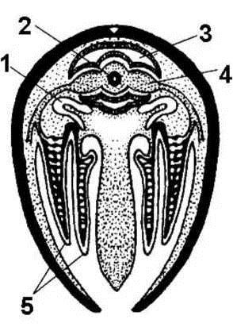
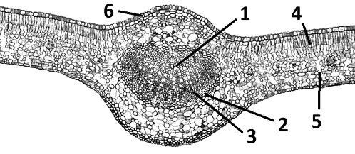

# Олимпиада 8 класса, 2016 — Олимпиадные задания · 2016 · 30 тестов, рисунки, задачи и «исключения» (часть 2 из 2)

Олимпиада `n16` из тренажёра «Олимпиада под микроскопом». Вопросов: 40. Каждый вопрос: условие (с рисунками), ключ и допустимые ответы, эталонный ответ, разбор по шагам 3–8 (алгоритм, объяснение и разбор вариантов, ловушки, как запомнить, схема, олимпиадный горизонт). Схемы в разборах здесь заменены подписями; сами схемы — в PDF-версии.

---

### [n16-q29] № 29 · Тест 29 · Короткодневная хризантема

Раздел: Задание 1 — Тесты (№ 1–30). Тип: один ответ. ID: `n16-q29`. На сайте: `#n16-q29`.

**Условие.** Хризантема — короткодневное растение. В июне его привезли из Петербурга в Краснодар, и оно зацвело. Выберите верное утверждение:

Варианты:
- а) слишком короткий день в Петербурге не дает этому растению зацвести
- б) слишком длинный день в Петербурге не дает этому растению зацвести
- в) все короткодневные растения имеют южное происхождение
- г) в Петербурге день в июне короче, чем в Краснодаре

**Ключ:** б) слишком длинный день в Петербурге не дает этому растению зацвести

**Эталонный ответ (карточка «Правильный ответ» на сайте):**

**б) слишком длинный день в Петербурге не даёт этому растению зацвести.**

**Разбор (шаги 3–8):**
#### 3. Алгоритм олимпиадного мышления
**Маркеры в условии.** «**Короткодневное**» растение, «в **июне**», «из Петербурга в Краснодар» — значит, с севера на юг.

**Логическая цепочка:**

1. Короткодневные растения зацветают, когда день становится **короче** определённой длины.
2. Чем севернее, тем длиннее летний день: в июне в Петербурге белые ночи (день почти 19 часов), в Краснодаре день короче (около 15,5 часа).
3. На юге день оказался короче — хризантема зацвела. Значит, в Петербурге ей мешал **слишком длинный** день → «б».

#### 4. Послойное объяснение и разбор вариантов
**Суть в двух предложениях.** Фотопериодизм — реакция растения на длину дня. Короткодневным растениям для цветения нужен день короче критического, поэтому на севере в разгар лета они не цветут.

**Механизм.** Растение «измеряет» продолжительность тёмного периода с помощью пигмента фитохрома в листьях. Когда ночь становится достаточно длинной, в листьях образуется сигнал к цветению, который по стеблю доходит до верхушки. Хризантемы, соя, конопля, «рождественская звезда» (пуансеттия) цветут, когда дни укорачиваются.

**Разбор неверных вариантов:**

- **а)** — перевёрнуто: в июне в Петербурге день не короткий, а самый длинный.
- **в)** — слово «**все**» делает вариант неверным. Многие короткодневные растения действительно родом из тропиков и субтропиков, но правило без исключений здесь не работает.
- **г)** — неверный географический факт: летом день тем длиннее, чем севернее.

#### 5. Типичные ошибки и ловушки
- **Летом день длиннее на севере, зимой — на юге.**
- **Короткодневное ≠ цветёт ранней весной.** Короткодневные цветут осенью (или весной в тропиках), длиннодневные — летом.
- **Слово «все»** почти всегда делает суждение неверным.

!

Запомни: короткодневным растениям для цветения нужен короткий день (длинная ночь); на севере летом им «слишком светло».

#### 6. Как запомнить
**Мини-таблица:**

| Группа | Цветёт при | Примеры |
|---|---|---|
| короткодневные | дне короче критического | хризантема, соя, конопля, пуансеттия, каланхоэ |
| длиннодневные | дне длиннее критического | пшеница, рожь, редис, шпинат |
| нейтральные | любой длине дня | томат, многие сорта фасоли и подсолнечника |

**Ассоциация:** хризантемы — «осенние цветы»: они ждут, пока день станет коротким.

#### 7. Визуализация
[Схема в разборе: Длина дня в июне]
*Подпись к схеме: Летом в Петербурге день на три часа длиннее, чем в Краснодаре.*

#### 8. Олимпиадный горизонт
- **Фотопериодизм в цветоводстве:** хризантемы к любому празднику получают, затемняя теплицы шторами — растения «думают», что пришла осень.
- **Редис у дачников уходит в стрелку в июне** — он длиннодневный, длинный день запускает цветение.
- **Фотопериодизм у животных:** длина дня запускает линьку, миграции и размножение (см. тест 28).

---

### [n16-q30] № 30 · Тест 30 · Кто выделяет пыльцу

Раздел: Задание 1 — Тесты (№ 1–30). Тип: один ответ. ID: `n16-q30`. На сайте: `#n16-q30`.

**Условие.** У Вашего друга аллергия на пыльцу. Он спрашивает, какие из перечисленных растений ему не подходят?

Пункты:
- 1) сальвиния
- 2) орхидея
- 3) пихта
- 4) сфагнум
- 5) колокольчик
- 6) кочедыжник женский
- 7) мужские растения тополя

Варианты:
- а) 1, 3, 5, 7
- б) 2, 3, 5, 6, 7
- в) 2, 3, 5, 7
- г) 2, 4, 5, 6, 7
- д) 1, 2, 4, 6

**Ключ:** в) 2, 3, 5, 7

**Эталонный ответ (карточка «Правильный ответ» на сайте):**

**в) 2, 3, 5, 7** — орхидея, пихта, колокольчик и мужские растения тополя образуют пыльцу.

**Разбор (шаги 3–8):**
#### 3. Алгоритм олимпиадного мышления
**Маркеры в условии.** «Аллергия на **пыльцу**». Пыльцу образуют только **семенные** растения — голосеменные и цветковые. Споровые растения (мхи, папоротники) размножаются спорами, пыльцы у них нет.

**Логическая цепочка — проверяем каждое растение:**

1. Сальвиния — водный папоротник → споры → не подходит.
2. Орхидея — цветковое → пыльца есть ✔.
3. Пихта — голосеменное → пыльца есть ✔.
4. Сфагнум — мох → споры.
5. Колокольчик — цветковое → пыльца ✔.
6. Кочедыжник — папоротник → споры.
7. Мужские растения тополя — образуют пыльцу ✔.
8. Набор 2, 3, 5, 7 → «в».

#### 4. Послойное объяснение и разбор вариантов
**Суть в двух предложениях.** Пыльца — мужской гаметофит семенных растений, поэтому её образуют только голосеменные и цветковые. Мхи и папоротники (сфагнум, сальвиния, кочедыжник) размножаются спорами, и аллергенной пыльцы у них нет.

**Механизм аллергии.** Чаще всего аллергию вызывает пыльца **ветроопыляемых** растений (берёза, тополь, полынь, злаки, хвойные): её очень много, она лёгкая и разносится ветром. У насекомоопыляемых (колокольчик, орхидея) пыльца липкая и тяжёлая, в воздух попадает мало — но она тоже пыльца, и чувствительному человеку лучше её избегать.

**Разбор неверных вариантов** (по «лишним» номерам):

- **а) 1, 3, 5, 7** — содержит 1 (сальвиния — папоротник, споры) и пропускает 2 (орхидея).
- **б) 2, 3, 5, 6, 7** — лишний 6 (кочедыжник — папоротник).
- **г) 2, 4, 5, 6, 7** — лишние 4 (сфагнум — мох) и 6, пропущена пихта.
- **д) 1, 2, 4, 6** — почти одни споровые; это ответ на вопрос «какие растения размножаются спорами» (кроме 2).

#### 5. Типичные ошибки и ловушки
- **Тополиный пух — не пыльца!** Пух — волоски на семенах женских тополей, он лишь переносит на себе пыльцу других растений. Пыльцу дают **мужские** деревья — поэтому в условии уточнение.
- **Голосеменные тоже пылят:** «жёлтый налёт» на лужах в мае — пыльца сосны и ели.
- **«Женский» в названии кочедыжника** — просто часть видового имени, к полу растения отношения не имеет.

!

Запомни: пыльца есть только у семенных растений (голосеменные + цветковые); мхи и папоротники — споры.

#### 6. Как запомнить
**Мини-таблица:**

| Растение | Группа | Пыльца? |
|---|---|---|
| сальвиния | папоротники (водные) | нет — споры |
| орхидея | цветковые | да |
| пихта | голосеменные | да |
| сфагнум | мхи | нет — споры |
| колокольчик | цветковые | да |
| кочедыжник женский | папоротники | нет — споры |
| тополь (мужские) | цветковые | да |

#### 7. Визуализация
[Схема в разборе: Кто выделяет пыльцу]
*Подпись к схеме: Пыльцевая аллергия возможна только на семенные растения.*

#### 8. Олимпиадный горизонт
- **Пыльцевое зерно — мужской гаметофит** из нескольких клеток; спора — одна клетка, из которой вырастает гаметофит  [олимпиадный уровень] .
- **Двудомность тополя:** мужские и женские цветки на разных деревьях. В городах стараются сажать мужские тополя, чтобы не было пуха, — но они сильнее пылят.
- Чередование поколений у мхов и папоротников — тесты 3 и 10 олимпиады 2016/2017.

---

### [n16-q31] № II.1 · Задание II · 1 · Поперечный разрез двустворчатого моллюска

Раздел: Задания II–IV — Рисунки, задачи и исключения. Тип: соответствие. ID: `n16-pii1`. На сайте: `#n16-q31`.

**Условие.** Соотнесите органы моллюска (А–К) с их обозначениями на рисунке (1–5).

*Указание на сайте:* Для каждой цифры на рисунке выбери орган. Пять органов из десяти останутся лишними.

(файл: `assets/img/n16-p1-mollusk.png`, ссылка: https://raw.githubusercontent.com/metalinjector/biology-tests/claude/intelligent-heisenberg-9woyvy/assets/img/n16-p1-mollusk.png)
*Рисунок из бланка: поперечный разрез двустворчатого моллюска (беззубки) на уровне сердца.*

Левый столбец (Обозначение):
- 1: Цифра 1
- 2: Цифра 2
- 3: Цифра 3
- 4: Цифра 4
- 5: Цифра 5

Правый столбец (Орган):
- а: кишечник
- б: перикард
- в: жабра
- г: почка
- д: предсердие
- е: мускул-замыкатель
- ж: нервный ганглий
- з: сифон
- и: печень
- к: желудочек

**Ключ (соответствие):**
- 1: Цифра 1 → г: почка
- 2: Цифра 2 → к: желудочек
- 3: Цифра 3 → б: перикард
- 4: Цифра 4 → д: предсердие
- 5: Цифра 5 → в: жабра
- *также засчитывается* 2 → а: кишечник — Засчитано: сквозь желудочек проходит задняя кишка, и на мелком рисунке линия 2 почти касается её кольца. Но конец линии лежит в зернистой стенке вокруг кишки — это желудочек сердца, основной ответ «к».

**Эталонный ответ (карточка «Правильный ответ» на сайте):**

**1 — г) почка; 2 — к) желудочек; 3 — б) перикард; 4 — д) предсердие; 5 — в) жабра.**

**Разбор (шаги 3–8):**
#### 3. Алгоритм олимпиадного мышления
**Маркеры на рисунке.** Две створки раковины (чёрная дуга), внизу — свисающая клиновидная нога, по бокам от неё — по две пластинчатые жабры с каждой стороны (5). Наверху, под замком раковины, — сердце в околосердечной сумке. Это поперечный разрез беззубки через область сердца.

**Логическая цепочка (сверху вниз):**

1. Самая верхняя полость под раковиной, ограниченная дугой, — **околосердечная сумка, перикард** (3).
2. В центре перикарда — зернистое тело сердца, **желудочек** (2). Через него насквозь проходит задняя кишка — тёмное колечко с точкой посередине: это знаменитая особенность двустворчатых.
3. Сбоку от желудочка, «крыльями», к жабрам тянутся **предсердия** (4).
4. Ниже перикарда, по бокам, — изогнутые трубки **почек** (органов Боянуса) (1).
5. По обеим сторонам ноги свисают пластины **жабр** (5).

#### 4. Послойное объяснение и разбор вариантов
**Суть в двух предложениях.** На уровне сердца у двустворчатого моллюска видны перикард, желудочек с проходящей сквозь него кишкой, два предсердия, почки и жабры. Это классическая схема строения беззубки.

**Механизм — как работает эта «связка».** Кровь, обогащённая кислородом в жабрах, по сосудам приходит в **предсердия**, оттуда — в **желудочек**, который гонит её к органам. Стенка перикарда отфильтровывает жидкость в **почки**: почки начинаются от перикарда и открываются в мантийную полость. Поэтому сердце, перикард и почки на разрезе всегда лежат рядом.

**Разбор лишних органов:**

- **а) кишечник** — проходит через желудочек (колечко в центре), но цифра 2 указывает на зернистую стенку вокруг него — сердце. Поэтому ответ «кишечник» для цифры 2 мы засчитываем как допустимый, но основной — «желудочек».
- **е) мускул-замыкатель** — два мощных мускула лежат у переднего и заднего края раковины; на разрезе через сердце их не видно.
- **ж) нервный ганглий** — ганглии мелкие (у рта, в ноге и у заднего мускула), на этой схеме не обозначены.
- **з) сифон** — у беззубки сифоны — отверстия на заднем крае мантии, на поперечном разрезе посередине тела их нет.
- **и) печень** — пищеварительная железа лежит в верхней части ноги, вокруг желудка, — ниже и впереди сердца.

#### 5. Типичные ошибки и ловушки
- **Кишка, проходящая сквозь сердце**, — особенность двустворчатых. Не принимай колечко кишки за всё сердце.
- **Перикард ≠ сердце:** перикард — сумка-полость вокруг сердца, а не сама сердечная мышца.
- **Почки моллюсков** начинаются от перикарда — поэтому их рисуют прямо под ним.

!

Запомни: у беззубки сверху вниз — перикард → желудочек с кишкой и предсердия по бокам → почки → жабры по бокам ноги.

#### 6. Как запомнить
**Этимология:** *перикард* — греч. peri «вокруг» + kardia «сердце»; *орган Боянуса* — почка моллюсков, названная по имени описавшего её анатома.

**Схема «этажей» разреза:**

| Этаж | Структура | Номер |
|---|---|---|
| верхний | перикард | 3 |
| в перикарде | желудочек (с кишкой) и предсердия | 2, 4 |
| под перикардом | почки | 1 |
| по бокам ноги | жабры | 5 |

#### 7. Визуализация
[Схема в разборе: Путь крови у двустворчатого моллюска]
*Подпись к схеме: Кровь из жабр через предсердия идёт в желудочек и от него — к органам.*

#### 8. Олимпиадный горизонт
- **Кровеносная система моллюсков незамкнутая** (кроме головоногих): кровь изливается в пространства между органами.
- **Беззубка фильтрует до 40 литров воды в сутки** — двустворчатые очищают водоёмы.
- Строение моллюсков и раковины — тест 17 этой олимпиады (наутилус).

---

### [n16-q32] № II.2 · Задание II · 2 · Возбудители и болезни

Раздел: Задания II–IV — Рисунки, задачи и исключения. Тип: соответствие. ID: `n16-pii2`. На сайте: `#n16-q32`.

**Условие.** Соотнесите возбудителей и соответствующие им заболевания.

*Указание на сайте:* Для каждой болезни выбери группу возбудителей. Бактерии подходят к двум болезням.

Левый столбец (Заболевание):
- а: молочница
- б: трихомониаз
- в: болезнь Лайма
- г: гепатит С
- д: холера

Правый столбец (Возбудитель):
- 1: бактерии
- 2: грибы
- 3: простейшие
- 4: вирусы

**Ключ (соответствие):**
- а: молочница → 2: грибы
- б: трихомониаз → 3: простейшие
- в: болезнь Лайма → 1: бактерии
- г: гепатит С → 4: вирусы
- д: холера → 1: бактерии

**Эталонный ответ (карточка «Правильный ответ» на сайте):**

**1 (бактерии) — в, д; 2 (грибы) — а; 3 (простейшие) — б; 4 (вирусы) — г.**

*В бланке возбудители слева, болезни справа; в тренажёре порядок обратный, чтобы у каждой болезни был ровно один ответ.*

**Разбор (шаги 3–8):**
#### 3. Алгоритм олимпиадного мышления
**Маркеры в условии.** Четыре группы возбудителей и пять болезней — значит, одна группа подходит к двум болезням.

**Логическая цепочка:**

1. **Молочница** (кандидоз) — дрожжеподобные грибы *Candida* → грибы.
2. **Трихомониаз** — трихомонада, жгутиковое простейшее → простейшие.
3. **Болезнь Лайма** (клещевой боррелиоз) — бактерия-спирохета боррелия, переносят клещи → бактерии.
4. **Гепатит С** — вирус, поражающий печень → вирусы.
5. **Холера** — холерный вибрион → бактерии.

#### 4. Послойное объяснение и разбор вариантов
**Суть в двух предложениях.** Одна и та же болезнь всегда вызывается возбудителем одной группы, и от этого зависит лечение: бактерии — антибиотики, грибы — противогрибковые средства, вирусы — противовирусные препараты и вакцины. В этом задании бактериальных болезней две: болезнь Лайма и холера.

**Механизм по болезням:**

- **Молочница** — гриб *Candida* в норме живёт на слизистых, но при ослаблении иммунитета или после антибиотиков разрастается белым налётом.
- **Трихомониаз** — простейшее с четырьмя жгутиками, передаётся при близком контакте.
- **Болезнь Лайма** — боррелии попадают в кровь при укусе иксодового клеща; характерный признак — расползающееся красное кольцо на коже.
- **Гепатит С** — вирус, передающийся через кровь; годами медленно повреждает печень.
- **Холера** — бактерии размножаются в кишечнике, токсин вызывает сильную потерю воды.

**Типичные ошибки:**

- «Молочница — бактериальная» — нет, грибковая (от белого налёта, похожего на молоко).
- «Болезнь Лайма вызывает клещ» — клещ только **переносчик**, а возбудитель — бактерия.

#### 5. Типичные ошибки и ловушки
- **Переносчик ≠ возбудитель.** Клещ, комар, блоха переносят возбудителей, но сами болезнь не вызывают.
- **Гепатит бывает разный:** гепатиты А, В, С — вирусные, но печень могут повредить и яды, и паразиты.

!

Запомни: бактерии — холера, болезнь Лайма; грибы — молочница; простейшие — трихомониаз; вирусы — гепатит С.

#### 6. Как запомнить
**Мини-таблица:**

| Возбудитель | Болезни из задания | Ещё примеры |
|---|---|---|
| бактерии | холера, болезнь Лайма | туберкулёз, столбняк, ангина |
| грибы | молочница | стригущий лишай |
| простейшие | трихомониаз | малярия, лямблиоз |
| вирусы | гепатит С | грипп, корь, ВИЧ |

**Ассоциация:** «молочница» — белый налёт, как молоко; «боррелия» — «бор»: клещи живут в лесу.

#### 7. Визуализация
[Схема в разборе: Болезни из задания по группам возбудителей]
*Подпись к схеме: К бактериям относятся две болезни из пяти.*

#### 8. Олимпиадный горизонт
- **Клещевой энцефалит** переносят те же клещи, что и болезнь Лайма, но его возбудитель — вирус. Поэтому от энцефалита есть прививка, а от боррелиоза — нет.
- Вирусные и бактериальные болезни — тест 11, кто не вызывает болезней — тест 4.

---

### [n16-q33] № II.3 · Задание II · 3 · Ткани листа на поперечном срезе

Раздел: Задания II–IV — Рисунки, задачи и исключения. Тип: соответствие. ID: `n16-pii3`. На сайте: `#n16-q33`.

**Условие.** Соотнесите ткани растения (а–е) с их обозначениями на рисунке (1–6).

*Указание на сайте:* Для каждой цифры на срезе листа выбери ткань.

(файл: `assets/img/n16-p3-list.jpg`, ссылка: https://raw.githubusercontent.com/metalinjector/biology-tests/claude/intelligent-heisenberg-9woyvy/assets/img/n16-p3-list.jpg)
*Рисунок из бланка: поперечный срез листа через главную жилку.*

Левый столбец (Обозначение):
- 1: Цифра 1
- 2: Цифра 2
- 3: Цифра 3
- 4: Цифра 4
- 5: Цифра 5
- 6: Цифра 6

Правый столбец (Ткань):
- а: столбчатый мезофилл
- б: ксилема
- в: губчатый мезофилл
- г: эпидермис
- д: флоэма
- е: склеренхима

**Ключ (соответствие):**
- 1: Цифра 1 → б: ксилема
- 2: Цифра 2 → е: склеренхима
- 3: Цифра 3 → д: флоэма
- 4: Цифра 4 → а: столбчатый мезофилл
- 5: Цифра 5 → в: губчатый мезофилл
- 6: Цифра 6 → г: эпидермис

**Эталонный ответ (карточка «Правильный ответ» на сайте):**

**1 — б) ксилема; 2 — е) склеренхима; 3 — д) флоэма; 4 — а) столбчатый мезофилл; 5 — в) губчатый мезофилл; 6 — г) эпидермис.**

**Разбор (шаги 3–8):**
#### 3. Алгоритм олимпиадного мышления
**Маркеры на рисунке.** Тонкая пластинка листа с утолщением посередине — главной жилкой. В жилке — крупный проводящий пучок, окружённый кольцом мелких толстостенных клеток.

**Логическая цепочка:**

1. **6** — самый наружный слой на поверхности листа → эпидермис (кожица).
2. **4** — под верхним эпидермисом ряд вытянутых «столбиков» → столбчатый мезофилл.
3. **5** — нижняя часть мякоти листа, рыхлые клетки с промежутками → губчатый мезофилл.
4. В пучке жилки: **ксилема лежит сверху** (к верхней стороне листа), **флоэма — снизу**. **1** — верхняя часть пучка с рядами крупных клеток-сосудов → ксилема; **3** — нижняя часть пучка → флоэма.
5. **2** — линия заканчивается на наружном кольце мелких толстостенных клеток вокруг пучка → склеренхима (механическая обкладка).

#### 4. Послойное объяснение и разбор вариантов
**Суть в двух предложениях.** Лист покрыт эпидермисом, под ним лежит столбчатый мезофилл (главная фотосинтезирующая ткань), а ниже — губчатый мезофилл с межклетниками для газообмена. В жилке проходит пучок: ксилема обращена к верхней стороне листа, флоэма — к нижней, а снаружи пучок укреплён склеренхимой.

**Механизм — почему ксилема сверху.** Жилки листа — продолжение пучков стебля. В стебле ксилема лежит ближе к центру, флоэма — снаружи. Когда пучок поворачивает из стебля в лист, «внутренняя» сторона становится верхней — поэтому ксилема в листе всегда сверху.

**Ткани и функции:**

- **Эпидермис** — защита, устьица (в основном на нижней стороне).
- **Столбчатый мезофилл** — много хлоропластов, основной фотосинтез.
- **Губчатый мезофилл** — межклетники, газообмен и испарение воды.
- **Ксилема** — сосуды, по ним вода с солями приходит в лист.
- **Флоэма** — ситовидные трубки, уносят сахара из листа.
- **Склеренхима** — толстостенные волокна, прочность жилки.

#### 5. Типичные ошибки и ловушки
- **Ксилема в листе — сверху, флоэма — снизу.** В корне они чередуются по кругу, в стебле — ксилема внутри.
- **Столбчатый мезофилл — под верхней кожицей**, губчатый — над нижней.
- **Склеренхима и колленхима:** в жилке листа часто есть обе; склеренхима — мёртвые волокна вокруг пучка.

!

Запомни: «Ксилема — к Солнцу» (сверху), флоэма — снизу; столбики сверху, губка снизу.

#### 6. Как запомнить
**Срез листа сверху вниз:**

| Слой | Ткань |
|---|---|
| 1-й | верхний эпидермис |
| 2-й | столбчатый мезофилл |
| 3-й | губчатый мезофилл (+ жилки) |
| 4-й | нижний эпидермис с устьицами |

**В жилке:** склеренхима (кольцо) → ксилема (сверху) → флоэма (снизу).

#### 7. Визуализация
[Схема в разборе: Слои листа сверху вниз]
*Подпись к схеме: В жилке ксилема обращена к верхней стороне листа.*

#### 8. Олимпиадный горизонт
- **Теневые и световые листья:** у листьев на солнце столбчатый мезофилл в 2–3 слоя, у теневых — в один.
- **У злаков** мезофилл однородный, без деления на столбчатый и губчатый  [олимпиадный уровень] .
- Ткани растений и их функции — задание 1 части Б олимпиады 2016/2017.

---

### [n16-q34] № III.1 · Задание III · 1 · Сколько тычинок в букете

Раздел: Задания II–IV — Рисунки, задачи и исключения. Тип: вписать слово или число. ID: `n16-piii1`. На сайте: `#n16-q34`.

**Условие.** У вас в букете: кисть душистого горошка с 5 цветками; 1 петуния; 1 корзинка василька с 20 трубчатыми и 20 воронковидными цветками. Сколько всего тычинок в букете? Ответ: ……

**Пропуск 1:** эталон см. эталонный ответ; принимаются ответы по шаблонам ['^155$']
  - подсказка на ответ по шаблону `^255$`: Краевые воронковидные цветки василька бесплодны — тычинок в них нет.
  - подсказка на ответ по шаблону `^130$`: Сколько тычинок в цветке душистого горошка? У бобовых их больше пяти.
  - подсказка на ответ по шаблону `^150$`: Не забыла петунию?
  - подсказка на ответ по шаблону `^(105|100)$`: А тычинки горошка? В его кисти 5 цветков.

**Эталонный ответ (карточка «Правильный ответ» на сайте):**

**155 тычинок** = 5 × 10 (горошек) + 5 (петуния) + 20 × 5 (трубчатые цветки василька) + 0 (воронковидные цветки бесплодны).

**Разбор (шаги 3–8):**
#### 3. Алгоритм олимпиадного мышления
**Маркеры в условии.** Три растения из трёх семейств — для каждого надо вспомнить формулу цветка. Особое внимание — «воронковидные» цветки василька.

**Логическая цепочка:**

1. **Душистый горошек** — семейство Бобовые: в цветке **10 тычинок** (9 сросшихся + 1 свободная). 5 цветков × 10 = **50**.
2. **Петуния** — семейство Паслёновые: в цветке **5 тычинок**. Итого **5**.
3. **Василёк** — семейство Сложноцветные (Астровые): трубчатые цветки обоеполые, в каждом **5 тычинок** → 20 × 5 = **100**; краевые **воронковидные** цветки **бесплодные** (ни тычинок, ни пестика) → 0.
4. Сумма: 50 + 5 + 100 = **155**.

#### 4. Послойное объяснение и разбор вариантов
**Суть в двух предложениях.** Чтобы посчитать тычинки, нужно знать формулу цветка каждого семейства и помнить, что корзинка — это соцветие, а не один цветок. У василька краевые воронковидные цветки бесплодные и только привлекают насекомых.

**Механизм — формулы цветков:**

- Бобовые (горошек): чашечка 5, венчик 5 (парус, вёсла, лодочка), **тычинок 10** (9 срослись в трубочку, 1 свободная), пестик 1.
- Паслёновые (петуния): чашечка 5, венчик 5 (сросшийся), **тычинок 5**, пестик 1.
- Сложноцветные (василёк): трубчатый цветок — **тычинок 5** (пыльники срослись в трубку); воронковидный краевой цветок — **тычинок нет**.

**Типичные ошибки:**

- **255** — посчитали тычинки и в воронковидных цветках василька.
- **130** — решили, что у горошка тоже 5 тычинок.
- **150** — забыли петунию.
- **55** — приняли корзинку василька за один цветок.

#### 5. Типичные ошибки и ловушки
- **Корзинка — соцветие**, в ней десятки цветков.
- **Краевые цветки сложноцветных** бывают бесплодными (василёк, подсолнечник) или пестичными (ромашка — язычковые цветки только с пестиком).
- **«Двубратственные» тычинки бобовых:** 9 + 1, всего 10.

!

Запомни: горошек — 10 тычинок в цветке, петуния — 5, трубчатый цветок василька — 5, воронковидный — 0.

#### 6. Как запомнить
**Формулы цветков** (Ч — чашечка, Л — лепестки, Т — тычинки, П — пестик; скобки — сросшиеся части):

| Семейство | Формула | Тычинок |
|---|---|---|
| Бобовые | Ч(5) Л1+2+(2) Т(9)+1 П1 | 10 |
| Паслёновые | Ч(5) Л(5) Т5 П1 | 5 |
| Сложноцветные (трубчатый) | Ч0 Л(5) Т(5) П1 | 5 |
| Сложноцветные (воронковидный) | Ч0 Л(5) Т0 П0 | 0 |

#### 7. Визуализация
[Схема в разборе: Считаем тычинки по цветкам]
*Подпись к схеме: Главная ловушка — бесплодные краевые цветки василька.*

#### 8. Олимпиадный горизонт
- **Зачем васильку бесплодные цветки:** крупные яркие воронки привлекают насекомых к мелким трубчатым цветкам — разделение труда в соцветии.
- **Соцветия:** олимпиада 7 класса, задание 5 (корзинка, кисть и другие).

---

### [n16-q35] № III.2 · Задание III · 2 · Сколько камер сердца в комнате

Раздел: Задания II–IV — Рисунки, задачи и исключения. Тип: вписать слово или число. ID: `n16-piii2`. На сайте: `#n16-q35`.

**Условие.** В комнате находятся золотая рыбка, летучая мышь, 2 попугая и удав. Сколько всего камер сердца насчитывается в комнате (суммарно)? Ответ: ……

**Пропуск 1:** эталон см. эталонный ответ; принимаются ответы по шаблонам ['^17$']
  - подсказка на ответ по шаблону `^13$`: Попугаев двое — посчитай каждого.
  - подсказка на ответ по шаблону `^18$`: Проверь удава (пресмыкающееся) и рыбку: у одного из них ты насчитала лишнюю камеру.
  - подсказка на ответ по шаблону `^(16|15)$`: Проверь летучую мышь — это млекопитающее.
  - подсказка на ответ по шаблону `^19$`: У рыб сердце двухкамерное, у пресмыкающихся (кроме крокодилов) — трёхкамерное.

**Эталонный ответ (карточка «Правильный ответ» на сайте):**

**17 камер** = 2 (рыбка) + 4 (летучая мышь) + 4 × 2 (два попугая) + 3 (удав).

**Разбор (шаги 3–8):**
#### 3. Алгоритм олимпиадного мышления
**Маркеры в условии.** Пять животных из четырёх классов; попугаев **двое**.

**Логическая цепочка:**

1. **Золотая рыбка** — рыбы: 1 предсердие + 1 желудочек = **2**.
2. **Летучая мышь** — млекопитающее (хоть и летает): **4**.
3. **Попугай** — птица: **4**, а попугаев двое → **8**.
4. **Удав** — пресмыкающееся: 2 предсердия + 1 желудочек с неполной перегородкой = **3**.
5. Сумма: 2 + 4 + 8 + 3 = **17**.

#### 4. Послойное объяснение и разбор вариантов
**Суть в двух предложениях.** Число камер сердца определяется классом животного, а не образом жизни: летучая мышь летает, но сердце у неё, как у всех млекопитающих, четырёхкамерное. У пресмыкающихся (кроме крокодилов) сердце трёхкамерное.

**Механизм.** Камеры — это предсердия и желудочки. Венозную пазуху рыб и артериальный конус при подсчёте камер не считают — это сосудистые отделы. Неполная перегородка в желудочке рептилий не делает его двумя камерами.

**Типичные ошибки:**

- **13** — посчитали одного попугая.
- **18** — удаву или рыбке приписали лишнюю камеру.
- **«Летучая мышь — как птица»** — нет, это млекопитающее.

#### 5. Типичные ошибки и ловушки
- **Летающие ≠ птицы:** летучие мыши — млекопитающие.
- **Неполная перегородка у рептилий не добавляет камеру** (а у крокодилов перегородка полная — 4 камеры).
- **Внимательно читай числа в условии:** «2 попугая».

!

Запомни: рыбы 2, земноводные 3, пресмыкающиеся 3 (крокодилы 4), птицы 4, млекопитающие 4.

#### 6. Как запомнить
**Таблица подсчёта:**

| Животное | Класс | Камер | Кол-во | Итого |
|---|---|---|---|---|
| золотая рыбка | рыбы | 2 | 1 | 2 |
| летучая мышь | млекопитающие | 4 | 1 | 4 |
| попугай | птицы | 4 | 2 | 8 |
| удав | пресмыкающиеся | 3 | 1 | 3 |
|  |  |  |  | **17** |

#### 7. Визуализация
[Схема в разборе: Считаем камеры сердца]
*Подпись к схеме: Не забудь, что попугаев двое.*

#### 8. Олимпиадный горизонт
- Строение сердца разных классов — тест 21 этой олимпиады.
- **Сердце рыб** перекачивает только венозную кровь — к жабрам; у них один круг кровообращения.

---

### [n16-q36] № IV · Задание IV · Исключения из правил

Раздел: Задания II–IV — Рисунки, задачи и исключения. Тип: соответствие. ID: `n16-piv`. На сайте: `#n16-q36`.

**Условие.** В биологии из почти любого правила найдутся исключения. Подберите организмы, у которых наблюдаются исключения из приведенных правил.

*Указание на сайте:* Для каждого правила выбери организм-исключение. Каждый организм подходит к одному правилу.

Левый столбец (Правило):
- 1: крылья птиц лишены когтей
- 2: личинки не размножаются
- 3: рыбы не ходят по суше
- 4: в предплечье две кости — локтевая и лучевая
- 5: пол животного неизменен в течение жизни
- 6: рыбы не дышат атмосферным воздухом
- 7: у рептилий трехкамерное сердце
- 8: у позвоночных всегда есть самцы

Правый столбец (Организм-исключение):
- а: скальная ящерица
- б: аксолотль
- в: лягушка
- г: рыба-клоун
- д: анабас
- е: гоацин
- ж: протоптерус
- з: крокодил

**Ключ (соответствие):**
- 1: крылья птиц лишены когтей → е: гоацин
- 2: личинки не размножаются → б: аксолотль
- 3: рыбы не ходят по суше → д: анабас
- 4: в предплечье две кости — локтевая и лучевая → в: лягушка
- 5: пол животного неизменен в течение жизни → г: рыба-клоун
- 6: рыбы не дышат атмосферным воздухом → ж: протоптерус
- 7: у рептилий трехкамерное сердце → з: крокодил
- 8: у позвоночных всегда есть самцы → а: скальная ящерица
- *также засчитывается* 6 → д: анабас — Засчитано: анабас действительно дышит атмосферным воздухом с помощью лабиринтового органа. Но анабас нужен для правила 3 (он ползает по суше), а для правила 6 главный пример — протоптерус с настоящими лёгкими.

**Эталонный ответ (карточка «Правильный ответ» на сайте):**

**1 — е) гоацин; 2 — б) аксолотль; 3 — д) анабас; 4 — в) лягушка; 5 — г) рыба-клоун; 6 — ж) протоптерус; 7 — з) крокодил; 8 — а) скальная ящерица.**

**Разбор (шаги 3–8):**
#### 3. Алгоритм олимпиадного мышления
**Маркеры в условии.** Восемь правил и восемь организмов — каждому правилу ровно одно исключение. Начинай с самых узнаваемых пар, остальные найдутся исключением.

**Логическая цепочка:**

1. **Крокодил** — единственная рептилия с четырёхкамерным сердцем → правило 7.
2. **Аксолотль** — личинка амбистомы, которая размножается, не превращаясь во взрослую форму (неотения) → правило 2.
3. **Гоацин** — у птенцов на крыльях по два когтя, ими они лазают по веткам → правило 1.
4. **Лягушка** — локтевая и лучевая кости срослись в одну (лучелоктевая кость) → правило 4.
5. **Рыба-клоун** — все рождаются самцами; когда самка группы погибает, крупнейший самец становится самкой → правило 5.
6. **Протоптерус** — двоякодышащая рыба с лёгкими → правило 6.
7. **Анабас** («ползун») переползает по суше между водоёмами → правило 3.
8. **Скальная ящерица** — у некоторых видов (например, армянской скальной ящерицы) популяции состоят из одних самок и размножаются партеногенезом → правило 8.

#### 4. Послойное объяснение и разбор вариантов
**Суть в двух предложениях.** Почти у каждого биологического правила есть исключения, и олимпиады их обожают. Здесь собраны восемь классических исключений из разных групп позвоночных.

**Механизм по примерам:**

- **Гоацин** (Южная Америка): птенцы карабкаются по ветвям с помощью когтей на крыльях, а при опасности прыгают в воду; у взрослых когти исчезают.
- **Аксолотль**: из-за недостатка гормона щитовидной железы личинка остаётся с жабрами всю жизнь, но становится половозрелой.
- **Анабас**: переползает по суше, опираясь на жаберные крышки и плавники, а дышит воздухом с помощью лабиринтового органа.
- **Лягушка**: кости предплечья (и голени) срослись — так конечность прочнее при прыжке.
- **Рыба-клоун**: пол меняется с мужского на женский (протандрия).
- **Протоптерус**: в пересыхающих водоёмах Африки зарывается в ил и месяцами дышит лёгкими.
- **Крокодил**: перегородка в желудочке полная — четыре камеры.
- **Скальные ящерицы** (Кавказ): у некоторых видов самцов нет вовсе, самки откладывают неоплодотворённые яйца, из которых вылупляются дочери.

#### 5. Типичные ошибки и ловушки
- **Анабас тоже дышит воздухом** — поэтому для правила 6 его тоже засчитываем, но главный пример — протоптерус с настоящими лёгкими.
- **Неотения ≠ раннее созревание взрослого:** аксолотль размножается, оставаясь личинкой.
- **Смена пола** у рыб встречается в обе стороны: у рыбы-клоуна из самцов в самок, у губанов — наоборот.

!

Запомни пары: гоацин — когти на крыльях, аксолотль — размножающаяся личинка, анабас — ходит по суше, лягушка — сросшееся предплечье, рыба-клоун — смена пола, протоптерус — лёгкие, крокодил — 4 камеры, скальная ящерица — партеногенез.

#### 6. Как запомнить
**Таблица исключений:**

| Правило | Исключение | Почему |
|---|---|---|
| нет когтей на крыльях | гоацин | когти у птенцов |
| личинки не размножаются | аксолотль | неотения |
| рыбы не ходят по суше | анабас | ползает по суше |
| в предплечье две кости | лягушка | лучелоктевая кость |
| пол неизменен | рыба-клоун | самец → самка |
| рыбы не дышат воздухом | протоптерус | лёгкие |
| у рептилий 3 камеры | крокодил | 4 камеры |
| всегда есть самцы | скальная ящерица | партеногенез |

#### 7. Визуализация
[Схема в разборе: Исключения из правил: три группы]
*Подпись к схеме: Исключения — любимый материал олимпиад.*

#### 8. Олимпиадный горизонт
- **Другие «ходячие» рыбы:** илистые прыгуны (периофтальмы) прыгают по грязи на грудных плавниках.
- **Партеногенез у позвоночных** встречается ещё у некоторых гекконов, вараны комодо иногда размножаются без самцов в неволе.
- **Неотения у человека?** Некоторые учёные считают, что человек сохраняет детские черты предков (большая голова, плоское лицо) — это гипотеза педоморфоза  [олимпиадный уровень] .

---

### [n16-q37] № 1 · Перенос знаний

Раздел: Бонус · Тренажёр на перенос знаний. Тип: один ответ. ID: `n16-t1`. На сайте: `#n16-q37`.

**Условие.** В каком органоиде клетки клубня картофеля синеют крахмальные зёрна от капли йода?

Варианты:
- а) в хлоропластах
- б) в лейкопластах (амилопластах)
- в) в вакуолях
- г) в рибосомах

**Ключ:** б) в лейкопластах (амилопластах)

**Эталонный ответ (карточка «Правильный ответ» на сайте):**

**б) в лейкопластах (амилопластах).** Хлоропластов в клубне почти нет (он под землёй), а вакуоли хранят растворимые вещества.

---

### [n16-q38] № 2 · Ловушка «летает — значит птица»

Раздел: Бонус · Тренажёр на перенос знаний. Тип: один ответ. ID: `n16-t2`. На сайте: `#n16-q38`.

**Условие.** Сколько камер в сердце у летучей лисицы (крупной летучей мыши)?

Варианты:
- а) 2
- б) 3
- в) 4
- г) у разных видов по-разному

**Ключ:** в) 4

**Эталонный ответ (карточка «Правильный ответ» на сайте):**

**в) 4.** Летучие мыши и лисицы — млекопитающие, у всех млекопитающих сердце четырёхкамерное.

---

### [n16-q39] № 3 · Осмос

Раздел: Бонус · Тренажёр на перенос знаний. Тип: один ответ. ID: `n16-t3`. На сайте: `#n16-q39`.

**Условие.** Пресноводную инфузорию-туфельку перенесли в морскую воду. Что произойдёт?

Варианты:
- а) она раздуется и лопнет
- б) она потеряет воду и сморщится
- в) ничего не изменится
- г) сократительные вакуоли начнут работать чаще

**Ключ:** б) она потеряет воду и сморщится

**Эталонный ответ (карточка «Правильный ответ» на сайте):**

**б) потеряет воду и сморщится.** Морская вода для пресноводной клетки гипертоническая: вода выходит наружу, а сократительные вакуоли, наоборот, почти перестают работать.

---

### [n16-q40] № 4 · Исключения

Раздел: Бонус · Тренажёр на перенос знаний. Тип: один ответ. ID: `n16-t4`. На сайте: `#n16-q40`.

**Условие.** Какое из животных — исключение из правила «у земноводных во взрослом состоянии нет жабр»?

Варианты:
- а) травяная лягушка
- б) аксолотль
- в) серая жаба
- г) обыкновенный тритон на суше

**Ключ:** б) аксолотль

**Эталонный ответ (карточка «Правильный ответ» на сайте):**

**б) аксолотль** — неотеническая личинка, которая размножается, сохраняя наружные жабры.

---

## Памятки олимпиады

### Памятка: Об этой олимпиаде

**Об этой олимпиаде.** Бланк «Олимпиадные задания по биологии, 8 класс» (2016): 30 тестов с одним ответом, практическая часть на соответствие по рисункам, две задачи на счёт и задание «Исключения». Ключа к бланку не было: все ответы решены заново и проверены по рисункам, а каждое задание разобрано по тем же 8 шагам, что и остальные олимпиады на сайте.

**На что обратить внимание:**

- В тесте 25 засчитываются два ответа: основной — дистиллированная вода, допустимый — физиологический раствор (он тоже гипотонический для морской амёбы).
- В задании II.1 для цифры 2 засчитывается и «кишечник»: кишка проходит сквозь желудочек.
- В задании II.2 порядок перевёрнут (болезнь → возбудитель), чтобы у каждой строки был один ответ.
- В задании IV для правила 6 засчитывается и анабас (он тоже дышит воздухом), но основной ответ — протоптерус.

### Восемь шагов разбора

1. **Условие** — задание дословно из бланка, с рисунком.
2. **Ответ** — правильный вариант и короткое обоснование.
3. **Алгоритм олимпиадного мышления** — маркеры в условии и цепочка рассуждений.
4. **Послойное объяснение** — механизм и разбор каждого неверного варианта.
5. **Ловушки** — где чаще всего ошибаются.
6. **Как запомнить** — таблицы, этимология, подсказки.
7. **Визуализация** — схема или рисунок.
8. **Олимпиадный горизонт** — что ещё полезно знать по теме.

### Памятка: Экспресс-шпаргалка и ответы

| № | Тема | Ответ | Главное правило и ловушка |
|---|---|---|---|
| 1 | запасной крахмал | а | крахмал — в лейкопластах; гликоген — в цитоплазме |
| 2 | пенициллин | г | бьёт по муреиновой стенке; на вирусы не действует |
| 3 | окучивание и пикировка | в | окучивание — земля к стеблю; пикировка — без кончика корня |
| 4 | возбудители болезней | а | среди лишайников возбудителей нет; «лишай» — болезнь, а не лишайник |
| 5 | ротовой аппарат | г | свёрнутый хоботок — бабочка, сосущий |
| 6 | не членистоногое | а | трубочник — кольчатый червь, мокрица — рак |
| 7 | скелет змеи | б | нет грудины → нет грудной клетки; атлант и эпистрофей есть |
| 8 | груминг | в | уход за телом — комфортное поведение |
| 9 | фазы митоза | в | П → М → А → Т |
| 10 | горилла бьёт в грудь | а | демонстрация заменяет драку |
| 11 | вирусные болезни | б | опоясывающий лишай — вирус ветрянки |
| 12 | пластида плазмодия | а | апикопласт без фотосинтеза |
| 13 | гриб | в | рыжик — пластинчатый млечник |
| 14 | нет усиков | б | усики: рак 2 пары, насекомое 1, паук 0 |
| 15 | не растёт | б | имаго насекомых не линяет и не растёт |
| 16 | овод | б | взрослые оводы не питаются; кровь пьют слепни |
| 17 | наутилус | б | головоногий с наружной раковиной |
| 18 | углерод ламинарии | б | автотроф: углерод из CO₂ |
| 19 | возраст | г | годичные кольца на чешуе рыб |
| 20 | настоящий орех | в | лещина; миндаль, фисташка, грецкий — костянки |
| 21 | схема сердца | в | 2 предсердия + 1 желудочек + артериальный конус |
| 22 | медуза | в | 4 подковы в центре — гонады аурелии |
| 23 | гормон | в | цитокинин — деление клеток, почки, клубни |
| 24 | череп | д | короткая морда, клыки, мало зубов — кошка |
| 25 | морская амёба | г (б) | гипотонический раствор — клетка набухает |
| 26 | клубеньковые бактерии | г | азот растению, сахара и жильё бактериям |
| 27 | роды кошачьих | г | Пантера, Каракал, Гепард |
| 28 | общее у животных | д | сезонные миграции |
| 29 | хризантема | б | короткодневным мешает длинный день |
| 30 | пыльца | в | пыльца только у семенных растений |
| II.1 | моллюск | 1г 2к 3б 4д 5в | кишка проходит сквозь желудочек |
| II.2 | возбудители | бактерии — в, д | клещ — переносчик, а не возбудитель |
| II.3 | ткани листа | 1б 2е 3д 4а 5в 6г | ксилема в жилке — сверху |
| III.1 | тычинки | 155 | воронковидные цветки василька бесплодны |
| III.2 | камеры сердца | 17 | попугаев двое; удав — 3 камеры |
| IV | исключения | 1е 2б 3д 4в 5г 6ж 7з 8а | анабас ходит, протоптерус дышит лёгкими |

### Памятка: Словарь корней

| Термин | Корень | Значение |
|---|---|---|
| **амилопласт** | греч. amylon «крахмал» + plastos «вылепленный» | пластида, запасающая крахмал |
| **лейкопласт** | греч. leukos «белый» | бесцветная пластида |
| **муреин** | лат. murus «стена» | вещество клеточной стенки бактерий |
| **пикировка** | франц. piquer «колоть, втыкать» | пересадка сеянцев с прищипкой кончика корня |
| **груминг** | англ. groom «чистить, ухаживать» | уход за шерстью и телом |
| **профаза / телофаза** | греч. pro «до» / telos «конец» | первая и последняя фазы митоза |
| **апикопласт** | лат. apex «верхушка» | пластида малярийного плазмодия |
| **имаго** | лат. imago «образ» | взрослая стадия насекомого |
| **наутилус** | греч. nautilos «мореход» | головоногий моллюск с наружной раковиной |
| **ламинария** | лат. lamina «пластинка» | бурая водоросль, «морская капуста» |
| **гонады** | греч. gone «рождение» | половые железы |
| **ропалии** | греч. rhopalon «булава» | краевые тельца медуз |
| **цитокинин** | греч. kytos «клетка» + kinesis «движение» | гормон деления клеток |
| **диастема** | греч. diastema «промежуток» | щель между резцами и коренными зубами |
| **гипотонический** | греч. hypo «ниже» + tonos «напряжение» | раствор слабее, чем в клетке |
| **мутуализм** | лат. mutuus «взаимный» | взаимовыгодный симбиоз |
| **меланизм** | греч. melas «чёрный» | чёрная окраска из-за избытка пигмента |
| **миграция** | лат. migratio «переселение» | регулярное массовое перемещение |
| **фотопериодизм** | греч. phos «свет» + periodos «круговорот» | реакция на длину дня |
| **перикард** | греч. peri «вокруг» + kardia «сердце» | околосердечная сумка |
| **мезофилл** | греч. mesos «средний» + phyllon «лист» | мякоть листа |
| **неотения** | греч. neos «юный» + teinein «удлинять» | размножение на стадии личинки |
| **партеногенез** | греч. parthenos «дева» + genesis «рождение» | развитие из неоплодотворённого яйца |

### Памятка: Карточки (таблица)

| Вопрос | Ответ |
|---|---|
| Где хранится запасной крахмал растений, а где гликоген животных? | Крахмал — в лейкопластах (амилопластах), гликоген — гранулами в цитоплазме. |
| Почему пенициллин не вредит клеткам человека? | У наших клеток нет муреиновой клеточной стенки — мишени пенициллина. |
| Чем пикировка отличается от окучивания? | Пикировка — удаляют кончик главного корня; окучивание — присыпают землю к стеблю. |
| Почему у змеи нет грудной клетки, хотя рёбер сотни? | Нет грудины — рёбра не замкнуты. |
| Растёт ли взрослая муха? | Нет: имаго насекомых не линяет и не растёт. |
| Чем питаются взрослые оводы? | Ничем: ротовой аппарат недоразвит, живут на запасах личинки. |
| Почему у морских простейших нет сократительных вакуолей? | Солёность среды близка к цитоплазме — вода не входит, откачивать нечего. |
| Сколько родов: лев, тигр, леопард, гепард, каракал? | Три: Пантера, Гепард, Каракал. |
| Почему хризантема не цветёт летом в Петербурге? | Она короткодневная, а летний день на севере слишком длинный. |
| Сколько тычинок в цветке душистого горошка? | Десять: девять сросшихся и одна свободная. |
