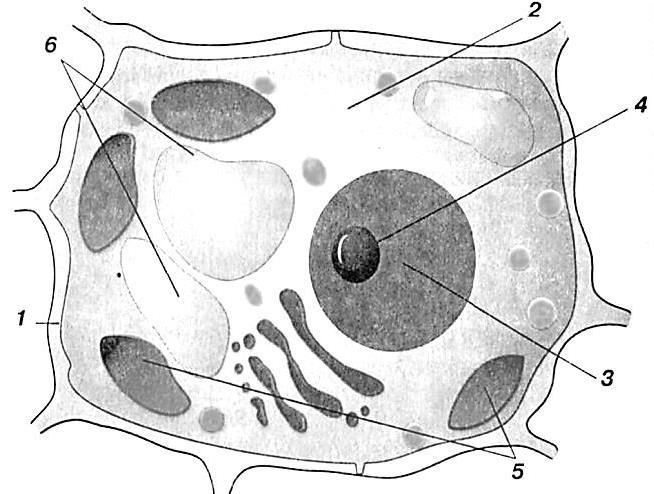
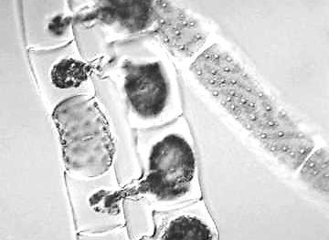
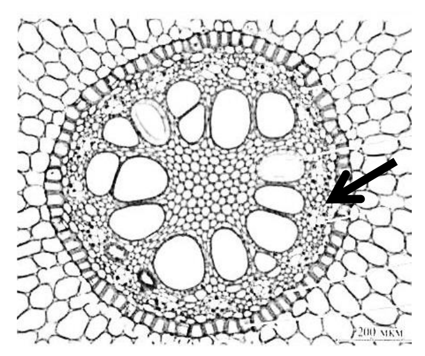

# Олимпиада 8 класса, 2018/2019 — Олимпиада · 2018/2019 · 29 тестов и 3 практических задания (часть 1 из 3)

Олимпиада `g8b` из тренажёра «Олимпиада под микроскопом». Вопросов: 36. Каждый вопрос: условие (с рисунками), ключ и допустимые ответы, эталонный ответ, разбор по шагам 3–8 (алгоритм, объяснение и разбор вариантов, ловушки, как запомнить, схема, олимпиадный горизонт). Схемы в разборах здесь заменены подписями; сами схемы — в PDF-версии.

---

### [g8b-q1] № 1 · Тест 1 · Архитектура соцветий — простые моноподиальные оси против сложных ветвящихся систем

Раздел: Тестовая часть (№ 1–30, номера 22 в бланке нет). Тип: один ответ. ID: `g8b-task-1`. На сайте: `#g8b-q1`.

**Условие.** К сложным соцветиям относится:

Варианты:
- а) головка клевера
- б) кисть ландыша
- в) метелка проса
- г) початок белокрыльника

**Ключ:** в) метелка проса

**Эталонный ответ (карточка «Правильный ответ» на сайте):**

**в) метёлка проса.**

**Разбор (шаги 3–8):**
#### 3. Алгоритм олимпиадного мышления
- **Маркеры в условии:** словосочетание **«сложные соцветия»** и парные названия «тип соцветия + конкретное растение» (головка клевера, кисть ландыша, метёлка проса, початок белокрыльника).
- **Логическая цепочка:**
  1. **Шаг 1 (Критерий деления соцветий):** Вспомним главный морфологический признак, разделяющий простые и сложные соцветия. У **простых соцветий** на главной оси (рахисе) сидят одиночные цветки (на цветоножках или без них — сидячие). У **сложных соцветий** главная ось ветвится, и на её боковых веточках сидят не одиночные цветки, а *частные (парциальные) простые соцветия* (например, колоски, простые зонтики или кисти).
  2. **Шаг 2 (Проверка вариантов методом исключения):**
    - У ландыша (б) цветки на цветоножках отходят прямо от неветвящейся главной оси — это *простая кисть*.
    - У белокрыльника (г) сидячие цветки расположены на сильно утолщённой мясистой, но *неветвящейся* главной оси — это *початок* (простое соцветие).
    - У клевера (а) сидячие или почти сидячие цветки скучены на укороченной булавовидно утолщённой, но *неветвящейся* главной оси — это *головка* (простое соцветие).
    - У проса (в) главная ось многократно ветвится, а на концах боковых веточек второго и третьего порядков располагаются мелкие элементарные соцветия — *колоски*.

  3. **Вывод:** Единственное сложное соцветие в списке — **в) метёлка проса**.

#### 4. Послойное объяснение и разбор дистракторов
**Суть в двух предложениях:** Главное отличие сложного соцветия от простого заключается в ветвлении главной цветоносной оси. Если от главной оси отходят сразу цветоножки отдельных цветков — соцветие простое, а если отходят боковые оси, несущие собственные мелкие соцветия (у злаков — колоски), то соцветие сложное.

**Подробный биологический механизм:**

- **Связь «строение → функция → среда обитания»:** Просо посевное (*Panicum miliaceum*) относится к семейству **Злаки (Мятликовые, *Poaceae*)**. Все злаки — ветроопыляемые растения (**анемофилы** — растения, пыльца которых переносится потоками воздуха). Развесистая сложная **метёлка** проса выносит сотни мелких колосков высоко над листьями: при малейшем дуновении ветра гибкие боковые веточки раскачиваются, выбрасывая в воздух облачка сухой мелкой пыльцы, которую легко улавливают перистые рыльца пестиков.
- **Школьное упрощение и олимпиадная норма:** В школьном учебнике метёлку обычно определяют как «сложную кисть, у которой нижние боковые веточки ветвятся сильнее и длиннее верхних, придавая соцветию пирамидальную форму» (как у сирени). **Олимпиадный уровень (старшие классы):** с точки зрения точной морфологии растений метёлка злаков (проса, овса, мятлика, риса) — это *метёлка из колосков* (сложное ботриоидное соцветие, где элементарными единицами на концах веточек служат не отдельные цветки, а простые соцветия — **колоски**).

**Полный разбор всех неверных вариантов (дистракторов):**

- **а) головка клевера:** *В чём ошибка:* головка — это **простое** соцветие с укороченной и слегка разросшейся главной осью, на которой тесно сидят цветки на очень коротких цветоножках или без них. *Почему включили:* плотное шаровидное скопление множества цветков у клевера визуально кажется «сложным» и напоминает корзинку сложноцветных. *Когда стал бы верным:* если бы в условии спрашивали о простом соцветии с укороченной булавовидной осью, характерном для представителей семейства Бобовые (клевер, люцерна хмелевидная).
- **б) кисть ландыша:** *В чём ошибка:* у ландыша майского (*Convallaria majalis*) классическая **простая однобокая кисть** — от длинного цветоноса поочерёдно отходят цветоножки одиночных цветков. *Почему включили:* чтобы проверить, различает ли ученица простую кисть (ландыш, черёмуха, пастушья сумка) и сложную кисть — метёлку (сирень, просо). *Когда стал бы верным:* если бы вопрос звучал: «К простым соцветиям с удлинённой главной осью и цветками на хорошо заметных цветоножках относится...».
- **г) початок белокрыльника:** *В чём ошибка:* початок — это **простое** соцветие (разновидность простого колоса с толстой мясистой осью и крупным кроющим листом — покрывалом). У белокрыльника болотного (калла, *Calla palustris*, семейство Ароидные) мелкие сидячие цветки расположены прямо на мясистой оси. *Почему включили:* из-за знаменитой путаницы с «початком кукурузы» (у кукурузы женское соцветие — это *сложный початок*, где на толстой оси сидят парные колоски, а вот у ароидных — белокрыльника, монстеры, рогоза — початок *простой*!). *Когда стал бы верным:* если бы спрашивали о простом соцветии с утолщённой мясистой главной осью или если бы вместо белокрыльника была указана кукуруза (женское соцветие которой морфологически является сложным початком).

#### 5. Типичные ошибки и ловушки
- **Когнитивная ловушка («много цветков = сложное соцветие»):** Ученики часто думают, что если в соцветии плотно собраны десятки или сотни мелких цветков (как в головке клевера, корзинке одуванчика или початке белокрыльника), то оно «сложное». На самом деле сложность соцветия определяется исключительно **ветвлением оси**, а не густотой цветков!
- **Исключения и олимпиадные хитрости:**
  - **Корзинка** (подсолнечник, ромашка, василёк) и **головка** (клевер) — это **простые** соцветия! Но если мелкие корзинки сами собраны на ветвящейся оси (например, у тысячелистника — щиток из корзинок, у полыни — метёлка из корзинок, у мордовника — головка из одноцветковых корзинок), то всё агрегатное соцветие целиком становится **сложным**!
  - У **кукурузы** женский початок — *сложный* (на мясистой оси сидят колоски), а у **белокрыльника и аира** початок — *простой* (на оси сидят отдельные цветки).

- **Правило-предостережение:** *«Запомни: количество цветков не делает соцветие сложным — ищи ветвление главной оси! Если цветок сидит прямо на главной оси (даже толстой или плоской) — соцветие простое!»*

#### 6. Методики запоминания
- **Этимология:** Термин **моноподиальные (ботриоидные) соцветия** происходит от греч. *monos* — «один», *pous (podos)* — «нога, ось» и *botrys* — «кисть винограда» (главная ось растёт неограниченно долго, цветки распускаются снизу вверх или от края к центру).
- **Яркая бытовая ассоциация (с границами аналогии):** Представь **вешалку в прихожей**. Если на центральной стойке сразу висят пальто (цветки) — это **простое соцветие** (стойка может быть длинной, как у кисти, или круглой шайбой, как у головки и корзинки). А если к центральной стойке приделаны боковые плечики-кронштейны, и уже на каждом кронштейне висит по связке одежды — это **сложное соцветие** (метёлка, сложный колос, сложный зонтик). *Граница аналогии:* в отличие от металлической вешалки, у живого соцветия порядок раскрытия цветков регулируется гормонами (ауксинами) и направлением притока питательных веществ.
- **Сравнительная мини-таблица простых и сложных соцветий-двойников:**

| Критерий сравнения | Простое соцветие | Сложный аналог (ветвящаяся ось) |
|---|---|---|
| **Строение оси** | Неветвящаяся главная ось (несёт цветки) | Ветвящаяся главная ось (несёт парциальные соцветия) |
| **Кистевидный тип** | **Простая кисть** (ландыш, черёмуха, капуста) | **Сложная кисть / Метёлка** (сирень, просо, овёс) |
| **Колосовидный тип** | **Простой колос** (подорожник, ятрышник) | **Сложный колос** (пшеница, рожь, ячмень, пырей) |
| **Зонтиковидный тип** | **Простой зонтик** (примула, вишня, лук, чистотел) | **Сложный зонтик** (морковь, укроп, петрушка, борщевик) |

#### 7. Визуализация
*Рис. к заданию 1. Сравнение архитектуры простых соцветий (головка, кисть, початок) и сложного ветвящегося соцветия (метёлка проса).*
[Схема: без подписи]

#### 8. Олимпиадный горизонт и перенос знаний
- **Агрегатные (составные) соцветия у разных семейств:** На региональном этапе ВсОШ часто просят определить «двойные» соцветия, сочетающие признаки разных типов — например, у пижмы и тысячелистника соцветие представляет собой *щитковидную метёлку из корзинок*, а у инжира (фикуса) соцветие **сиконий** — это разросшаяся полая грушевидная ось, внутри которой сидят мелкие цветки.
- **Цимозные (симподиальные) соцветия (Олимпиадный уровень):** Помимо ботриоидных соцветий (с неограниченным ростом главной оси), существуют цимозные соцветия, где верхушечная точка роста быстро заканчивается цветком, а рост продолжают боковые оси: *монохазий* (завиток у незабудки и медуницы), *дихазий* (развилка у гвоздичных) и *плейохазий* (молочай).

---

### [g8b-q2] № 2 · Тест 2 · Половой диморфизм соцветий кукурузы — верхушечная мужская метёлка и пазушный женский початок

Раздел: Тестовая часть (№ 1–30, номера 22 в бланке нет). Тип: один ответ. ID: `g8b-task-2`. На сайте: `#g8b-q2`.

**Условие.** Соцветие тычиночных цветков кукурузы:

Варианты:
- а) метелка из колосков
- б) початок
- в) зонтик
- г) сложный колос

**Ключ:** а) метелка из колосков

**Эталонный ответ (карточка «Правильный ответ» на сайте):**

**а) метёлка из колосков.**

**Разбор (шаги 3–8):**
#### 3. Алгоритм олимпиадного мышления
- **Маркеры в условии:** слова **«тычиночных цветков»** (то есть мужских цветков, образующих пыльцу) и объект **«кукуруза»**.
- **Логическая цепочка:**
  1. **Шаг 1 (Определение пола цветков кукурузы):** Кукуруза сахарная, или маис (*Zea mays*) — однодомное растение с раздельнополыми цветками. Это значит, что мужские (тычиночные) и женские (пестичные) цветки находятся на одной и той же особи, но собраны в два совершенно разных по форме и расположению соцветия.
  2. **Шаг 2 (Сопоставление с местоположением на побеге):** Женские (пестичные) цветки расположены в средних пазухах листьев и образуют массивный *початок* (вариант «б» — ловушка для тех, кто не прочитал слово «тычиночных»). Мужские (тычиночные) цветки расположены на самой макушке стебля в виде раскидистого «султана», который с ботанической точки зрения представляет собой **метёлку из двухцветковых колосков**.
  3. **Вывод:** Правильный ответ — **а) метёлка из колосков**.

#### 4. Послойное объяснение и разбор дистракторов
**Суть в двух предложениях:** У кукурузы мужские и женские цветки живут на одном растении, но на разных «этажах». На самой верхушке стебля качается мужское соцветие — ветвистая метёлка из колосков, а ниже в пазухах листьев прячутся женские соцветия — початки.

**Подробный биологический механизм:**

- **Связь «строение → функция → среда обитания»:** Почему мужское соцветие кукурузы находится наверху и имеет форму раскидистой метёлки, а женское — внизу в виде плотного початка в обёртке? Пыльца кукурузы довольно крупная и тяжёлая, переносится ветром и под действием силы тяжести оседает сверху вниз и по диагонали на соседние растения. Высокое расположение мужской метёлки обеспечивает дальний разлёт пыльцы. В свою очередь, женское соцветие (початок), в котором формируются тяжёлые богатые крахмалом зерновки, крепится к прочной средней части стебля в пазухе листа (чтобы верхушка стебля не обломилась под тяжестью зрелого початка!) и защищено плотной листовой обёрткой от высыхания и вредителей, выставляя наружу лишь длинные шелковистые нити — столбики с двулопастными рыльцами («кукурузные рыльца»), улавливающие летящую пыльцу.
- **Почему кукуруза не опыляет сама себя (Олимпиадный уровень):** Чтобы избежать близкородственного самоопыления (инбридинга), у кукурузы действует механизм **протандрии** (от греч. *protos* — «первый», *andros* — «мужчина»): тычиночные цветки в верхушечной метёлке созревают и высыпают пыльцу на 2–5 дней раньше, чем из обёртки початка того же самого растения покажутся восприимчивые женские рыльца!

**Полный разбор всех неверных вариантов (дистракторов):**

- **б) початок:** *В чём ошибка:* початок (точнее, сложный початок) — это соцветие **пестичных (женских)** цветков кукурузы, а не тычиночных. *Почему включили:* главная ловушка на невнимательность: увидев слово «кукуруза», ученик автоматически выбирает слово «початок». *Когда стал бы верным:* если бы вопрос звучал: «Соцветие пестичных (женских) цветков кукурузы — это...».
- **в) зонтик:** *В чём ошибка:* у злаков вообще не бывает соцветия зонтик. *Почему включили:* для проверки базовых знаний систематики. *Когда стал бы верным:* для представителей семейств Амариллисовые / Луковые (лук, чеснок) или Первоцветные (примула), а сложный зонтик — для семейства Зонтичные (Сельдерейные).
- **г) сложный колос:** *В чём ошибка:* в сложном колосе колоски сидят непосредственно на уступах неветвящейся главной оси (колосового стержня), а у мужского соцветия кукурузы ось ветвится, образуя длинные боковые веточки. *Почему включили:* сложный колос — классическое соцветие многих других злаков, которое часто путают с метёлкой. *Когда стал бы верным:* если бы в вопросе спрашивали о соцветии пшеницы, ржи, ячменя или пырея ползучего.

#### 5. Типичные ошибки и ловушки
- **Фактическая ловушка:** Смешение понятий «однодомное растение» и «обоеполые цветки». У кукурузы цветки **раздельнополые** (однополые: отдельно тычиночные, отдельно пестичные), но само растение **однодомное** («один дом» для обоих полов).
- **Исключения и олимпиадные детали:** Иногда на верхушечной мужской метёлке кукурузы при гормональных сбоях или похолодании развиваются отдельные женские цветки и прямо на макушке образуются голые зерновки — это одно из свидетельств того, что цветки предков злаков были обоеполыми.
- **Правило-предостережение:** *«Запомни: у кукурузы сверху — папа-метёлка (пылит по ветру), а в пазухе листа — мама-початок (ловит пыльцу длинными косами-столбиками)!»*

#### 6. Методики запоминания
- **Этимология:** Латинское название кукурузы *Zea mays* объединяет древнегреческое слово *zeia* («хлебный злак», от *zeo* — «жить, поддерживать жизнь») и слово индейцев таино *mahiz* (маис).
- **Мнемонический образ:** «Кукуруза — гусар в высоком кивере с **метёлкой-султаном** на макушке (мужское соцветие) и спеленатым младенцем-**початком** на руках (женское соцветие в листовых обёртках)».
- **Цепочка развития женского и мужского цветков кукурузы:** Зачаток обоеполого цветка → на верхушке побега редуцируется пестик (остаются 3 тычинки в колоске метёлки) / в пазухе листа редуцируются тычинки (остаётся пестик с гигантским нитевидным столбиком в початке).

#### 8. Олимпиадный горизонт и перенос знаний
- **Однодомные и двудомные ветроопыляемые растения:** Тот же принцип пространственного разделения мужских и женских соцветий на одном растении (однодомность) работает у **осоки** (мужские колоски обычно выше женских), **рогоза** (верхняя узкая часть початка — тычиночная, нижняя широкая бархатистая — пестичная), а также у **берёзы, ольхи, лещины и дуба**. А вот **облепиха, ива, тополь и конопля** пошли ещё дальше и стали *двудомными* (мужские и женские соцветия развиваются на разных растениях).

---

### [g8b-q3] № 3 · Тест 3 · Карпология банана — почему гигантская тропическая трава приносит многосемянную трёхгнёздную ягоду

Раздел: Тестовая часть (№ 1–30, номера 22 в бланке нет). Тип: один ответ. ID: `g8b-task-3`. На сайте: `#g8b-q3`.

**Условие.** Плод банана:

Варианты:
- а) трехгнездная ягода
- б) многогнездная коробочка
- в) померанец
- г) стручок

**Ключ:** а) трехгнездная ягода

**Эталонный ответ (карточка «Правильный ответ» на сайте):**

**а) трёхгнёздная ягода.**

**Разбор (шаги 3–8):**
#### 3. Алгоритм олимпиадного мышления
- **Маркеры в условии:** ботанический тип плода объекта **«банан»** и четыре морфологических типа плодов (двух сочных — ягода и померанец, и двух сухих вскрывающихся — коробочка и стручок).
- **Логическая цепочка:**
  1. **Шаг 1 (Отсечение сухих плодов):** Околоплодник банана при созревании мясистый, сочный и не растрескивается сам по себе. Значит, сухие вскрывающиеся плоды — *коробочка (б)* и *стручок (г)* — отпадают сразу.
  2. **Шаг 2 (Выбор между сочными плодами):** *Померанец (в)*, или гесперидий, с ароматной цедрой, белым губчатым мезокарпием и сочными дольками из волосков эндокарпия встречается исключительно у цитрусовых (лимон, апельсин, мандарин).
  3. **Шаг 3 (Анатомическая проверка):** Если очистить банан и надавить на кончик его мякоти вдоль оси, она легко разделится ровно на **три продольные доли** — это три гнезда завязи, в которых у диких бананов лежат твёрдые чёрные семена (а у культурных сортов — мелкие тёмные точки-семязачатки). Плод сочный, многосемянный, с кожистым наружным слоем и сочной мякотью без деревянистой косточки — это **трёхгнёздная ягода**!
  4. **Вывод:** Правильный ответ — **а) трёхгнёздная ягода**.

#### 4. Послойное объяснение и разбор дистракторов
**Суть в двух предложениях:** С ботанической точки зрения плод банана — это многосемянная трёхгнёздная ягода с плотной кожистой оболочкой и сочной внутренней мякотью. Тёмные точки внутри магазинного банана — это недоразвитые семязачатки в трёх сросшихся гнёздах завязи.

**Подробный биологический механизм:**

- **Строение околоплодника (перикарпия):** В ботанике **ягода** — это сочный невскрывающийся многосемянный плод, у которого наружный слой околоплодника (**экзокарпий**) тонкий или кожистый, а средний и внутренний слои (**мезокарпий** и **эндокарпий**) сочные и мясистые (без каменистого эндокарпия-косточки). У банана (род *Musa*, класс Однодольные!) цветок имеет трёхчленный тип строения и нижнюю завязь из **трёх сросшихся плодолистиков**, образующих **три гнезда**. «Кожура» банана — это кожистый экзокарпий (сросшийся с тканями цветоложа нижней завязи), а съедобная сладкая мякоть — разросшиеся мезокарпий и эндокарпий.
- **Куда делись семена у магазинного банана? (Олимпиадный уровень — старшие классы):** Дикие виды бананов (*Musa acuminata* и *Musa balbisiana*) диплоидны (2n = 22) и буквально набиты крупными каменными чёрными семенами, из-за которых мякоть почти невозможно есть. Но культурные десертные сорта бананов — это **стерильные триплоиды (3n = 33)**! Во время мейоза нечётный набор из 33 хромосом не может равномерно поделиться пополам, поэтому нормальные гаметы и семена не образуются, а плоды развиваются без оплодотворения — путём вегетативной **партенокарпии** (от греч. *parthenos* — «девственный» и *karpos* — «плод»). Размножают такие бананы исключительно вегетативно (отпрысками подземного корневища — ризома).

**Полный разбор всех неверных вариантов (дистракторов):**

- **б) многогнездная коробочка:** *В чём ошибка:* коробочка — это **сухой вскрывающийся** многосемянный плод. *Почему включили:* у некоторых близких тропических родственников банана по порядку Имбирецветные (например, у стрелиции и некоторых геликоний) плод действительно представляет собой трехгнёздную коробочку! *Когда стал бы верным:* для мака, тюльпана, лилии, дурмана или хлопчатника.
- **в) померанец:** *В чём ошибка:* померанец (гесперидий) образуется из верхней многогнёздной завязи только у подсемейства Померанцевые (Цитрусовые) семейства Рутовые; его мякоть образована разросшимися соковыми мешочками (выростами эндокарпия), а кожура содержит эфиромасличные вместилища. *Почему включили:* банан, как и апельсин, чистят руками от толстой кожуры, что создаёт ложную бытовую аналогию. *Когда стал бы верным:* для лимона, апельсина, грейпфрута, мандарина, кумквата.
- **г) стручок:** *В чём ошибка:* стручок — сухой вскрывающийся двустворчатый плод из двух плодолистиков с плёнчатой ложной перегородкой посредине, на которой сидят семена. *Почему включили:* вытянутая изогнутая форма банана внешне напоминает длинный стручок или боб. *Когда стал бы верным:* для растений семейства Крестоцветные (Капустные) — капусты, редьки, горчицы, пастушьей сумки (стручочек).

#### 5. Типичные ошибки и ловушки
- **Бытовая ловушка («банановая пальма» и «ягода»):**
  1. В быту банан часто называют «пальмой» или «деревом». На самом деле банан — это **многолетняя гигантская трава**! Его «ствол» (ложный стебель, или псевдостебель) образован плотно обхватывающими друг друга влагалищами огромных листьев, а настоящий стебель — это короткое подземное корневище (ризом).
  2. В быту «ягодами» называют любые мелкие сочные плоды (вишню, малину, клубнику), а в ботанике вишня — это *костянка*, малина — *многокостянка*, клубника — *земляничина (многоорешек на сочном цветоложе)*, зато **банан, томат, картофель, баклажан, виноград и киви — настоящие ягоды**!

- **Правило-предостережение:** *«Запомни: банан — это не пальма и не фрукт с дерева, а гигантская однодольная трава, плод которой — трёхгнёздная ягода!»*

#### 6. Методики запоминания
- **Практический эксперимент для запоминания:** Очисти банан и аккуратно надави пальцем на его острый кончик строго вдоль центра — банан сам распадётся ровно на **три продольные дольки**! Каждая долька — это одно из **трёх гнёзд** его ягоды (потому что банан — однодольное растение, а у однодольных части цветка кратны **3**!).
- **Сравнительная мини-таблица сочных ягодообразных плодов:**

| Ботанический тип плода | Строение околоплодника (экзо- / мезо- / эндокарпий) | Классические примеры на олимпиадах |
|---|---|---|
| **Ягода** | Кожистый экзокарпий + сочные мезо- и эндокарпий (семена погружены в мякоть) | Банан, томат, картофель, паслён, виноград, смородина, черника, ландыш |
| **Тыквина** | Твёрдый (иногда деревянистый) экзокарпий + сочные мезо- и эндокарпий (нижняя завязь) | Тыква, арбуз, дыня, огурец, кабачок, патиссон |
| **Померанец (гесперидий)** | Флаведо (железистый экзокарпий) + альбедо (губчатый белый мезокарпий) + соковые мешочки эндокарпия | Апельсин, лимон, мандарин, грейпфрут, помело, лайм |
| **Яблоко (многосемянный)** | Мякоть из разросшегося цветоложа (гипантия) + хрящеватые перегородки эндокарпия вокруг семян | Яблоня, груша, айва, рябина, боярышник, ирга |

#### 7. Визуализация
*Рис. к заданию 3. Поперечный срез плода банана: отчётливо видны три гнезда сросшихся плодолистиков и центральные ряды семязачатков.*
[Схема: без подписи]

#### 8. Олимпиадный горизонт и перенос знаний
- **Полиплоидия и бессемянные плоды в селекции:** По тому же принципу создания нечётных триплоидов (3n), что и у культурного банана, современные генетики получают **бессемянные арбузы** (скрещивая диплоидный арбуз 2n с искусственно полученным с помощью колхицина тетраплоидным арбузом 4n: n + 2n = 3n).
- **Хитрые плоды на ВсОШ:** Обязательно помни ещё три любимых олимпиадных объекта: плод граната — **гранатина** (из двухъярусной нижней завязи, где сочной является кожура самих семян — *саркотеста*!), плод инжира — соплодие **сиконий**, а плод ананаса и шелковицы — **соплодие** из сросшихся ягод или орешков в сочном околоцветнике.

---

### [g8b-q4] № 4 · Тест 4 · Эволюция корневых систем — почему у папоротников все корни придаточные и боковые

Раздел: Тестовая часть (№ 1–30, номера 22 в бланке нет). Тип: один ответ. ID: `g8b-task-4`. На сайте: `#g8b-q4`.

**Условие.** Какие растения формируют корневую систему без главного корня?

Варианты:
- а) ламинария
- б) сфагнум
- в) щитовник мужской
- г) гингко

**Ключ:** в) щитовник мужской

**Эталонный ответ (карточка «Правильный ответ» на сайте):**

**в) щитовник мужской.**

**Разбор (шаги 3–8):**
#### 3. Алгоритм олимпиадного мышления
- **Маркеры в условии:** два одновременных требования: 1) растение **формирует корневую систему** (то есть у него вообще есть настоящие корни!), 2) в этой системе **нет главного корня**.
- **Логическая цепочка:**
  1. **Шаг 1 (Отсев растений без корней):** Корни впервые в эволюции появляются у высших сосудистых растений (Плауновидных и Папоротникообразных). У водорослей — *ламинарии (а)* — и у моховидных — *сфагнума (б)* — настоящих корней нет вообще! Значит, они не могут формировать корневую систему ни с главным корнем, ни без него.
  2. **Шаг 2 (Сравнение папоротника и голосеменного):** Остаются *щитовник мужской (в)* (папоротник) и *гинкго (г)* (голосеменное дерево). Главный корень развивается из зародышевого корешка семени и сохраняется у голосеменных (включая гинкго двулопастный, формирующий мощную стержневую корневую систему). А у папоротников зародышевый корешок отмирает в самом начале жизни проростка, и вся взрослая корневая система состоит только из **придаточных корней**, отходящих от подземного побега — корневища, и ветвящихся на них боковых корней.
  3. **Вывод:** Корневую систему без главного корня формирует **в) щитовник мужской**.

#### 4. Послойное объяснение и разбор дистракторов
**Суть в двух предложениях:** Чтобы иметь корневую систему без главного корня, растение сначала должно вообще обзавестись настоящими корнями (чего нет у водорослей и мхов), но при этом утратить главный корень во взрослом состоянии. Именно так устроены папоротники, хвощи и плауны: их корневая система целиком образована придаточными и боковыми корнями, растущими от корневища.

**Подробный биологический механизм:**

- **Что такое главный, придаточные и боковые корни:**
  - **Главный корень** развивается строго из *зародышевого корешка*.
  - **Придаточные (адвентивные) корни** отрастают от любых частей побега — стебля (включая подземное корневище, клубень, луковицу) или листьев.
  - **Боковые корни** образуются при ветвлении любых других корней (главного, придаточных или более старых боковых) за счёт деления клеток *перицикла*.

- **Как развивается зародыш папоротника (Олимпиадный уровень — старшие классы):** У папоротникообразных (в том числе у щитовника мужского, *Dryopteris filix-mas*) при развитии диплоидного зародыша из зиготы на заростке (гаметофите) закладывается первичный зародышевый корешок. Однако этот первичный корешок функционирует совсем недолго и быстро отмирает (это явление в эволюционной ботанике называется **первичной гоморизией** — от греч. *homos* — «одинаковый» и *rhiza* — «корень»). Все корни взрослого спорофита папоротника возникают заново на стеблевой части — толстом подземном **корневище** — и поэтому являются **придаточными** (и отходящими от них боковыми).

**Полный разбор всех неверных вариантов (дистракторов):**

- **а) ламинария:** *В чём ошибка:* ламинария («морская капуста») — это бурая водоросль (низшее талломное растение). У неё нет ни корней, ни стеблей, ни листьев, ни проводящих тканей; к каменистому грунту она прикрепляется корневидными выростами — **ризоидами**. *Почему включили:* внешне ризоиды ламинарии похожи на пучок корней без главного корня. *Когда стал бы верным:* если бы вопрос звучал: «Какой организм прикрепляется к субстрату многоклеточными ризоидами у основания слоевища (таллома)?».
- **б) сфагнум:** *В чём ошибка:* сфагнум (торфяной мох) относится к отделу Моховидные. У всех мхов настоящие корни отсутствуют, а у взрослого сфагнума нет даже ризоидов (он впитывает воду всей поверхностью тела с помощью мёртвых водоносных клеток — *гиалоцист*). *Почему включили:* двойная ловушка — проверить, знает ли ученица, что у мхов вообще нет корней, а у взрослого сфагнума нет и ризоидов. *Когда стал бы верным:* если бы спрашивали: «У какого взрослого высшего растения отсутствуют как корни, так и ризоиды?».
- **г) гинкго:** *В чём ошибка:* гинкго двулопастный (*Ginkgo biloba*) — реликтовое голосеменное дерево. Как и у всех голосеменных, из зародышевого корешка семени у него развивается мощный **главный корень**, формирующий глубокую стержневую корневую систему (первичная аллоризия). *Почему включили:* гинкго — «живое ископаемое», современник динозавров и древних папоротников, поэтому многие ошибочно приписывают ему примитивные черты споровых растений. *Когда стал бы верным:* если бы спрашивали о голосеменном растении с вееровидными листьями, дихотомическим жилкованием и стержневой корневой системой.

#### 5. Типичные ошибки и ловушки
- **Когнитивная ловушка («Нет главного корня = нет корней вообще»):** Невнимательный участник олимпиады читает «без главного корня» и выбирает ламинарию или сфагнум, потому что у них точно нет главного корня. Но он пропускает слова **«формируют корневую систему»**! Нет корней = нет корневой системы!
- **Исключения и олимпиадные тонкости:**
  - Корневую систему **без главного корня** (или с быстро отмирающим главным корнем) имеют **все современные высшие споровые сосудистые растения** (плауны, хвощи, папоротники — *первичная гоморизия*), а среди семенных растений — **Однодольные** (злаки, лилейные, луковые — *вторичная гоморизия*, где главный корень закладывается в семени, но быстро отмирает или перестаёт выделяться среди массы придаточных корней), а также любое двудольное растение, выращенное **вегетативно** (из стеблевого черенка, уса, отводка или листа)!

- **Правило-предостережение:** *«Запомни: у водорослей и мхов корней НЕТ совсем; впервые корни появляются у плаунов, хвощей и папоротников, но все они — придаточные и боковые!»*

#### 6. Методики запоминания
- **Эволюционная лестница подземных органов (кто → чем держится):** Водоросли (таллом, ризоиды только для прикрепления) → Мхи (ризоиды для прикрепления и всасывания, но у взрослого сфагнума ризоидов нет!) → Папоротники, хвощи, плауны (корневище + **придаточные и боковые корни**, главного корня нет) → Голосеменные и Двудольные из семени (**главный корень** + боковые = стержневая система) → Однодольные (мочковатая система из придаточных корней).
- **Сравнительная мини-таблица подземных структур:**

| Группа растений | Наличие настоящих корней | Наличие главного корня | Чем представлено подземное закрепление |
|---|---|---|---|
| **Водоросли** (ламинария) | Нет | Нет | Ризоиды (выросты слоевища, не имеют тканей) |
| **Мхи** (кукушкин лён / сфагнум) | Нет | Нет | Многоклеточные ризоиды (у взрослого сфагнума отсутствуют) |
| **Папоротники** (щитовник мужской) | **Да** | **Нет** (отмирает у зародыша) | Подземный побег (корневище) + придаточные и боковые корни |
| **Голосеменные** (гинкго, сосна) | **Да** | **Да** (хорошо развит) | Стержневая корневая система (главный + боковые корни) |

#### 8. Олимпиадный горизонт и перенос знаний
- **Удивительные исключения среди папоротников:** На олимпиадах часто спрашивают о водных папоротниках — **сальвинии плавающей (*Salvinia natans*)**. У сальвинии настоящие корни **вторично редуцировались (исчезли совсем!)**, а роль корней играет один из трёх листьев в каждой мутовке: два овальных зелёных листа плавают на поверхности воды, а третий лист рассечён на тонкие бурые нити, покрытые волосками, и свисает в воду, всасывая минеральные вещества и работая как стабилизатор плавучести!

---

### [g8b-q5] № 5 · Тест 5 · Защита спорангиев папоротника — что такое индузий и почему голокучник остался «голым»

Раздел: Тестовая часть (№ 1–30, номера 22 в бланке нет). Тип: один ответ. ID: `g8b-task-5`. На сайте: `#g8b-q5`.

**Условие.** Индузий (покрывальце) можно наблюдать у:

Варианты:
- а) ламинарии
- б) кукушкиного льна
- в) голокучника
- г) щитовника мужского

**Ключ:** г) щитовника мужского

**Эталонный ответ (карточка «Правильный ответ» на сайте):**

**г) щитовника мужского.**

**Разбор (шаги 3–8):**
#### 3. Алгоритм олимпиадного мышления
- **Маркеры в условии:** термин **«индузий (покрывальце)»** и два папоротника в вариантах ответа — *голокучник (в)* и *щитовник мужской (г)*.
- **Логическая цепочка:**
  1. **Шаг 1 (Привязка термина к систематике):** Индузий (покрывальце) — это тонкий плёнчатый вырост на нижней стороне листа (вайи) **папоротников**, который сверху, словно зонтик или щиток, прикрывает группу спорангиев (*сорус*) от высыхания и механических повреждений. Значит, водоросль *ламинария (а)* и мох *кукушкин лён (б)* сразу исключаются.
  2. **Шаг 2 (Лингвистический анализ названий двух папоротников):** Сравним два папоротника: «голокучник» и «щитовник». Слово **«голо-кучник»** буквально означает «голые кучки» (сорусы — кучки спорангиев — лежат открыто, без покрывальца!). А слово **«щитовник»** происходит от того, что каждый сорус сверху прикрыт почковидным покрывальцем-**индузием**, похожим на маленький боевой щит!
  3. **Вывод:** Индузий можно наблюдать у **г) щитовника мужского**.

#### 4. Послойное объяснение и разбор дистракторов
**Суть в двух предложениях:** На нижней стороне листьев (вай) папоротников спорангии собраны в бурые бугорки — сорусы. У многих папоротников, включая щитовник мужской, каждый сорус защищён тонким плёнчатым «зонтиком» — индузием (покрывальцем), тогда как у голокучника и многоножки сорусы голые.

**Подробный биологический механизм:**

- **Строение соруса щитовника мужского (*Dryopteris filix-mas*):** На нижней (абаксиальной) стороне рассечённой вайи над проводящей жилкой образуется небольшой вырост ткани — *плацента (ложе соруса)*. К плаценте на длинных ножках прикрепляются многочисленные двояковыпуклые **спорангии**. Сверху от верхушки плаценты отходит тонкое кожистое почковидное (округло-сердцевидное) покрывальце — **индузий**.
- **Зачем нужен индузий и как вскрываются спорангии (Олимпиадный уровень):** Пока споры внутри спорангиев созревают (путём мейоза из диплоидных клеток спорогенной ткани), индузий плотно прижат к поверхности вайи, защищая нежные молодые спорангии от пересыхания, капель дождя и мелких фитофагов. Когда споры созревают, в сухую погоду индузий подсыхает и приподнимается по краям, открывая доступ сухому воздуху к спорангиям. В стенке каждого спорангия есть дугообразный ряд клеток с неравномерно (подковообразно) утолщёнными стенками — **механическое кольцо (аннулюс)**. При испарении воды клетки кольца сжимаются, разрывают тонкую стенку спорангия (стомиум) и, резко распрямляясь, как катапульта, выстреливают споры в воздух!

**Полный разбор всех неверных вариантов (дистракторов):**

- **а) ламинарии:** *В чём ошибка:* у бурой водоросли ламинарии одноклеточные зооспорангии образуются прямо на поверхности слоевища среди стерильных нитей (парафиз), никаких сорусов с индузием у неё нет. *Почему включили:* для проверки различий между низшими и высшими споровыми растениями. *Когда стал бы верным:* если бы спрашивали об организме, образующем двужгутиковые зооспоры с разножгутиковым аппаратом.
- **б) кукушкиного льна:** *В чём ошибка:* у мха кукушкиного льна (*Polytrichum commune*) спорангием является одиночная коробочка на длинной ножке. Сверху коробочка одета войлочным **колпачком (калиптрой)**, но это НЕ индузий! Калиптра у мхов — это гаплоидная (n) ткань, представляющая собой оторвавшуюся верхнюю часть брюшка женского полового органа — архегония, тогда как индузий папоротника — это диплоидный (2n) вырост листа спорофита. *Почему включили:* тонкая олимпиадная ловушка на смешение терминов «колпачок (калиптра) мха» и «покрывальце (индузий) папоротника». *Когда стал бы верным:* если бы спрашивали о гаплоидном войлочном колпачке (калиптре), прикрывающем коробочку спорофита.
- **в) голокучника:** *В чём ошибка:* голокучник (род *Gymnocarpium*, например голокучник трёхраздельный или голокучник Роберта) — настоящий лесной папоротник, но его отличительный систематический признак — **полное отсутствие индузия** (сорусы голые!). *Почему включили:* это дистрактор высшего пилотажа! Кто выучил просто правило «индузий есть у папоротников», но не знает конкретных родов, может случайно выбрать голокучник. *Когда стал бы верным:* если бы спрашивали, у какого папоротника сорусы лишены покрывальца (наряду с многоножкой *Polypodium*).

#### 5. Типичные ошибки и ловушки
- **Фактическая ловушка (Индузий ≠ Калиптра):** Никогда не путай **индузий** папоротника (диплоидный 2n плёнчатый вырост вайи, прикрывающий сорус снизу листа) и **калиптру (колпачок)** мха кукушкиного льна (гаплоидный n остаток архегония гаметофита, сидящий сверху на коробочке спорофита!).
- **Исключения среди папоротников:**
  - Сорусы **с настоящим индузием**: *щитовник* (почковидный индузий), *кочедыжник женский* (продолговатый или серповидный бахромчатый индузий), *страусник* (покрывальце вокруг сорусов внутри свёрнутых бурых спороносных вай).
  - Сорусы **с ложным индузием** (завёрнутым краем самой листовой пластинки): *орляк обыкновенный*, *адиантум (венерин волос)*.
  - Сорусы **голые (без индузия)**: *голокучник* (*Gymnocarpium*), *многоножка обыкновенная* (*Polypodium vulgare*), *фегоптерис (буковник)*.

- **Правило-предостережение:** *«Запомни: ЩИТовник прячет спорангии под ЩИТком-индузием, а у ГОЛОкучника кучки спорангиев всегда ГОЛЫЕ!»*

#### 6. Методики запоминания
- **Этимология:**
  - **Индузий** — от лат. *indusium* — «верхняя женская туника, накидка, покрывало» (от *induo* — «одевать, накрывать»).
  - **Сорус** — от греч. *soros* — «куча, груда».
  - **Голокучник** (*Gymnocarpium*) — от греч. *gymnos* — «голый» и *karpos* — «плод» (буквально: «с открытыми, голыми сорусами»).

- **Мнемоника:** «**Сорус** — это корзинка со спорангиями, а **индузий** — зонтик над этой корзинкой. У **щитовника** зонтик в виде **щита**, а **голокучник** забыл зонтик дома и ходит с **голыми кучками**!»

#### 7. Визуализация
*Рис. к заданию 5. Поперечный разрез соруса щитовника мужского: спорангии развиваются на плаценте и снизу защищены зонтиковидным покрывальцем — индузием.*
[Схема: без подписи]

#### 8. Олимпиадный горизонт и перенос знаний
- **Гомология индузия и оболочек семязачатка (Олимпиадный уровень):** В эволюционной морфологии растений существует гипотеза, что покровы семязачатка (*интегументы*) у древних семенных папоротников возникли из сросшихся стерильных лопастей или выростов, выполнявших ту же защитную функцию над мегаспорангием, что и индузий над сорусом современных папоротников!
- **Разноспоровые водные папоротники (сальвиния, марсилия, азолла):** У них сорусы целиком заключены в замкнутые шаровидные вместилища с плотной стенкой (видоизменённый индузий или доля листа) — **спорокарпии**, которые зимуют на дне водоёмов.

---

### [g8b-q6] № 6 · Тест 6 · Секрет зерновки злаков — как единственная семядоля превратилась в ферментативный щиток

Раздел: Тестовая часть (№ 1–30, номера 22 в бланке нет). Тип: один ответ. ID: `g8b-task-6`. На сайте: `#g8b-q6`.

**Условие.** Для каких растений в семени характерен щиток?

Варианты:
- а) томат
- б) сосна
- в) пшеница
- г) тюльпан

**Ключ:** в) пшеница

**Эталонный ответ (карточка «Правильный ответ» на сайте):**

**в) пшеница.**

**Разбор (шаги 3–8):**
#### 3. Алгоритм олимпиадного мышления
- **Маркеры в условии:** анатомическая структура **«щиток в семени»** и четыре растения из разных систематических групп: *томат* (Двудольные, Паслёновые), *сосна* (Голосеменные), *пшеница* (Однодольные, Злаки), *тюльпан* (Однодольные, Лилейные).
- **Логическая цепочка:**
  1. **Шаг 1 (Отсев неголосеменных и двудольных):** **Щиток (скутеллум)** — это специализированная видоизменённая *единственная семядоля* зародыша. Поэтому *томат (а)* (у которого 2 семядоли) и *сосна (б)* (у которой в семени несколько мутовчатых семядолей — у сосны обыкновенной обычно 4–7!) сразу отпадают.
  2. **Шаг 2 (Выбор между двумя однодольными — пшеницей и тюльпаном):** И пшеница, и тюльпан — однодольные растения (имеют одну семядолю). Но термин **«щиток»** применяется строго к видоизменённой плоской семядоле в плоде **зерновке у семейства Злаки (Мятликовые, *Poaceae*)**! У тюльпана (семейство Лилейные) единственная семядоля цилиндрическая и при прорастании выносит свою верхушку над землёй, а у злаков (пшеницы, ржи, кукурузы, ячменя) щиток никогда не зеленеет и не выходит из зерновки, работая как орган всасывания на границе с эндоспермом.
  3. **Вывод:** Правильный ответ — **в) пшеница**.

#### 4. Послойное объяснение и разбор дистракторов
**Суть в двух предложениях:** Щиток (скутеллум) — это уникальная видоизменённая единственная семядоля зародыша злаков (пшеницы, ржи, кукурузы, овса). Он плотно прижат к запасающей ткани — эндосперму — и при прорастании зерновки работает как «пищеварительная плацента», переваривая крахмал и перекачивая сахара к растущему проростку.

**Подробный биологический механизм:**

- **В школьном учебнике пишут так:** «У пшеницы в зерновке есть одна семядоля — щиток, через который питательные вещества поступают из эндосперма в зародыш».
- **Как щиток работает на самом деле (Олимпиадный уровень — старшие классы):** Крахмалистый эндосперм зрелой зерновки злаков состоит из *мёртвых* клеток, доверху набитых зёрнами крахмала и запасными белками (клейковиной — глиадином и глютенином), но по периферии эндосперм окружён одним-тремя рядами *живых* клеток — **алейроновым слоем**. Сам крахмал нерастворим в воде и не может пройти сквозь клеточные мембраны в зародыш! Что же происходит при набухании зерновки?
  1. Зародыш и **щиток** синтезируют растительный гормон **гиббереллин** и выделяют его в алейроновый слой.
  2. Под действием гиббереллина клетки алейронового слоя и цилиндрического эпителия самого щитка начинают активно синтезировать и выбрасывать в крахмалистый эндосперм пищеварительные ферменты — прежде всего **α-амилазу** и протеазы.
  3. Амилаза расщепляет нерастворимый крахмал до растворимых сахаров (мальтозы и глюкозы), а эпителий **щитка** активно всасывает эти сахара и аминокислоты и транспортирует их по проводящим пучкам к почечке и корешку зародыша!

**Полный разбор всех неверных вариантов (дистракторов):**

- **а) томат:** *В чём ошибка:* томат (*Solanum lycopersicum*) — представитель класса Двудольные (семейство Паслёновые); в его семени **две семядоли**, которые при прорастании выносятся на свет (надземное прорастание) и становятся первыми зелёными фотосинтезирующими листьями проростка. *Почему включили:* для проверки деления покрытосеменных на Двудольные и Однодольные. *Когда стал бы верным:* если бы спрашивали о растении с двумя семядолями и изогнутым зародышем в семени внутри плода ягоды.
- **б) сосна:** *В чём ошибка:* у сосны обыкновенной (*Pinus sylvestris*, отдел Голосеменные) зародыш имеет не одну, а **несколько семядолей (обычно 4–7)**, расположенных мутовкой, и окружён гаплоидным (n) первичным эндоспермом. *Почему включили:* ученики часто забывают, сколько семядолей у хвойных. *Когда стал бы верным:* если бы спрашивали о растении с многосемядольным зародышем и гаплоидным эндоспермом.
- **г) тюльпан:** *В чём ошибка:* хотя тюльпан (*Tulipa*, семейство Лилейные) относится к классу Однодольные и имеет одну семядолю, она не имеет формы плоского щитка. *Почему включили:* это главная ловушка для тех, кто выучил неточное школьное обобщение «у всех однодольных семядоля называется щитком»! *Когда стал бы верным:* если бы в вопросе спрашивали не про «щиток», а про «наличие одной семядоли и простого трёхчленного околоцветника».

#### 5. Типичные ошибки и ловушки
- **Главное школьное заблуждение («Однодольные = щиток»):** В 6-м классе зерновку пшеницы изучают как единственный пример семени однодольных, и у многих откладывается ложное равенство: «однодольное = щиток». Запомни: **щиток (скутеллум) есть ТОЛЬКО у злаков (Мятликовых)!** У лука, лилии, тюльпана, пальмы или орхидеи семядоля одна, но она НЕ является щитком!
- **Специальные термины зародыша злаков для олимпиад:** Кроме **щитка** (видоизменённой семядоли), в зародыше зерновки пшеницы и кукурузы есть ещё три уникальные структуры:
  - **Колеоптиль** — колпачок (влагалище), защищающий зародышевую почечку (пёрышко) при пробивании почвы;
  - **Колеориза** — корневое влагалище, прикрывающее зародышевый корешок;
  - **Эпибласт** — маленький чешуевидный вырост напротив щитка (считается рудиментом второй семядоли!).

- **Правило-предостережение:** *«Запомни: всякий злак — однодольное, но не всякое однодольное — злак! Щиток, колеоптиль и колеориза — это фирменный паспорт только семейства Злаки!»*

#### 6. Методики запоминания
- **Этимология:**
  - **Скутеллум (щиток)** — от лат. *scutellum* (уменьшительное от *scutum* — «длинный римский легионерский щит»).
  - **Колеоптиль** — от греч. *koleos* («ножны, футляр») + *ptilon* («перо, пёрышко») = «футляр для пёрышка почечки».
  - **Колеориза** — от греч. *koleos* («футляр») + *rhiza* («корень») = «футляр для корешка».

- **Цепочка работы щитка при прорастании зерновки:** Вода проникает в зерновку → зародыш и щиток выделяют гормон *гиббереллин* → гиббереллин включает *алейроновый слой* → выделяется фермент *амилаза* → крахмал эндосперма (3n) расщепляется до глюкозы → **щиток** всасывает глюкозу и кормит растущий зародыш (2n).

#### 7. Визуализация
*Рис. к заданию 6. Строение зерновки пшеницы: щиток служит пограничным органом между триплоидным эндоспермом и осевыми органами зародыша.*
[Схема: без подписи]

#### 8. Олимпиадный горизонт и перенос знаний
- **Гаусториальная семядоля у лука и пальм:** У лука репчатого (*Allium cepa*) единственная семядоля при прорастании выходит из земли в виде зелёной «петельки», при этом её острый кончик остаётся внутри семени под землёй и высасывает питательные вещества из эндосперма (*гаусторий*), а у финиковой пальмы и кокоса кончик семядоли разрастается внутри семени в крупную губчатую «кокосовую губку», растворяющую твёрдую мякоть (копру) ореха!

---

### [g8b-q7] № 7 · Тест 7 · Газообмен под водой — почему полностью погружённые листья гидатофитов отказались от устьиц

Раздел: Тестовая часть (№ 1–30, номера 22 в бланке нет). Тип: один ответ. ID: `g8b-task-7`. На сайте: `#g8b-q7`.

**Условие.** Водные растения с погруженными в воду листьями:

Варианты:
- а) имеют устьица на верхней стороне листа
- б) имеют устьица на нижней стороне листа
- в) устьица распределены равномерно между верхней и нижней сторонами
- г) не имеют устьиц

**Ключ:** г) не имеют устьиц

**Эталонный ответ (карточка «Правильный ответ» на сайте):**

**г) не имеют устьиц.**

**Разбор (шаги 3–8):**
#### 3. Алгоритм олимпиадного мышления
- **Маркеры в условии:** ключевое уточнение — **«с погруженными в воду листьями»** (не просто «водные растения», а именно листья, находящиеся целиком в толще воды!).
- **Логическая цепочка:**
  1. **Шаг 1 (Вспоминаем функции устьиц):** Устьица нужны сухопутным растениям для двух вещей: 1) газообмен с *воздушной* средой через покрытую водонепроницаемой кутикулой эпидерму и 2) регуляция транспирации (испарения водяного пара в воздух).
  2. **Шаг 2 (Анализ среды вокруг погружённого листа):** Под водой лист со всех сторон окружён жидкой водой, а не воздухом! Испарять водяной пар в жидкую воду невозможно (транспирации нет), а кутикула на погружённом листе редуцирована (чтобы лист мог всасывать растворённый в воде CO₂, O₂ и ионы минеральных солей всей поверхностью эпидермы). Если бы в таком листе были открытые устьичные щели, вода просто залила бы воздухоносные межклетники (аэренхиму), лишив растение плавучести!
  3. **Вывод:** Погружённые в воду листья **г) не имеют устьиц**.

#### 4. Послойное объяснение и разбор дистракторов
**Суть в двух предложениях:** Листья растений, полностью погружённые в толщу воды, лишены устьиц и восковой кутикулы. В воде невозможно испарение пара, а растворённые газы (O₂ и CO₂) свободно диффундируют прямо через тонкие клеточные стенки эпидермы всей поверхности листа.

**Подробный биологический механизм:**

- **Связь «строение → функция → среда обитания»:** Настоящие водные растения, полностью или большей частью погружённые в воду (**гидатофиты** — например, элодея канадская, роголистник, валлиснерия, рдест пронзённолистный), живут в среде, где воды в избытке, но скорость диффузии газов (O₂ и CO₂) в 10 000 раз ниже, чем в воздухе, а освещённость быстро падает с глубиной. В ходе естественного отбора у них закрепились четыре ключевые адаптации листа:
  1. **Полное отсутствие устьиц и кутикулы** — позволяет поглощать растворённый углекислый газ (и гидрокарбонат-ионы HCO₃⁻) всей поверхностью листа.
  2. **Хлоропласты в клетках эпидермы!** (Внимание: у сухопутных растений в основных клетках эпидермы хлоропластов обычно нет или они мелкие и редкие, а хорошо развиты они в замыкающих клетках устьиц; а у подводных листьев гидатофитов именно эпидерма содержит хлоропласты и активно фотосинтезирует, улавливая слабый подводный свет!).
  3. **Тонкая или рассечённая листовая пластинка** (у элодеи лист состоит всего из двух слоёв клеток!) — увеличивает отношение площади поверхности к объёму (S/V).
  4. **Развитая аэренхима (воздухоносная паренхима)** — система крупных межклетников, заполненных газами, обеспечивающая плавучесть побегов и внутренний резервуар O₂ (от фотосинтеза) и CO₂ (от дыхания).

**Полный разбор всех неверных вариантов (дистракторов):**

- **а) имеют устьица на верхней стороне листа:** *В чём ошибка:* это признак не погружённых в воду листьев, а **плавающих на поверхности воды листьев** (например, у кувшинки белой, кубышки жёлтой, виктории амазонской, ряски). *Почему включили:* главная ловушка задачи! Ученики помнят со школы фразу «у водных растений (кувшинки) устьица на верхней стороне листа» и выбирают пункт «а», не заметив в условии слова **«погруженными в воду»**! *Когда стал бы верным:* для плавающих на поверхности воды листьев (*эпистоматический тип листа*), нижняя сторона которых лежит на воде, а верхняя контактирует с атмосферным воздухом.
- **б) имеют устьица на нижней стороне листа:** *В чём ошибка:* устьица только на нижней (абаксиальной) стороне листа (*гипостоматический тип*) характерны для большинства **сухопутных двудольных деревьев и кустарников умеренного пояса** (дуб, липа, яблоня, берёза), где нижняя сторона защищена от прямых солнечных лучей и перегрева. *Почему включили:* это базовый «школьный стандарт» обычного сухопутного листа. *Когда стал бы верным:* для листьев большинства наземных широколиственных деревьев.
- **в) устьица распределены равномерно между верхней и нижней сторонами:** *В чём ошибка:* двустороннее расположение устьиц (*амфистоматический тип листа*) характерно для растений открытых солнечных местообитаний с вертикально ориентированными листьями — прежде всего для **злаков, ирисов, рогоза, эвкалипта**. *Почему включили:* для проверки полного спектра типов расположения устьиц. *Когда стал бы верным:* для листьев кукурузы, пшеницы, ириса или эвкалипта.

#### 5. Типичные ошибки и ловушки
- **Когнитивная ловушка («Кувшинка-эффект»):** Как только школьник видит слова «водные растения + устьица», мозг мгновенно выдаёт заученный шаблон: «на верхней стороне, как у кувшинки!». Всегда проверяй в условии, **где именно находится лист**: лежит на зеркале воды (плавающий → устьица сверху) или находится в толще воды (погружённый → устьиц НЕТ!).
- **Явление гетерофиллии (разнолистности) у стрелолиста и кубышки (Олимпиадный хит!):** У одного и того же растения **стрелолиста обыкновенного (*Sagittaria sagittifolia*)** или **водяного лютика (шелковника)** одновременно есть 3 типа листьев:
  - *Подводные (погружённые) лентовидные листья* — **устьиц НЕТ**;
  - *Плавающие на воде овальные листья* — устьица **на верхней стороне** (эпистоматические);
  - *Воздушные стреловидные листья* — устьица **на обеих сторонах** (преимущественно снизу, амфи-/гипостоматические)!

- **Правило-предостережение:** *«Запомни: устьице работает только на границе с воздухом! Лист на воде — устьица сверху; лист под водой — устьиц нет вовсе!»*

#### 6. Методики запоминания
- **Этимология (3 научных названия типов листьев по расположению устьиц):** От греч. *stoma (stomatos)* — «рот, устье, отверстие»:
  - **Гипостоматический лист** (*hypo* — «внизу»): устьица снизу (яблоня, дуб, сирень);
  - **Эпистоматический лист** (*epi* — «наверху»): устьица сверху (плавающий лист кувшинки и кубышки);
  - **Амфистоматический лист** (*amphi* — «с обеих сторон»): устьица с двух сторон (пшеница, кукуруза, капуста);
  - **Астоматический лист** (*a-* — «отрицание, без»): без устьиц (погружённый лист элодеи, рдеста, валлиснерии).

- **Бытовая ассоциация:** Представь **пловца с дыхательной трубкой (шноркелем)**. Когда пловец лежит на поверхности воды (как лист кувшинки), отверстие трубки (устьице) выведено **наверх, на спину** — в воздух. Но если пловец нырнул глубоко на дно (погружённый лист элодеи), открытая трубка бесполезна и опасна — через неё внутрь хлынет вода!

#### 7. Визуализация
*Рис. к заданию 7. Зависимость расположения устьиц от положения листа относительно границы «вода — воздух».*
[Схема: без подписи]

#### 8. Олимпиадный горизонт и перенос знаний
- **Как устроена проводящая и механическая ткань у гидатофитов:** Поскольку плотность воды (≈ 1000 кг/м³) почти равна плотности тканей растения и выталкивающая сила Архимеда сама поддерживает побеги в вертикальном положении, у погружённых водных растений **почти полностью редуцированы механические ткани** (склеренхима и колленхима) и **сильно редуцирована ксилема** (ведь воду не нужно качать от корней к листьям — её впитывает вся поверхность тела!).

---

### [g8b-q8] № 8 · Тест 8 · Цитология растительных красок — почему антоцианы живут в вакуолях, а каротиноиды и хлорофиллы — в пластидах

Раздел: Тестовая часть (№ 1–30, номера 22 в бланке нет). Тип: один ответ. ID: `g8b-task-8`. На сайте: `#g8b-q8`.

**Условие.** В каком органоиде растительной клетке находятся пигменты антоцианы?

(файл: `assets/img/g8b-t08-kletka.jpg`, ссылка: https://raw.githubusercontent.com/metalinjector/biology-tests/claude/intelligent-heisenberg-9woyvy/assets/img/g8b-t08-kletka.jpg)
*Оригинальный рисунок из задания 8 (строение растительной клетки с обозначениями 1–6).*

Варианты:
- а) 1
- б) 2
- в) 3
- г) 4
- д) 5
- е) 6

**Ключ:** е) 6

**Эталонный ответ (карточка «Правильный ответ» на сайте):**

**е) 6 (вакуоли с клеточным соком).**

**Разбор (шаги 3–8):**
#### 3. Алгоритм олимпиадного мышления
- **Маркеры в условии:** слово **«антоцианы»** и схема растительной клетки с цифрами от 1 до 6.
- **Логическая цепочка:**
  1. **Шаг 1 (Химическая природа антоцианов):** Вспомним две главные группы пигментов у растений:
    - *Жирорастворимые (липофильные) пигменты* — хлорофиллы (зелёные) и каротиноиды (жёлтые, оранжевые, морковно-красные). Они встроены в липидные мембраны или капли внутри двумембранных органоидов — **пластид** (хлоропластов и хромопластов, цифра 5).
    - *Водорастворимые (гидрофильные) пигменты* — **антоцианы** (синие, фиолетовые, малиновые, пурпурные, розовые). Так как они растворимы в воде, они находятся в водном растворе — **клеточном соке внутри вакуолей**!

  2. **Шаг 2 (Расшифровка цифр на рисунке клетки):**
    - 1 — клеточная стенка (и плазмалемма);
    - 2 — цитоплазма (гиалоплазма / цитозоль);
    - 3 — ядро (кариоплазма с хроматином);
    - 4 — ядрышко внутри ядра;
    - 5 — пластиды (хлоропласты);
    - 6 — крупные прозрачные **вакуоли**, заполненные клеточным соком!

  3. **Вывод:** Антоцианы находятся в органоиде под цифрой **е) 6**.

#### 4. Послойное объяснение и разбор дистракторов
**Суть в двух предложениях:** Антоцианы — это водорастворимые растительные пигменты (гликозиды), которые растворены в клеточном соке вакуолей (обозначены цифрой 6) и окрашивают цветки, плоды, корнеплоды и осенние листья в оттенки от красного и розового до синего и фиолетового. В отличие от них, хлорофиллы и каротиноиды нерастворимы в воде и находятся внутри пластид (цифра 5).

**Подробный биологический механизм (Олимпиадный уровень — старшие классы):**

- **Почему цветки медуницы и гиацинта меняют цвет? (Антоцианы как природный pH-индикатор!):** Молекулы антоцианов обладают удивительным свойством менять свою окраску в зависимости от кислотности (pH) клеточного сока вакуоли:
  - В **кислой среде (pH < 6)** антоцианы имеют **красную или ярко-розовую** окраску (например, молодые бутоны медуницы неясной и незабудки, клюква, вишня);
  - В **нейтральной среде (pH ≈ 7)** они становятся **фиолетовыми или пурпурными** (краснокочанная капуста, баклажан);
  - В **слабощелочной среде (pH > 7,5)** или при образовании комплексов с ионами металлов (Mg²⁺, Al³⁺, Fe³⁺) антоцианы приобретают **синюю и голубую** окраску (василёк, раскрывшиеся цветки медуницы)! Именно поэтому отвар краснокочанной капусты или лепестков каркаде на лабораторном туре олимпиады используют как натуральный индикатор кислот и щелочей!

- **Биологическая роль антоцианов:** В лепестках цветков и сочных плодах они служат визуальным сигналом для животных-опылителей и распространителей семян (энтомофилия и зоохория), а в молодых весенних побегах и осенних листьях работают как «солнцезащитные очки» (экранируют фотосистемы от избытка ультрафиолета и синего света) и мощные антиоксиданты.

**Полный разбор всех неверных вариантов (дистракторов):**

- **а) 1 (клеточная стенка):** *В чём ошибка:* клеточная стенка образована целлюлозой, гемицеллюлозой и пектинами и не является органоидом, содержащим антоцианы. *Когда стал бы верным:* если бы спрашивали, где откладывается полимер *лигнин* (при одревеснении) или *суберин* (при опробковении).
- **б) 2 (гиалоплазма / цитозоль):** *В чём ошибка:* в цитозоле антоцианы только синтезируются (на мембранах эндоплазматической сети), но сразу же перекачиваются специальными белками-переносчиками через мембрану вакуоли (*тонопласт*) внутрь вакуоли. *Когда стал бы верным:* если бы спрашивали, где протекает бескислородный этап дыхания — *гликолиз*.
- **в) 3 (ядро) и г) 4 (ядрышко):** *В чём ошибка:* ядро хранит наследственную информацию (ДНК) и осуществляет транскрипцию РНК, а ядрышко собирает субъединицы рибосом; пигментов там нет. *Когда стали бы верными:* при вопросе о месте репликации ядерной ДНК (`3`) или синтеза рРНК и сборки рибосом (`4`).
- **д) 5 (пластиды — хлоропласты/хромопласты):** *В чём ошибка:* в пластидах содержатся жирорастворимые пигменты — **хлорофиллы** (зелёные) и **каротиноиды** (каротины и ксантофиллы — жёлтые, оранжевые, кирпично-красные). *Почему включили:* это главный дистрактор! Многие ученики считают, что вообще все растительные пигменты находятся в пластидах (хлоропластах и хромопластах). *Когда стал бы верным:* если бы вопрос был про хлорофилл или про каротиноиды (например, ликопин томата или β-каротин моркови).

#### 5. Типичные ошибки и ловушки
- **Главная биохимическая ловушка (Хромопласты vs Вакуоли):** Почему морковь, облепиха и красный томат обязаны своим цветом **хромопластам** (пластидам, цифра 5), а вишня, слива, черника, баклажан и краснокочанная капуста — **вакуолям** (цифра 6)? Простой кулинарный тест: когда ты варишь борщ или компот из вишни и краснокочанной капусты, **вода быстро окрашивается** (потому что антоцианы из вакуолей водорастворимы!). А если бросить морковь или томат в чистую воду без масла, вода почти не окрасится — зато при обжарке на растительном масле масло сразу станет ярко-оранжевым (потому что каротиноиды из хромопластов жирорастворимы!).
- **А какое исключение есть у свеклы? (Супер-ловушка ВсОШ!):** Бордово-красный цвет столовой свеклы (*Beta vulgaris*) тоже находится в клеточном соке **вакуолей (6)** и растворим в воде, но химически это НЕ антоцианы, а особая группа азотсодержащих пигментов — **беталаины (бетацианины)**, характерная для порядка Гвоздичноцветные (Свекла, Амарант, Кактусы)!
- **Правило-предостережение:** *«Запомни: синего и фиолетового цвета в пластидах высших растений не бывает никогда — все синие, фиолетовые и малиновые оттенки лепестков и ягод живут в клеточном соке вакуоли!»*

#### 6. Методики запоминания
- **Этимология:** Слово **«антоциан»** происходит от двух древнегреческих корней: *anthos* — «цветок» и *kyanos* — «лазурный, тёмно-синий» (буквально: «синий пигмент цветков»). Мембрана вакуоли называется **тонопласт** (от греч. *tonos* — «натяжение, тургор» и *plastos* — «вылепленный»).
- **Сравнительная таблица пигментов растительной клетки:**

| Группа пигментов | Органоид на схеме | Растворимость | Цветовая гамма | Примеры объектов |
|---|---|---|---|---|
| **Хлорофиллы (a, b)** | **Хлоропласты (5)** | Жирорастворимые (в мембранах тилакоидов) | Зелёная (изумрудно- и сине-зелёная) | Зелёные листья и молодые стебли всех растений |
| **Каротиноиды** (каротины, ксантофиллы) | **Хромопласты и хлоропласты (5)** | Жирорастворимые (липофильные) | Жёлтая, оранжевая, алая | Корнеплод моркови, плоды томата, рябины, шиповника, облепихи |
| **Антоцианы** (и беталаины) | **Вакуоль с клеточным соком (6)** | **Водорастворимые** (гидрофильные) | Розовая, малиновая, пурпурная, синяя, фиолетовая | Лепестки василька, медуницы, розы; плоды черники, вишни, сливы, баклажана |

#### 8. Олимпиадный горизонт и перенос знаний
- **Почему листья желтеют и багровеют осенью:** Зелёный хлорофилл и жёлтые каротиноиды присутствуют в хлоропластах листа всё лето, но хлорофилла в 3–4 раза больше, и он маскирует жёлтый цвет. Осенью при сокращении светового дня и похолодании хлорофилл разрушается (а азот из белков листа перемещается в ветви и ствол), хлоропласты стареют (превращаются в геронтопласты), и становятся видны **жёлтые каротиноиды (в пластидах)**. А вот **багрово-красные антоцианы (в вакуолях)** синтезируются осенью *заново* из сахаров, застрявших в листе при солнечной прохладной погоде!

---

### [g8b-q9] № 9 · Тест 9 · Половой процесс без жгутиков — как узнать конъюгацию спирогиры на микрофотографии

Раздел: Тестовая часть (№ 1–30, номера 22 в бланке нет). Тип: один ответ. ID: `g8b-task-9`. На сайте: `#g8b-q9`.

**Условие.** Какой тип полового процесса водорослей изображен на снимке:

(файл: `assets/img/g8b-t09-spirogira.jpg`, ссылка: https://raw.githubusercontent.com/metalinjector/biology-tests/claude/intelligent-heisenberg-9woyvy/assets/img/g8b-t09-spirogira.jpg)
*Оригинальный снимок из задания 9 (две нити водоросли спирогиры, соединённые поперечными мостиками).*

Варианты:
- а) изогамия
- б) гетерогамия
- в) оогамия
- г) коньюгация

**Ключ:** г) коньюгация

**Эталонный ответ (карточка «Правильный ответ» на сайте):**

**г) конъюгация.**

**Разбор (шаги 3–8):**
#### 3. Алгоритм олимпиадного мышления
- **Маркеры на снимке и в условии:** На микрофотографии изображены не отдельные подвижные клетки со жгутиками, а **две многоклеточные нити**, расположенные параллельно друг другу и соединённые поперечными трубочками-перемычками (как ступеньки верёвочной лестницы). Через эти мостики тёмный комок цитоплазмы из клеток левой нити переползает в клетки средней нити, где образуются тёмные овальные тела.
- **Логическая цепочка:**
  1. **Шаг 1 (Отделение гаметогамии от конъюгации):** Варианты *изогамия (а)*, *гетерогамия (б)* и *оогамия (в)* — это разновидности **гаметогамии**, при которой в специализированных клетках (гаметангиях) формируются отдельные половые клетки — **гаметы** (обычно со жгутиками), выходящие в воду и сливающиеся друг с другом.
  2. **Шаг 2 (Распознавание объекта на фото):** В правой нити на снимке отчётливо виден лентовидный хроматофор, закрученный по спирали с светлыми точками — пиреноидами. Это нитчатая зелёная водоросль **спирогира (*Spirogyra*)** из класса Конъюгаты (Сцеплянки)! У неё вообще нет жгутиковых стадий, а половой процесс идёт путём слияния протопластов двух обычных вегетативных клеток по соединительному каналу — это **конъюгация**.
  3. **Вывод:** На снимке изображена **г) конъюгация**.

#### 4. Послойное объяснение и разбор дистракторов
**Суть в двух предложениях:** На микрофотографии показана лестничная конъюгация нитчатой зелёной водоросли спирогиры (*Spirogyra*). Две нити сближаются, образуют встречные выросты — конъюгационные мостики, и содержимое (протопласт) клетки одной нити целиком перетекает в клетку другой нити, образуя диплоидную зиготу.

**Подробный биологический механизм:**

- **Как проходит лестничная конъюгация у спирогиры:**
  1. Две гаплоидные (n) нити спирогиры (разного физиологического знака: «+» и «-») ложатся в воде параллельно друг другу и выделяют слизь.
  2. На обращённых друг к другу боковых стенках клеток вырастают бугорки (сосочки), которые растут навстречу и соприкасаются. Перегородка между ними растворяется ферментами — образуется сквозной **конъюгационный канал (мостик)**, и две нити становятся похожими на лестницу.
  3. Протопласт клетки «мужской» нити («+») теряет воду, сжимается, отделяется от клеточной стенки и амёбообразно (без всяких жгутиков!) перетекает через мостик в клетку «женской» нити («-»). Клетки левой нити при этом остаются совершенно пустыми (прозрачными — посмотри на нижнюю левую клетку на снимке!).
  4. Ядра и цитоплазма сливаются, образуя диплоидную (2n) **зиготу**, которая покрывается толстой многослойной защитной оболочкой и превращается в покоящуюся **зигоспору** (тёмные овалы внутри средней нити на снимке). После зимовки зигоспора делится **мейозом** (зиготическая редукция!), три из четырёх гаплоидных ядер отмирают, а из одного вырастает новая гаплоидная нить спирогиры!

**Полный разбор всех неверных вариантов (дистракторов):**

- **а) изогамия:** *В чём ошибка:* при изогамии сливаются две подвижные (жгутиковые) гаметы, **одинаковые** по размерам и форме. *Почему включили:* классический примитивный тип полового процесса многих зелёных водорослей. *Когда стал бы верным:* если бы на рисунке было слияние двух одинаковых двужгутиковых гамет у хламидомонады (*Chlamydomonas*) или улотрикса (*Ulothrix*).
- **б) гетерогамия (анизогамия):** *В чём ошибка:* при гетерогамии сливаются две подвижные жгутиковые гаметы **разного размера** (крупная менее подвижная женская макрогамета и мелкая быстрая мужская микрогамета). *Когда стал бы верным:* для некоторых видов хламидомонад (*Chlamydomonas braunii*) и морских ульвовых водорослей.
- **в) оогамия:** *В чём ошибка:* при оогамии крупная неподвижная яйцеклетка, богатая запасными веществами, оплодотворяется мелким подвижным сперматозоидом (или спермием). *Когда стал бы верным:* для вольвокса (*Volvox*), ламинарии, фукуса, хары или всех высших растений и многоклеточных животных.

#### 5. Типичные ошибки и ловушки
- **Главный олимпиадный парадокс конъюгации (Размножение или нет?!):** При конъюгации у спирогиры (как и у инфузории-туфельки!) **число особей НЕ увеличивается**, а у спирогиры число живых клеток даже уменьшается вдвое (из двух слившихся гаплоидных клеток получается одна зигоспора, которая после мейоза даёт начало только *одной* новой нити, так как 3 из 4 ядер мейоза отмирают!). Поэтому конъюгация — это **половой процесс** (рекомбинация генов и переживание неблагоприятных условий), но **НЕ половое размножение**!
- **Лестничная vs Боковая конъюгация:** Помимо изображённой на снимке *лестничной конъюгации* (между клетками двух соседних нитей), у некоторых видов спирогиры бывает *боковая конъюгация*, когда соединительный мостик образуется в обход перегородки между двумя соседними клетками **одной и той же нити**!
- **Правило-предостережение:** *«Запомни: у спирогиры никогда не бывает жгутиков — ни у вегетативных клеток, ни при бесполом размножении, ни при половом процессе!»*

#### 6. Методики запоминания
- **Этимология:**
  - **Конъюгация** — от лат. *conjugatio* — «соединение, спаривание, сцепление» (отсюда старое русское название класса Конъюгат — **Сцеплянки**).
  - **Изогамия** — греч. *isos* («равный») + *gamos* («брак»).
  - **Гетерогамия (анизогамия)** — греч. *heteros* («другой, разный») + *gamos* («брак»).
  - **Оогамия** — греч. *oon* («яйцо») + *gamos* («брак»).

- **Сравнительная мини-таблица 4 типов полового процесса водорослей:**

| Тип полового процесса | Участники слияния | Наличие жгутиков | Примеры водорослей |
|---|---|---|---|
| **Изогамия (а)** | Две одинаковые по размеру и форме гаметы | Есть у обеих гамет | Улотрикс, большинство видов хламидомонады |
| **Гетерогамия (б)** | Две подвижные гаметы разного размера (макро- и микрогамета) | Есть у обеих гамет | Некоторые виды хламидомонады, каулерпа |
| **Оогамия (в)** | Крупная неподвижная яйцеклетка + мелкий сперматозоид | Только у сперматозоида (у красных водорослей нет ни у кого) | Вольвокс, ламинария, фукус, эдогониум, хара |
| **Конъюгация (г)** | Протопласты двух неспециализированных вегетативных клеток | **Нет вообще** (амёбоидное перетекание по мостику) | Спирогира, зигнема, мужоция, десмидиевые (космариум, клостериум) |

#### 8. Олимпиадный горизонт и перенос знаний
- **У кого ещё в живой природе нет жгутиков:** Полное отсутствие жгутиковых стадий в жизненном цикле (не только у Конъюгат!) характерно для целого отдела **Красные водоросли (Багрянки, *Rhodophyta*)** — у них мужские гаметы лишены жгутиков, пассивно переносятся током воды и поэтому называются не сперматозоидами, а **спермиями** (или спермациями). Также жгутики полностью отсутствуют у **высших грибов** (Аскомицетов и Базидиомицетов) и у большинства **Голосеменных и всех Покрытосеменных растений** (исключение среди голосеменных — гинкго и саговники, сохранившие многожгутиковые сперматозоиды!).

---

### [g8b-q10] № 10 · Тест 10 · Анатомия центрального цилиндра корня — как отличить ксилему, флоэму, перицикл и эндодерму

Раздел: Тестовая часть (№ 1–30, номера 22 в бланке нет). Тип: один ответ. ID: `g8b-task-10`. На сайте: `#g8b-q10`.

**Условие.** Ткань, отмеченная на изображении стрелкой, выполняет функцию:

(файл: `assets/img/g8b-t10-koren-irisa.png`, ссылка: https://raw.githubusercontent.com/metalinjector/biology-tests/claude/intelligent-heisenberg-9woyvy/assets/img/g8b-t10-koren-irisa.png)
*Оригинальный микропрепарат из задания 10 (поперечный срез центрального цилиндра корня однодольного растения — ириса).*

Варианты:
- а) проведения воды и минеральных солей
- б) проведения растворов сахаров
- в) придания механической прочности корню
- г) образования боковых корней

**Ключ:** б) проведения растворов сахаров
**Также засчитывается:** г) образования боковых корней — Засчитано. Широкая стрелка на скане задевает и перицикл (корнеродный слой), поэтому такой ответ допустим. Но остриё попадает в островок мелких клеток флоэмы, и основной ответ — «б».

**Эталонный ответ (карточка «Правильный ответ» на сайте):**

**б) проведения растворов сахаров** *(первичная флоэма между лучами ксилемы)* — **или г) образования боковых корней** *(прилегающий к эндодерме перицикл; ниже разобраны оба варианта, так как широкое остриё стрелки на чёрно-белом скане накрывает пограничную зону флоэмы и перицикла)*.

**Разбор (шаги 3–8):**
#### 3. Алгоритм олимпиадного мышления
- **Маркеры на изображении и в условии:** На микрофотографии показан поперечный срез центрального цилиндра (стелы) корня однодольного растения (ириса *Iris germanica*). Стрелка указывает на мелкоклеточную ткань внутри кольца эндодермы в выемке между двумя лучами крупных сосудов ксилемы.
- **Логическая цепочка:**
  1. **Шаг 1 (Ориентация на срезе корня от периферии к центру):**
    - Вокруг центрального цилиндра лежит крупноклеточная паренхима первичной коры, заканчивающаяся характерным кольцом **эндодермы** — её клетки имеют тёмные подковообразные (U-образные) утолщения внутренних и боковых стенок.
    - Сразу под эндодермой в один ряд лежат тонкостенные клетки **перицикла** (корнеродного слоя), из которого закладываются боковые корни (функция «г»).
    - Глубже по радиусам расположены лучи **первичной ксилемы**: огромные белые округлые просветы — это сосуды метаксилемы, а более мелкие сосуды у самого перицикла — протоксилема (функция «а» — проведение воды и минеральных солей).
    - В промежутках («бухтах») между лучами ксилемы под перициклом лежат островки мелких светлых тонкостенных клеток — это **первичная флоэма** (ситовидные трубки с клетками-спутницами), выполняющая функцию **проведения растворов сахаров (б)**!
    - В самом центре среза находится склеренхимная/паренхимная сердцевина (функция «в»).

  2. **Шаг 2 (Точная проверка острия стрелки):** На исходном учебном снимке справа были две тонкие белые линии-выноски (верхняя указывала на луч ксилемы, нижняя — на участок флоэмы и перицикл). Жирная чёрная стрелка в тестовом бланке упирается остриём как раз в **участок первичной флоэмы** (между лучами ксилемы на «4 часа» циферблата) и пограничный слой **перицикла**.
  3. **Вывод:** Если стрелка указывает на островок проводящей ткани между лучами ксилемы (первичную флоэму) — правильный ответ **б) проведения растворов сахаров**; если в ключе составителей подразумевался пограничный однорядный слой под эндодермой (перицикл) — **г) образования боковых корней**. Знание обоих слоёв даёт 100%-ную защиту на любой олимпиаде!

#### 4. Послойное объяснение и разбор дистракторов
**Суть в двух предложениях:** На снимке представлен классический полиархный (многолучевой) радиальный проводящий пучок корня однодольного растения (ириса). В нём лучи водопроводящей ксилемы (крупные белые сосуды) строго чередуются по кругу с участками сахаропроводящей флоэмы (мелкоклеточные островки, куда направлена стрелка), а снаружи весь пучок окружён перициклом и барьерным кольцом эндодермы.

**Подробный биологический механизм (Олимпиадный уровень — старшие классы):**

- **Почему в молодом корне ксилема и флоэма чередуются по радиусам (радиальный пучок)?** В стебле и листе ксилема и флоэма лежат на одном радиусе (коллатеральный пучок: ксилема ближе к центру, флоэма снаружи). Но если бы в зоне всасывания корня флоэма сплошным кольцом закрывала ксилему снаружи, то вода, всасываемая корневыми волосками из почвы, должна была бы проходить к сосудам ксилемы прямо сквозь ситовидные трубки флоэмы, разбавляя и смывая текущий по ним концентрированный раствор сахарозы! Чередование лучей ксилемы и участков флоэмы (**радиальный проводящий пучок**) позволяет воде беспрепятственно входить из коры через **пропускные клетки эндодермы** прямо в лучи протоксилемы, не задевая флоэму!
- **Как отличить на срезе корень однодольного от корня двудольного:**
  - У **однодольных** (наш снимок корня ириса!) лучей первичной ксилемы много — от 6 до 20 и более (**полиархный пучок**), в центре остаётся паренхимная или склеренхимная сердцевина, камбий не образуется (только первичное строение), а клетки эндодермы имеют мощные **U-образные (подковообразные) утолщения** клеточных стенок.
  - У **двудольных** лучей ксилемы мало — обычно от 2 до 5 (например, у свёклы — 2), в центре лучи ксилемы сходятся в сплошную «звёздочку» без сердцевины, а позже между ксилемой и флоэмой закладывается **камбий** (вторичное утолщение корня).

**Полный разбор всех вариантов ответа по тканям среза:**

- **а) проведения воды и минеральных солей (Ксилема / Древесина):** На снимке это самые заметные **крупные белые округлые просветы сосудов метаксилемы** и отходящие от них к периферии лучи более мелких сосудов протоксилемы. Вода и минеральные соли поднимаются по ним от корней к листьям (восходящий ток).
- **б) проведения растворов сахаров (Флоэма / Луб):** Это **мелкоклеточные тонкостенные участки**, расположенные в выемках между лучами сосудов ксилемы (именно туда направлено остриё стрелки). По ситовидным трубкам флоэмы от листьев к растущему кончику корня поступают органические вещества — прежде всего сахароза (нисходящий ток).
- **в) придания механической прочности корню (Склеренхима сердцевины):** Это плотная мелкоклеточная ткань с утолщёнными стенками в самом **центре** круга сосудов ксилемы (в центре корня сосредоточены элементы, работающие на разрыв при натяжении корня ветром).
- **г) образования боковых корней (Перицикл / Корнеродный слой):** Это **один слой живых паренхимных клеток**, лежащий непосредственно под кольцом подковообразно утолщённых клеток эндодермы. При закладке бокового корня клетки перицикла (обычно напротив лучей протоксилемы) возвращаются к делению (дедифференцируются), формируя апекс нового бокового корня, который прорывает первичную кору и выходит наружу (эндогенное заложение!).

#### 5. Типичные ошибки и ловушки
- **Анатомическая ловушка (Боковые корни vs Боковые побеги):** Боковые побеги закладываются на стебле **экзогенно** (из поверхностных тканей пазушных почек), а вот **боковые корни** закладываются **эндогенно (внутри!)** — из глубокого слоя **перицикла** на границе центрального цилиндра, буквально «прогрызая» себе дорогу наружу сквозь эндодерму, паренхиму первичной коры и ризодерму!
- **Правило-предостережение:** *«Запомни: крупные белые "дырки" в центральном цилиндре корня — это всегда сосуды ксилемы (вода), а островки мелких клеток между их лучами — всегда флоэма (сахара)!»*

#### 6. Методики запоминания
- **Этимология:**
  - **Ксилема** — от греч. *xylon* — «срубленное дерево, древесина».
  - **Флоэма** — от греч. *phloios* — «кора, лыко, луб».
  - **Эндодерма** — от греч. *endon* («внутри») + *derma* («кожа») = самый внутренний слой первичной коры с поясками Каспари.
  - **Перицикл** — от греч. *peri* («вокруг») + *kyklos* («круг, кольцо») = наружное кольцо клеток центрального цилиндра.

- **Цепочка радиального транспорта воды в корне (снаружи внутрь):** Почвенный раствор → Корневой волосок (ризодерма) → Экзодерма → Паренхима первичной коры (мезодерма) → Пропускные клетки **эндодермы** (обход поясков Каспари) → **Перицикл** → Сосуды протоксилемы и метаксилемы (восходящий ток к листьям).

#### 7. Визуализация
*Рис. к заданию 10. Схема расположения тканей в полиархном радиальном пучке корня ириса и их соответствие функциям а)–г).*
[Схема: без подписи]

#### 8. Олимпиадный горизонт и перенос знаний
- **Зачем механическая ткань в корне собрана в центре, а в стебле — по краям (Закон биомеханики С. Швенденера):** Корень в почве испытывает нагрузку на **растяжение (разрыв)**, когда ветер раскачивает надземную часть растения — как трос или канат, поэтому прочные элементы в корне компактно собраны в самом центре (в осевом цилиндре). А стебель испытывает нагрузку на **изгиб**, а при изгибе максимальное сжатие и растяжение возникают на периферии цилиндра — поэтому в стебле механические ткани (колленхима, склеренхима) расположены ближе к краям или по углам!

---

### [g8b-q11] № 11 · Тест 11 · Паразитический минимализм бычьего цепня — почему исчезли органы дыхания и пищеварения, но остались органы выделения

Раздел: Тестовая часть (№ 1–30, номера 22 в бланке нет). Тип: один ответ. ID: `g8b-task-11`. На сайте: `#g8b-q11`.

**Условие.** У бычьего цепня имеются специальные органы:

Варианты:
- а) дыхания и выделения
- б) только для дыхания
- в) только для выделения
- г) ни для дыхания, ни для выделения

**Ключ:** в) только для выделения

**Эталонный ответ (карточка «Правильный ответ» на сайте):**

**в) только для выделения.**

**Разбор (шаги 3–8):**
#### 3. Алгоритм олимпиадного мышления
- **Маркеры в условии:** объект **«бычий цепень»** (класс Ленточные черви, тип Плоские черви) и пара систем органов — **«дыхания»** и **«выделения»**.
- **Логическая цепочка:**
  1. **Шаг 1 (Проверка наличия органов дыхания у плоских червей):** Ни у одного представителя типа Плоские черви (даже у свободноживущей белой планарии!) нет специальных органов дыхания (нет ни жабр, ни лёгких, ни трахей). Более того, бычий цепень живёт в просвете тонкого кишечника человека, где свободного кислорода практически нет (**анаэробная среда**), поэтому дышит он бескислородным путём (гликолизом). Значит, пункты «а» и «б» неверны.
  2. **Шаг 2 (Проверка наличия органов выделения):** При анаэробном расщеплении углеводов образуется множество токсичных кислых продуктов обмена (органических кислот — молочной, янтарной, летучих жирных кислот), а также необходимо поддерживать водно-солевой баланс (осморегуляцию). Для этого у всех плоских червей, включая бычьего цепня, хорошо развита специальная выделительная система **протонефридиального типа**!
  3. **Вывод:** У бычьего цепня имеются специальные органы **в) только для выделения**.

#### 4. Послойное объяснение и разбор дистракторов
**Суть в двух предложениях:** У бычьего цепня, как и у всех плоских червей, отсутствуют специальные органы дыхания (а также кровеносная и пищеварительная системы), поскольку он обитает в бескислородной среде кишечника и получает энергию путём бескислородного расщепления гликогена. При этом у него есть настоящие специализированные органы выделения — протонефридии, удаляющие продукты обмена и регулирующие осмотическое давление.

**Подробный биологический механизм:**

- **Как устроены органы выделения бычьего цепня (протонефридии):** В паренхиме каждого членика (проглоттиды) стробилы червя разбросаны особые терминальные («звёздчатые») клетки — **циртоциты**. Внутрь канальца такой клетки направлен пучок длинных биением работающих ресничек, напоминающий колеблющийся язычок свечи («мерцательное пламя»). Движение ресничек создаёт отрицательное давление, за счёт которого тканевая жидкость фильтруется через тонкие щели в стенке клетки внутрь микроканальцев. Мелкие канальцы сливаются в **два крупных боковых продольных выделительных канала**, тянущихся вдоль всего тела червя (в задней части каждого членика они соединены поперечной перемычкой и открываются наружу на последнем членике).
- **Связь «строение → функция → среда обитания» (Олимпиадный уровень):** В ходе эволюции предки ленточных червей перешли к эндопаразитизму в кишечнике позвоночных. Те особи, которые не тратили ресурсы на развитие громоздкой пищеварительной трубки в среде, уже заполненной готовыми мономерами (глюкозой и аминокислотами хозяина), получили преимущество в скорости роста и плодовитости. В результате пищеварительная система полностью исчезла (**общая дегенерация**, или катаморфоз), а всасывание пищи взяла на себя специализированная наружная покровная ткань — **тегумент**, образующий миллионы микротрихий (выростов, аналогичных микроворсинкам кишечника человека!). Но выделительную систему утратить было нельзя: без постоянного выведения органических кислот (продуктов брожения) червь отравил бы сам себя за считанные часы!

**Полный разбор всех неверных вариантов (дистракторов):**

- **а) дыхания и выделения:** *В чём ошибка:* специальных органов дыхания у плоских червей нет. *Когда стал бы верным:* например, для морских многощетинковых кольчатых червей (у пескожила и нереис есть кожные *жабры* и органы выделения — *метанефридии*), моллюсков, членистоногих или позвоночных.
- **б) только для дыхания:** *В чём ошибка:* всё с точностью до наоборот — органов дыхания нет, а органы выделения есть.
- **г) ни для дыхания, ни для выделения:** *В чём ошибка:* отрицается наличие протонефридиев. *Почему включили:* главная ловушка! Ученики помнят, что у бычьего цепня в связи с паразитизмом произошла редукция многих систем органов (нет пищеварительной системы, нет глаз, нет органов дыхания), и по инерции думают, что у него «вообще ничего нет, кроме половой системы». *Когда стал бы верным:* для кишечнополостных (гидры, медузы) или губок, у которых нет ни специальных органов дыхания, ни специальных органов выделения!

#### 5. Типичные ошибки и ловушки
- **Когнитивная ловушка («Тотальная дегенерация паразита»):** Запомни точный список того, что у ленточных червей (бычьего и свиного цепней, широкого лентеца, эхинококка) **ЕСТЬ**, и того, чего у них **НЕТ**:
  - **НЕТ (4 системы):** пищеварительной (совсем нет рта и кишечника!), дыхательной, кровеносной, сложных органов чувств (глаз).
  - **ЕСТЬ (5 систем):** покровная (тегумент с микротрихиями), мышечная (кожно-мускульный мешок), нервная (лестничного/ортогонального типа), **выделительная (протонефридии)** и мощнейшая гермафродитная **половая система**!

- **Правило-предостережение:** *«Запомни: бычий цепень потерял рот и кишечник, но НЕ потерял выделительную систему (протонефридии) — даже в раю из готовой глюкозы нужно выносить "мусор"!»*

#### 6. Методики запоминания
- **Этимология:** **Протонефридии** — от греч. *protos* («первый, первичный») и *nephros* («почка») = «первичные почки» (замкнутые со стороны паренхимы канальцы со звёздчатыми клетками).
- **Ассоциация:** Звёздчатая клетка протонефридия работает как **микроскопический пылесос**: пучок ресничек («мерцательное пламя») внутри трубки создаёт тягу, засасывающую жидкие отходы из паренхимы через ситечко в стенке клетки.

#### 8. Олимпиадный горизонт и перенос знаний
- **Эволюция органов выделения беспозвоночных (любимый вопрос ВсОШ!):**
  - **Губки и Кишечнополостные:** специальных органов выделения нет (диффузия всей поверхностью тела).
  - **Плоские черви:** *протонефридии* (разветвлённые канальцы с пламенными клетками — циртоцитами).
  - **Круглые черви (Нематоды):** видоизменённые шейные кожные железы (1–2 гигантские клетки с боковыми внутриклеточными каналами в валиках гиподермы) + фагоцитарные «звёздчатые» клетки.
  - **Кольчатые черви:** *метанефридии* (открываются ресничной воронкой — нефростомом — в полость одного сегмента, а выделительной порой — в следующем сегменте).

---

### [g8b-q12] № 12 · Тест 12 · Зародышевые листки трёхслойных животных — что даёт мезодерма у плоских червей

Раздел: Тестовая часть (№ 1–30, номера 22 в бланке нет). Тип: один ответ. ID: `g8b-task-12`. На сайте: `#g8b-q12`.

**Условие.** Какие органы развиваются из мезодермы у плоских червей?

Варианты:
- а) мышцы и эпителий
- б) мышцы и паренхима
- в) кишечник и паренхима
- г) кишечник и мышцы

**Ключ:** б) мышцы и паренхима

**Эталонный ответ (карточка «Правильный ответ» на сайте):**

**б) мышцы и паренхима.**

**Разбор (шаги 3–8):**
#### 3. Алгоритм олимпиадного мышления
- **Маркеры в условии:** слово **«мезодерма»** (средний зародышевый листок) и объект **«плоские черви»**.
- **Логическая цепочка:**
  1. **Шаг 1 (Отсев производных эктодермы и энтодермы):** Вспомним три зародышевых листка:
    - *Эктодерма (наружный листок)* образует то, чем животное контактирует с внешним миром: покровный **эпителий** (кожу/ресничный эпителий), нервную систему и органы чувств, а также переднюю кишку (глотку). Значит, вариант «а» (содержит эпителий) отпадает!
    - *Энтодерма (внутренний листок)* образует первичную кишку — эпителий средней кишки (**кишечник**) и пищеварительные железы. Значит, варианты «в» и «г» (содержат кишечник) сразу отпадают!

  2. **Шаг 2 (Проверка производных мезодермы):** Между эктодермой и энтодермой у плоских червей закладывается третий (средний) листок — **мезодерма**, из которого формируются все внутренние ткани между кожей и кишкой: слои гладких **мышц** (кольцевые, продольные, диагональные, спинно-брюшные) и рыхлая соединительная ткань — **паренхима**, заполняющая всё пространство внутри тела (а также половая система и канальцы протонефридиев).
  3. **Вывод:** Правильный ответ — **б) мышцы и паренхима**.

#### 4. Послойное объяснение и разбор дистракторов
**Суть в двух предложениях:** Плоские черви — первые в эволюции трёхслойные животные, у которых в эмбриогенезе между наружной эктодермой и внутренней энтодермой появляется средний зародышевый листок — мезодерма. Именно из мезодермы у них развиваются все мышечные слои и соединительная ткань — паренхима, заполняющая промежутки между органами.

**Подробный биологический механизм (Олимпиадный уровень — старшие классы):**

- **Почему появление мезодермы стало гигантским ароморфозом:** У двухслойных животных (стрекающих — гидры, медуз, кораллов) между эктодермой и энтодермой лежит лишь студенистая неклеточная (или бедная клетками) прослойка — *мезоглея*, а сократительные волоконца есть только у оснований эпителиально-мускульных клеток. Появление настоящего третьего зародышевого листка — **мезодермы** — у предков плоских червей позволило:
  1. Сформировать мощные самостоятельные пучки и пласты **настоящей мышечной ткани** (кольцевые, продольные, косые и дорсовентральные мышцы), что обеспечило активное направленное ползание и привело к появлению **двусторонней (билатеральной) симметрии** и обособлению головного конца тела (цефализации)!
  2. Сформировать **паренхиму (мезенхиму)** — губчатую ткань внутренней среды, которая служит гидроскелетом (опорой для мышц), распределяет питательные вещества от слепо замкнутого кишечника ко всем клеткам тела (выполняя роль ещё отсутствующей кровеносной системы), запасает гликоген и жиры и содержит стволовые клетки — **необласты**, обеспечивающие фантастическую регенерацию планарий!

**Полный разбор всех неверных вариантов (дистракторов):**

- **а) мышцы и эпителий:** *В чём ошибка:* покровный эпителий развивается из **эктодермы** (а кишечный эпителий — из энтодермы). *Когда стал бы верным:* если бы спрашивали о совместных производных эктодермы (покровный эпителий) и мезодермы (мышцы), образующих кожно-мускульный мешок.
- **в) кишечник и паренхима / г) кишечник и мышцы:** *В чём ошибка:* средняя кишка (слепо замкнутый разветвлённый кишечник планарии и сосальщиков) развивается из **энтодермы** (за исключением мускулистой эктодермальной глотки!). *Когда стали бы верными:* если бы вопрос был о производных энтодермы и мезодермы.

#### 5. Типичные ошибки и ловушки
- **Когнитивная ловушка («Кожно-мускульный мешок = один листок»):** Поскольку у червей покровный эпителий и слои мышц срастаются в единый функциональный орган — **кожно-мускульный мешок**, многие школьники думают, что он целиком происходит из одного зародышевого листка. Ни в коем случае! Кожно-мускульный мешок имеет **двойное происхождение**: его «кожная» часть (однослойный ресничный эпителий или тегумент) — из **эктодермы**, а «мускульная» часть (кольцевые, косые и продольные мышцы) — из **мезодермы**!
- **Хитрая ловушка про кишечник плоских червей:** У плоских червей кишечник состоит из двух отделов разного эмбрионального происхождения: **передняя кишка (рот и мускулистая глотка)** развивается путём впячивания наружного покрова и поэтому происходит из **эктодермы**, а **средняя кишка (слепо замкнутые ветви кишечника)** — из **энтодермы**! (Задней кишки и анального отверстия у плоских червей ещё нет).
- **Правило-предостережение:** *«Запомни: снаружи и в нервах — эктодерма, внутри кишки — энтодерма, а всё, что между ними (мышцы, паренхима, половые железы) — мезодерма!»*

#### 6. Методики запоминания
- **Этимология трёх зародышевых листков (от греч. *derma* — «кожа, пласт, листок»):**
  - **Эктодерма** (*ektos* — «снаружи»): покровный эпителий, нервная система, органы чувств, передняя кишка (глотка).
  - **Мезодерма** (*mesos* — «средний, промежуточный»): мышцы, паренхима, половая система, выделительные каналы.
  - **Энтодерма** (*entos* — «внутри»): средняя кишка и пищеварительные железы.

- **Бытовая ассоциация «Бутерброд (сэндвич) планарии»:** Верхняя корочка хлеба (**эктодерма**) — это кожа и датчики-нервы; нижняя корочка, выстилающая пищеварительный мешок (**энтодерма**) — это стенка кишечника; а сочная сытная начинка посередине (**мезодерма**) — это **мясо (мышцы)** и связующий **соус-паренхима**!

#### 7. Визуализация
*Рис. к заданию 12. Три зародышевых листка на поперечном срезе планарии: мышцы и паренхима целиком формируются из мезодермы.*
[Схема: без подписи]

#### 8. Олимпиадный горизонт и перенос знаний
- **Эволюция полости тела (Ацеломаты → Псевдоцеломаты → Целоматы):**
  - У **Плоских червей** полости тела нет вообще (пространство между органами заполнено мезодермальной *паренхимой* — поэтому их называют **паренхиматозными, или ацеломическими** животными).
  - У **Круглых червей (Нематод)** паренхима исчезает и появляется **первичная полость тела (псевдоцель)**, заполненная жидкостью под высоким давлением (гидроскелет), но не имеющая собственной мезодермальной эпителиальной выстилки.
  - У **Кольчатых червей, Моллюсков, Членистоногих и Хордовых** формируется **вторичная полость тела (целом)**, со всех сторон выстланная собственным мезодермальным эпителием (*мезотелием*)!

---

### [g8b-q13] № 13 · Тест 13 · Терминология шелководства — что такое «грена» тутового шелкопряда

Раздел: Тестовая часть (№ 1–30, номера 22 в бланке нет). Тип: один ответ. ID: `g8b-task-13`. На сайте: `#g8b-q13`.

**Условие.** Грена тутового шелкопряда — это:

Варианты:
- а) куколка
- б) гусеница
- в) кладка яиц шелкопряда
- г) семья гусениц

**Ключ:** в) кладка яиц шелкопряда

**Эталонный ответ (карточка «Правильный ответ» на сайте):**

**в) кладка яиц шелкопряда.**

**Разбор (шаги 3–8):**
#### 3. Алгоритм олимпиадного мышления
- **Маркеры в условии:** специальный зоологический и сельскохозяйственный термин **«грена тутового шелкопряда»**.
- **Логическая цепочка:**
  1. **Шаг 1 (Лингвистическая подсказка):** Слово «грена» пришло в русскую биологическую и агрономическую литературу из французского языка (фр. *graine* — «зерно, семечко», однокоренное со словами *гранула* и *гранат* — «зернистый»).
  2. **Шаг 2 (Сопоставление со стадиями цикла развития бабочки):** Какая стадия развития бабочки тутового шелкопряда (*Bombyx mori*) внешне выглядит как россыпь мелких плоских овальных зёрнышек или семян (диаметром около 1–1,5 мм), которые заготавливают, хранят в прохладе всю зиму и продают на вес в шелководческих хозяйствах? Это **кладка яиц шелкопряда**!
  3. **Вывод:** Грена — это **в) кладка яиц шелкопряда**.

#### 4. Послойное объяснение и разбор дистракторов
**Суть в двух предложениях:** Грена — это специальное название яиц (кладки яиц) бабочки тутового шелкопряда, используемое в биологии и шелководстве. Своё название эти яйца получили за поразительное внешнее сходство с мелкими семенами (зёрнышками) растений.

**Подробный биологический механизм:**

- **Полный цикл развития тутового шелкопряда (*Bombyx mori*, отряд Чешуекрылые):** Тутовый шелкопряд — полностью одомашненное насекомое с **полным превращением (голометаморфозом)**, в дикой природе уже не встречающееся:
  1. **Яйцо (грена):** После спаривания малоподвижная, утратившая способность летать и питаться взрослая самка откладывает от 300 до 700 мелких сплюснутых овальных яиц — **грену**. Именно на стадии грены происходит зимняя *диапауза* (состояние физиологического покоя зародыша), пока весной на деревьях шелковицы (тутовника, *Morus*) не распустятся свежие листья.
  2. **Личинка (гусеница):** Вылупившиеся из грены гусеницы («черви» шелководов) около месяца непрерывно поедают исключительно листья тутового дерева (монофагия!), 4 раза линяют и увеличивают массу тела в 10 000 раз!
  3. **Куколка в коконе:** Перед окукливанием гусеница выделяет из парных видоизменённых слюнных (лабиальных) **прядильных желёз** на нижней губе непрерывную белковую нить (из белков *фиброина* и клейкого *серицина*) длиной до 1000–1500 метров и завивает вокруг себя плотный шелковистый **кокон**, внутри которого превращается в куколку.
  4. **Имаго (взрослая бабочка):** При выходе из кокона бабочка выделяет щелочную жидкость с ферментом *коконазой*, растворяющую серицин и прорывающую нити на одном полюсе кокона. Поэтому в шелководстве основную часть коконов до выхода бабочек обрабатывают горячим паром и разматывают на натуральный шёлк, а лучшую часть коконов оставляют на *гренажных заводах* для получения бабочек и новой **грены**!

**Полный разбор всех неверных вариантов (дистракторов):**

- **а) куколка:** *В чём ошибка:* куколка находится внутри шелковистого кокона (тип куколки у бабочек — *покрытая*), она не называется греной.
- **б) гусеница:** *В чём ошибка:* гусеница — это эруковидная личинка чешуекрылых с грызущим ротовым аппаратом, 3 парами членистых грудных ног и ложными брюшными ножками.
- **г) семья гусениц:** *В чём ошибка:* тутовый шелкопряд не является общественным насекомым и не образует «семей».

#### 5. Типичные ошибки и ловушки
- **Анатомическая ловушка про шёлк (Гусеница vs Паук):** На олимпиадах часто спрашивают: «Гомологичны ли шелкоотделительные (прядильные) железы гусеницы тутового шелкопряда и паутинные железы паука-крестовика?». Правильный ответ — **НЕТ, это аналогичные органы (конвергенция)!** У гусеницы шелкопряда шёлковая нить выделяется на **голове** (из протоков видоизменённых слюнных желёз на нижней губе), а у паука паутина выделяется на **заднем конце брюшка** из паутинных бородавок (видоизменённых брюшных конечностей)!
- **Правило-предостережение:** *«Запомни: ГРЕНА — это яйца ("зёрна") шелкопряда, а шёлковую нить кокона прядёт ГУСЕНИЦА перед превращением в куколку!»*

#### 6. Методики запоминания
- **Этимология и ассоциация:** **Грена** = фр. *graine* («зерно») = лат. *granum* («зерно, гранула»). Представь пакетик с маковыми зёрнышками: именно так выглядит кладка яиц шелкопряда — **грена**! (Вспомни также знаменитые опыты советского генетика Б. Л. Астаурова по искусственному партеногенезу и получению клонов тутового шелкопряда путём прогревания неоплодотворённой *грены* в воде при 46 °C!).

#### 8. Олимпиадный горизонт и перенос знаний
- **Специальные названия кладок яиц у других беспозвоночных и позвоночных на олимпиадах:**
  - У **тутового шелкопряда** кладка яиц — **грена**;
  - У **саранчовых** кладка яиц в почве, сцементированная пенистыми выделениями в плотный земляной бочонок, — **кубышка**;
  - У **тараканов и богомолов** капсула с яйцами — **оотека** (от греч. *oon* — «яйцо» и *theke* — «вместилище, ящик»);
  - У **рыб и земноводных** яйца без твёрдых зародышевых оболочек (анамнии) — **икра**.

---
