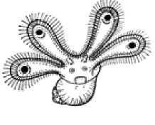
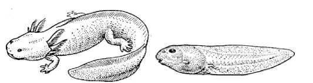
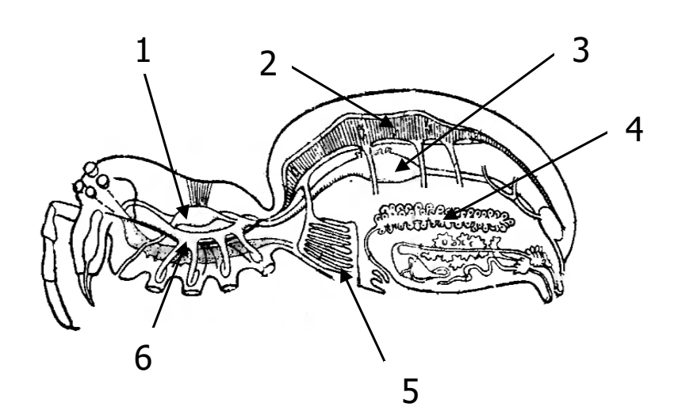

# Олимпиада 8 класса, 2018/2019 — Олимпиада · 2018/2019 · 29 тестов и 3 практических задания (часть 2 из 3)

Олимпиада `g8b` из тренажёра «Олимпиада под микроскопом». Вопросов: 36. Каждый вопрос: условие (с рисунками), ключ и допустимые ответы, эталонный ответ, разбор по шагам 3–8 (алгоритм, объяснение и разбор вариантов, ловушки, как запомнить, схема, олимпиадный горизонт). Схемы в разборах здесь заменены подписями; сами схемы — в PDF-версии.

---

### [g8b-q14] № 14 · Тест 14 · Экологические группы гидробионтов и пищевые цепи моря — кто не питается планктоном

Раздел: Тестовая часть (№ 1–30, номера 22 в бланке нет). Тип: один ответ. ID: `g8b-task-14`. На сайте: `#g8b-q14`.

**Условие.** Какое животное никогда (ни на одной стадии) не питается планктоном?

Варианты:
- а) мидия
- б) копепода
- в) медуза
- г) кальмар

**Ключ:** г) кальмар

**Эталонный ответ (карточка «Правильный ответ» на сайте):**

**г) кальмар** *(в рамках школьного и олимпиадного курса зоологии 8 класса: активный нектонный хищник с прямым развитием без планктонной личинки; ниже также разобран олимпиадный нюанс питания молоди в природе)*.

**Разбор (шаги 3–8):**
#### 3. Алгоритм олимпиадного мышления
- **Маркеры в условии:** уточнение **«никогда (ни на одной стадии) не питается планктоном»** и четыре морских животных: *мидия* (двустворчатый моллюск), *копепода* (веслоногий рачок), *медуза* (стрекающее), *кальмар* (головоногий моллюск).
- **Логическая цепочка:**
  1. **Шаг 1 (Что такое планктон):** **Планктон** (от греч. *planktos* — «блуждающий, парящий») — совокупность мелких организмов (одноклеточных водорослей — фитопланктона, а также простейших, мелких рачков, коловраток и личинок — зоопланктона), обитающих в толще воды и не способных противостоять переносу течениями.
  2. **Шаг 2 (Проверка рациона взрослых особей и личинок):**
    - **а) Мидия:** взрослая мидия — неподвижный донный *фильтратор*, который непрерывно прогоняет воду через мантийную полость и жабры, отцеживая **фито- и зоопланктон** (и органический детрит); кроме того, её планктонная личинка (велигер) питается одноклеточным фитопланктоном.
    - **б) Копепода (веслоногий рачок):** сама является главной частью морского и пресноводного зоопланктона и на всех стадиях (науплиус, копеподит, взрослый рачок) питается **фитопланктоном** и мелким зоопланктоном.
    - **в) Медуза:** пелагический хищник, основу питания которого (как на стадии эфиры, так и у взрослой медузы) составляет **зоопланктон** (копеподы, икра, личинки беспозвоночных и рыб).
    - **г) Кальмар:** представитель класса Головоногие моллюски (*Cephalopoda*). В отличие от двустворчатых и брюхоногих моллюсков, у кальмаров **развитие прямое** (из яйца выходит сформированный маленький кальмар, планктонной личинки трохофоры/велигера нет!), а сами кальмары — быстрые пелагические хищники (**нектон**), охотящиеся с помощью ловчих щупалец и рогового клюва на стайную рыбу и макрофауну.

  3. **Вывод:** В школьной и олимпиадной программе 8 класса правильный ответ — **г) кальмар**.

#### 4. Послойное объяснение и разбор дистракторов
**Суть в двух предложениях:** Мидия (фильтратор), веслоногий рачок копепода и медуза напрямую зависят от планктона как основного источника пищи. Кальмар же относится к нектону — активно плавающим хищникам с прямым развитием (без стадии планктонной личинки), которые охотятся на рыбу и крупных беспозвоночных.

**Подробный биологический механизм и олимпиадная точность:**

- **Школьное упрощение и точная научная норма (Олимпиадный уровень):**
  - **Как пишут в тестах 7–8 класса:** У большинства морских моллюсков (например, у мидии) развитие *непрямое* — из яйца выходит планктонная ресничная личинка (трохофора → велигер), питающаяся микроскопическим фитопланктоном. А у головоногих моллюсков (кальмара, осьминога, каракатицы) яйца крупные, богаты желтком, и развитие **прямое** (без личинки), поэтому сразу формируется хищник с щупальцами и роговыми челюстями («клювом попугая»), относящийся к **нектону** и питающийся рыбой. Именно на этом противопоставлении («мидия с велигером vs кальмар с прямым развитием») построен данный вопрос.
  - **А как на самом деле в морской биологии?** На всероссийской олимпиаде старшеклассников важно знать, что в реальном океане крошечная молодь кальмаров (длиной всего несколько миллиметров, которую океанологи называют *параларвой*) в первые недели жизни после вылупления физически не может поймать крупную рыбу и охотится на мелких планктонных ракообразных (тех же копепод и эвфаузиид — криль)! Однако в тестах с выбором одного ответа из четвёрки «мидия — копепода — медуза — кальмар» однозначно выбирается **г) кальмар** как единственный представитель *нектона* с *прямым развитием*.

**Полный разбор всех остальных вариантов (дистракторов):**

- **а) мидия:** Двустворчатый моллюск (*Mytilus*), биофильтратор бентоса. Реснички на жабрах и ротовых лопастях создают ток воды через вводной сифон, улавливая клетки фитопланктона, простейших и детрит. Одна мидия профильтровывает до 50–70 литров воды в сутки!
- **б) копепода:** Веслоногие ракообразные (отряд *Copepoda* — калянус, циклоп, диаптомус) — самые многочисленные многоклеточные животные в океане, главные первичные консументы морских экосистем, поедающие диатомовые и перидиниевые водоросли фитопланктона.
- **в) медуза:** Свободноплавающая стадия стрекающих (классы Сцифоидные и Гидроидные), захватывающая зоопланктон стрекательными щупальцами и ротовыми лопастями.

#### 5. Типичные ошибки и ловушки
- **Терминологическая ловушка («Копепода»):** Многие восьмиклассники пугаются незнакомого латинского слова **«копепода»** (*Copepoda*) и выбирают его наугад. Запомни: **копеподы — это веслоногие рачки** (знакомый тебе по учебнику пресноводный *циклоп* и морской *калянус*)!
- **Правило-предостережение:** *«Запомни три главные экологические группы водных организмов: ПЛАНКТОН парит в толще воды (копеподы, медузы, личинки велигеры), НЕКТОН активно плывёт против течения (кальмары, рыбы, киты), а БЕНТОС живёт на дне (взрослые мидии, крабы, камбала)!»*

#### 6. Методики запоминания
- **Этимология:**
  - **Копепода (*Copepoda*)** — от греч. *kope* («весло») + *pous, podos* («нога») = «веслоногие» (их грудные ножки при плавании работают синхронно, как вёсла на лодке).
  - **Планктон** — от греч. *planktos* — «блуждающий, носимый течением».
  - **Нектон** — от греч. *nektos* — «плавающий» (активные пловцы: кальмары, рыбы, дельфины).
  - **Бентос** — от греч. *benthos* — «глубина, дно».

#### 8. Олимпиадный горизонт и перенос знаний
- **Крупнейшие фильтраторы планктона среди позвоночных:** Парадоксально, но самые гигантские животные нашей планеты (представители мощного нектона!) питаются исключительно мелким планктоном (крилем, копеподами): это **усатые киты** (синий кит, финвал, гренландский кит), а среди хрящевых рыб — **китовая акула, гигантская акула и скат манта (морской дьявол)**!

---

### [g8b-q15] № 15 · Тест 15 · Зоогеография и охрана природы — какие млекопитающие занесены в Красную книгу Республики Беларусь

Раздел: Тестовая часть (№ 1–30, номера 22 в бланке нет). Тип: один ответ. ID: `g8b-task-15`. На сайте: `#g8b-q15`.

**Условие.** В Красную книгу Республики Беларусь занесены:

Пункты:
- 1) выхухоль
- 2) барсук
- 3) енот
- 4) рыжая вечерница
- 5) нерпа
- 6) красный волк
- 7) лесной кот

Варианты:
- а) 1, 2, 3, 6
- б) 2, 5, 6, 7
- в) 1, 2, 7
- г) 1, 6

**Ключ:** в) 1, 2, 7

**Эталонный ответ (карточка «Правильный ответ» на сайте):**

**в) 1, 2, 7** *(выхухоль, барсук, лесной кот)*.

**Разбор (шаги 3–8):**
#### 3. Алгоритм олимпиадного мышления
- **Маркеры в условии:** географическая привязка **«Красная книга Республики Беларусь»** и список из 7 видов млекопитающих с комбинациями ответов.
- **Логическая цепочка (метод зоогеографического исключения — работает даже без заучивания списков наизусть!):**
  1. **Шаг 1 (Отсекаем виды, которые вообще не могут быть в Красной книге Беларуси):**
    - Посмотрим на 6) красный волк (*Cuon alpinus*): это хищник гор Южной и Центральной Азии (Гималаи, Тянь-Шань, Индостан, заходил на юг Дальнего Востока России). В Беларуси он никогда в истории не обитал! Исключаем все варианты, где есть цифра **6** — мгновенно отпадают **а)**, **б)** и **г)**!
    - Проверим также 5) нерпа (кольчатая или байкальская нерпа — обитатель холодных морей и озера Байкал; в Беларуси нет выхода к морю!) и 3) енот (американский енот-полоскун — чужеродный инвазивный вид, акклиматизированный в СССР; инвазивные виды в Красную книгу не заносят!).

  2. **Шаг 2 (Проверка оставшейся комбинации «в) 1, 2, 7»):**
    - 2) барсук (*Meles meles*) и 7) европейский лесной кот (*Felis silvestris*) — редкие аборигенные хищные млекопитающие лесов Беларуси, официально занесённые в Красную книгу Республики Беларусь.
    - 1) русская выхухоль (*Desmana moschata*) — реликтовое полуводное насекомоядное млекопитающее, исторически обитавшее в пойме Днепра на территории Беларуси (включено в списки охраняемых/исчезнувших с территории страны видов Красной книги РБ).

  3. **Вывод:** Единственно верная комбинация — **в) 1, 2, 7**.

#### 4. Послойное объяснение и разбор дистракторов
**Суть в двух предложениях:** В национальную Красную книгу включаются только редкие, уязвимые или исчезающие виды местной (аборигенной) фауны данной страны. Метод исключения чужеродных для Беларуси видов (азиатского красного волка, морской нерпы и инвазивного американского енота-полоскуна) безошибочно приводит к ответу «в) 1, 2, 7» (выхухоль, барсук, лесной кот).

**Подробный биологический разбор всех 7 животных из списка:**

- **1) Выхухоль (русская выхухоль, или хохуля, *Desmana moschata*):** Реликтовое полуводное млекопитающее из отряда **Насекомоядные (*Eulipotyphla*)**, близкий родственник крота (семейство Кротовые!). Имеет длинный подвижный хоботок, плавательные перепонки между пальцами и уплощённый с боков чешуйчатый хвост с мускусной железой. Исторически встречалась в бассейне Днепра; ключ олимпиады относит её к видам Красной книги РБ.
- **2) Барсук (*Meles meles*):** Крупный представитель семейства **Куньи (*Mustelidae*)** отряда Хищные. Единственный представитель куньих нашей фауны, впадающий в настоящий зимний сон в глубоких многоярусных норах («барсучьих городищах»). По ключу олимпиады — вид Красной книги Республики Беларусь.
- **7) Европейский лесной кот (*Felis silvestris*):** Дикий аборигенный представитель семейства Кошачьи в широколиственных и смешанных лесах Полесья и Беловежской пущи (не путать с одичавшими домашними кошками: у лесного кота толстый тупо обрубленный пушистый хвост с несколькими чёткими чёрными кольцами и чёрным кончиком). По ключу олимпиады — вид Красной книги РБ.
- **3) Енот (енот-полоскун, *Procyon lotor*):** Родина — Северная Америка. В Европу и на территорию бывшего СССР завезён человеком. Будучи чужеродным (инвазивным) видом, разоряющим гнёзда редких птиц, в Красную книгу не заносится.
- **4) Рыжая вечерница (*Nyctalus noctula*):** Крупная перелётная летучая мышь (отряд Рукокрылые). Обычный вид летучих мышей, поэтому в ключе олимпиады к краснокнижным не отнесён.
- **5) Нерпа (род *Pusa*):** Безухий тюлень (кольчатая нерпа в Балтийском и северных морях, каспийская и байкальская нерпы). В сухопутной Беларуси не обитает.
- **6) Красный волк (*Cuon alpinus*):** Редкий горный хищник Южной и Восточной Азии (занесён в Международную Красную книгу МСОП и Красную книгу РФ, но никогда не жил в Европе и Беларуси).

#### 5. Типичные ошибки и ловушки
- **Две главные систематические ловушки на олимпиадах:**
  1. **Выхухоль — НЕ грызун!** Из-за полуводного образа жизни и созвучия со словами «ондатра» и «нутрия» школьники часто записывают выхухоль в отряд Грызуны. На самом деле выхухоль относится к отряду **Насекомоядные** (семейство Кротовые) — у неё нет долотообразных резцов без корней и нет диастемы, а зубы остробугорчатые!
  2. **Списки Красной книги меняются** от издания к изданию, поэтому категории охраны и точный состав списка лучше проверять по действующему изданию Красной книги Республики Беларусь.

- **Правило-предостережение:** *«Запомни: в Красную книгу любой страны заносят только КОРЕННЫХ (аборигенных) редких обитателей этой территории — ни чужеземный красный волк, ни морская нерпа, ни завезённый из Америки енот-полоскун туда попасть не могут!»*

#### 6. Методики запоминания
- **Ассоциативное правило «Три фильтра Красной книги Беларуси»:**
  - Фильтр 1 (География): в Беларуси нет гор Азии (минус *красный волк*) и нет морей (минус *нерпа*).
  - Фильтр 2 (Происхождение): американских переселенцев не охраняют (минус *енот-полоскун*).
  - Остаются коренные лесные и речные редкости: **Выхухоль (1) + Барсук (2) + Лесной кот (7)**!

#### 8. Олимпиадный горизонт и перенос знаний
- **Символы Красной книги Беларуси и России на олимпиадах:** Обязательно помни других знаковых краснокнижных млекопитающих Беларуси, которых регулярно спрашивают на олимпиадах: **европейский зубр** (*Bison bonasus*), **европейская рысь** (*Lynx lynx*), **бурый медведь** (*Ursus arctos*), **обыкновенная летяга** (*Pteromys volans*), **садовая, орешниковая и полчок сони**, **европейская норка** (*Mustela lutreola* — вытесняемая инвазивной американской норкой!) и **обыкновенный хомяк**.

---

### [g8b-q16] № 16 · Тест 16 · Протистология в деталях — чем амёба обыкновенная отличается от инфузории-туфельки

Раздел: Тестовая часть (№ 1–30, номера 22 в бланке нет). Тип: один ответ. ID: `g8b-task-16`. На сайте: `#g8b-q16`.

**Условие.** Амеба обыкновенная отличается от инфузории-туфельки следующими признаками:

Пункты:
- 1) способностью образовывать ложноножки
- 2) отсутствием сократительных вакуолей
- 3) паразитическим образом жизни
- 4) отсутствием полового процесса

Варианты:
- а) только 1
- б) 3, 4
- в) 1, 4
- г) только 2

**Ключ:** в) 1, 4

**Эталонный ответ (карточка «Правильный ответ» на сайте):**

**в) 1, 4.**

**Разбор (шаги 3–8):**
#### 3. Алгоритм олимпиадного мышления
- **Маркеры в условии:** видовое название **«амёба обыкновенная»** (не дизентерийная!), объект сравнения **«инфузория-туфелька»** и 4 признака.
- **Логическая цепочка:**
  1. **Шаг 1 (Проверка признака 1 — ложноножки):** Амёба обыкновенная (*Amoeba proteus*) не имеет плотной клеточной оболочки (пелликулы), поэтому образует временные выросты цитоплазмы — **ложноножки (псевдоподии)** для передвижения и захвата пищи. Инфузория-туфелька покрыта эластичной пелликулой, имеет постоянную форму тела и передвигается с помощью ресничек. Значит, признак **1 верен**! (Сразу остаются только варианты «а» и «в»).
  2. **Шаг 2 (Проверка признака 4 — отсутствие полового процесса):** У инфузории-туфельки есть два ядра (вегетативный макронуклеус и генеративный микронуклеус) и хорошо изученный половой процесс — **конъюгация**. А у амёбы обыкновенной ядро одно и **половой процесс полностью отсутствует** — она размножается исключительно бесполым путём (митотическим делением надвое). Значит, признак **4 тоже верен**!
  3. **Шаг 3 (Контрольная проверка признаков 2 и 3):** И амёба обыкновенная, и инфузория-туфелька — *свободноживущие пресноводные* простейшие, поэтому у обеих **есть сократительные вакуоли** (признак 2 неверен) и обе ведут **свободноживущий**, а не паразитический образ жизни (признак 3 неверен).
  4. **Вывод:** Правильный ответ — **в) 1, 4**.

#### 4. Послойное объяснение и разбор дистракторов
**Суть в двух предложениях:** Амёба обыкновенная и инфузория-туфелька живут в одной и той же пресноводной среде (поэтому обе свободноживущие и обе имеют сократительные вакуоли для откачки избытка воды). Однако амёба отличается от инфузории двумя фундаментальными чертами: она передвигается и захватывает пищу с помощью ложноножек (1) и не имеет полового процесса в жизненном цикле (4).

**Подробный биологический механизм:**

- **Как образуются ложноножки у амёбы (Олимпиадный уровень — цитоскелет):** Цитоплазма амёбы разделена на два слоя: наружный плотный прозрачный гель — *эктоплазму* и внутренний жидкий зернистый золь — *эндоплазму*. В основе образования ложноножки (псевдоподии) лежит обратимая сборка и разборка белковых микрофиламентов **актина** и работа моторного белка **миозина** с затратой АТФ: в месте будущего выступа корковый слой актина локально разжижается, сокращение актомиозиновой сети на заднем конце тела (в *уродии*) выжимает жидкую эндоплазму вперёд, а по бокам новой ложноножки эндоплазма снова переходит в плотный гель эктоплазмы!
- **Почему у обеих есть сократительная вакуоль (Закон осмоса):** Пресная вода пруда — это **гипотонический раствор** (концентрация солей в ней намного ниже, чем в цитоплазме простейшего). По закону осмоса вода непрерывно стремится внутрь клетки через полупроницаемую мембрану. Без **сократительной (пульсирующей) вакуоли**, которая регулярно выкачивает избыток воды наружу, и амёбу, и инфузорию просто разорвало бы внутренним давлением!

**Полный разбор неверных признаков (дистракторов 2 и 3):**

- **2) отсутствие сократительных вакуолей:** *В чём ошибка:* у пресноводной амёбы обыкновенной **есть** одна шаровидная сократительная вакуоль (сокращается раз в 1–5 минут), а у инфузории-туфельки — две сложные сократительные вакуоли с венчиком приводящих канальцев (сокращаются каждые 10–20 секунд). *Когда стал бы верным:* если бы речь шла о **морских** простейших (например, фораминиферах или радиоляриях) или об **эндопаразитических** простейших (например, дизентерийной амёбе или малярийном плазмодии), живущих в изотонической среде!
- **3) паразитический образ жизни:** *В чём ошибка:* *Амёба обыкновенная* (*Amoeba proteus*) — мирный свободноживущий обитатель илистого дна пресных водоёмов, питающийся бактериями и одноклеточными водорослями. *Почему включили:* чтобы поймать тех, кто путает свободноживущую *амёбу обыкновенную* и патогенную *дизентерийную амёбу* (*Entamoeba histolytica*), вызывающую амёбную дизентерию (амёбиаз) в толстом кишечнике человека!

#### 5. Типичные ошибки и ловушки
- **Двойная ловушка («только 1» vs «1, 4»):** Многие на этом вопросе выбирают вариант **«а) только 1»**, потому что про ложноножки амёбы помнят все, а про отсутствие полового процесса у *Amoeba proteus* забывают! Обязательно запомни: у амёбы обыкновенной полового процесса нет (только митоз), а у инфузории-туфельки есть конъюгация с мейозом микронуклеусов!
- **Правило-предостережение:** *«Запомни: у пресноводных простейших есть сократительные вакуоли, а у морских и паразитических их, как правило, нет — концентрация солей в морской воде и в теле хозяина близка к концентрации в цитоплазме (исключения есть: например, у паразитической инфузории балантидия вакуоли сохраняются)»*

#### 6. Методики запоминания
- **Сравнительная таблица двух классических простейших для олимпиад:**

| Признак сравнения | Амёба обыкновенная (*Amoeba proteus*) | Инфузория-туфелька (*Paramecium caudatum*) |
|---|---|---|
| **Покровы и форма тела** | Только плазмалемма; форма тела **непостоянная** | Плотная эластичная **пелликула** с альвеолами; форма постоянная |
| **Органоиды движения** | Временные **ложноножки (псевдоподии)** | Многочисленные постоянные **реснички** (около 10–15 тыс.) |
| **Захват пищи и удаление остатков** | Любым участком тела; выбрасывание остатков в любом месте | Клеточная воронка → клеточный рот (цитостом) → глотка; удаление через **порошицу** |
| **Сократительные вакуоли** | **Есть** (1 простая шаровидная вакуоль) | **Есть** (2 сложные вакуоли с приводящими канальцами) |
| **Ядерный аппарат** | **Одно ядро** (одноядерная) | **Два ядра (ядерный дуализм):** макронуклеус + микронуклеус |
| **Половой процесс** | **Отсутствует** (только бесполое деление надвое) | **Есть — конъюгация** (обмен гаплоидными ядрами) |

#### 8. Олимпиадный горизонт и перенос знаний
- **Что будет, если пересадить пресноводную амёбу в разбавленную или солёную воду:** На практическом туре ВсОШ часто дают задачу с графиком частоты пульсации сократительной вакуоли. Если добавить в воду немного соли (повысить осмотическую концентрацию среды), поток воды внутрь клетки ослабеет и **частота сокращений вакуоли уменьшится**, а в дистиллированной воде — наоборот, **возрастёт**!

---

### [g8b-q17] № 17 · Тест 17 · Зоология планктонных личинок — как узнать «парусник» (велигер) морского моллюска

Раздел: Тестовая часть (№ 1–30, номера 22 в бланке нет). Тип: один ответ. ID: `g8b-task-17`. На сайте: `#g8b-q17`.

**Условие.** На рисунке изображена:

(файл: `assets/img/g8b-t17-veliger.jpg`, ссылка: https://raw.githubusercontent.com/metalinjector/biology-tests/claude/intelligent-heisenberg-9woyvy/assets/img/g8b-t17-veliger.jpg)
*Оригинальный рисунок из задания 17 (личинка велигер с четырёхлопастным ресничным парусом и раковинкой).*

Варианты:
- а) нимфа клеща
- б) личинка моллюска
- в) имаго паразитического насекомого
- г) личинка ракообразного

**Ключ:** б) личинка моллюска

**Эталонный ответ (карточка «Правильный ответ» на сайте):**

**б) личинка моллюска** *(планктонная личинка велигер, или «парусник», брюхоногого моллюска)*.

**Разбор (шаги 3–8):**
#### 3. Алгоритм олимпиадного мышления
- **Маркеры на рисунке:** Обрати внимание на три яркие детали рисунка:
  1. Сверху раскинулись четыре крупные симметричные лопасти («крылья бабочки»), сплошь окаймлённые густой бахромой **ресничек**;
  2. В центре между лопастями видны два маленьких щупальца, два глазка и ротовое отверстие;
  3. А в самой нижней части тела (слева внизу) видна маленькая **спирально закрученная раковинка**!

- **Логическая цепочка:**
  1. **Шаг 1 (Отсев членистоногих — пунктов «а», «в», «г»):** У всех членистоногих (клещей, насекомых и ракообразных) тело покрыто плотной хитиновой кутикулой, имеются *членистые конечности*, и у них **в принципе никогда не бывает наружных локомоторных ресничек**! Обилие ресничек по краю лопастей мгновенно исключает клеща (а), насекомое (в) и ракообразное (г)!
  2. **Шаг 2 (Идентификация по спиральной раковине и парусу):** Спиральная известковая раковинка внизу и четырёхлопастный ресничный парус (*велум*) сверху — это визитная карточка планктонной личинки морских брюхоногих (и двустворчатых) моллюсков, которая называется **велигер (парусник)**!
  3. **Вывод:** На рисунке изображена **б) личинка моллюска**.

#### 4. Послойное объяснение и разбор дистракторов
**Суть в двух предложениях:** На иллюстрации изображён велигер (парусник) — свободноплавающая планктонная личинка морских моллюсков. Своё название она получила благодаря мощному лопастному выросту головы — парусу (велуму), усаженному длинными ресничками, с помощью которых личинка парит в толще воды и загоняет в рот микроскопические водоросли.

**Подробный биологический механизм (Олимпиадный уровень — старшие классы):**

- **Стадии развития морских моллюсков (Трохофора → Велигер → Взрослый моллюск):** У большинства морских брюхоногих (*Gastropoda*) и двустворчатых (*Bivalvia*) моллюсков развитие непрямое (с метаморфозом) и включает две последовательные планктонные личиночные стадии:
  1. **Трохофора:** ранняя микроскопическая личинка волчковидной формы с пояском ресничек (*прототрохом*) перед ртом и пучком ресничек на теменной пластинке (такая же личинка есть у морских кольчатых червей — полихет, что доказывает близкое эволюционное родство Моллюсков и Кольчатых червей в группе *Trochozoa*!).
  2. **Велигер (парусник):** развивается из трохофоры. Предротовой ресничный поясок сильно разрастается в две или четыре крупные плоские лопасти — **велум (парус)**, на спинной стороне раковинная железа выделяет зачаточную раковинку, а на брюшной стороне формируется зачаток мускулистой **ноги** и крышечки (оперкулума). Когда велигер готов к оседанию на дно, парус (велум) редуцируется (рассасывается), и молодой моллюск переходит к донному образу жизни!

**Полный разбор всех неверных вариантов (дистракторов):**

- **а) нимфа клеща:** *В чём ошибка:* нимфа клеща похожа на взрослого клеща и имеет 4 пары членистых ходильных ног (а личинка клеща — 3 пары членистых ног) и хелицеры с педипальпами; никаких ресничных лопастей и спиральной раковины у неё нет.
- **в) имаго паразитического насекомого:** *В чём ошибка:* у насекомых 3 отдела тела (голова, грудь, брюшко) и 3 пары членистых ног. *Почему включили:* четыре длинные лопасти паруса с «глазками» на концах внешне напоминают расправленные крылья причудливой бабочки или мухи.
- **г) личинка ракообразного:** *В чём ошибка:* ранняя планктонная личинка ракообразных называется **науплиус** — она имеет овальное несегментированное тело с одним непарным лобным («науплиальным») глазком и **тремя парами членистых придатков** (антеннулы, антенны и мандибулы), усаженных хитиновыми щетинками (а не ресничками!).

#### 5. Типичные ошибки и ловушки
- **Золотое правило для любых олимпиад по зоологии («У Членистоногих и Круглых червей НЕТ ресничек!»):** У всех представителей надтипа Линяющие (*Ecdysozoa*), куда входят **Членистоногие** (ракообразные, паукообразные, насекомые, многоножки) и **Круглые черви (Нематоды)**, нет двигательных ресничек на поверхности тела (у нематод и многих ракообразных даже сперматозоиды без жгутиков, хотя у насекомых сперматозоиды со жгутиком). Если на рисунке видны реснички на поверхности тела — это на 100% НЕ членистоногое (а моллюск, кольчатый червь, плоский червь, иглокожее или инфузория)!
- **Исключения у пресноводных и сухопутных моллюсков:**
  - У **головоногих моллюсков** (кальмар, осьминог), а также у **легочных брюхоногих** (виноградная улитка, слизень, прудовик, катушка) развитие **прямое** — без стадий трохофоры и велигера!
  - А у пресноводных двустворчатых моллюсков — **беззубки и перловицы** — вместо свободного велигера развивается специализированная паразитическая личинка **глохидий** с зубчиками на створках раковины и клейкой биссусной нитью, которая временно паразитирует на жабрах и коже рыб, расселяясь вверх по течению рек!

- **Правило-предостережение:** *«Запомни: увидел ресничный парус и маленькую улитковую раковинку снизу — перед тобой ВЕЛИГЕР (парусник), морская личинка моллюска!»*

#### 6. Методики запоминания
- **Этимология:** **Велигер** (лат. *veliger*) — от лат. *velum* («парус, завеса») + *gero* («несу») = «несущий парус, парусник».
- **Шпаргалка «Кто чья личинка» на олимпиадах:**
  - **Трохофора** — морские кольчатые черви (полихеты) и морские моллюски (1-я стадия);
  - **Велигер (парусник)** — морские брюхоногие и двустворчатые моллюски (2-я стадия);
  - **Глохидий** — пресноводные двустворчатые моллюски (перловица, беззубка);
  - **Науплиус и зоеа** — ракообразные;
  - **Мирацидий, церкария** — сосальщики (трематоды);
  - **Онкосфера, финна** — ленточные черви (цестоды);
  - **Плутеус, бипиннария, аурикулярия** — иглокожие.

#### 8. Олимпиадный горизонт и перенос знаний
- **Зачем сидячим и малоподвижным донным животным планктонная личинка:** Взрослая мидия прикреплена к скале биссусом, а взрослая морская улитка ползёт со скоростью несколько сантиметров в минуту. Свободноплавающая планктонная личинка **велигер**, подхватываемая морскими течениями, выполняет функцию **расселения вида** на десятки и сотни километров и снижает конкуренцию за пищу между родителями (на дне) и потомством (в поверхностном слое воды)!

---

### [g8b-q18] № 18 · Тест 18 · Два разных головастика одного класса — почему личинки хвостатых и бесхвостых амфибий так непохожи

Раздел: Тестовая часть (№ 1–30, номера 22 в бланке нет). Тип: один ответ. ID: `g8b-task-18`. На сайте: `#g8b-q18`.

**Условие.** К каким классам принадлежат животные, личинки которых изображены на рисунке.

(файл: `assets/img/g8b-t18-lichinki.jpg`, ссылка: https://raw.githubusercontent.com/metalinjector/biology-tests/claude/intelligent-heisenberg-9woyvy/assets/img/g8b-t18-lichinki.jpg)
*Оригинальный рисунок из задания 18 (слева — личинка хвостатого земноводного, справа — головастик бесхвостого земноводного).*

Варианты:
- а) амфибии и амфибии
- б) костные и хрящевые рыбы
- в) амфибии и костные рыбы
- г) амфибии и головохордовые

**Ключ:** а) амфибии и амфибии

**Эталонный ответ (карточка «Правильный ответ» на сайте):**

**а) амфибии и амфибии.**

**Разбор (шаги 3–8):**
#### 3. Алгоритм олимпиадного мышления
- **Маркеры на рисунке:**
  - **Левая личинка:** вытянутое тело с длинным хвостом, окаймлённым кожной плавниковой складкой, три пары пушистых *наружных перистых жабр* по бокам головы и **две пары пятипалых конечностей с пальцами** (передние и задние лапки!).
  - **Правая личинка:** крупная каплевидная головогрудь без наружных жабр (жабры спрятаны под кожной жаберной крышкой — оперкулярной складкой), длинный хвост и прорезающиеся **задние лапки с пальцами** у основания хвоста (классический головастик лягушки!).

- **Логическая цепочка:**
  1. **Шаг 1 (Пятипалые конечности = Четвероногие, а не Рыбы!):** И у левой личинки, и у правой личинки отчётливо видны **парные конечности наземного типа с пальцами** (у левой — и передние, и задние лапки; у правой у основания брюшка — маленькая задняя лапка с пальчиками!). Ни у костных рыб, ни у хрящевых рыб, ни у головохордовых (ланцетника) лапок с пальцами не бывает никогда!
  2. **Шаг 2 (Определение отрядов внутри одного класса):** Левая личинка — это личинка **тритона или саламандры** (отряд Хвостатые земноводные, *Caudata / Urodela*), а правая — головастик **лягушки или жабы** (отряд Бесхвостые земноводные, *Anura / Ecaudata*). Оба отряда входят в один и тот же класс — **Земноводные, или Амфибии (*Amphibia*)**!
  3. **Вывод:** Правильный ответ — **а) амфибии и амфибии**.

#### 4. Послойное объяснение и разбор дистракторов
**Суть в двух предложениях:** На рисунке изображены личинки двух разных отрядов одного и того же класса Земноводные (Амфибии): слева — личинка хвостатой амфибии (тритона или амбистомы), справа — головастик бесхвостой амфибии (лягушки). Психологическая ловушка задания состоит в том, что ученик подсознательно ищет два *разных* класса животных и боится выбрать ответ «амфибии и амфибии».

**Подробный биологический механизм (Олимпиадный уровень — старшие классы):**

- **Четыре фундаментальных отличия личинок Хвостатых (слева) и Бесхвостых (справа) амфибий:**
  1. **Порядок появления конечностей (любимый вопрос ВсОШ!):** У личинок **хвостатых амфибий** (тритонов, саламандр) сначала появляются **передние конечности**, а чуть позже — задние (обе пары растут открыто снаружи). У головастиков **бесхвостых амфибий** (лягушек, жаб) передние и задние конечности закладываются одновременно, но передние лапки долго скрыты внутри под кожной жаберной крышкой (в оперкулярной полости), поэтому снаружи сначала становятся видны **задние конечности**, а передние прорываются наружу лишь перед самым выходом на сушу!
  2. **Строение жабр:** У личинки тритона всю водную жизнь сохраняются крупные ветвистые **наружные жабры** (3 пары). У головастика лягушки наружные жабры есть только в первые дни после вылупления, а затем они зарастают кожной складкой и сменяются **внутренними жабрами** в жаберных щелях глотки.
  3. **Тип питания и строение рта и кишечника:** Личинка тритона (слева) с первых дней жизни — **активный хищник** с широким ртом, настоящими зубами и коротким кишечником (охотится на дафний, циклопов, червей). Головастик лягушки (справа) — преимущественно **растительноядный фильтратор и соскабливатель** с узким ртом, роговыми челюстями-клювиком (для соскабливания водорослевого налёта — перифитона) и очень длинным спирально свёрнутым кишечником!
  4. **Судьба хвоста при метаморфозе:** У тритона хвост сохраняется на всю жизнь, а у головастика лягушки под действием гормона щитовидной железы — **тироксина** — клетки хвоста подвергаются программируемой гибели (апоптозу) и рассасываются с участием ферментов **лизосом**!

**Полный разбор всех неверных вариантов (дистракторов):**

- **б) костные и хрящевые рыбы / в) амфибии и костные рыбы / г) амфибии и головохордовые:** *В чём ошибка:* у личинок (мальков) рыб есть парные грудные и брюшные *плавники* с костными или роговыми лучами (лепидотрихиями), но нет пятипалых рычажных конечностей с пальцами, а у головохордовых (ланцетника) нет ни парных плавников, ни обособленной головы с глазами. *Почему включили:* из-за рыбообразной формы тела правого головастика многие принимают его за малька костной рыбы!

#### 5. Типичные ошибки и ловушки
- **Психологическая ловушка тестологии:** Когда вопрос сформулирован во множественном числе («К каким классам принадлежат животные...»), мозг ученика автоматически отбрасывает вариант с двумя одинаковыми словами («амфибии и амфибии»), считая его «опечаткой». На олимпиадах это классический приём проверки уверенности в своих знаниях!
- **Неотения у хвостатых амфибий (Олимпиадный хит!):** Знаменитый **аксолотль** — это не самостоятельный вид, а **неотеническая личинка** мексиканской хвостатой амфибии **амбистомы** (*Ambystoma mexicanum*), которая выглядит точно как левый рисунок в нашем задании! Из-за наследственного дефицита тиреотропного гормона гипофиза и тироксина щитовидной железы аксолотль достигает половой зрелости и размножается прямо на водной личиночной стадии с наружными жабрами, не превращаясь во взрослую сухопутную амбистому!
- **Правило-предостережение:** *«Запомни: у личинки тритона сначала видны передние лапки и пушистые наружные жабры (она хищник), а у головастика лягушки сначала видны задние лапки и длинный хвост (он вегетарианец)!»*

#### 6. Методики запоминания
- **Сравнительная мини-таблица двух типов личинок амфибий:**

| Признак | Личинка Хвостатых (тритон, амбистома) — слева | Головастик Бесхвостых (лягушка, жаба) — справа |
|---|---|---|
| **Наружные жабры** | Крупные перистые (3 пары), сохраняются до конца метаморфоза | Только в первые дни, затем скрыты под жаберной крышкой (внутренние жабры) |
| **Появление ног снаружи** | Сначала **передние**, затем задние | Сначала **задние**, а передние прорываются позже из-под жаберной крышки |
| **Питание и рот** | **Хищник** (широкий рот с зубами, короткий кишечник) | **Растительноядный / детритофаг** (роговой клювик, длинный спиральный кишечник) |

#### 8. Олимпиадный горизонт и перенос знаний
- **У каких рыб тоже бывают наружные личиночные жабры:** Чтобы тебя не поймали на всероссийском этапе, помни редкое исключение: наружные перистые жабры, очень похожие на жабры личинок тритонов, развиваются у мальков **двоякодышащих рыб** (протоптера, лепидосирена) и древних лучепёрых рыб **многопёров (*Polypterus*)**, но у них вместо пятипалых лапок всегда находятся *парные плавники*!

---

### [g8b-q19] № 19 · Тест 19 · Метаморфозы пластид — почему в темноте из протопластид вырастают этиопласты

Раздел: Тестовая часть (№ 1–30, номера 22 в бланке нет). Тип: один ответ. ID: `g8b-task-19`. На сайте: `#g8b-q19`.

**Условие.** Этиопласты - это:

Варианты:
- а) пластиды, развивающиеся из протопластид в темноте
- б) пластиды, накапливающие крахмал
- в) пластиды, имеющие оранжевую или красную окраску
- г) пластиды, развивающиеся при обработке этиленом

**Ключ:** а) пластиды, развивающиеся из протопластид в темноте

**Эталонный ответ (карточка «Правильный ответ» на сайте):**

**а) пластиды, развивающиеся из протопластид в темноте.**

**Разбор (шаги 3–8):**
#### 3. Алгоритм олимпиадного мышления
- **Маркеры в условии:** термин **«этиопласты»** и четыре определения пластид.
- **Логическая цепочка:**
  1. **Шаг 1 (Метод исключения известных со школы пластид):**
    - Пластиды, накапливающие крахмал (б), — это бесцветные *лейкопласты* (точнее, **амилопласты**).
    - Пластиды, имеющие оранжевую или красную окраску (в), — это **хромопласты**.

  2. **Шаг 2 (Различаем «этиопласты» и ловушку со словом «этилен»):** Слово «этиопласт» происходит не от газа этилена (г), а от ботанического термина **этиоляция** (от фр. *étioler* — «делать бледным, чахлым») — так называют выращивание растений в полной темноте, когда побеги вытягиваются и остаются бледно-жёлтыми или белыми!
  3. **Вывод:** Этиопласты — это **а) пластиды, развивающиеся из протопластид в темноте**.

#### 4. Послойное объяснение и разбор дистракторов
**Суть в двух предложениях:** Если семя прорастает в полной темноте (например, глубоко под землёй или в тёмном шкафу), из зародышевых пропластид вместо зелёных хлоропластов формируются бледно-жёлтые этиопласты. Как только проросток выходит на солнечный свет, в этиопластах запускается синтез хлорофилла, и они за несколько часов превращаются в настоящие фотосинтезирующие хлоропласты.

**Подробный биологический механизм (Олимпиадный уровень — старшие классы):**

- **Почему у покрытосеменных растений хлорофилл не образуется в темноте:** В биосинтезе хлорофилла у цветковых растений предпоследняя стадия — превращение бесцветного предшественника *протохлорофиллида* в зелёный *хлорофиллид* — катализируется светозависимым ферментом (протохлорофиллид-оксидоредуктазой), которому для реакции необходим **квант света (фотон)**!
- **Как устроен этиопласт внутри:** Поскольку без хлорофилла плоские мембранные мешочки — тилакоиды гран — собраться не могут, внутренняя мембрана этиопласта образует удивительную геометрически правильную кристаллическую решётку из переплетённых трубочек — **проламеллярное тело**. Это «полуфабрикат» фотосинтетического аппарата на низком старте: стоит лучу света упасть на пробившийся из-под земли росток, как протохлорофиллид мгновенно превращается в хлорофилл, а трубочки проламеллярного тела разворачиваются в стопки тилакоидов (граны) полноценного **хлоропласта**!

**Полный разбор всех неверных вариантов (дистракторов):**

- **б) пластиды, накапливающие крахмал:** *В чём ошибка:* это бесцветные запасающие пластиды — **лейкопласты (амилопласты)**, развивающиеся в неосвещаемых запасающих органах (клубнях картофеля, эндосперме зерновок, корнях). В отличие от этиопластов, в типичных лейкопластах нет проламеллярного тела (хотя на свету, например при позеленении клубня картофеля, лейкопласты тоже способны превращаться в хлоропласты!).
- **в) пластиды, имеющие оранжевую или красную окраску:** *В чём ошибка:* это **хромопласты**, содержащие кристаллы или липидные капли каротиноидов (в зрелых плодах, лепестках, корнеплоде моркови и осенних листьях).
- **г) пластиды, развивающиеся при обработке этиленом:** *В чём ошибка:* вымышленное определение, основанное на звуковом сходстве слов «этиопласт» и «этилен». При этом сам фитогормон **этилен** (C₂H₄ — «гормон созревания плодов и листопада») стимулирует разрушение хлорофилла и превращение хлоропластов в **хромопласты** (например, когда зелёные бананы или томаты краснеют и желтеют в присутствии этилена) или в стареющие пластиды — **геронтопласты**!

#### 5. Типичные ошибки и ловушки
- **Фонетическая ловушка («Этиопласт ↔ Этилен»):** Составители олимпиад обожают подбирать дистракторы по созвучию первых букв (этиопласт — этилен, гликолиз — гликокаликс, микориза — микоплазма). Всегда разбирай корень слова по смыслу: **этиоляция** — обесцвечивание побегов в темноте → **этиопласт** — темновая пластида!
- **Удивительное исключение у Голосеменных и Папоротников (Супер-факт для ВсОШ!):** У **Покрытосеменных (Цветковых)** растений проростки в темноте всегда бледно-жёлтые (с этиопластами). А вот проростки **хвойных Голосеменных (ели, сосны, пихты)**, а также мхов, папоротников и водорослей **зеленеют даже в абсолютной темноте**, потому что у них сохранился древний светонезависимый (темновой) фермент синтеза хлорофилла!
- **Правило-предостережение:** *«Запомни: этиопласт — это хлоропласт в режиме ожидания света, а не пластида от газа этилена! Хромопласты и геронтопласты — обычно конечный этап развития пластид; обратное позеленение встречается редко (например, у перезревших плодов некоторых цитрусовых)»*

#### 6. Методики запоминания
- **Этимология семейства пластид (от греч. *plastos* — «вылепленный, оформленный»):**
  - **Пропластида (протопластида)** (*protos* — «первый»): мелкая недифференцированная юная пластида меристемы;
  - **Этиопласт** (фр. *étioler* — «бледнеть в темноте»): темновая пластида с проламеллярным телом;
  - **Хлоропласт** (*chloros* — «зелёный»): фотосинтезирующая пластида с хлорофиллом;
  - **Лейкопласт** (*leukos* — «белый, бесцветный»): запасающая пластида (разновидности: *амилопласт* — крахмал, *элайопласт/олеопласт* — жиры, *протеинопласт* — белки);
  - **Хромопласт** (*chroma* — «цвет, краска»): жёлто-оранжево-красная пластида с каротиноидами;
  - **Геронтопласт** (*geron, gerontos* — «старик»): разрушающийся хлоропласт осеннего листа.

#### 7. Визуализация
*Рис. к заданию 19. Пути развития пластид из протопластиды: в темноте формируется этиопласт, который при освещении быстро зеленеет и превращается в хлоропласт.*
[Схема: без подписи]

#### 8. Олимпиадный горизонт и перенос знаний
- **Почему в амилопластах кончика корня растения определяют направление силы тяжести (Геотропизм / Гравитропизм):** Тяжёлые крахмальные зёрна внутри амилопластов в клетках корневого чехлика (*статоцитах*) работают как грузики — **статолиты**: под действием силы тяжести они оседают на нижнюю сторону клетки и перераспределяют поток гормона ауксина так, чтобы корень всегда изгибался и рос строго вниз, к центру Земли!

---

### [g8b-q20] № 20 · Тест 20 · Архитектура клеточной стенки растений — железобетон из целлюлозы, гемицеллюлозы, пектинов и белков

Раздел: Тестовая часть (№ 1–30, номера 22 в бланке нет). Тип: один ответ. ID: `g8b-task-20`. На сайте: `#g8b-q20`.

**Условие.** В состав клеточной стенки высших растений входит:

Варианты:
- а) только целлюлоза
- б) только целлюлоза и пектины
- в) целлюлоза и хитин
- г) целлюлоза, гемицеллюлоза, пектин, белки

**Ключ:** г) целлюлоза, гемицеллюлоза, пектин, белки

**Эталонный ответ (карточка «Правильный ответ» на сайте):**

**г) целлюлоза, гемицеллюлоза, пектин, белки.**

**Разбор (шаги 3–8):**
#### 3. Алгоритм олимпиадного мышления
- **Маркеры в условии:** слова-абсолюты **«только»** в пунктах «а» и «б», грибной/членистоногий полисахарид **«хитин»** в пункте «в» и полный биохимический перечень в пункте «г».
- **Логическая цепочка:**
  1. **Шаг 1 (Отсев слов-ограничителей «только» и чужеродного хитина):** В биологических тестах слово *«только»* почти всегда выдаёт неполное, чрезмерно упрощённое утверждение (отсекаем «а» и «б»). В пункте «в» указан *хитин* — азотсодержащий полисахарид клеточных стенок **грибов** и кутикулы **членистоногих**, которого у высших растений нет!
  2. **Шаг 2 (Проверка композитного состава клеточной стенки растений):** Первичная клеточная стенка высших растений — это сложный природный композит, включающий арматуру из **целлюлозы**, сшивающие нити **гемицеллюлозы**, гелеобразный матрикс из **пектина** и структурно-регуляторные **белки**.
  3. **Вывод:** Правильный ответ — **г) целлюлоза, гемицеллюлоза, пектин, белки**.

#### 4. Послойное объяснение и разбор дистракторов
**Суть в двух предложениях:** Клеточная стенка высших растений состоит не из одной лишь целлюлозы, а устроена как высокотехнологичный композитный материал (подобно железобетону или стекловолокну). Пучки молекул целлюлозы образуют прочные тросы-микрофибриллы, гемицеллюлозы связывают их поперечными сшивками, пектины формируют упругий водоудерживающий гель и склеивают соседние клетки между собой, а структурные и ферментативные белки управляют ростом и прочностью стенки.

**Подробный биологический механизм (Олимпиадный уровень — старшие классы):**

- **В школьном учебнике пишут так:** «Клеточная стенка растений состоит из целлюлозы (клетчатки)».
- **На олимпиаде важно знать реальный четырёхкомпонентный состав первичной клеточной стенки:**
  1. **Целлюлоза (≈ 25–30% сухой массы первичной стенки):** неразветвлённый гомополимер β-D-глюкозы, соединённой β(1→ 4)-гликозидными связями. Десятки параллельных цепей целлюлозы сшиты водородными связями в сверхпрочные кабельные пучки — **микрофибриллы**, синтезируемые ферментными комплексами («розеточными комплексами» целлюлозосинтазы) прямо в плазматической мембране!
  2. **Гемицеллюлозы (≈ 20–30%):** разветвлённые гетерополисахариды (ксилоглюканы, ксиланы, глюкоманнаны), которые синтезируются в аппарате Гольджи и работают как гибкие «верёвочки-стяжки», обвязывающие соседние микрофибриллы целлюлозы в единую пространственную сеть.
  3. **Пектины (пектиновые вещества, ≈ 30–35%):** кислые разветвлённые полисахариды, богатые галактуроновой кислотой. Они образуют гидрофильный гель (матрикс), определяющий пористость стенки, а также формируют **срединную пластинку**, склеивающую соседние клетки друг с другом за счёт кальциевых мостиков (Ca²⁺)! (Именно пектины яблок и айвы позволяют варить мармелад и желе!).
  4. **Белки клеточной стенки (≈ 5–10%!):** структурные гликопротеины **экстенсины** (укрепляющие каркас стенки после завершения роста клетки) и уникальные белки **экспансины**, которые при подкислении клеточной стенки (под действием гормона роста *ауксина*!) временно расцепляют водородные связи между целлюлозой и гемицеллюлозой, позволяя клетке растягиваться под давлением тургора!

**Полный разбор всех неверных вариантов (дистракторов):**

- **а) только целлюлоза / б) только целлюлоза и пектины:** *В чём ошибка:* слова «только» искусственно исключают гемицеллюлозу и белки, без которых клеточная стенка не смогла бы ни расти растяжением, ни держать форму.
- **в) целлюлоза и хитин:** *В чём ошибка:* у высших растений хитина нет. *Когда стал бы верным:* у настоящих **Грибов** клеточная стенка содержит **хитин** (и β-глюканы), у грибоподобных **Оомицетов** (например, фитофторы) — **целлюлозу**, а вот сочетание целлюлозы и хитина одновременно встречается лишь у единичных групп низших организмов (например, у некоторых хитридиомицетов и зелёных водорослей рода *Cladophora*).

#### 5. Типичные ошибки и ловушки
- **Когнитивная ловушка («В клеточной стенке нет белков»):** Школьники привыкли считать, что белки есть только в мембране и цитоплазме, а клеточная стенка — это «чистые углеводы». На самом деле в растущей первичной клеточной стенке растений до 10% сухой массы составляют белки (экстенсины, экспансины, пероксидазы, пектиназы)!
- **Что добавляется во вторичную клеточную стенку при взрослении тканей:**
  - В сосудах ксилемы и склеренхиме (древесине) стенка пропитывается гидрофобным фенольным полимером **лигнином** (*одревеснение*);
  - В клетках пробки (феллемы), а позже и в стенках клеток эндодермы корня откладывается жироподобное вещество **суберин** (*опробковение*). Сами **пояски Каспари**, по современным данным, пропитаны в основном лигнином (в школьных учебниках их часто называют опробковевшими — на олимпиаде полезно знать оба варианта);
  - На внешней стенке эпидермы листьев и стеблей откладываются **кутин и воски** (*кутинизация*, образование кутикулы).

- **Правило-предостережение:** *«Запомни: увидев в олимпиадном тесте слово "ТОЛЬКО", включи режим максимальной подозрительности — в живой клетке почти не бывает структур из одного-единственного вещества!»*

#### 6. Методики запоминания
- **Инженерная аналогия «Железобетонный дом клеточной стенки»:**
  - **Целлюлоза** — стальные арматурные прутья (принимают нагрузку на разрыв);
  - **Гемицеллюлоза** — проволока, связывающая арматуру в каркас;
  - **Пектин** — цементный раствор (бетон) и клей между кирпичами (срединная пластинка);
  - **Белки (экспансины и экстенсины)** — рабочие-монтажники, которые умеют временно ослаблять проволоку, чтобы раздвинуть стены растущей комнаты, а затем намертво закрепляют конструкцию!

#### 8. Олимпиадный горизонт и перенос знаний
- **Из чего построены клеточные стенки всех царств живой природы (Обязательная таблица для ВсОШ!):**
  - **Высшие растения и многие водоросли:** целлюлоза + гемицеллюлоза + пектины + белки (во вторичной стенке — лигнин/суберин).
  - **Настоящие грибы:** хитин + β-глюканы + маннопротеины.
  - **Бактерии (Эубактерии):** пептидогликан — **муреин** (цепи N-ацетилглюкозамина и N-ацетилмурамовой кислоты, сшитые короткими пептидами).
  - **Археи:** псевдомуреин или белковые S-слои (настоящего муреина нет!).
  - **Животные:** клеточной стенки **НЕТ** (над плазмалеммой расположен гликокаликс).

---

### [g8b-q21] № 21 · Тест 21 · Внутриклеточное пищеварение — как кислые гидролазы лизосом расщепляют биополимеры до мономеров

Раздел: Тестовая часть (№ 1–30, номера 22 в бланке нет). Тип: один ответ. ID: `g8b-task-21`. На сайте: `#g8b-q21`.

**Условие.** Лизосомы служат для:

Варианты:
- а) расщепления полимеров до мономеров
- б) клеточной подвижности
- в) синтеза полисахаридов
- г) образования АТФ

**Ключ:** а) расщепления полимеров до мономеров

**Эталонный ответ (карточка «Правильный ответ» на сайте):**

**а) расщепления полимеров до мономеров.**

**Разбор (шаги 3–8):**
#### 3. Алгоритм олимпиадного мышления
- **Маркеры в условии:** органоид **«лизосомы»** и четыре базовые клеточные функции.
- **Логическая цепочка:**
  1. **Шаг 1 (Перевод названия органоида):** Слово «лизосома» образовано от греч. *lysis* — «растворение, расщепление» и *soma* — «тело». Значит, функция лизосомы напрямую связана с **расщеплением (гидролизом)** сложных веществ, а не с синтезом или движением!
  2. **Шаг 2 (Отсев остальных вариантов по органоидам):**
    - Клеточная подвижность (б) обеспечивается *цитоскелетом* (микрофиламентами актина, микротрубочками тубулина, жгутиками и ресничками).
    - Синтез полисахаридов (в) происходит в *аппарате Гольджи* (пектины, гемицеллюлозы), на плазмалемме (целлюлоза), в гладкой ЭПС и гиалоплазме (гликоген) и в строме хлоропластов (крахмал).
    - Образование АТФ (г) за счёт окислительного и фотофосфорилирования происходит в *митохондриях* и *хлоропластах* (а при гликолизе — в гиалоплазме).

  3. **Вывод:** Лизосомы служат для **а) расщепления полимеров до мономеров**.

#### 4. Послойное объяснение и разбор дистракторов
**Суть в двух предложениях:** Лизосомы — это одномембранные пищеварительные пузырьки эукариотической клетки, заполненные десятками пищеварительных ферментов (кислых гидролаз). Они расщепляют крупные молекулы биополимеров (белков, нуклеиновых кислот, полисахаридов) до мелких мономеров (аминокислот, нуклеотидов, моносахаридов), которые затем выходят в цитоплазму и используются клеткой как строительный материал или топливо.

**Подробный биологический механизм (Олимпиадный уровень — старшие классы):**

- **Как клетка защищает сама себя от переваривания собственными лизосомами?** Внутри лизосомы находится около 40–50 видов разрушительных ферментов — **кислых гидролаз** (протеазы расщепляют белки, нуклеазы — ДНК и РНК, гликозидазы — полисахариды, липазы — жиры). Почему же, если одна лизосома случайно лопнет, клетка не переварит саму себя? Потому что в мембрану лизосомы встроены специальные **протонные насосы (H⁺-АТФазы)**, которые за счёт энергии АТФ закачивают ионы водорода (H⁺) внутрь лизосомы, создавая там кислую среду с pH ≈ 4,5–5,0 (в желудке среда ещё кислее — pH 1,5–3,5). Ферменты лизосом активны *только в кислой среде*, а в цитозоле клетки среда близка к нейтральной (pH ≈ 7,2), где эти ферменты мгновенно теряют активность!
- **Откуда берутся лизосомы и какие виды пищеварения они ведут:** Ферменты лизосом синтезируются на рибосомах шероховатой ЭПС, затем поступают в **аппарат Гольджи**, где получают специальную «адресную метку» (маннозо-6-фосфат) и упаковываются в первичные лизосомы. Сливаясь с фагосомой (пузырьком с захваченной пищей или бактерией), первичная лизосома образует **вторичную лизосому (пищеварительную вакуоль)** — это *гетерофагия*. А если лизосома переваривает старую изношенную митохондрию собственной клетки — это **аутофагия** («самопоедание» и обновление клетки, за открытие механизмов которого Ёсинори Осуми получил Нобелевскую премию в 2016 году!).

**Полный разбор всех неверных вариантов (дистракторов):**

- **б) клеточной подвижности:** Функция микрофиламентов (актин + миозин) и микротрубочек (тубулин + динеин/кинезин).
- **в) синтеза полисахаридов:** Противоположный процесс (анаболизм вместо катаболизма), идущий в комплексе Гольджи, ЭПС и пластидах.
- **г) образования АТФ:** *Почему это важнейший олимпиадный дистрактор:* расщепление полимеров до мономеров в лизосомах (подготовительный этап энергетического обмена!) сопровождается выделением энергии, но **вся эта энергия рассеивается в виде тепла (100% в тепло!) — в лизосомах НЕ образуется ни одной молекулы АТФ!** Более того, лизосома сама тратит АТФ на работу протонной помпы!

#### 5. Типичные ошибки и ловушки
- **Главный энергетический капкан ЕГЭ и ВсОШ:** В школьных задачах по энергетическому обмену (катаболизму) подготовительный этап (расщепление полимеров до мономеров в пищеварительном тракте или в **лизосомах**) часто путают с гликолизом. Твёрдо запомни: на подготовительном этапе в лизосомах выход АТФ равен **НУЛЮ (0 АТФ)** — вся высвобождающаяся энергия уходит в тепло!
- **А кто выполняет роль лизосом у высших растений и грибов?** В типичных клетках высших растений и грибов функции лизосом (расщепление белков и аутофагию) выполняет **центральная вакуоль**, клеточный сок которой тоже имеет кислую реакцию и содержит гидролитические ферменты!
- **Правило-предостережение:** *«Запомни: лизосома — это "желудок" клетки с кислотой внутри (pH 4,5–5,0), который режет полимеры на мономеры, но не даёт ни одной молекулы АТФ!»*

#### 6. Методики запоминания
- **Этимология:** **Лизосома** = греч. *lysis* («растворение, разложение») + *soma* («тельце»). **Гидролиз** = греч. *hydor* («вода») + *lysis* («расщепление») — разрыв химических связей полимера с присоединением молекулы воды (H₂O).
- **Цепочка жизни лизосомы:** Шероховатая ЭПС (синтез белков-ферментов) → Аппарат Гольджи (сортировка и упаковка в пузырёк) → Первичная лизосома → Слияние с фагосомой = Вторичная лизосома (пищеварительная вакуоль) → Гидролиз полимеров до мономеров → Выход мономеров в цитозоль → Остаточное тельце (экзоцитоз).

#### 8. Олимпиадный горизонт и перенос знаний
- **Роль лизосом в метаморфозе и иммунитете:** Именно благодаря ферментам лизосом (и программируемой клеточной гибели — апоптозу) исчезает хвост у головастика лягушки при превращении во взрослую лягушку (Задание 18!), рассасываются межпальцевые перепонки у эмбриона человека, а наши иммунные клетки — **нейтрофилы и макрофаги** — уничтожают проглоченных бактерий!

---

### [g8b-q22] № 23 · Тест 23 · Комбинаторный взрыв жизни — почему белки являются самыми разнообразными молекулами в живых организмах

Раздел: Тестовая часть (№ 1–30, номера 22 в бланке нет). Тип: один ответ. ID: `g8b-task-22`. На сайте: `#g8b-q22`.

**Условие.** В живых организмах наиболее разнообразны:

*(Примечание: в исходном бланке олимпиады номер 22 пропущен, сразу после задания 21 идёт задание 23).*

Варианты:
- а) минеральные вещества
- б) углеводы
- в) белки
- г) липиды

**Ключ:** в) белки

**Эталонный ответ (карточка «Правильный ответ» на сайте):**

**в) белки.**

**Разбор (шаги 3–8):**
#### 3. Алгоритм олимпиадного мышления
- **Маркеры в условии:** словосочетание **«наиболее разнообразны»** (речь идёт о числе различных видов молекул в клетке и природе, а не о процентном содержании по массе!).
- **Логическая цепочка:**
  1. **Шаг 1 (Сравнение строительных блоков — мономеров):**
    - Минеральные вещества (а) представлены несколькими десятками неорганических ионов и солей (Na⁺, K⁺, Ca²⁺, Mg²⁺, Cl⁻, HPO₄²⁻ и др.).
    - Крупные полисахариды (б) — крахмал, гликоген, целлюлоза, хитин — это *регулярные гомополимеры*, построенные из одного и того же повторяющегося мономера (глюкозы или N-ацетилглюкозамина).
    - Липиды (г) даже не являются полимерами (это эфиры глицерина/сфингозина и жирных кислот, стероиды, воски).
    - А **белки (в)** — это *нерегулярные гетерополимеры*, собираемые по матрице генов из **20 различных аминокислот**!

  2. **Шаг 2 (Математическая проверка):** Даже для короткой белковой цепочки всего из 100 аминокислот существует 20¹⁰⁰ ≈ 1,26 × 10¹³⁰ вариантов последовательностей (это на десятки порядков больше, чем число всех атомов в наблюдаемой Вселенной!).
  3. **Вывод:** Наиболее разнообразны в живых организмах **в) белки**.

#### 4. Послойное объяснение и разбор дистракторов
**Суть в двух предложениях:** Белки — самый разнообразный класс органических веществ в живой природе, потому что они представляют собой нерегулярные биополимеры, построенные из 20 видов аминокислот, чередующихся в уникальной генетически закодированной последовательности. В одной клетке человека одновременно работают десятки тысяч различных видов белков, а в масштабах всей биосферы их число измеряется миллиардами и триллионами вариантов.

**Подробный биологический механизм (Олимпиадный уровень — старшие классы):**

- **Почему из одного мономера получается скука, а из 20 — бесконечное разнообразие (Гомополимеры vs Гетерополимеры):** Представь, что ты собираешь бусы. Если у тебя в коробке лежат бусины только одного цвета — глюкоза (как в молекулах крахмала, гликогена или целлюлозы), то какую бы длинную нитку ты ни собрала, это будет **регулярный гомополимер** с однообразными свойствами (запас энергии или прочная стенка). А у белков в коробке лежат **20 разных по заряду, размеру и гидрофобности бусин — аминокислот**! Замена всего одной аминокислоты из сотен (как при серповидноклеточной анемии, где в β-цепи гемоглобина глутаминовая кислота в 6-м положении заменена на валин) меняет укладку и свойства всего белка!
- **Четыре уровня пространственной организации белка:**
  1. **Первичная структура** — линейная последовательность аминокислот, соединённых прочными ковалентными *пептидными связями* (-CO-NH-).
  2. **Вторичная структура** — α-спирали и β-складчатые слои, удерживаемые *водородными связями* между пептидными группами остова.
  3. **Третичная структура** — трёхмерная глобула или фибрилла одной полипептидной цепи (удерживается гидрофобными взаимодействиями, дисульфидными мостиками -S-S-, ионными и водородными связями).
  4. **Четвертичная структура** — объединение нескольких полипептидных цепей (субъединиц) в единый рабочий комплекс (есть не у всех белков: например, у гемоглобина из 4 субъединиц, коллагена из 3 цепей, РНК-полимеразы).

**Полный разбор всех неверных вариантов (дистракторов):**

- **а) минеральные вещества:** Составляют всего 1–1,5% массы клетки и представлены ограниченным набором неорганических солей и ионов.
- **б) углеводы:** Хотя в растительных клетках углеводы занимают 1-е место по сухой массе (до 80–90%), их видовое разнообразие невелико, так как основные полисахариды построены из одинаковых мономеров (D-глюкозы).
- **г) липиды:** Насчитывают несколько тысяч молекулярных видов (триглицериды, фосфолипиды, гликолипиды, стероиды), но не являются матричными полимерами и не обладают индивидуальной видовой специфичностью, как белки и нуклеиновые кислоты.

#### 5. Типичные ошибки и ловушки
- **Когнитивная ловушка («Больше всего по массе» ≠ «Наиболее разнообразны»):**
  - Если на олимпиаде спросят: «Какого вещества в живой клетке **больше всего по массе**?» — ответ: **воды** (≈ 70–80%).
  - Если спросят: «Каких органических веществ больше всего по сухой массе в **животной клетке**?» — ответ: **белков** (50–70% сухой массы), а в **растительной клетке** — **углеводов / полисахаридов** (до 80–90% сухой массы).
  - А если спросят: «Какие вещества из перечисленных **наиболее разнообразны** (по числу различных молекул и функций)?» — всегда **белки** (и кодирующие их нуклеиновые кислоты)!

- **Правило-предостережение:** *«Запомни: у двух людей (кроме однояйцевых близнецов) молекулы глюкозы, АТФ, холестерина и воды абсолютно одинаковы, а вот набор белков — уникален, именно поэтому при пересадке органов возникает тканевая несовместимость!»*

#### 6. Методики запоминания
- **Этимология:** Научное международное название белков — **протеины** — ввёл в 1838 году шведский химик Йёнс Якоб Берцелиус от греч. *protos* — «первый, важнейший, первостепенный».

#### 8. Олимпиадный горизонт и перенос знаний
- **Почему в человеке около 20 000 белок-кодирующих генов, но, по разным оценкам, сотни тысяч разных форм белков (Олимпиадный уровень):** В клетках эукариот с одной и той же пре-иРНК можно вырезать интроны и сшить экзоны в разных комбинациях (этот процесс называется **альтернативный сплайсинг**!), а готовый белок можно дополнительно модифицировать (присоединить фосфаты, углеводы, липиды). Поэтому разнообразие белков (*протеом*) во много раз превышает число генов в ДНК!

---

### [g8b-q23] № 24 · Тест 24 · Ботанический детектив «Кто настоящий орех?» — каштан против костянок миндаля, фисташки и грецкого ореха

Раздел: Тестовая часть (№ 1–30, номера 22 в бланке нет). Тип: один ответ. ID: `g8b-task-23`. На сайте: `#g8b-q23`.

**Условие.** Какой из представленных плодов является орехом с ботанической точки зрения?

Варианты:
- а) настоящий каштан
- б) фисташка
- в) миндаль
- г) бразильский орех
- д) грецкий орех

**Ключ:** а) настоящий каштан

**Эталонный ответ (карточка «Правильный ответ» на сайте):**

**а) настоящий каштан.**

**Разбор (шаги 3–8):**
#### 3. Алгоритм олимпиадного мышления
- **Маркеры в условии:** ключевое уточнение **«с ботанической точки зрения»** и 5 кулинарных «орехов».
- **Логическая цепочка:**
  1. **Шаг 1 (Строгое ботаническое определение ореха):** В ботанике **орех (лат. *nux*)** — это сухой невскрывающийся односемянный (редко двусемянный) плод с твёрдым **деревянистым (или кожисто-деревянистым) околоплодником целиком**, внутри которого свободно лежит семя, и который снаружи обычно окружён листовой обёрткой — *плюской (купулой)*.
  2. **Шаг 2 (Разоблачение кулинарных «самозванцев»):**
    - У *миндаля (в)*, *фисташки (б)* и *грецкого ореха (д)* снаружи на дереве развивается зелёная мясистая оболочка (экзо- и мезокарпий), которая при созревании высыхает и трескается, а твёрдая «скорлупа» внутри — это не весь околоплодник, а только его внутренний каменистый слой (эндокарпий — косточка)! Значит, миндаль, фисташка и грецкий орех — это **сухие костянки**!
    - У *бразильского ореха (г)* на дереве висит огромный деревянистый шар весом до 2 кг (плод — **коробочка**), внутри которого, как дольки апельсина, лежат 12–24 **семени** в твёрдой семенной кожуре!
    - А вот у **настоящего (съедобного, или благородного) каштана (а)** (*Castanea sativa*, семейство Буковые, родственное дубу, буку и лещине!) внутри колючей плюски (купулы) сидят 1–3 настоящих сухих односемянных плода с кожисто-деревянистым околоплодником — **настоящие орехи**!

  3. **Вывод:** Настоящим орехом с ботанической точки зрения является **а) настоящий каштан**.

#### 4. Послойное объяснение и разбор дистракторов
**Суть в двух предложениях:** Почти всё, что мы покупаем в магазине под названием «орехи» (грецкий орех, миндаль, фисташка, кешью, арахис, бразильский и кедровый орехи), с точки зрения ботаники орехами НЕ является! Из предложенного списка настоящий ботанический орех — только плод настоящего (благородного) каштана (*Castanea sativa*), а также в природе — фундук (лещина), граб и мелкие орешки гречихи, щавеля и осоки.

**Подробный биологический разбор каждого плода из задания:**

- **а) Настоящий (посевной, съедобный, благородный) каштан (*Castanea sativa*, семейство Буковые *Fagaceae*):** Южное широколиственное дерево, близкий родственник дуба и бука. Его женское соцветие из 1–3 пестичных цветков окружено разрастающейся колючей чашевидной обёрткой стеблевого происхождения — **плюской (купулой)**. Из нижней завязи каждого цветка формируется сухой невскрывающийся односемянный плод с тонким деревянисто-кожистым околоплодником — **настоящий орех** (в быту — просто «каштан»).
- **б) Фисташка (*Pistacia vera*, семейство Сумаховые) и в) Миндаль (*Prunus dulcis / Amygdalus communis*, семейство Розовые):** Это **сухие однокостянки**! Миндаль — родной брат персика, абрикоса и сливы (род *Prunus*). У персика средний слой околоплодника (мезокарпий) становится сочным и сладким, а у миндаля и фисташки он остаётся сухим, кожисто-волокнистым и при созревании растрескивается, обнажая деревянистую **косточку (эндокарпий)**, внутри которой лежит съедобное семя!
- **г) Бразильский орех (*Bertholletia excelsa*, семейство Лецитисовые):** Гигантское дерево влажных тропических лесов Амазонии. Его плод — толстостенная одревесневшая **коробочка (крыночка)** диаметром 10–15 см. То, что продаётся в магазинах в трёхгранной твёрдой скорлупе, — это **семена**, а их «скорлупа» — одревесневшая семенная кожура (*склеротеста*)!
- **д) Грецкий орех (*Juglans regia*, семейство Ореховые):** Несмотря на то что он дал русское название всему семейству Ореховые, в ботанике его плод — **ложная (псевдомонокарпная) сухая костянка**! Зелёная пахучая кожура, темнеющая и трескающаяся осенью, — это сросшиеся с цветоложем и прицветниками наружный и средний слои околоплодника, а двустворчатая морщинистая скорлупа грецкого ореха — это каменистый внутренний слой околоплодника (косточка) с причудливо извилистым семенем (напоминающим полушария мозга) внутри!

#### 5. Типичные ошибки и ловушки
- **Двойная ловушка с двумя «каштанами» (Настоящий каштан vs Конский каштан!):** Внимательно смотри на слово **«настоящий»** в варианте «а»! В природе есть два совершенно неродственных дерева (пример конвергенции):
  1. **Настоящий (съедобный, благородный) каштан (*Castanea sativa*, сем. Буковые):** листья простые, продолговато-ланцетные с пильчатым краем; цветки мелкие в серёжках; плод — **настоящий орех** (1–3 гладких коричневых ореха лежат внутри густо усаженной длинными иголками плюски; их жарят и едят на улицах Парижа и южных городов!).
  2. **Конский каштан обыкновенный (*Aesculus hippocastanum*, сем. Сапиндовые / Конскокаштановые):** привычное дерево наших парков и школьных дворов! Листья у него пальчато-сложные (веером из 5–7 листочков), соцветия — прямостоячие «свечки» крупных бело-розовых цветков, а зелёный шиповатый шарик — это сам околоплодник плода **трехстворчатой коробочки**, внутри которой лежит 1 крупное блестящее несъедобное (горькое, ядовитое для человека) **семя**!

- **Правило-предостережение:** *«Запомни великую ботаническую четвёрку настоящих орехов: ЛЕЩИНА (фундук), ГРАБ, НАСТОЯЩИЙ КАШТАН (и жёлудь дуба/бука как разновидность ореха в плюске), а все остальные "орехи" из магазина — это костянки, бобы или семена!»*

#### 6. Методики запоминания
- **Золотая таблица для олимпиад «Магазинные орехи под микроскопом ботаника»:**

| Бытовое название | Истинный ботанический статус | Что именно мы едим |
|---|---|---|
| **Фундук (лещина), настоящий каштан** | **Настоящий орех** (сухой невскрывающийся плод в плюске) | Семя (ядро), извлечённое из деревянистого околоплодника |
| **Грецкий орех, миндаль, фисташка, пекан** | **Сухая костянка** (скорлупа = косточка/эндокарпий) | Семя изнутри косточки костянки |
| **Кокосовый орех** | **Сухая волокнистая костянка** (койр = мезокарпий) | Семя (белая мякоть и кокосовая вода — это триплоидный эндосперм 3n!) |
| **Арахис («земляной орех»)** | **Боб** (семейство Бобовые; зарывается в почву — геокарпия!) | Семена из невскрывающегося подземного боба |
| **Бразильский орех, конский каштан** | **Коробочка** (многосемянный или односемянный сухой плод) | Семя в твёрдой семенной кожуре |
| **Кедровый орех (сосна сибирская)** | **Голое семя голосеменного растения!** (плодов у хвойных нет!) | Эндосперм (n) и зародыш (2n) семени сосны сибирской |

#### 8. Олимпиадный горизонт и перенос знаний
- **А что такое кешью и мускатный орех?** У тропического дерева **кешью** (*Anacardium occidentale*) плод — односемянный орех/костянка на верхушке разросшейся сочной грушевидной цветоножки («яблока кажу» — ложного плода!). А **мускатный орех** — это ядро семени, извлечённое из сочной растрескивающейся однокостянки (а красная кружевная оболочка вокруг этого семени — *ариллус, или присемянник* — даёт пряность «мацис», или мускатный цвет!).

---

### [g8b-q24] № 25 · Тест 25 · Разнообразие стеблей в пространстве — вьющиеся лианы против ползучих, лежачих и прямостоячих побегов

Раздел: Тестовая часть (№ 1–30, номера 22 в бланке нет). Тип: один ответ. ID: `g8b-task-24`. На сайте: `#g8b-q24`.

**Условие.** Для формирования живой изгороди вокруг школы необходимо высадить растение, имеющее вьющийся стебель. Какое из предложенных растений Вам необходимо выбрать?

Варианты:
- а) фасоль многоцветная
- б) горец птичий
- в) клевер ползучий
- г) кипрей лесной
- д) кукуруза посевная

**Ключ:** а) фасоль многоцветная

**Эталонный ответ (карточка «Правильный ответ» на сайте):**

**а) фасоль многоцветная.**

**Разбор (шаги 3–8):**
#### 3. Алгоритм олимпиадного мышления
- **Маркеры в условии:** практическая цель **«формирование живой изгороди»** и морфологический признак **«вьющийся стебель»**.
- **Логическая цепочка:**
  1. **Шаг 1 (Отсев прямостоячих и стелющихся по земле растений):**
    - *Кукуруза посевная (д)* и *кипрей лесной (г)* (иван-чай) имеют прочные вертикальные **прямостоячие** стебли (не обвивают опору).
    - *Клевер ползучий (в)* (в самом названии подсказка!) имеет **ползучий** стебель, который стелется по земле и укореняется в узлах придаточными корнями.
    - *Горец птичий (б)* (спорыш, травка-муравка на школьных тропинках) имеет **лежачий (простёртый)** стебель, распластанный по земле без укоренения в узлах.

  2. **Шаг 2 (Проверка фасоли):** *Фасоль многоцветная*, или огненно-красная (*Phaseolus coccineus*, семейство Бобовые) — классическая травянистая лиана с длинным (до 3–5 м) **вьющимся стеблем**, который спирально обвивает вертикальные опоры изгороди и образует густую зелёную стену с яркими алыми соцветиями.
  3. **Вывод:** Необходимо выбрать **а) фасоль многоцветную**.

#### 4. Послойное объяснение и разбор дистракторов
**Суть в двух предложениях:** Растения с тонкими длинными междоузлиями и слабо развитой механической тканью не могут самостоятельно удерживать стебель вертикально, но многие из них приспособились подниматься к свету по опорам. У фасоли многоцветной верхушка растущего стебля совершает круговые движения и плотно обвивает опору по спирали — такой стебель называется вьющимся, и он идеально подходит для вертикального озеленения изгородей.

**Подробный биологический механизм (Олимпиадный уровень — физиология движения растений):**

- **Как растение «крутит головой» без мышц и нервов? (Круговые нутации):** Верхушка молодого побега вьющегося растения (фасоли, вьюнка, хмеля, лимонника) растёт неравномерно: зона наиболее быстрого растяжения клеток (под действием гормона роста **ауксина**) непрерывно перемещается по окружности стебля. В результате верхушка побега описывает в воздухе круги (это ростовое движение называется **круговой нутацией** — от лат. *nutatio* — «колебание, качание»), как бы «нащупывая» опору в пространстве! Как только стебель касается колышка или сетки забора, механическое раздражение (*тигмотропизм*) замедляет рост клеток на внутренней стороне касания и ускоряет на внешней — и стебель туго обвивает опору!
- **Левовращающие и правовращающие лианы:** Удивительно, но направление завивания строго наследственно для каждого рода растений! Например, **фасоль и вьюнок полевой** всегда вьются **против часовой стрелки** (если смотреть сверху), а **хмель и жимолость каприфоль** — **по часовой стрелке**, и заставить их виться в обратную сторону невозможно!

**Полный разбор всех неверных вариантов (дистракторов) и классификация стеблей по положению в пространстве:**

- **б) горец птичий (спорыш, *Polygonum aviculare*):** Травянистое растение семейства Гречишные с **лежачим (простёртым, стелющимся) стеблем** — побеги лежат горизонтально на почве, но *не образуют придаточных корней в узлах*. Устойчив к вытаптыванию на дорожках, но забор не обовьёт.
- **в) клевер ползучий (белый клевер, *Trifolium repens*):** Бобовое растение с **ползучим стеблем** — побеги стелются по земле и *укореняются в узлах с помощью придаточных корней* (как и усы земляники или лапчатки гусиной).
- **г) кипрей лесной (иван-чай, *Chamaenerion angustifolium*):** Высокое многолетнее травянистое растение семейства Кипрейные с **прямостоячим стеблем**.
- **д) кукуруза посевная (*Zea mays*):** Однолетний злак с мощным **прямостоячим стеблем** (соломиной, заполненной паренхимой) и опорными (ходульными) придаточными корнями в нижней части.

#### 5. Типичные ошибки и ловушки
- **Две классические олимпиадные ловушки по типам стеблей:**
  1. **Вьющийся vs Лазающий (цепляющийся) стебель!** Не путай их!
    - **Вьющийся стебель** обвивает опору *самим главным стеблем по спирали* (примеры: **фасоль, вьюнок полевой, хмель, актинидия, повилика**).
    - **Лазающий (цепляющийся) стебель** сам вокруг опоры НЕ закручивается, а цепляется за неё специальными органами — усиками (горох, чина, виноград, огурец, тыква) или придаточными корнями-присосками (плющ обыкновенный) или крючочками (подмаренник цепкий)! *Обрати внимание: фасоль и горох оба из семейства Бобовые, но у фасоли стебель ВЬЮЩИЙСЯ (без усиков), а у гороха — ЛАЗАЮЩИЙ (с усиками из верхних долей сложного листа)!*

  2. **Лежачий vs Ползучий стебель:** Оба лежат на земле горизонтально, но **ползучий** укореняется в узлах придаточными корнями (клевер ползучий, земляника, живучка ползучая), а **лежачий** просто лежит на земле, держась только главным корнем в основании (горец птичий, портулак)!

- **Правило-предостережение:** *«Запомни: ФАСОЛЬ — вьётся всем стеблем (вьющийся), ГОРОХ и ВИНОГРАД — цепляются усиками (лазающий), КЛЕВЕР ПОЛЗУЧИЙ — шагает по земле корнями в узлах (ползучий), а СПОРЫШ — просто лежит на тропинке (лежачий)!»*

#### 6. Методики запоминания
- **Сравнительная шпаргалка 5 типов стеблей по положению в пространстве:**

| Тип стебля | Как ориентирован и чем удерживается | Типичные примеры на олимпиадах |
|---|---|---|
| **1. Прямостоячий** | Растёт вертикально вверх за счёт прочной склеренхимы/древесины или тургора | Кукуруза, пшеница, кипрей, подсолнечник, берёза, дуб |
| **2. Вьющийся** | Поднимается вверх, **спирально обвивая опору самим стеблем** | **Фасоль**, вьюнок полевой, ипомея, хмель, лимонник китайский |
| **3. Лазающий (цепляющийся)** | Поднимается вверх, прикрепляясь к опоре **усиками или корнями-присосками** | Горох, мышиный горошек, огурец, тыква, виноград, плющ |
| **4. Ползучий** | Стелется горизонтально по почве и **укореняется в узлах придаточными корнями** | Клевер ползучий, земляника лесная, лютик ползучий, лапчатка гусиная |
| **5. Лежачий (простёртый)** | Стелется горизонтально по почве **БЕЗ образования корней в узлах** | Горец птичий (спорыш), якорцы стелющиеся, грыжник |

#### 7. Визуализация
*Рис. к заданию 25. Четыре типа непрямостоячих стеблей: вьющийся, лазающий, ползучий и лежачий.*
[Схема: без подписи]

#### 8. Олимпиадный горизонт и перенос знаний
- **Гомология усиков у лазающих растений (Классика ВсОШ!):** Усики — это пример *аналогичных органов* у разных семейств!
  - У **гороха, чины и вики** (Бобовые) усики — это **видоизменённые верхние листочки сложного листа**;
  - У **винограда, девичьего винограда и страстоцвета** усики — это **видоизменённые побеги** (у **огурца, тыквы и арбуза** происхождение усиков ботаники толкуют по-разному);
  - У **сассапарели (смилакса)** усики — это **видоизменённые прилистники**!

---

### [g8b-q25] № 26 · Тест 26 · Жизненный цикл мха сфагнума — где кончается гаметофит и начинается спорофит

Раздел: Тестовая часть (№ 1–30, номера 22 в бланке нет). Тип: один ответ. ID: `g8b-task-25`. На сайте: `#g8b-q25`.

**Условие.** Укажите структуры расположенные на спорофите мха сфагнума.

Пункты:
- 1) листья
- 2) архегонии
- 3) антеридии
- 4) коробочка
- 5) споры
- 6) ризоиды

Варианты:
- а) 1,2,3,6
- б) 1,4,5
- в) 1,4,6
- г) только 2,3
- д) только 4,5

**Ключ:** д) только 4,5

**Эталонный ответ (карточка «Правильный ответ» на сайте):**

**д) только 4, 5.**

**Разбор (шаги 3–8):**
#### 3. Алгоритм олимпиадного мышления
- **Маркеры в условии:** слова **«на спорофите»** и объект **«мха сфагнума»**.
- **Логическая цепочка:**
  1. **Шаг 1 (Разделение гаметофита и спорофита у мхов):** У всех представителей отдела Моховидные в жизненном цикле преобладает гаплоидное половое поколение — **гаметофит (n)**. Именно гаметофит представляет собой само зелёное листостебельное растение мха! На гаметофите находятся *стебель с листьями (1)*, женские половые органы — *архегонии (2)*, мужские половые органы — *антеридии (3)* и (у зелёных мхов, но не у взрослого сфагнума!) *ризоиды (6)*.
  2. **Шаг 2 (Что представляет собой спорофит мха):** Диплоидное бесполое поколение — **спорофит (2n)**, или спорогон, — у мхов не является самостоятельным растением, а развивается из оплодотворённой яйцеклетки (зиготы) прямо на верхушке женского гаметофита и представляет собой **коробочку (4)** на ножке (у сфагнума — шаровидную коробочку со стопой), внутри которой путём мейоза созревают гаплоидные **споры (5)**.
  3. **Вывод:** На спорофите мха сфагнума расположены только коробочка и споры — **д) только 4, 5**.

#### 4. Послойное объяснение и разбор дистракторов
**Суть в двух предложениях:** Моховидные — единственная группа высших растений, у которых в жизненном цикле доминирует гаплоидный гаметофит (само листостебельное растение), а диплоидный спорофит редуцирован до коробочки со спорами, живущей за счёт гаметофита. Поэтому ни листьев, ни ризоидов, ни половых органов (антеридиев и архегониев) на спорофите мха не бывает в принципе — там есть только коробочка (4) и созревающие внутри неё споры (5).

**Подробный биологический механизм и уникальные особенности сфагнума (Олимпиадный уровень — старшие классы):**

- **Три супер-особенности торфяного мха сфагнума (*Sphagnum*), которые постоянно спрашивают на ВсОШ:**
  1. **У взрослого сфагнума НЕТ ризоидов (`6`) даже на гаметофите!** Ризоиды образуются только на самой ранней стадии пластинчатого предростка (*протонемы*), а взрослое растение нарастает верхушкой вверх, его нижняя часть в бескислородной кислой среде болота постепенно отмирает и превращается в **торф**!
  2. **Два типа клеток в однослойном листе сфагнума:** Лист сфагнума не имеет жилки и состоит из одного слоя клеток двух типов: узких живых зелёных **фотосинтезирующих (хлорофиллоносных) клеток**, соединённых в сеть, и расположенных между ними крупных ромбовидных мёртвых пустых **водоносных клеток (гиалоцист)** с кольчатыми утолщениями стенок и сквозными порами. Благодаря гиалоцистам сфагнум работает как губка и впитывает воды **примерно в 20 раз больше собственной сухой массы**!
  3. **Секрет «ножки» коробочки сфагнума (Ложноножка / Псевдоподий!):** У кукушкиного льна длинная ножка под коробочкой диплоидна (2n) и является частью самого спорофита. А у сфагнума собственная ножка спорофита почти не растёт (остаётся в виде короткой луковицеобразной стопы), а шаровидную тёмно-бурую коробочку выносит вверх удлинённая безлистная веточка самого **женского гаметофита (n)** — **ложноножка (псевдоподий)**!

**Полный разбор всех неверных вариантов (дистракторов):**

- **а) 1, 2, 3, 6:** Все перечисленные структуры относятся к **гаметофиту (n)** (причём ризоиды `6` есть у кукушкиного льна, а у сфагнума только на протонеме).
- **б) 1, 4, 5 и в) 1, 4, 6:** Ошибочно включают листья (`1`) и ризоиды (`6`) в состав спорофита. *Когда стал бы верным пункт «б) 1, 4, 5»:* если бы речь шла о спорофите *папоротника, хвоща или плауна* (у которых листья расположены на спорофите!).
- **г) только 2, 3:** Архегонии (`2`) и антеридии (`3`) — это органы полового размножения (гаметангии), которые развиваются исключительно на **гаметофите**!

#### 5. Типичные ошибки и ловушки
- **Когнитивная ловушка («Стебель с листьями = спорофит»):** У всех привычных нам сосудистых растений (папоротников, хвощей, плаунов, сосны, берёзы, яблони) стебель с листьями — это действительно спорофит (2n). И только у **Моховидных** стебель с листьями — это **гаметофит (n)**!
- **Какой хромосомный набор у коробочки и у спор внутри неё?** Сама стенка коробочки мха (`4`) — это ткань спорофита, она **диплоидна (2n)**. Но клетки спорогенной ткани внутри коробочки делятся **мейозом**, поэтому зрелые **споры (`5`)** внутри коробочки уже **гаплоидны (n)**!
- **Правило-предостережение:** *«Запомни: у мхов зелёный коврик со стебельками и листьями — это гаметофит (n), а спорофит (2n) — только коробочка на ножке, сидящая на макушке гаметофита как "пассажир"! И у взрослого сфагнума ризоидов нет вообще!»*

#### 6. Методики запоминания
- **Этимология:**
  - **Спорофит** — греч. *spora* («семя, посев, спора») + *phyton* («растение») = «растение, рождающее споры» (путём мейоза).
  - **Гаметофит** — греч. *gamete* («супруга, половая клетка») + *phyton* («растение») = «растение, рождающее гаметы» (путём митоза!).
  - **Архегоний** — женский гаметангий (кувшинчик с яйцеклеткой); **Антеридий** — мужской гаметангий (мешочек со сперматозоидами, от греч. *anthos* — «цветок»).

#### 7. Визуализация
*Рис. к заданию 26. Строение мха сфагнума: спорофит представлен исключительно шаровидной коробочкой (4) со спорами (5) и стопой.*
[Схема: без подписи]

#### 8. Олимпиадный горизонт и перенос знаний
- **Как «стреляет» коробочка сфагнума:** В сухую солнечную погоду стенки шаровидной коробочки сфагнума подсыхают и сжимаются, превращаясь из шара в цилиндр. При этом воздух внутри коробочки сжимается под давлением до **4–5 атмосфер** (как в автомобильной шине!) и с громким сухим щелчком срывает крышечку, выбрасывая облачко спор на высоту до 10–20 см!

---

### [g8b-q26] № 27 · Тест 27 · Внутренняя анатомия паука-крестовика — где находятся лёгочные мешки и трахеи

Раздел: Тестовая часть (№ 1–30, номера 22 в бланке нет). Тип: один ответ. ID: `g8b-task-26`. На сайте: `#g8b-q26`.

**Условие.** На схеме внутреннего строения паука-крестовика, органы дыхания обозначены цифрой (-ами):

(файл: `assets/img/g8b-t27-pauk.png`, ссылка: https://raw.githubusercontent.com/metalinjector/biology-tests/claude/intelligent-heisenberg-9woyvy/assets/img/g8b-t27-pauk.png)
*Оригинальная схема из задания 27 (внутреннее строение паука-крестовика с обозначениями 1–6).*

Варианты:
- а) 1,6
- б) 2
- в) 3
- г) 4
- д) 5

**Ключ:** д) 5

**Эталонный ответ (карточка «Правильный ответ» на сайте):**

**д) 5.**

**Разбор (шаги 3–8):**
#### 3. Алгоритм олимпиадного мышления
- **Маркеры на схеме и в условии:** вопрос об **«органах дыхания»** паука-крестовика и цифры 1–6 на сагиттальном (продольном) разрезе головогруди и брюшка.
- **Логическая цепочка:**
  1. **Шаг 1 (Где у паука находятся органы дыхания?):** У паука-крестовика два отдела тела: головогрудь и брюшко, соединённые узким стебельком. Органы дыхания (пара **лёгочных мешков**, или книжных лёгких, и пучок **трахей**) расположены исключительно в **брюшке**, причём лёгочные мешки лежат в передней нижней (брюшной) части брюшка сразу позади стебелька!
  2. **Шаг 2 (Расшифровка всех цифр на схеме):**
    - Цифры 1 и 6 находятся в **головогруди**: 1 — сосательный желудок (и надглоточный ганглий), 6 — центральная нервная масса и слепые выросты средней кишки, заходящие в основания ног. В головогруди органов дыхания нет!
    - В брюшке сверху (под спинной стенкой) расположена длинная трубка с вертикальными щелями-остиями — это **сердце (2)**.
    - В центре брюшка проходит пищеварительная трубка — **средняя кишка (3)**, а под ней лежит гроздевидная половая железа — **яичник (4)**.
    - А в передней нижней части брюшка виден орган с параллельными горизонтальными пластинками («страницами книги») — это **лёгочный мешок (книжное лёгкое, 5)**!

  3. **Вывод:** Органы дыхания обозначены цифрой **д) 5**.

#### 4. Послойное объяснение и разбор дистракторов
**Суть в двух предложениях:** На схеме внутреннего строения паука-крестовика цифрой 5 обозначен лёгочный мешок (книжное лёгкое), расположенный на брюшной стороне в основании брюшка. Его многочисленные тонкие листовидные складки, заполненные гемолимфой, сложены стопкой подобно страницам книги, что многократно увеличивает площадь газообмена с воздухом без излишнего испарения воды.

**Подробный биологический механизм (Олимпиадный уровень — старшие классы):**

- **Комбинированное (лёгочно-трахейное) дыхание паука-крестовика:** Паук-крестовик (*Araneus diadematus*) обладает **двумя типами органов воздушного дыхания** одновременно:
  1. **Пара лёгочных мешков (книжных лёгких, цифра 5)** в передней части брюшка. Каждый лёгочный мешок открывается наружу дыхательной щелью и содержит до 100–150 тончайших хитиновых лепестков, между которыми циркулирует воздух, а внутри лепестков течёт бесцветная кровь — **гемолимфа**, содержащая медьсодержащий дыхательный пигмент **гемоцианин**! (Именно из лёгочных мешков артериальная гемолимфа по лёгочным венам поступает в околосердечную сумку и через остии — в трубчатое сердце `2`).
  2. **Два пучка трахей** в задней части брюшка (открываются одним общим дыхальцем перед паутинными бородавками), которые доставляют кислород напрямую к тканям.

- **Эволюционное происхождение лёгочных мешков (Связь с мечехвостами!):** Лёгочные мешки пауков и скорпионов — это видоизменённые (втянутые внутрь брюшка при выходе на сушу) **жаберные книжки брюшных конечностей** древних водных хелицеровых (родственных современным морским *мечехвостам*)!

**Полный разбор всех остальных цифр на схеме (дистракторов):**

- **а) 1, 6:** 1 — мускулистый **сосательный желудок** в головогруди (работает как насос, втягивающий полупереваренную жидкую пищу при внекишечном пищеварении паука); 6 — подглоточная нервная масса и **слепые карманы средней кишки** в головогруди, заходящие даже в первые членики ходильных ног!
- **б) 2:** **Сердце** (спинной сосуд незамкнутой кровеносной системы с остиями — боковыми отверстиями с клапанами).
- **в) 3:** **Кишечник** (средняя кишка в брюшке, окружённая массивной пищеварительной железой — «печенью»).
- **г) 4:** **Половая железа (яичник)** (а позади и выше неё находятся слепые выделительные трубочки — *мальпигиевы сосуды* и *клоакальный мешок*, а на самом конце брюшка — 3 пары паутинных бородавок).

#### 5. Типичные ошибки и ловушки
- **Систематическая ловушка («Чем дышат разные паукообразные?»):** Не все паукообразные дышат одинаково! На олимпиадах обязательно проверяют знание трёх вариантов внутри класса Паукообразные (*Arachnida*):
  - **Только лёгочными мешками (книжными лёгкими):** *скорпионы* (4 пары лёгочных мешков), *пауки-птицееды* (2 пары лёгочных мешков).
  - **Лёгочными мешками И трахеями (смешанное дыхание):** большинство *настоящих пауков* (включая паука-крестовика: 1 пара лёгких + пучок трахей).
  - **Только трахеями (или всей поверхностью тела у мелких видов):** *сенокосцы, сольпуги (фаланги), ложноскорпионы и клещи*!

- **Правило-предостережение:** *«Запомни: у паука-крестовика в головогруди НЕТ органов дыхания — и книжные лёгкие (5), и трахеи, и сердце (2), и паутинные бородавки находятся только в брюшке!»*

#### 6. Методики запоминания
- **Ассоциация для чтения схемы паука:** В брюшке паука органы лежат по этажам сверху вниз: на чердаке под крышей спины — **сердце (2)**, на втором этаже — **кишка (3)**, на первом этаже — **яичник (4)**, а у порога снизу — «библиотека» с **книжным лёгким (5)**!

#### 8. Олимпиадный горизонт и перенос знаний
- **Сравнение мальпигиевых сосудов пауков и насекомых (Супер-факт для ВсОШ!):** И у пауков, и у насекомых органы выделения называются **мальпигиевыми сосудами**, но они возникли в эволюции **независимо (конвергентно, это аналогичные органы!)**: у паукообразных мальпигиевы сосуды являются выростами задней части *средней кишки* и имеют **энтодермальное** происхождение (а конечный продукт азотистого обмена у пауков — не мочевая кислота, а **гуанин**!), тогда как у насекомых мальпигиевы сосуды — выросты передней части *задней кишки* и имеют **эктодермальное** происхождение (выводят кристаллы **мочевой кислоты**)!

---

### [g8b-q27] № 28 · Тест 28 · Ловушка на кровососов — почему мокрецы пьют кровь, клещи — не насекомые, а взрослые оводы вообще не имеют рта

Раздел: Тестовая часть (№ 1–30, номера 22 в бланке нет). Тип: один ответ. ID: `g8b-task-27`. На сайте: `#g8b-q27`.

**Условие.** Какие из перечисленных членистоногих относятся к группе кровососущих насекомых?

Варианты:
- а) оводы
- б) мокрецы
- в) цикадки
- г) клещи
- д) щитовки

**Ключ:** б) мокрецы

**Эталонный ответ (карточка «Правильный ответ» на сайте):**

**б) мокрецы.**

**Разбор (шаги 3–8):**
#### 3. Алгоритм олимпиадного мышления
- **Маркеры в условии:** два строгих фильтра одновременно: 1) систематический — **«насекомые»** (класс *Insecta*), 2) экологический — **«кровососущие»** (гематофаги).
- **Логическая цепочка:**
  1. **Шаг 1 (Отсев не-насекомых):** *Клещи (г)* (таёжный, собачий и др.) действительно сосут кровь, но они относятся к классу **Паукообразные (*Arachnida*)**, у них 4 пары ног и нет усиков и крыльев! Отсекаем «г».
  2. **Шаг 2 (Отсев растительноядных насекомых):** *Цикадки (в)* и *щитовки (д)* — это насекомые с колюще-сосущим ротовым аппаратом (отряд Полужесткокрылые; в старых учебниках — Равнокрылые), но они прокалывают ткани **растений** и сосут растительный сок (флоэмный сок), а не кровь! Отсекаем «в» и «д».
  3. **Шаг 3 (Разоблачение главной ловушки: оводы vs мокрецы):** Остаются два представителя отряда Двукрылые (*Diptera*) — *оводы (а)* и *мокрецы (б)*. Взрослые **оводы (а) вообще НЕ питаются** (ротовой аппарат у них полностью редуцирован — это афаги!), а их личинки паразитируют под кожей, в носоглотке или желудке копытных. А вот **мокрецы (б)** (семейство *Ceratopogonidae*) — это мельчайшие (1–3 мм) двукрылые насекомые из комплекса «гнуса», самки которых обладают колюще-сосущим ротовым аппаратом и активно пьют кровь человека и животных!
  4. **Вывод:** К кровососущим насекомым относятся **б) мокрецы**.

#### 4. Послойное объяснение и разбор дистракторов
**Суть в двух предложениях:** Из пяти предложенных членистоногих настоящими кровососущими насекомыми являются только мокрецы — мелкие двукрылые из группы гнуса. Это задание содержит сразу две знаменитые олимпиадные ловушки: клещи пьют кровь, но не являются насекомыми (они паукообразные), а оводы — насекомые, но во взрослом состоянии не имеют ротового аппарата и никогда не кусаются (в быту оводами ошибочно называют кровососущих слепней!).

**Подробный биологический механизм и систематика:**

- **Кто входит в состав кровососущего «гнуса» (комплекс кровососущих двукрылых насекомых):** В тайге, тундре и лесной зоне в комплекс летающих кровососущих двукрылых (отряд *Diptera*) входят 5 семейств:  У всех этих пяти групп кровь пьют **только самки** (белок крови необходим им для созревания яиц — *гонотрофический цикл*), тогда как самцы питаются исключительно нектаром и соками растений! (А вот у кровососущей мухи **жигалки осенней** и тропической мухи **цеце**, а также у **блох, вшей и постельных клопов** кровь пьют **и самки, и самцы**!).
  1. **Комары настоящие (*Culicidae*)** — длинноусые двукрылые (малярийный комар, кулекс, пискун);
  2. **Мокрецы (*Ceratopogonidae*)** — самые мелкие (1–2,5 мм) длинноусые кровососы, способные пролезать даже сквозь ячейки обычной москитной сетки;
  3. **Мошки (*Simuliidae*)** — мелкие горбатые двукрылые, личинки которых развиваются только в быстрых текучих реках и ручьях;
  4. **Москиты (*Psychodidae*)** — мелкие южные кровососы, переносчики лейшманиоза;
  5. **Слепни (*Tabanidae*)** — крупные короткоусые мухи с радужными глазами (бычий слепень, дождёвка, златоглазик).

**Полный разбор всех неверных вариантов (дистракторов):**

- **а) оводы (семейства *Oestridae, Hypodermatidae, Gasterophilidae*):** *В чём ошибка:* у взрослых оводов (имаго) ротовые органы **редуцированы**, они живут всего несколько дней за счёт запасов жирового тела, накопленных личинкой, и не кусают ни человека, ни скот! *Почему включили:* в быту часто называют крупных кусачих мух на речке «оводами», путая их со **слепнями**!
- **в) цикадки и д) щитовки:** *В чём ошибка:* это растительноядные насекомые-фитофаги с колюще-сосущим ротовым аппаратом, питающиеся соком флоэмы растений.
- **г) клещи:** *В чём ошибка:* относятся к классу Паукообразные, а не к классу Насекомые.

#### 5. Типичные ошибки и ловушки
- **Двойная бытовая ловушка («Овод ≠ Слепень» и «Клещ ≠ Насекомое»):**
  - Если летом у реки тебя больно укусила крупная муха с переливающимися зелёными глазами — это была **самка слепня** (режуще-сосущий ротовой аппарат), а НЕ овод! Овод укусить не может физически — у него нет рта!
  - Если в условии написано «выберите насекомых...», первым делом вычёркивай **клещей, пауков, скорпионов** (Паукообразные) и **мокриц, дафний, циклопов** (Ракообразные)!

- **Правило-предостережение:** *«Запомни: взрослый ОВОД никогда не кусает (у него нет рта, кусает СЛЕПЕНЬ!), а КЛЕЩ никогда не был насекомым (у него 8 ног, он паукообразное)!»*

#### 6. Методики запоминания
- **Сравнительная таблица: Слепень vs Овод (чтобы никогда не спутать на олимпиаде!):**

| Критерий сравнения | Слепень (*Tabanidae*) | Овод (*Oestridae* и др.) |
|---|---|---|
| **Ротовой аппарат имаго** | Развит: у самок — **режуще-сосущий**, у самцов — сосущий/лижущий | **Полностью редуцирован** (взрослые оводы не питаются — афагия!) |
| **Питание взрослого насекомого** | Самки сосут **кровь** позвоночных, самцы пьют нектар цветков | Живут за счёт запасов жирового тела, накопленных личинкой |
| **Образ жизни личинки** | Свободноживущий хищник или детритофаг в воде и влажной почве | **Эндопаразит млекопитающих** (под кожей, в желудке или носоглотке) |

#### 8. Олимпиадный горизонт и перенос знаний
- **Какие ещё насекомые во взрослом состоянии не питаются (афагия у имаго):** Помимо оводов, редуцированный ротовой аппарат и полное отсутствие питания у взрослых особей характерны для **подёнок** (отряд *Ephemeroptera* — имаго живут от нескольких часов до нескольких дней), а среди бабочек — для **тутового шелкопряда, павлиноглазок и мешочниц**!

---
