# Олимпиада 8 класса, 2018/2019 — Олимпиада · 2018/2019 · 29 тестов и 3 практических задания (часть 3 из 3)

Олимпиада `g8b` из тренажёра «Олимпиада под микроскопом». Вопросов: 36. Каждый вопрос: условие (с рисунками), ключ и допустимые ответы, эталонный ответ, разбор по шагам 3–8 (алгоритм, объяснение и разбор вариантов, ловушки, как запомнить, схема, олимпиадный горизонт). Схемы в разборах здесь заменены подписями; сами схемы — в PDF-версии.

---

### [g8b-q28] № 29 · Тест 29 · Прокариоты в «водорослевой маске» — почему у сине-зелёных водорослей (цианобактерий) нет ядра

Раздел: Тестовая часть (№ 1–30, номера 22 в бланке нет). Тип: один ответ. ID: `g8b-task-28`. На сайте: `#g8b-q28`.

**Условие.** Оформленных оболочкой ядер нет в клетках водорослей:

Варианты:
- а) зеленых
- б) красных
- в) бурых
- г) сине-зеленых

**Ключ:** г) сине-зеленых

**Эталонный ответ (карточка «Правильный ответ» на сайте):**

**г) сине-зелёных.**

**Разбор (шаги 3–8):**
#### 3. Алгоритм олимпиадного мышления
- **Маркеры в условии:** цитологический признак **«нет оформленных оболочкой ядер»** (то есть организм относится к надцарству **Прокариоты / Доядерные**!).
- **Логическая цепочка:**
  1. **Шаг 1 (Разделение эукариотических водорослей и прокариот):** Зелёные (а), красные (б) и бурые (в) водоросли — это настоящие ядерные организмы (**Эукариоты**). В их клетках есть оформленное двумембранной ядерной оболочкой ядро, митохондрии и пластиды (у зелёных и красных водорослей пластиды двумембранные, у бурых — с четырьмя мембранами).
  2. **Шаг 2 (Раскрытие исторического названия «сине-зелёные водоросли»):** Под традиционным ботаническим названием **«сине-зелёные водоросли (г)»** скрываются **цианобактерии (*Cyanobacteria*)** — фотосинтезирующие грам-отрицательные **бактерии (Прокариоты)**!
  3. **Вывод:** Оформленных оболочкой ядер нет в клетках **г) сине-зелёных** водорослей.

#### 4. Послойное объяснение и разбор дистракторов
**Суть в двух предложениях:** «Сине-зелёные водоросли» — это историческое название цианобактерий, которые относятся к царству Бактерии (надцарству Прокариоты, или Доядерные). В их клетках нет ядерной оболочки (кольцевая молекула ДНК лежит свободно в цитоплазме в зоне нуклеоида) и нет мембранных органоидов, тогда как зелёные, красные и бурые водоросли — настоящие эукариоты.

**Подробный биологический механизм (Олимпиадный уровень — старшие классы):**

- **Как цианобактерии фотосинтезируют с выделением кислорода без хлоропластов?** У цианобактерий (например, у *ностока, анабены, осциллатории, спирулины*) нет хлоропластов, но их собственная цитоплазматическая мембрана образует многочисленные впячивания внутрь клетки — одиночные уплощённые мембранные мешочки **тилакоиды**! В мембраны тилакоидов встроен зелёный пигмент **хлорофилл a** и каротиноиды, а на наружной поверхности тилакоидов сидят полусферические белковые гранулы — **фикобилисомы**, содержащие водорастворимые синие пигменты (**фикоцианин**) и красные пигменты (**фикоэритрин**). Сочетание зелёного хлорофилла a и синего фикоцианина как раз и даёт им характерную сине-зелёную (бирюзовую) окраску!
- **Эндосимбиотическая теория (как цианобактерии породили все растения Земли!):** Около 1,5–2 миллиардов лет назад древняя гетеротрофная эукариотическая клетка захватила путём фагоцитоза сине-зелёную водоросль (цианобактерию), но не переварила её, а вступила с ней в симбиоз. Именно так из симбиотической цианобактерии возникли **хлоропласты** зелёных водорослей и высших растений, а также **родопласты** красных водорослей (которые до сих пор сохранили фикобилисомы на своих тилакоидах!).

**Полный разбор всех неверных вариантов (дистракторов):**

- **а) зелёных (*Chlorophyta*):** Настоящие эукариоты (хламидомонада, хлорелла, спирогира, улотрикс, ульва); имеют ядро и двумембранные хлоропласты с хлорофиллами a и b.
- **б) красных, или багрянок (*Rhodophyta*):** Настоящие эукариоты (порфира, филлофора, анфельция); имеют ядро и двумембранные пластиды (родопласты) с хлорофиллом a (d) и фикобилинами, а в цитоплазме откладывают «багрянковый крахмал».
- **в) бурых (*Phaeophyceae*):** Настоящие многоклеточные эукариоты (ламинария, фукус, саргассум); имеют ядро и четырёхмембранные вторично-симбиотические пластиды (феопласты) с хлорофиллами a, c и бурым каротиноидом фукоксантином.

#### 5. Типичные ошибки и ловушки
- **Терминологическая ловушка:** Слово «водоросли» в словосочетании «сине-зелёные водоросли» — это дань ботанической традиции XIX века. На любой олимпиаде помни строгое равенство: **Сине-зелёные водоросли = Цианобактерии = Прокариоты** (клеточная стенка из муреина, рибосомы 70S, кольцевая ДНК без гистонов в нуклеоиде, деление бинарное — митоза и мейоза нет!).
- **Уникальная способность цианобактерий — азотфиксация в гетероцистах:** Многие нитчатые цианобактерии (например, *носток* и *анабена*) способны фиксировать атмосферный азот (N₂ → NH₃) в особых крупных толстостенных клетках — **гетероцистах**! Поскольку фермент азотфиксации — *нитрогеназа* — необратимо разрушается кислородом, в гетероцистах отключена выделяющая кислород Фотосистема II, а обычные вегетативные клетки нити ведут фотосинтез и снабжают гетероцисту углеводами! Собственных ферментов азотфиксации у эукариот нет: связанный азот они получают от бактерий-симбионтов.
- **Правило-предостережение:** *«Запомни: сине-зелёные водоросли — это бактерии (цианобактерии), у них нет ни ядра, ни хлоропластов, ни митохондрий, ни жгутиков!»*

#### 6. Методики запоминания
- **Этимология:** **Цианобактерии** — от греч. *kyanos* («тёмно-синий, лазурный») и *bakterion* («палочка»). **Прокариоты** — от лат. *pro* («до, перед») и греч. *karyon* («орех, ядро») = «доядерные».

#### 8. Олимпиадный горизонт и перенос знаний
- **Где в природе мы встречаем симбиотических цианобактерий:** Цианобактерии (род *Nostoc* и др.) выступают фотосинтезирующим партнёром (фотобионтом) во многих **лишайниках** (вместе с грибом), живут в воздухоносных полостях таллома роголистных мхов (антоцеротовых), в коралловидных корнях голосеменных **саговников** и в полостях листьев крошечного водного папоротника **азоллы (*Azolla*)**, которым в Юго-Восточной Азии удобряют рисовые чеки как живым азотным удобрением!

---

### [g8b-q29] № 30 · Тест 30 · Ботаника на кухне — из каких злаков получают манную, перловую, пшённую и овсяную крупы

Раздел: Тестовая часть (№ 1–30, номера 22 в бланке нет). Тип: один ответ. ID: `g8b-task-29`. На сайте: `#g8b-q29`.

**Условие.** Манную крупу изготовляют из:

Варианты:
- а) пшеницы
- б) проса
- в) овса
- г) ячменя

**Ключ:** а) пшеницы

**Эталонный ответ (карточка «Правильный ответ» на сайте):**

**а) пшеницы.**

**Разбор (шаги 3–8):**
#### 3. Алгоритм олимпиадного мышления
- **Маркеры в условии:** пищевой продукт **«манная крупа»** и 4 вида хлебных злаков (пшеница, просо, овёс, ячмень).
- **Логическая цепочка:**
  1. **Шаг 1 (Отсев известных пар «злак — крупа»):**
    - Из *проса (б)* получают жёлтую круглую крупу — **пшено**.
    - Из *овса (в)* получают **овсяную крупу, геркулес и толокно**.
    - Из *ячменя (г)* получают **перловую и ячневую крупы**.

  2. **Шаг 2 (Что такое манная крупа):** **Манная крупа (манка)** — это крупноразмолотые частицы крахмалистого эндосперма зерновки **пшеницы (а)** (диаметром от 0,25 до 0,75 мм), получаемые при сортовом помоле пшеницы в муку!
  3. **Вывод:** Манную крупу изготовляют из **а) пшеницы**.

#### 4. Послойное объяснение и разбор дистракторов
**Суть в двух предложениях:** Манная крупа — это продукт переработки зерновок пшеницы (*Triticum*), представляющий собой мелко дроблённую центральную часть крахмалистого эндосперма, очищенную от зародыша и плодово-семенных оболочек (отрубей). Все остальные перечисленные злаки дают совершенно другие виды круп: просо — пшено, ячмень — перловку и ячневую крупу, а овёс — геркулес и толокно.

**Подробный биологический и технологический механизм:**

- **Из какой ткани зерновки пшеницы делают манку и какие марки манки бывают (Олимпиадный уровень):** При помоле зерновки пшеницы плодовые и семенные оболочки вместе с алейроновым слоем и зародышем отделяются (они образуют богатые клетчаткой и витаминами группы B **отруби**), а чистая сердцевина — триплоидный (3n) **мучнистый эндосперм**, содержащий крахмал и белки клейковины (глютен), — дробится в крупку. По виду пшеницы различают три марки манной крупы:
  - Марка **«М»** — из *мягкой пшеницы* (*Triticum aestivum*, 2n = 42, гексаплоид): крупинки белые, непрозрачные, мучнистые, быстро развариваются;
  - Марка **«Т»** — из *твёрдой пшеницы* (*Triticum durum*, 2n = 28, тетраплоид): крупинки слегка желтоватые (из-за каротиноидов), полупрозрачные, стекловидные с гранями, богаты белком и при варке сохраняют форму (именно из крупки твёрдой пшеницы — *семолины* — делают настоящие итальянские макароны пасту и крупу кускус!);
  - Марка **«МТ»** — смесь мягкой (80%) и твёрдой (20%) пшеницы.

**Полный разбор всех неверных вариантов (дистракторов):**

- **б) просо (*Panicum miliaceum*):** Зерновки проса, очищенные от цветковых чешуй при шелушении, дают крупу **пшено**.
- **в) овёс (*Avena sativa*):** Из зерновок овса делают **недроблёную овсяную крупу**, плющеные **овсяные хлопья («Геркулес»)** и пропаренную обжаренную муку — **толокно**.
- **г) ячмень (*Hordeum vulgare*):** Отшлифованные целые зерновки ячменя, похожие на речной жемчуг (от фр. *perle* — «жемчужина»), дают **перловую крупу (перловку)**, а дроблёные неошлифованные зерновки ячменя — **ячневую крупу**.

#### 5. Типичные ошибки и ловушки
- **Классическая путаница «Пшеница ≠ Пшено»:** Из-за общего древнеславянского корня (от глагола *«пхати / пехать»* — толочь в ступе) городские школьники регулярно считают, что «пшено делают из пшеницы». Это грубейшая ошибка! **Пшено делают из ПРОСА, а из ПШЕНИЦЫ делают манку, булгур, кускус и пшеничную крупу!**
- **А какое растение даёт гречневую крупу и киноа? (Исключение — псевдозлаки!):** Гречиха посевная (дающая *гречневую крупу — ядрицу и продел*) вообще **НЕ относится к злакам** (и даже не относится к Однодольным!): гречиха — это **Двудольное** растение семейства Гречишные (*Polygonaceae*), а её плод — сухой трёхгранный **орешек**, а не зерновка!
- **Правило-предостережение:** *«Запомни: ПШЕНО — это детище ПРОСА, ПЕРЛОВКА — жемчужина ЯЧМЕНЯ, ГЕРКУЛЕС — богатырь ОВСА, а МАНКА и БУЛГУР — золото ПШЕНИЦЫ!»*

#### 6. Методики запоминания
- **Этимология:**
  - **Манная крупа** — название восходит к библейской «манне небесной» (мелким белым крупинкам).
  - **Перловая крупа** — от ст.-рус. *перлъ* (фр. *perle*) — «жемчуг» (шлифованные зерновки ячменя блестят и напоминают круглые речные жемчужины).

- **Полная олимпиадная таблица «Растение → Соцветие → Крупа»:**

| Культурное растение | Семейство и тип соцветия | Какие крупы из него получают |
|---|---|---|
| **Пшеница** (*Triticum*) | Злаки; **сложный колос** | **Манная крупа**, булгур, кускус, полба, пшеничная («Артек», «Полтавская») |
| **Просо** (*Panicum*) | Злаки; **метёлка из колосков** (Задание 1!) | **Пшено** (пшённая крупа) |
| **Ячмень** (*Hordeum*) | Злаки; **сложный колос** | **Перловая крупа** (шлифованная) и **ячневая крупа** (дроблёная) |
| **Овёс** (*Avena*) | Злаки; **метёлка из колосков** | Овсяная крупа, хлопья **«Геркулес»**, **толокно** |
| **Кукуруза** (*Zea mays*) | Злаки; муж. — **метёлка**, жен. — **початок** (Задание 2!) | Кукурузная крупа, полента, мамалыга, кукурузные хлопья |
| **Гречиха** (*Fagopyrum*) | **Гречишные (Двудольные!)**; кисть, плод — **орешек** | Гречневая крупа (цельная — **ядрица**, дроблёная — **продел**, зелёная гречка) |

#### 8. Олимпиадный горизонт и перенос знаний
- **Ещё одна «манная» загадка ботаники — лишайник аспицилия съедобная:** В пустынях и полупустынях Передней и Средней Азии растёт кочующий кустисто-листоватый лишайник **аспицилия съедобная (*Aspicilia esculenta*)**, или «лишайниковая манна». Ветер перекатывает его серые съедобные комочки по пескам и собирает в низинах — по одной из гипотез, именно его могли принять за библейскую «манну небесную» (название манной крупы тоже связывают с «манной»).

---

### [g8b-q30] № П1 · Практическая часть · задание 1 · Физиология агротехнических приёмов — как садовод управляет гормонами, корнями и питанием растений

Раздел: Практическая часть. Тип: соответствие. ID: `g8b-task-30`. На сайте: `#g8b-q30`.

**Условие.** Рассмотрите иллюстрации и определите, какие агротехнические приёмы на них изображены?

*Указание на сайте:* Для каждой иллюстрации выбери приём. Нажми на картинку, чтобы увеличить.

*Техническое примечание к вёрстке исходного файла 8-класс-биология.pdf:* при конвертации исходного документа Word в PDF у составителей задания часть наложенных поверх базового коллажа рисунков (в частности, схема 6 с отщипыванием кончика главного корня и подписи цифр 4, 5, 6) сместилась вверх на текст тестовых вопросов 28–30. Выше приведены все 6 извлечённых из PDF оригинальных изображений без перекрытий.

Левый столбец (Иллюстрация):
- 1: 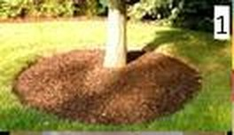
(файл: `assets/img/g8b-p1-1.jpg`, ссылка: https://raw.githubusercontent.com/metalinjector/biology-tests/claude/intelligent-heisenberg-9woyvy/assets/img/g8b-p1-1.jpg)
Иллюстрация 1
- 2: 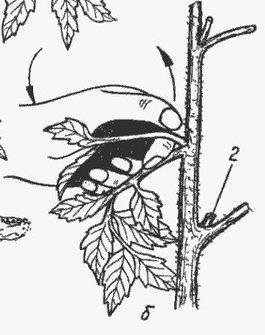
(файл: `assets/img/g8b-p1-2.jpg`, ссылка: https://raw.githubusercontent.com/metalinjector/biology-tests/claude/intelligent-heisenberg-9woyvy/assets/img/g8b-p1-2.jpg)
Иллюстрация 2
- 3: 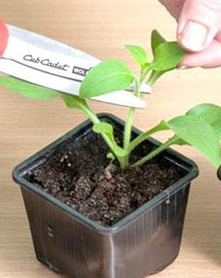
(файл: `assets/img/g8b-p1-3.jpg`, ссылка: https://raw.githubusercontent.com/metalinjector/biology-tests/claude/intelligent-heisenberg-9woyvy/assets/img/g8b-p1-3.jpg)
Иллюстрация 3
- 4: 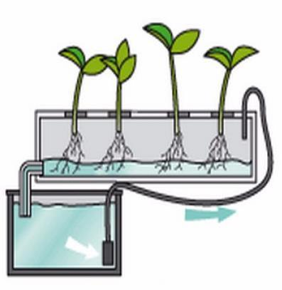
(файл: `assets/img/g8b-p1-4.jpg`, ссылка: https://raw.githubusercontent.com/metalinjector/biology-tests/claude/intelligent-heisenberg-9woyvy/assets/img/g8b-p1-4.jpg)
Иллюстрация 4
- 5: 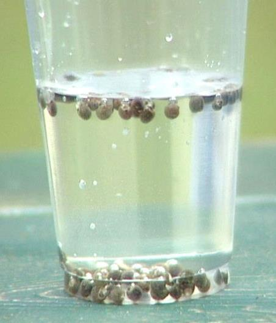
(файл: `assets/img/g8b-p1-5.jpg`, ссылка: https://raw.githubusercontent.com/metalinjector/biology-tests/claude/intelligent-heisenberg-9woyvy/assets/img/g8b-p1-5.jpg)
Иллюстрация 5
- 6: 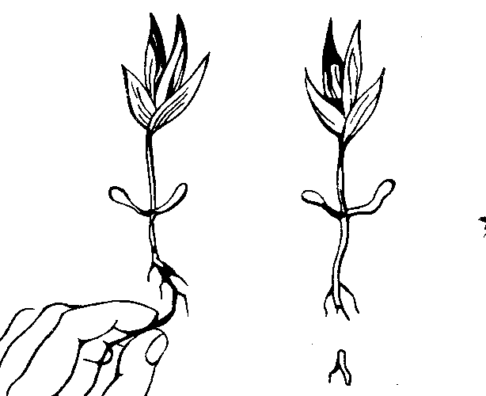
(файл: `assets/img/g8b-p1-6.png`, ссылка: https://raw.githubusercontent.com/metalinjector/biology-tests/claude/intelligent-heisenberg-9woyvy/assets/img/g8b-p1-6.png)
Иллюстрация 6

Правый столбец (Агротехнический приём (три лишних)):
- а: прищипка
- б: прореживание
- в: калибровка
- г: гидропоника
- д: пикировка
- е: прививка
- ж: мульчирование
- з: окучивание
- и: пасынкование

**Ключ (соответствие):**
- 1: Иллюстрация 1 → ж: мульчирование
- 2: Иллюстрация 2 → и: пасынкование
- 3: Иллюстрация 3 → а: прищипка
- 4: Иллюстрация 4 → г: гидропоника
- 5: Иллюстрация 5 → в: калибровка
- 6: Иллюстрация 6 → д: пикировка

**Эталонный ответ (карточка «Правильный ответ» на сайте):**

- **1 — ж) мульчирование** (укрытие приствольного круга дерева защитным слоем мульчи);
- **2 — и) пасынкование** (удаление бокового побега — пасынка — из пазухи листа на наложенном рисунке 2; *примечание: на скрытой под ним подложке 1–5 под цифрой 2 изображена **д) пикировка** — укорачивание корня сеянца ножницами при пересадке в кассету*);
- **3 — а) прищипка** (удаление верхушечной почки / верхушки растущего побега);
- **4 — г) гидропоника** (беспочвенное выращивание растений на аэрируемом питательном растворе);
- **5 — в) калибровка** (сортировка/отбор полновесных семян по плотности в стакане с жидкостью);
- **6 — д) пикировка** (отщипывание кончика главного корня у молодого проростка для стимуляции ветвления боковых корней).

**Разбор (шаги 3–8):**
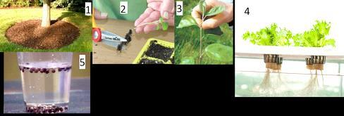
(файл: `assets/img/g8b-p1-kollazh.jpg`, ссылка: https://raw.githubusercontent.com/metalinjector/biology-tests/claude/intelligent-heisenberg-9woyvy/assets/img/g8b-p1-kollazh.jpg)
*Исходный коллаж из бланка (рисунки 1–5). Под рисунком 2 на нём видна пикировка, поверх был наложен рисунок пасынкования; рисунок 6 в PDF сместился наверх.*

#### 3. Алгоритм олимпиадного мышления
- **Маркеры на иллюстрациях:**
  1. На **фото 1** вокруг ствола дерева по кругу насыпан рыхлый тёмно-коричневый слой торфа, коры или опилок — это защита почвы у корней (*мульчирование*).
  2. На **рисунке 2** пальцы выламывают молодой боковой побег, выросший строго в углу (пазухе) между главным стеблем и черешком сложного листа томата — это удаление пасынка (*пасынкование*).
  3. На **фото 3** ножницами (или пальцами на базовом фото) срезают самую макушку (апекс) главного стебля молодого растения в горшочке — это *прищипка (пинцировка) побега*.
  4. На **схеме 4** корни растений погружены не в землю, а в лоток с циркулирующим водным раствором минеральных солей, подаваемым насосом из резервуара — это *гидропоника*.
  5. На **фото 5** в прозрачный стакан с водой (или раствором поваренной соли) насыпаны семена: тяжёлые полновесные семена опустились на дно, а пустые и щуплые всплыли на поверхность — это *калибровка (гидросепарация) семян*.
  6. На **рисунке 6** пальцы отщипывают самый кончик (верхушку) главного корня у сеянца с двумя семядолями и первыми настоящими листьями — это *пикировка*!

#### 4. Послойное объяснение и разбор дистракторов
**Суть в двух предложениях:** Все агротехнические приёмы опираются на фундаментальные законы физиологии и анатомии растений — гормональную регуляцию верхушечного доминирования, деятельность апикальных меристем и перицикла, минеральное питание и водный режим. Понимание того, какой именно орган растения (верхушку побега, пазушный побег, кончик главного корня, семя или почву) затрагивает процедура, позволяет безошибочно назвать каждый приём.

**Подробный биологический механизм всех 9 агротехнических приёмов из списка (а–и):**

- **а) Прищипка побега (пинцировка, Иллюстрация 3):** Удаление самой верхушки растущего молодого побега (конуса нарастания с верхушечной апикальной меристемой). *Биологический механизм (Олимпиадный уровень):* Верхушечная почка выделяет растительный гормон **ауксин (индолилуксусную кислоту)**, который спускается вниз по стеблю и тормозит рост боковых пазушных почек (это явление называется **апикальным доминированием** — «властью верхушки»). Когда мы прищипываем верхушку побега, поток ауксина прекращается, а приток гормонов деления — **цитокининов** — из корней будит спящие боковые почки, и растение начинает пышно ветвиться вширь!
- **б) Прореживание (дистрактор):** Удаление части слишком густо взошедших сеянцев на грядке (например, моркови, свеклы, редиса) для уменьшения внутривидовой конкуренции за свет, воду, минеральные соли и площадь питания корнеплодов.
- **в) Калибровка семян (Иллюстрация 5):** Разделение семян на фракции по размеру, массе и удельной плотности (на ситах или в воде / 3–5%-ном растворе NaCl). *Биологический механизм:* В полноценном семени клетки эндосперма или семядолей плотно заполнены тяжёлыми зёрнами крахмала, белками и жирами (плотность > 1,05 г/см³), поэтому такие семена тонут на дно и дают дружные сильные всходы. А семена с погибшим зародышем, высохшим эндоспермом или воздушными пустотами легче воды и всплывают наверх (их выбраковывают).
- **г) Гидропоника (Иллюстрация 4):** Способ выращивания растений без почвы на искусственных водных растворах минеральных солей (раствор Кнопа и др.), содержащих макроэлементы (N, P, K, Ca, Mg, S) и микроэлементы (Fe, B, Mn, Zn, Cu, Mo). *Критическое условие:* корням в воде необходим **кислород (O₂) для аэробного клеточного дыхания** (иначе клетки корня погибнут от гипоксии и перестанут активно закачивать ионы с затратой АТФ!), поэтому питательный раствор в гидропонной установке обязательно продувают воздухом или непрерывно прокачивают насосом!
- **д) Пикировка (Иллюстрация 6 и №2 на базовой подложке):** Пересадка молодых сеянцев (в фазе 1–2 настоящих листьев) из общей тесной плошки в отдельные горшочки или на большую площадь, сопровождаемая **прищипыванием (укорачиванием на 1/4–1/3) кончика главного корня**. *Биологический механизм:* Удаление апикальной меристемы (зоны деления) на кончике главного корня останавливает его рост вглубь, снимает гормональное торможение и стимулирует деление клеток **перицикла** (Задание 10!), из которого начинает бурно расти густая сеть **боковых корней** в самом тёплом и богатом гумусом и кислородом верхнем слое почвы!
- **е) Прививка (трансплантация, дистрактор):** Искусственное сращивание части одного растения (черенка или почки — **привоя**) с побегом или корнем другого растения (**подвоя**) за счёт совмещения и совместного деления их образовательной ткани — **камбия** (поэтому прививка легко удаётся у двудольных и голосеменных, но крайне трудна у лишённых камбия однодольных!).
- **ж) Мульчирование (Иллюстрация 1):** Покрытие поверхности почвы вокруг растений слоем органических (торф, перегной, древесная кора, солома, скошенная трава) или неорганических материалов (мульчей). *Биологический механизм:* мульча разрушает почвенные капилляры и резко снижает испарение воды из почвы, защищает корни от перегрева летом и промерзания зимой, перекрывает свет проросткам сорняков, а при перегнивании обогащает почву гумусом и стимулирует размножение дождевых червей и почвенных бактерий.
- **з) Окучивание (дистрактор):** Приваливание влажной рыхлой почвы к нижней части стебля растения (например, картофеля, томата, капусты). *Биологический механизм:* стимулирует рост **придаточных корней** из затенённой и увлажнённой нижней части стебля (а у картофеля — также рост подземных боковых побегов *столонов*, на концах которых формируются клубни!).
- **и) Пасынкование (Иллюстрация 2):** Выламывание или вырезание молодых боковых побегов (**пасынков**), отрастающих из пазушных почек листьев (особенно у томатов, винограда, табака). *Биологический механизм:* устраняет ненужные вегетативные побеги-конкуренты и перенаправляет поток ассимилятов (сахарозы во флоэме) от листьев прямо к развивающимся цветкам и плодам, ускоряя их созревание и увеличивая массу плодов!

#### 5. Типичные ошибки и ловушки
- **Тройная путаница («Прищипка побега vs Пасынкование vs Пикировка»):** Это три самых часто путаемых агроприёма на олимпиадах! Запомни их точные адреса на теле растения:
  - **Прищипка (пинцировка):** отщипываем **верхушку стебля** (чтобы боковые пазушные побеги ПОШЛИ в рост и куст стал пышным!).
  - **Пасынкование:** выламываем сами **боковые пазушные побеги (пасынки)** (чтобы куст НЕ тратил силы на ветвление, а наливал крупные плоды!). То есть прищипка и пасынкование преследуют *прямо противоположные цели*!
  - **Пикировка:** пересаживаем рассаду и отщипываем **кончик главного КОРНЯ** (чтобы вместо одного длинного корня выросла мочка боковых корней!).

- **Правило-предостережение:** *«Запомни: прищипка будит боковые побеги, пасынкование их удаляет, пикировка ветвит главный корень, а окучивание вызывает рост придаточных корней на стебле!»*

#### 6. Методики запоминания
- **Этимология:**
  - **Пикировка** — от фр. *piquer* («колоть, втыкать») и названия заострённого колышка — **пики (пикета)**, которым садовники делают лунки в земле для пересадки молодых сеянцев.
  - **Мульчирование** — от англ. *mulch* (нем. *molsch* — «мягкий, рыхлый, начавший перегнивать»).
  - **Гидропоника** — от греч. *hydor* («вода») + *ponos* («работа, труд») = «работающая вода».
  - **Пасынок** — славянская метафора «неродного сына»: боковой побег в пазухе листа, который «объедает» главный плодоносящий стебель.

#### 8. Олимпиадный горизонт и перенос знаний
- **Аэропоника — следующий шаг после гидропоники:** В современных оранжереях и на космических станциях кроме гидропоники применяют **аэропонику** — корни растений вообще не погружены в жидкость, а свободно висят в тёмной герметичной камере во влажном воздухе и каждые несколько минут опрыскиваются мельчайшим аэрозолем (туманом) питательного раствора. Корни при этом хорошо обеспечены кислородом.

---

### [g8b-q31] № П2 · Практическая часть · задание 2 · Эволюционный конструктор ротовых аппаратов насекомых — от грызущих жвал таракана до маски стрекозы

Раздел: Практическая часть. Тип: соответствие. ID: `g8b-task-31`. На сайте: `#g8b-q31`.

**Условие.** Насекомые - самый крупный класс животных по числу видов. Представители разных отрядов насекомых используют различные стратегии питания, что привело к формированию у них нескольких основных типов ротового аппарата. Сопоставьте насекомое и характерный для него тип ротового аппарата.

*Указание на сайте:* Для каждого насекомого выбери тип ротового аппарата.

Левый столбец (Насекомое):
- 1: 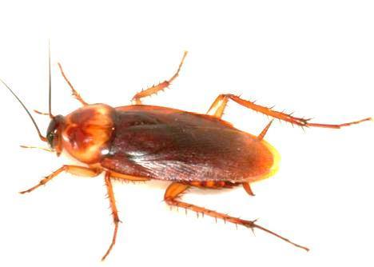
(файл: `assets/img/g8b-p2-1.jpg`, ссылка: https://raw.githubusercontent.com/metalinjector/biology-tests/claude/intelligent-heisenberg-9woyvy/assets/img/g8b-p2-1.jpg)
1. Таракан
- 2: 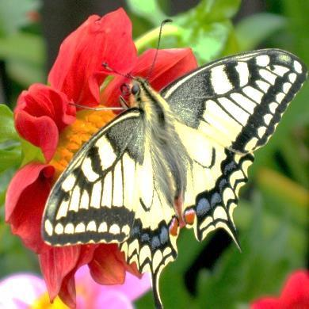
(файл: `assets/img/g8b-p2-2.jpg`, ссылка: https://raw.githubusercontent.com/metalinjector/biology-tests/claude/intelligent-heisenberg-9woyvy/assets/img/g8b-p2-2.jpg)
2. Бабочка махаон
- 3: 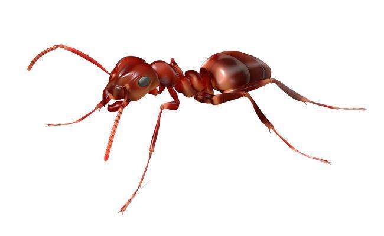
(файл: `assets/img/g8b-p2-3.jpg`, ссылка: https://raw.githubusercontent.com/metalinjector/biology-tests/claude/intelligent-heisenberg-9woyvy/assets/img/g8b-p2-3.jpg)
3. Муравей
- 4: 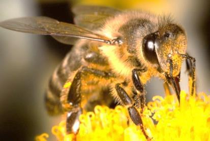
(файл: `assets/img/g8b-p2-4.jpg`, ссылка: https://raw.githubusercontent.com/metalinjector/biology-tests/claude/intelligent-heisenberg-9woyvy/assets/img/g8b-p2-4.jpg)
4. Медоносная пчела
- 5: 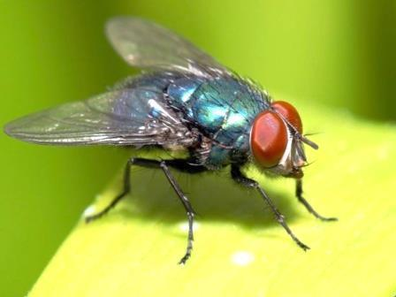
(файл: `assets/img/g8b-p2-5.jpg`, ссылка: https://raw.githubusercontent.com/metalinjector/biology-tests/claude/intelligent-heisenberg-9woyvy/assets/img/g8b-p2-5.jpg)
5. Зелёная мясная муха
- 6: 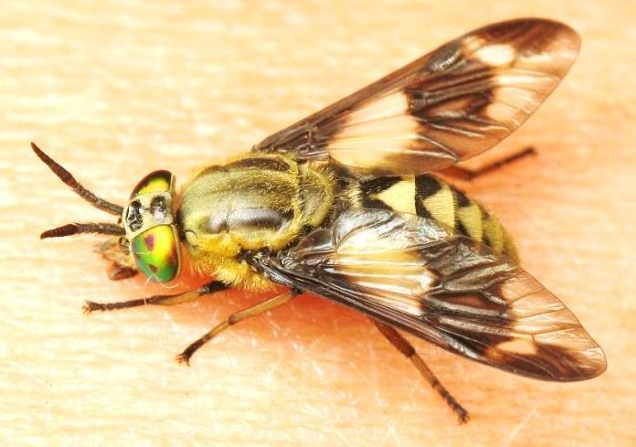
(файл: `assets/img/g8b-p2-6.jpg`, ссылка: https://raw.githubusercontent.com/metalinjector/biology-tests/claude/intelligent-heisenberg-9woyvy/assets/img/g8b-p2-6.jpg)
6. Слепень-златоглазик
- 7: 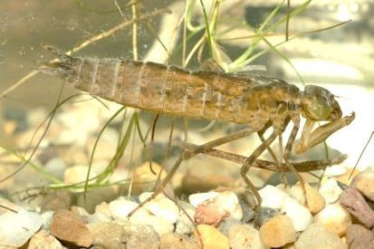
(файл: `assets/img/g8b-p2-7.jpg`, ссылка: https://raw.githubusercontent.com/metalinjector/biology-tests/claude/intelligent-heisenberg-9woyvy/assets/img/g8b-p2-7.jpg)
7. Личинка стрекозы — наяда
- 8: 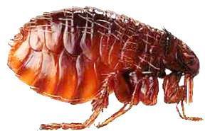
(файл: `assets/img/g8b-p2-8.jpg`, ссылка: https://raw.githubusercontent.com/metalinjector/biology-tests/claude/intelligent-heisenberg-9woyvy/assets/img/g8b-p2-8.jpg)
8. Блоха

Правый столбец (Тип ротового аппарата):
- а: грызущий
- б: грызуще-лижущий
- в: сосущий
- г: колюще-сосущий
- д: фильтрующий
- е: лижущий
- ж: маска
- з: режуще-сосущий

**Ключ (соответствие):**
- 1: 1. Таракан → а: грызущий
- 2: 2. Бабочка махаон → в: сосущий
- 3: 3. Муравей → а: грызущий
- 4: 4. Медоносная пчела → б: грызуще-лижущий
- 5: 5. Зелёная мясная муха → е: лижущий
- 6: 6. Слепень-златоглазик → з: режуще-сосущий
- 7: 7. Личинка стрекозы — наяда → ж: маска
- 8: 8. Блоха → г: колюще-сосущий
- *также засчитывается* 3 → б: грызуще-лижущий — Засчитано: в некоторых ключах у муравья указывают грызуще-лижущий аппарат. Основной ответ — грызущий: мощные жвалы муравья грызут и режут.
- *также засчитывается* 5 → д: фильтрующий — Засчитано, как допускает разбор: псевдотрахеи на хоботке мухи отфильтровывают твёрдые частицы. Но основной и школьный ответ — лижущий.

**Эталонный ответ (карточка «Правильный ответ» на сайте):**

- **1 (Таракан) — а) грызущий**
- **2 (Бабочка махаон) — в) сосущий**
- **3 (Муравей) — а) грызущий** *(или в некоторых ключах **б) грызуще-лижущий**, так как муравей относится к отряду Перепончатокрылые и помимо мощных грызущих мандибул имеет лижущий нижнегубной комплекс для слизывания сладкой пади тлей и соков)*
- **4 (Пчела медоносная) — б) грызуще-лижущий**
- **5 (Муха зелёная падальница) — е) лижущий** *(или при взаимно-однозначном соответствии 1:1 — **д) фильтрующий**, так как подушечки-лабеллумы хоботка мух пронизаны системой микроканальцев — псевдотрахей, отфильтровывающих жидкую пищу от твёрдых частиц!)*
- **6 (Слепень-златоглазик, самка) — з) режуще-сосущий**
- **7 (Водная личинка стрекозы — наяда) — ж) маска** *(видоизменённый грызущий аппарат с выбрасывающейся нижней губой — маской)*
- **8 (Блоха) — г) колюще-сосущий**

**Разбор (шаги 3–8):**
#### !. Заметка к рисунку 3
Рисунок муравья в бланке — компьютерная 3D-модель. На ней задняя пара ног выглядит прикреплённой к узкой «талии» позади груди. У настоящих насекомых все три пары ног отходят от груди. На ответ про ротовой аппарат это не влияет: жвалы нарисованы верно.

#### 3. Алгоритм олимпиадного мышления
- **Маркеры на фотографиях (как узнать всех 8 насекомых с первого взгляда):**
  1. 1 — плоское овальное тело, длинные щетинковидные усики, кожистые передние надкрылья, бегательные ноги с шипами → **таракан** (отряд Таракановые) → **а) грызущий**.
  2. 2 — две пары широких крыльев с жёлто-чёрным рисунком, синими лунками, красным глазком и «хвостиками» на задних крыльях → **бабочка махаон** (отряд Чешуекрылые) → **в) сосущий**.
  3. 3 — голова с коленчатыми усиками и челюстями, тонкий стебелёк между грудью и брюшком, бескрылая рабочая особь → **муравей** (отряд Перепончатокрылые) → **а) грызущий** (с лижущим комплексом нижней губы).
  4. 4 — мохнатое насекомое на цветке с корзиночками для пыльцы на задних лапках и вытянутым вниз язычком → **медоносная пчела** (отряд Перепончатокрылые) → **б) грызуще-лижущий**.
  5. 5 — изумрудно-зелёное металлическое тело, огромные красные фасеточные глаза, короткие 3-члениковые усики с перистой щетинкой (аристой) и мягкий хоботок с подушечкой на конце → **зелёная мясная муха (падальница)** (отряд Двукрылые) → **е) лижущий** / **д) фильтрующий**.
  6. 6 — муха с треугольно расставленными пятнистыми крыльями и ярко-зелёными глазами с фиолетовыми пятнами → **слепень-златоглазик (*Chrysops relictus*)** (семейство Слепни, отряд Двукрылые) → **з) режуще-сосущий**!
  7. 7 — бурое водное насекомое на каменистом дне с зачатками крыльев на спине и сложенной под головой длинной шарнирной клешнёй → **личинка (наяда) стрекозы** → **ж) маска**!
  8. 8 — бескрылое коричневое насекомое, сильно сплющенное с боков (латерально), с гребнями щетинок (ктенидиями) и мощными прыгательными задними ногами → **блоха** (отряд Блохи) → **г) колюще-сосущий**!

#### 4. Послойное объяснение и разбор дистракторов
**Суть в двух предложениях:** Все ротовые аппараты насекомых — это блестящий пример эволюционной **дивергенции и гомологии**: несмотря на колоссальные внешние различия, все они построены из одних и тех же базовых частей исходного грызущего ротового аппарата (верхней губы, пары верхних челюстей — мандибул, пары нижних челюстей — максилл и нижней губы — лабиума). В зависимости от агрегатного состояния и доступности пищи одни части челюстей превращались в стилеты-иглы, другие — в ножички, спиральные трубочки, ситечки-губки или гидравлические капканы.

**Подробный биологический разбор каждого типа ротового аппарата (Олимпиадный уровень — гомология частей!):**

- **а) Грызущий (ортоптероидный) тип — Таракан (1), Муравей (3), а также жуки, кузнечики, саранча, богомолы, взрослые стрекозы и гусеницы бабочек:** Это эволюционно **исходный (первичный)** тип ротового аппарата для всех насекомых! Включает:
  1. Непарную **верхнюю губу (лабрум)** — кожную складку головы, прикрывающую рот сверху;
  2. Пару мощных нечленистых зазубренных **верхних челюстей — мандибул (жвал)**, дробящих и откусывающих твёрдую пищу;
  3. Пару членистых **нижних челюстей — максилл** с щупиками (удерживают пищу и пробуют её на вкус);
  4. Непарную **нижнюю губу (лабиум)** с парой щупиков (образовалась путём срастания второй пары нижних челюстей!).

- **б) Грызуще-лижущий тип — Медоносная пчела (4), шмель (а в функциональном плане отчасти и муравей — 3):** Верхняя губа и **верхние челюсти (мандибулы) остались грызущими** (пчела разминает ими воск, строит шестигранные соты, прогрызает крышечки ячеек и собирает пыльцу), а вот **нижние челюсти (максиллы) и нижняя губа (лабиум)** сильно вытянулись и сложились в желобоватый футляр (хоботок), внутри которого движется длинный волосистый **язычок** нижней губы, слизывающий нектар из глубины цветков!
- **в) Сосущий тип — Бабочка махаон (2) (отряд Чешуекрылые):** Верхние челюсти (мандибулы) полностью редуцировались, нижняя губа оставила только пушистые трёхчлениковые щупики, а длинный, свёрнутый в покое в часовую спираль **хоботок** бабочки образован исключительно двумя сцепленными желобками **наружных жевательных лопастей (галеа) нижних челюстей — максилл**! Бабочка не может проколоть кожу или кожицу плода (за исключением тропических бабочек-вампиров рода *Calyptra*!) и пьёт только открыто лежащий жидкий нектар.
- **г) Колюще-сосущий тип — Блоха (8), а также комары, клопы, тли, цикады, вши:** Ротовые части превращены в тончайшие зазубренные иглы — **колющие стилеты**, вложенные в футляр (хоботок) из нижней губы. При укусе стилеты прокалывают кожу (у кровососов) или покровы растения (у тлей и клопов), через слюнной канал в ранку впрыскивается слюна с антикоагулянтами (препятствующими свёртыванию крови), а через пищевой канал насос глотки всасывает жидкую кровь или сок!
- **е) Лижущий и д) Фильтрующий тип — Зелёная мясная муха (5), комнатная муха:** Мандибулы и максиллы у настоящих (круглошовных) мух редуцированы, а **нижняя губа** превратилась в мягкий мясистый хоботок, заканчивающийся двумя широкими губчатыми лопастями — **оральными дисками (лабеллумами)**. На нижней поверхности лабеллумов проходит сеть микроскопических незамкнутых хитиновых трубочек — **псевдотрахей**, которые работают как капиллярный **фильтр (ситечко)**! Муха выпускает на кусочек сахара или мяса каплю слюны с пищеварительными ферментами, растворяет его, а затем *отфильтровывает* и слизывает получившийся бульон через псевдотрахеи! (Кроме того, в зоологии водных насекомых **фильтрующим** называют веерообразный ротовой аппарат водных *личинок комаров и мошек*, отцеживающих бактерий и детрит из воды!).
- **ж) Маска — Личинка стрекозы (наяда, 7):** Это уникальная модификация **грызущего** ротового аппарата у водных хищных личинок всех стрекоз! Их **нижняя губа (лабиум)** сильно удлинена, состоит из двух подвижно сочленённых на шарнире отделов (ментума и прементума) с острыми подвижными крючьями-зубцами на конце и в покое сложена под головой и грудью, прикрывая лицо личинки снизу, словно забрало рыцарского шлема (отсюда название — **«маска»**!). Когда мимо проплывает малёк рыбы или головастик, маска за сотые доли секунды выбрасывается далеко вперёд, зубцы пронзают добычу и подтягивают её прямо к грызущим мандибулам!
- **з) Режуще-сосущий тип — Самка слепня-златоглазика (6) (а также мошки):** В отличие от комара или блохи, которые аккуратно прокалывают кожу тонкой иглой, самка слепня действует как хирург со скальпелем: её широкие кинжаловидные **верхние и нижние челюсти (мандибулы и максиллы)** двигаются в стороны, как лезвия ножниц, **разрезая кожу и капилляры жертвы** (поэтому укус слепня такой болезненный и из ранки долго течёт кровь!), а широкие подушечки **нижней губы** тут же впитывают и слизывают выступившую лужицу крови!

#### 5. Типичные ошибки и ловушки
- **Две главные олимпиадные ловушки по ротовым аппаратам:**
  1. **Гусеница vs Бабочка (Смена ротового аппарата при метаморфозе!):** У взрослой бабочки (имаго махаона — №2) ротовой аппарат **сосущий** (питается нектаром), а у её собственной личинки — **гусеницы** — ротовой аппарат **грызущий** (питается твёрдыми листьями укропа и зонтичных)! Благодаря этому родители и дети у насекомых с полным превращением **не конкурируют за пищу**! (А вот у стрекозы и её личинки наяды №7 — неполное превращение, оба хищники с грызущими челюстями, но у водной личинки нижняя губа превращена в ловчую *маску*, которая исчезает у взрослой летающей стрекозы!).
  2. **Слепень (№6) vs Комар/Блоха (№8):** Не перепутай: у комара, клопа и блохи ротовой аппарат **колюще-сосущий (г)**, а у самки слепня (№6) — **режуще-сосущий (з)**!

- **Правило-предостережение:** *«Запомни: только у бабочек хоботок свернут спиралью и сделан из одних нижних челюстей (сосущий); только у личинки стрекозы нижняя губа стреляет вперёд (маска); и только слепни с мошками режут кожу челюстями-ножами (режуще-сосущий)!»*

#### 6. Методики запоминания
- **Сводная таблица гомологии ротовых аппаратов насекомых (Олимпиадный стандарт):**

| Номер и насекомое | Отряд и тип превращения | Тип ротового аппарата | Из каких челюстей построен главный рабочий орган |
|---|---|---|---|
| **1. Таракан** | Таракановые (неполное) | **а) Грызущий** | Зазубренные мандибулы + максиллы + верхняя и нижняя губы |
| **2. Бабочка махаон** | Чешуекрылые (полное) | **в) Сосущий** | Спиральный хоботок из **нижних челюстей (максилл)**; мандибул нет |
| **3. Муравей** | Перепончатокрылые (полное) | **а) Грызущий** (или б) | Мощные грызущие мандибулы + лижущий комплекс нижней губы |
| **4. Медоносная пчела** | Перепончатокрылые (полное) | **б) Грызуще-лижущий** | Грызущие мандибулы (для воска) + хоботок из максилл и нижней губы |
| **5. Мясная муха** | Двукрылые (полное) | **е) Лижущий / д) Фильтрующий** | Мягкий хоботок из **нижней губы** с фильтрующими псевдотрахеями |
| **6. Слепень-златоглазик** | Двукрылые (полное) | **з) Режуще-сосущий** | Режущие ножи-мандибулы и максиллы + слизывающая нижняя губа |
| **7. Личинка стрекозы** | Стрекозы (неполное) | **ж) Маска (грызущий)** | Выбрасывающаяся шарнирная **нижняя губа (маска)** + мандибулы |
| **8. Блоха** | Блохи (полное) | **г) Колюще-сосущий** | Колющие стилеты (верхняя губа и максиллы) в футляре нижней губы |

#### 8. Олимпиадный горизонт и перенос знаний
- **Бейтсовская мимикрия у насекомого №6:** Посмотри ещё раз на брюшко слепня-златоглазика (№6): оно окрашено в чередующиеся ярко-жёлтые и чёрные полосы, из-за чего в полёте он очень похож на осу! У слепня нет жала на конце брюшка, но предупреждающая «осиная» окраска отпугивает насекомоядных птиц — такое подражание незащищённого вида защищённому называют **бейтсовской мимикрией** (классический пример — мухи-журчалки, похожие на ос).

---

### [g8b-q32] № П3 · Практическая часть · задание 3 · Морфологический паспорт листа — 6 точных координат описания листовой пластинки

Раздел: Практическая часть. Тип: несколько ответов (засчитывается набор). ID: `g8b-task-32`. На сайте: `#g8b-q32`.

**Условие.** Выбери все пункты, верно характеризующие строение листа.

*Указание на сайте:* Отметь все признаки, которые подходят листу на фотографии.

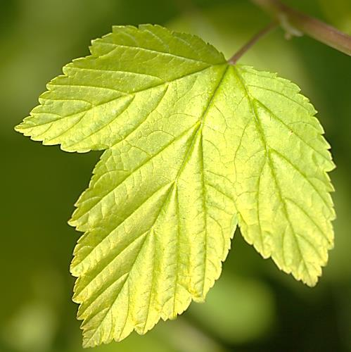
(файл: `assets/img/g8b-p3-list.jpg`, ссылка: https://raw.githubusercontent.com/metalinjector/biology-tests/claude/intelligent-heisenberg-9woyvy/assets/img/g8b-p3-list.jpg)
*Оригинальная фотография листа из практического задания 3.*

Варианты:
- 1) сложный
- 2) простой
- 3) с пильчато-зубчатым краем
- 4) с городчатым краем
- 5) тройчато-раздельный
- 6) тройчато-лопастной
- 7) тройчато-рассечённый
- 8) с округлым основанием
- 9) с сердцевидным основанием
- 10) с клиновидным основанием
- 11) с притуплённой верхушкой
- 12) с острой верхушкой
- 13) с параллельным жилкованием
- 14) с перистым жилкованием
- 15) с пальчатым жилкованием

**Ключ (все нужные пункты):** 2, 3, 6, 9, 12, 15
**Также засчитывается набор:** 2, 3, 6, 8, 12, 15
**Также засчитывается набор:** 2, 3, 5, 9, 12, 15
**Также засчитывается набор:** 2, 3, 5, 8, 12, 15
**Пояснение к наборам:** Засчитано. Основной ответ: 2, 3, 6, 9, 12, 15. Разбор допускает и «тройчато-раздельный» (5) вместо «тройчато-лопастного» (6) и «округлое основание» (8) вместо «сердцевидного» (9).

**Эталонный ответ (карточка «Правильный ответ» на сайте):**

**2, 3, 6, 9 (или 8), 12, 15.**

- **2** — простой;
- **3** — с пильчато-зубчатым краем;
- **6** — тройчато-лопастной *(примечание: если в ключе составителей глубина выреза между центральной и левой лопастью оценена чуть глубже половины полупластинки, может засчитываться **5 — тройчато-раздельный**)*;
- **9** — с сердцевидным основанием *(или **8 — с округлым основанием**, так как основание листа переходное округло-выемчатое у точки прикрепления черешка)*;
- **12** — с острой верхушкой;
- **15** — с пальчатым жилкованием.

**Разбор (шаги 3–8):**
#### 3. Алгоритм олимпиадного мышления
- **Маркеры в условии (Секрет «6 баллов = 6 категорий»!):** Обрати внимание: в списке 15 пунктов, а задание оценивается ровно в **6 баллов**! Почему? Потому что 15 пунктов представляют собой **6 независимых морфологических групп альтернатив**, и из каждой группы нужно выбрать ровно **один** верный пункт:
  1. **Группа I (Пункты 1–2: Простой или сложный лист):** На черешке сидит *одна единая листовая пластинка* (вырезы между тремя лопастями не доходят до основания и не делят лист на отдельные листочки со своими черешочками). При листопаде такой лист опадает целиком → **2. простой**.
  2. **Группа II (Пункты 3–4: Характер края пластинки):** По краю листа идут острые, направленные к верхушке зубчики разной величины, а не тупые округлые волнистые выступы → **3. с пильчато-зубчатым краем**.
  3. **Группа III (Пункты 5–6–7: Степень расчленения пластинки):** Листовая пластинка расчленена на 3 крупные части (три лопасти), при этом выемки между ними доходят примерно до трети — середины ширины полупластинки (не до самого основания черешка!) → **6. тройчато-лопастной** (при оценке глубины левого выреза как чуть больше 1/2 полупластинки — *5. тройчато-раздельный*).
  4. **Группа IV (Пункты 8–9–10: Форма основания пластинки):** Нижние края пластинки у входа черешка не сужаются клином (отпадает 10 — клиновидное), а плавно закругляются и образуют небольшую выемку в месте прикрепления черешка → **9. с сердцевидным основанием** (или **8. с округлым основанием**).
  5. **Группа V (Пункты 11–12: Форма верхушки пластинки):** Верхушка центральной лопасти (и боковых лопастей) заканчивается острым зубцом (углом менее 90°) → **12. с острой верхушкой**.
  6. **Группа VI (Пункты 13–14–15: Тип жилкования):** В самом основании пластинки от верхушки черешка веером («пальцами ладони») расходятся сразу **три крупные главные жилки первого порядка** — по одной в каждую из трёх лопастей! Это классическое **15. с пальчатым жилкованием**!

#### 4. Послойное объяснение и разбор дистракторов
**Суть в двух предложениях:** Морфологическое описание листа в ботанике строится по чёткому алгоритму из шести шагов: сначала определяют, простой лист или сложный, затем оценивают расчленение пластинки, тип жилкования, форму края, основание и верхушку. На фотографии изображён простой тройчато-лопастной лист (характерный, например, для калины обыкновенной, пузыреплодника или смородины/малины душистой) с пальчатым жилкованием, пильчато-зубчатым краем, сердцевидным (округло-сердцевидным) основанием и острой верхушкой.

**Подробный биологический механизм и строгие геометрические критерии ботаники (Олимпиадный уровень):**

- **1. Как отличить простой расчленённый лист (2) от сложного листа (1)?**
  - У **простого листа (2)** листовая пластинка одна (даже если она глубоко изрезана), у её частей нет собственных сочленений с рахисом, и осенью весь лист опадает с ветки **единым целым вместе с черешком**.
  - У **сложного листа (1)** (например, тройчатосложного у клевера и земляники, пальчатосложного у конского каштана и люпина, перистосложного у рябины, розы, гороха и акации) на общем черешке (*рахисе*) сидят несколько полностью самостоятельных **листочков**, каждый из которых имеет собственное сочленение (черешочек) и при листопаде опадает по отдельности!

- **2. Математическое правило «Лопастной — Раздельный — Рассечённый» (Пункты 5, 6, 7):** Мысленно проведи линию от края листа до центра (основания черешка или главной жилки) — это ширина полупластинки. Теперь посмотри, насколько глубоко врезаются выемки:
  - Если глубина выемок **меньше половины (< 1/2, обычно около 1/4–1/3)** полупластинки — лист **лопастной** (а выступы называются *лопастями*) → **6. тройчато-лопастной** (клён татарский, калина, смородина).
  - Если глубина выемок **больше половины (> 1/2), но не доходит до основания или главной жилки** — лист **раздельный** (а выступы называются *долями*) → **5. тройчато-раздельный**.
  - Если выемки доходят **почти до самого основания пластинки или до главной жилки** (оставляя лишь узкую полоску ткани вдоль жилки) — лист **рассечённый** (выступы называются *сегментами*) → **7. тройчато-рассечённый** (например, у некоторых видов лютика и ветреницы).

- **3. Четыре главных типа края листовой пластинки (Пункты 3, 4):**
  - **Зубчатый:** зубчики острые, равнобокие (симметричные, смотрят перпендикулярно краю).
  - **Пильчатый:** зубчики острые, неравнобокие (наклонены вперёд к верхушке листа, как зубья ручной пилы). Если на крупных зубцах сидят более мелкие пильчатые зубчики (как на нашем фото!), край называют **двоякопильчатым или пильчато-зубчатым (3)**!
  - **Городчатый (4):** выступы по краю *тупые, полукруглые*, а выемки между ними острые (как у будры плющевидной или фиалки).
  - **Выемчатый:** выступы тупые и выемки тоже пологие, округлые (например, у дуба черешчатого).

- **4. Почему у тройчато-лопастного листа жилкование пальчатое (15), а не перистое (14)?** При **перистом (перисто-сетчатом) жилковании (14)** (берёза, дуб, яблоня, сирень) вдоль всего листа от основания до верхушки идёт *одна-единственная главная центральная жилка*, от которой по бокам, как бородки пера, поочерёдно отходят боковые жилки второго порядка. А при **пальчатом (пальчато-сетчатом) жилковании (15)** (клён, смородина, калина, манжетка, наш лист!) в самой точке прикрепления черешка главная жилка сразу разветвляется веером на **3, 5 или 7 равноценных крупных жилок**, расходящихся в каждую лопасть подобно пальцам раскрытой ладони!

#### 5. Типичные ошибки и ловушки
- **Ловушка №1 («Тройчато-лопастной простой vs Тройчатосложный лист»):** Никогда не путай *простой тройчато-лопастной лист* (наш рисунок: три лопасти срослись в нижней половине в единую пластинку!) и *тройчатосложный лист* клевера, кислицы или земляники (три отдельных листочка сидят на своих маленьких черешочках и не соединены листовой тканью!).
- **Ловушка №2 («Пальчатое жилкование при 3 лопастях»):** Многие ученики думают, что если лопастей три («тройчато-лопастной»), то жилкование должно называться «тройчатым». В школьной и олимпиадной морфологии растений тип жилкования, при котором из основания листовой пластинки веером выходит 3 и более главных жилок, всегда называется **пальчатым (15)**!
- **Правило-предостережение:** *«Запомни правило трёх глубин выреза простого листа: до 1/2 — ЛОПАСТНОЙ (лопасти), глубже 1/2 — РАЗДЕЛЬНЫЙ (доли), до самой жилки — РАССЕЧЁННЫЙ (сегменты), а если распался на отдельные листочки с черешочками — СЛОЖНЫЙ!»*

#### 6. Методики запоминания
- **Мнемоническая формула «Л — Р — Рс — С» (по алфавиту и по увеличению глубины разреза!):** Чем дальше мы режем листовую пластинку ножницами к середине, тем длиннее становится слово: **Л**опастной (< 1/2) → **Р**аздельный (> 1/2) → **Р**а**сс**ечённый (до жилки) → **С**ложный (распался на отдельные листочки)!

#### 7. Визуализация
*Рис. к практическому заданию 3. Геометрические различия между лопастным, раздельным и рассечённым листом, а также между пильчато-зубчатым и городчатым краем.*
[Схема: без подписи]

#### 8. Олимпиадный горизонт и перенос знаний
- **Листорасположение на стебле (следующий шаг описания побега на практическом туре ВсОШ):** После описания самой листовой пластинки на олимпиаде всегда просят указать тип **листорасположения**:
  - **Очерёдное (спиральное):** из каждого узла стебля отходит по **1 листу** (яблоня, берёза, дуб, смородина, роза);
  - **Супротивное:** из каждого узла друг напротив друга отходят **2 листа** (сирень, клён, калина, крапива, мята, гвоздика);
  - **Мутовчатое:** из каждого узла отходит **3 и более листьев** (элодея, вороний глаз, олеандр, хвощ, подмаренник).

---

### [g8b-q33] № 1 · Ботаника и физиология растений

Раздел: Бонус · Тренажёр на перенос знаний. Тип: открытый ответ (ученица сверяет себя с ключом). ID: `g8b-t1`. На сайте: `#g8b-q33`.

**Условие.** На лабораторном столе лежат четыре гербарных образца водных и околоводных растений: 1) кувшинка белая (плавающий лист), 2) элодея канадская (погружённый лист), 3) сальвиния плавающая (водный папоротник), 4) сфагнум болотный (торфяной мох). Укажите: а) у каких из этих четырёх взрослых растений полностью отсутствуют настоящие корни; б) у какого из них в клетках эпидермы листа содержатся хлоропласты, но нет ни одного устьица; в) чем образован подводный «корнеподобный» орган у сальвинии плавающей?

**Ключ:** открытый ответ — см. эталонный ответ ниже.

**Эталонный ответ (карточка «Правильный ответ» на сайте):**

а)
Настоящих корней во взрослом состоянии нет у
сфагнума (4)
(у мхов корней нет в принципе, а у взрослого сфагнума нет и ризоидов) и у водного папоротника
сальвинии плавающей (3)
(у которой корни вторично редуцировались!). У элодеи (2) и кувшинки (1) корни есть — придаточные.
б)
Хлоропласты в клетках основной эпидермы при полном отсутствии устьиц находятся в погружённом в воду листе
элодеи канадской (2)
.
в)
У сальвинии плавающей в каждом узле сидит мутовка из трёх листьев: два цельных зелёных листа плавают на поверхности, а
третий видоизменённый лист
рассечён на бурые нитевидные доли и выполняет функцию корня (поглощение воды и солей и стабилизация в воде).

---

### [g8b-q34] № 2 · Цитология и биохимия

Раздел: Бонус · Тренажёр на перенос знаний. Тип: открытый ответ (ученица сверяет себя с ключом). ID: `g8b-t2`. На сайте: `#g8b-q34`.

**Условие.** Исследователь выделил из растительного объекта клеточный сок, который в кислой среде имел ярко-красную окраску, а при добавлении капли раствора питьевой соды (
NaHCO₃

, слабощелочная среда) изменил цвет на сине-зелёный. Затем исследователь поместил проростки пшеницы и проростки ели обыкновенной в абсолютно тёмный термостат. Ответьте: а) из какого органоида был выделен пигмент и к какому классу веществ он относится; б) какие пластиды сформируются в листьях проростков пшеницы в темноте и почему проростки ели в тех же условиях станут зелёными?

**Ключ:** открытый ответ — см. эталонный ответ ниже.

**Эталонный ответ (карточка «Правильный ответ» на сайте):**

а)
Пигмент был выделен из
центральной вакуоли
(ограниченной мембраной — тонопластом); это водорастворимый пигмент группы
антоцианов
, работающий как природный
pH

-индикатор (красный в кислоте, фиолетовый в нейтральной среде, сине-зелёный в щёлочи).
б)
В проростках пшеницы (Покрытосеменные) в темноте из протопластид разовьются бледно-жёлтые
этиопласты
(с проламеллярным телом), так как фермент превращения протохлорофиллида в хлорофиллид у цветковых требует света. А у проростков ели (Голосеменные) есть светонезависимый фермент синтеза хлорофилла, поэтому в них даже в темноте образуются зелёные
хлоропласты
!

---

### [g8b-q35] № 3 · Зоология беспозвоночных и позвоночных

Раздел: Бонус · Тренажёр на перенос знаний. Тип: открытый ответ (ученица сверяет себя с ключом). ID: `g8b-t3`. На сайте: `#g8b-q35`.

**Условие.** У головастика травяной лягушки при превращении во взрослое животное полностью рассасывается длинный мускулистый хвост, а у водной личинки стрекозы (наяды) при выходе во взрослую крылатую стрекозу исчезает ловчая «маска». Укажите: а) какие органоиды клетки непосредственно обеспечивают самопереваривание тканей хвоста головастика и какой гормон запускает этот процесс; б) какой частью ротового аппарата по происхождению является «маска» личинки стрекозы; в) как по порядку появления конечностей и строению рта отличить в пруду личинку обыкновенного тритона от головастика травяной лягушки?

**Ключ:** открытый ответ — см. эталонный ответ ниже.

**Эталонный ответ (карточка «Правильный ответ» на сайте):**

а)
Рассасывание хвоста головастика (программируемая клеточная гибель / аутофагия) осуществляется гидролитическими ферментами
лизосом
под действием йодсодержащего гормона щитовидной железы —
тироксина
.
б)
Ловчая «маска» личинки стрекозы — это видоизменённая шарнирная
нижняя губа (лабиум)
грызущего ротового аппарата.
в)
У личинки тритона (Хвостатые) сначала появляются
передние
конечности, сохраняются 3 пары перистых наружных жабр, а рот широкий с зубами (она хищник); у головастика лягушки (Бесхвостые) снаружи сначала появляются
задние
конечности, жабры скрыты под крышкой, а рот узкий с роговым клювиком (растительноядный).

---

### [g8b-q36] № 4 · Систематика и карпология

Раздел: Бонус · Тренажёр на перенос знаний. Тип: соответствие. ID: `g8b-t4`. На сайте: `#g8b-q36`.

**Условие.** Распредели продукты по трём группам: чем каждый из них является с точки зрения ботаники.

Левый столбец (Продукт):
- фундук: фундук
- миндаль: миндаль
- пшено: пшено
- перловая крупа: перловая крупа
- гречневая крупа (ядрица): гречневая крупа (ядрица)
- кедровый «орешек»: кедровый «орешек»
- манная крупа: манная крупа
- настоящий каштан: настоящий каштан

Правый столбец (Группа):
- I: I — настоящий орех
- II: II — семя или косточка костянки
- III: III — из зерновки злака или орешка

**Ключ (соответствие):**
- фундук: фундук → I: I — настоящий орех
- миндаль: миндаль → II: II — семя или косточка костянки
- пшено: пшено → III: III — из зерновки злака или орешка
- перловая крупа: перловая крупа → III: III — из зерновки злака или орешка
- гречневая крупа (ядрица): гречневая крупа (ядрица) → III: III — из зерновки злака или орешка
- кедровый «орешек»: кедровый «орешек» → II: II — семя или косточка костянки
- манная крупа: манная крупа → III: III — из зерновки злака или орешка
- настоящий каштан: настоящий каштан → I: I — настоящий орех

**Эталонный ответ (карточка «Правильный ответ» на сайте):**

Группа I (настоящий плод орех):
1) фундук
и
8) настоящий каштан
.
Группа II (семя голосеменного или косточка/семя сухой костянки):
2) миндаль
(сухая костянка) и
6) кедровый «орешек»
(голое семя сосны сибирской, плодов у голосеменных нет!).
Группа III (крупы из зерновок злаков и орешков гречихи):
3) пшено
(зерновка проса),
4) перловая крупа
(зерновка ячменя),
7) манная крупа
(эндосперм зерновки пшеницы) и
5) гречневая крупа
(плод трёхгранный орешек двудольного растения гречихи посевной).

---

## Памятки олимпиады

### Памятка: Об этой олимпиаде

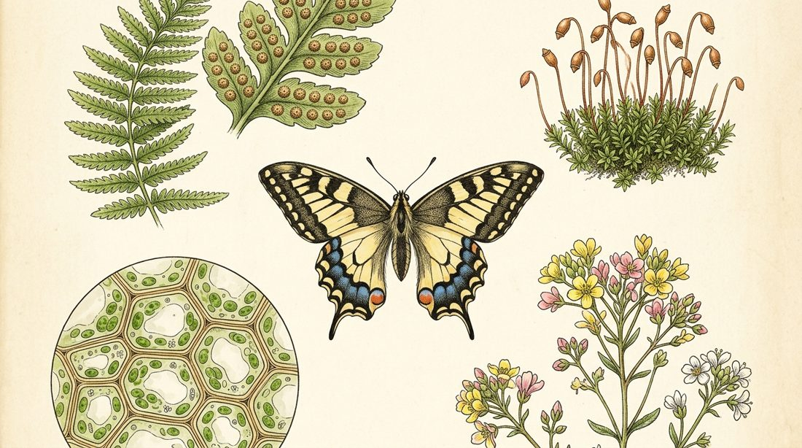
(файл: `assets/img/g8b-oblozhka.jpg`, ссылка: https://raw.githubusercontent.com/metalinjector/biology-tests/claude/intelligent-heisenberg-9woyvy/assets/img/g8b-oblozhka.jpg)

### Олимпиадная биология: 8 класс (2018/2019 учебный год)

Полный учебный разбор всех 32 заданий (Тестовая часть №1–30 и Практическая часть №1–3) + Экспресс-шпаргалка, Словарь корней, Карточки и Тренажёр

Каждое задание разобрано по шагам: алгоритм олимпиадного мышления, послойное объяснение с разбором всех вариантов, типичные ошибки и ловушки, приёмы запоминания, схема и олимпиадный горизонт.

### Памятка: Экспресс-шпаргалка и ответы

Эта сводная таблица объединяет эталонные ответы, главные биологические правила и «красные флажки» (исключения и ловушки) по каждому вопросу разобранного варианта:

| № задания | Тема и объект | Эталонный ответ | Главное правило и олимпиадное исключение |
|---|---|---|---|
| **Тест №1** | Сложные соцветия | **в) метёлка проса** | В сложном соцветии ветвится главная ось; головка клевера, кисть ландыша и початок белокрыльника — простые. |
| **Тест №2** | Соцветия кукурузы | **а) метёлка из колосков** | Кукуруза однодомна: мужские цветки (тычиночные) — в метёлке на макушке, женские (пестичные) — в сложном початке в пазухе листа. |
| **Тест №3** | Плод банана | **а) трёхгнёздная ягода** | Банан — гигантская однодольная трава; культурные сорта триплоидны (3n=33) и образуют ягоды без семян (партенокарпия). |
| **Тест №4** | Корневая система без главного корня | **в) щитовник мужской** | У водорослей и мхов корней нет вовсе; у папоротников зародышевый корешок отмирает, все корни придаточные и боковые. |
| **Тест №5** | Индузий (покрывальце) | **г) щитовник мужской** | Индузий (2n) защищает сорус снизу вайи у щитовника; у папоротника голокучника сорусы голые, а у мхов на коробочке — калиптра (n). |
| **Тест №6** | Щиток (скутеллум) в семени | **в) пшеница** | Щиток — видоизменённая единственная семядоля только у семейства **Злаки** (не у всех однодольных!); выделяет ферменты в эндосперм. |
| **Тест №7** | Погружённые листья гидатофитов | **г) не имеют устьиц** | Погружённые в толщу воды листья (элодея, рдест) лишены устьиц и кутикулы; устьица сверху — только у *плавающих* листьев кувшинки. |
| **Тест №8** | Локализация антоцианов | **е) 6 (вакуоли)** | Водорастворимые антоцианы (синие/красные/фиолетовые) растворены в клеточном соке вакуоли и меняют цвет от pH; каротиноиды — в пластидах. |
| **Тест №9** | Половой процесс спирогиры | **г) конъюгация** | Слияние протопластов вегетативных клеток без жгутиков по мостику между нитями; число особей при этом не увеличивается. |
| **Тест №10** | Поперечный срез корня ириса | **б) транспорт сахаров (флоэма)** / **г) боковые корни (перицикл)** | В радиальном пучке корня лучи сосудов ксилемы (вода) чередуются с островками флоэмы (сахара), а снаружи под эндодермой лежит перицикл. |
| **Тест №11** | Органы бычьего цепня | **в) только для выделения** | Пищеварительной и дыхательной систем у цепня нет (анаэроб, всасывает тегументом), но выделительная система есть — **протонефридии**. |
| **Тест №12** | Производные мезодермы плоских червей | **б) мышцы и паренхима** | Покровный эпителий и нервы — из эктодермы; средняя кишка — из энтодермы; мышцы, паренхима, половая система — из мезодермы. |
| **Тест №13** | Грена тутового шелкопряда | **в) кладка яиц шелкопряда** | От фр. *graine* — «зерно». Шёлковую нить выделяет гусеница из слюнных (лабиальных) желёз на нижней губе. |
| **Тест №14** | Кто не питается планктоном | **г) кальмар** | Кальмар — активный хищник (нектон) с прямым развитием без планктонной личинки; мидия, копепода и медуза питаются планктоном. |
| **Тест №15** | Красная книга Беларуси | **в) 1, 2, 7 (выхухоль, барсук, лесной кот)** | Красный волк (Азия), нерпа (море) и енот-полоскун (инвазивный вид из Америки) не входят в аборигенную охраняемую фауну РБ. |
| **Тест №16** | Амёба обыкновенная vs Инфузория | **в) 1, 4 (ложноножки и нет полового процесса)** | Обе пресноводные и свободноживущие (у обеих есть сократительные вакуоли!), но у *Amoeba proteus* нет пелликулы и нет полового процесса. |
| **Тест №17** | Планктонная личинка с ресничным парусом | **б) личинка моллюска (велигер)** | У членистоногих никогда не бывает ресничек! Четыре ресничные лопасти велума + спиральная раковинка = велигер (парусник) моллюска. |
| **Тест №18** | Две личинки с лапками и жабрами | **а) амфибии и амфибии** | Слева — хищная личинка хвостатой амфибии (тритон: передние ноги раньше задних), справа — головастик бесхвостой амфибии (лягушка: задние раньше). |
| **Тест №19** | Этиопласты | **а) из протопластид в темноте** | Содержат кристаллическое проламеллярное тело и протохлорофиллид; на свету быстро превращаются в зелёные хлоропласты. |
| **Тест №20** | Состав клеточной стенки растений | **г) целлюлоза, гемицеллюлоза, пектин, белки** | Первичная клеточная стенка — композит из микрофибрилл целлюлозы, сшивок гемицеллюлозы, матрикса пектинов и белков (экспансины, экстенсины). |
| **Тест №21** | Функция лизосом | **а) расщепление полимеров до мономеров** | Содержат кислые гидролазы (pH 4,5–5,0); при гидролизе в лизосомах 100% энергии рассеивается в тепло (0 АТФ!). |
| **Тест №23** | Наиболее разнообразные вещества | **в) белки** | Нерегулярные гетерополимеры из 20 аминокислот (20ⁿ комбинаций), определяющие видовую и индивидуальную специфичность. |
| **Тест №24** | Настоящий ботанический орех | **а) настоящий каштан** | Каштан посевной (*Castanea sativa*) и фундук — настоящие орехи; миндаль, фисташка и грецкий орех — сухие костянки; бразильский орех — семена из коробочки. |
| **Тест №25** | Растение с вьющимся стеблем | **а) фасоль многоцветная** | Фасоль обвивает опору самим стеблем (вьющийся); клевер ползучий укореняется в узлах (ползучий); спорыш лежит без корней в узлах (лежачий). |
| **Тест №26** | Спорофит мха сфагнума | **д) только 4, 5 (коробочка и споры)** | Стебель, листья, архегонии и антеридии мха — это гаметофит (n); ризоидов у взрослого сфагнума нет вообще; спорофит (2n) — коробочка со спорами. |
| **Тест №27** | Органы дыхания паука-крестовика | **д) 5 (лёгочный мешок)** | На схеме: 1 — сосательный желудок, 2 — сердце, 3 — кишка, 4 — яичник, 5 — книжное лёгкое (и трахеи в брюшке), 6 — нервная масса и выросты кишки. |
| **Тест №28** | Кровососущие насекомые | **б) мокрецы** | Мокрецы — кровососущие двукрылые (гнус); клещи — паукообразные (не насекомые!); взрослые оводы не имеют рта и не питаются (афаги). |
| **Тест №29** | Клетки без оформленного ядра | **г) сине-зелёные водоросли** | Сине-зелёные водоросли = цианобактерии (Прокариоты): нет ядра и хлоропластов, фотосинтезируют на тилакоидах с хлорофиллом a и фикобилинами. |
| **Тест №30** | Сырьё для манной крупы | **а) пшеница** | Манка, булгур, кускус — из пшеницы; пшено — из проса; перловка и ячневая — из ячменя; геркулес и толокно — из овса. |
| **Практ. №1** | Агротехнические приёмы (1–6) | **1–ж, 2–и (или д), 3–а, 4–г, 5–в, 6–д** | 1 — мульчирование, 2 — пасынкование (удаление боковых побегов), 3 — прищипка верхушки побега, 4 — гидропоника, 5 — калибровка семян, 6 — пикировка корня. |
| **Практ. №2** | Ротовые аппараты насекомых (1–8) | **1–а, 2–в, 3–а, 4–б, 5–е(д), 6–з, 7–ж, 8–г** | Таракан и муравей — грызущий, махаон — сосущий, пчела — грызуще-лижущий, муха — лижущий/фильтрующий, слепень — режуще-сосущий, наяда стрекозы — маска, блоха — колюще-сосущий. |
| **Практ. №3** | Морфология листа (6 признаков) | **2, 3, 6, 9 (или 8), 12, 15** | Простой (2), пильчато-зубчатый край (3), тройчато-лопастной (6), сердцевидное/округлое основание (9/8), острая верхушка (12), пальчатое жилкование (15). |

### Памятка: Словарь корней

Понимание древнегреческих и латинских корней позволяет переводить незнакомые биологические термины прямо на олимпиаде без зубрёжки:

| Термин из разбора | Греческий / латинский корень | Дословный перевод и биологический смысл |
|---|---|---|
| **Антоцианы** | греч. *anthos* (цветок) + *kyanos* (лазурный, синий) | «Синие краски цветков» — водорастворимые пигменты клеточного сока вакуолей, меняющие цвет от pH. |
| **Апикальное доминирование** | лат. *apex, apicis* (верхушка) + *dominans* (господствующий) | Подавление роста боковых пазушных почек гормоном ауксином, текущим от верхушечной почки (снимается прищипкой). |
| **Архегоний и Антеридий** | греч. *arche* (начало) + *gone* (рождение); *anthos* (цветок) | Женский (кувшинчик с яйцеклеткой) и мужской (мешочек со сперматозоидами) половые органы высших споровых и голосеменных. |
| **Велигер (парусник)** | лат. *velum* (парус) + *gero* (несу) | «Несущий парус» — планктонная личинка морских моллюсков с ресничными лопастями (велумом) и зачатком раковины. |
| **Гидатофиты** | греч. *hydor, hydatos* (вода) + *phyton* (растение) | Водные растения, полностью или большей частью погружённые в воду (элодея, рдест); их погружённые листья не имеют устьиц. |
| **Гидропоника** | греч. *hydor* (вода) + *ponos* (работа, труд) | Выращивание растений без почвы на искусственных аэрируемых растворах минеральных солей. |
| **Грена** | фр. *graine* от лат. *granum* (зерно, семечко) | Кладка яиц бабочки тутового шелкопряда, напоминающих мелкие зёрнышки. |
| **Индузий** | лат. *indusium* (верхняя туника, покрывало) | Плёнчатое покрывальце на нижней стороне вайи папоротника (например, щитовника), защищающее сорус со спорангиями. |
| **Конъюгация** | лат. *conjugatio* (соединение, сцепление) | Половой процесс слияния протопластов вегетативных клеток по мостику (у спирогиры) или обмена ядрами (у инфузорий). |
| **Копеподы (Веслоногие)** | греч. *kope* (весло) + *pous, podos* (нога) | «Веслоногие» ракообразные (циклоп, калянус) — основа морского и пресноводного зоопланктона. |
| **Ксилема и Флоэма** | греч. *xylon* (древесина) и *phloios* (кора, луб) | Водопроводящая ткань (сосуды и трахеиды — восходящий ток) и сахаропроводящая ткань (ситовидные трубки — нисходящий ток). |
| **Лизосома** | греч. *lysis* (растворение) + *soma* (тело) | Одномембранный органоид с кислыми гидролазами для внутриклеточного расщепления полимеров до мономеров. |
| **Мезодерма** | греч. *mesos* (средний) + *derma* (кожа, пласт) | Средний зародышевый листок трёхслойных животных, дающий начало мышцам, паренхиме и половой системе плоских червей. |
| **Партенокарпия** | греч. *parthenos* (девственница) + *karpos* (плод) | Развитие бессемянных плодов без оплодотворения (например, у триплоидных культурных бананов). |
| **Перицикл** | греч. *peri* (вокруг) + *kyklos* (круг, кольцо) | Наружный корнеродный слой клеток центрального цилиндра корня (под эндодермой), из которого закладываются боковые корни. |
| **Протонефридии** | греч. *protos* (первый) + *nephros* (почка) | Разветвлённые выделительные канальцы со звёздчатыми ресничными («пламенными») клетками у плоских червей. |
| **Скутеллум (Щиток)** | лат. *scutellum* (маленький щит) | Единственная видоизменённая семядоля в зерновке злаков, выделяющая ферменты и всасывающая сахара из эндосперма. |
| **Цианобактерии** | греч. *kyanos* (сине-зелёный, лазурный) + *bakterion* (палочка) | Фотосинтезирующие прокариоты («сине-зелёные водоросли»), лишённые ядра и мембранных органоидов. |
| **Этиопласты** | фр. *étioler* (делать бледным) + греч. *plastos* (оформленный) | Бесцветные или бледно-жёлтые пластиды с проламеллярным телом, развивающиеся из протопластид в темноте. |

### Памятка: Карточки (таблица)

Используй эти карточки для быстрой самопроверки перед олимпиадой (прочитай лицевую сторону с ситуацией-ловушкой, сформулируй ответ вслух и сверься с оборотной стороной):

| № | Лицевая сторона (Вопрос / Ситуация-ловушка) | Оборотная сторона (Точный краткий ответ с объяснением в 1 строку) |
|---|---|---|
| **1** | Почему у кувшинки устьица расположены на верхней стороне листа, а у элодеи и рдеста с полностью погружёнными листьями их не нашли ни сверху, ни снизу? | **У погружённых в толщу воды листьев гидатофитов устьиц нет вообще**, так как под водой нет испарения пара, а газы (O₂, CO₂) диффундируют через всю поверхность эпидермы. |
| **2** | Ученик написал: «Поскольку тюльпан и пшеница — однодольные растения, их единственная семядоля в семени называется щитком». В чём его ошибка? | **Щиток (скутеллум) характерен ТОЛЬКО для семейства Злаки (Мятликовые)**, к которым относится пшеница, но не для Лилейных (тюльпана). |
| **3** | Чем отличается цель **прищипки побега** от цели **пасынкования**, и почему при **пикировке** рассады прищипывают кончик главного корня? | Прищипка верхушки побега **стимулирует** рост боковых побегов (снимая апикальное доминирование), пасынкование **удаляет** боковые побеги (пасынки), а пикировка корня стимулирует рост **боковых корней из перицикла**. |
| **4** | В хозяйственном магазине продают «ореховую смесь» из миндаля, фисташки, грецкого ореха, кешью, бразильского ореха и съедобного каштана. Кто здесь настоящий орех? | Только **настоящий (съедобный) каштан** (*Castanea sativa*)! Миндаль, фисташка и грецкий орех — это косточки сухих **костянок**, а бразильский орех — **семя** из плода коробочки. |
| **5** | Почему при варке вишнёвого компота или краснокочанной капусты вода окрашивается в ярко-красный или фиолетовый цвет, а при варке моркови в чистой воде — почти нет? | В вишне и краснокочанной капусте находятся **водорастворимые антоцианы в клеточном соке вакуолей**, а в моркови — **жирорастворимые каротиноиды в хромопластах (пластидах)**. |
| **6** | Летом у реки путешественника больно укусила крупная муха с радужными зелёными глазами. «Меня укусил овод!» — воскликнул он. Почему биолог сразу с ним не согласится? | Взрослые **оводы вообще не имеют ротового аппарата и не питаются** (афаги); человека укусила **самка слепня** с режуще-сосущим ротовым аппаратом! |
| **7** | Сколько молекул АТФ синтезируется в **лизосомах** при расщеплении одной молекулы белка из 300 аминокислот до свободных аминокислот? | **Ноль (0 АТФ)!** На подготовительном этапе катаболизма в лизосомах вся выделяющаяся при гидролизе энергия рассеивается в виде тепла. |
| **8** | Назови хромосомный набор (n или 2n) у мха сфагнума для: 1) листьев, 2) архегониев, 3) стенки коробочки, 4) спор внутри коробочки, 5) «ножки» под коробочкой. | Листья (n), архегонии (n) и ложноножка-псевдоподий (n) принадлежат **гаметофиту**; стенка коробочки (2n) — **спорофиту**; а зрелые споры (n) образуются в коробочке путём мейоза! |
| **9** | На микропрепарате планктона видна личинка с четырьмя лопастями, покрытыми бьющими ресничками, и маленькой раковинкой. Может ли это быть личинка рачка или клеща? | **Категорически нет!** У Членистоногих (раков, клещей, насекомых) и Круглых червей вообще не бывает ресничек; это **велигер (парусник)** — личинка морского моллюска. |
| **10** | Чем ротовой аппарат взрослой бабочки махаона отличается от ротового аппарата её собственной гусеницы, и какое экологическое преимущество это даёт виду? | У гусеницы ротовой аппарат **грызущий** (ест твёрдые листья), а у бабочки — **сосущий** (пьёт жидкий нектар цветков), что полностью устраняет пищевую конкуренцию между родителями и потомством! |
