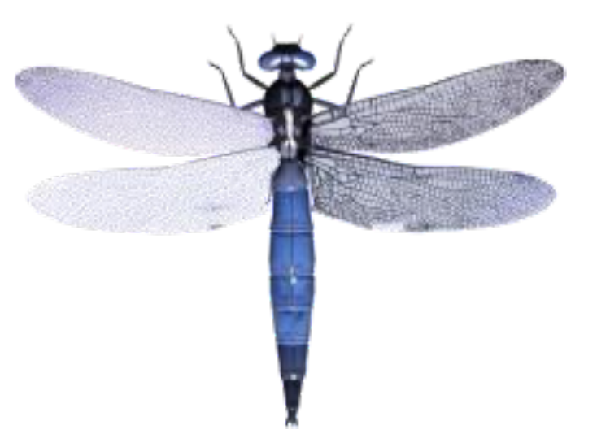

# Областной этап, 8 класс — Областной этап · 8 класс · 36 заданий части I и 2 задания части II (часть 1 из 2)

Олимпиада `obl` из тренажёра «Олимпиада под микроскопом». Вопросов: 42. Каждый вопрос: условие (с рисунками), ключ и допустимые ответы, эталонный ответ, разбор по шагам 3–8 (алгоритм, объяснение и разбор вариантов, ловушки, как запомнить, схема, олимпиадный горизонт). Схемы в разборах здесь заменены подписями; сами схемы — в PDF-версии.

---

### [obl-q1] № 1 · Задание 1 · Царство организмов без ядра

Раздел: Часть I — Задания 1–22: тесты и последовательность. Тип: один ответ. ID: `obl-q1`. На сайте: `#obl-q1`.

**Условие.** Одноклеточные или колониальные организмы, не имеющие оформленного ядра, относятся к царству:

Варианты:
- 1) растения
- 2) животные
- 3) грибы
- 4) бактерии

**Ключ:** 4) бактерии

**Эталонный ответ (карточка «Правильный ответ» на сайте):**

**4) бактерии.**

**Разбор (шаги 3–8):**
#### 3. Алгоритм олимпиадного мышления
**Маркеры в условии.** «Не имеющие **оформленного ядра**» — это определение прокариот.

**Логическая цепочка:**

1. Все организмы делят на прокариот (нет ядра) и эукариот (есть ядро).
2. Растения, животные и грибы — эукариоты: ядро окружено оболочкой.
3. Прокариоты — бактерии (включая цианобактерии) → «4».

#### 4. Послойное объяснение и разбор вариантов
**Суть в двух предложениях.** У бактерий нет ядра: их ДНК лежит прямо в цитоплазме, в области, которую называют нуклеоидом. Поэтому бактерии — прокариоты, а все остальные царства — эукариоты.

**Механизм.** У эукариот ДНК отделена от цитоплазмы двойной ядерной оболочкой с порами. У бактерий одна кольцевая молекула ДНК свободно лежит в цитоплазме, мембранных органоидов (митохондрий, пластид) тоже нет. Бактерии бывают одноклеточными и колониальными (цепочки стрептококков, нити цианобактерий).

**Разбор неверных вариантов:**

- **1) растения** — эукариоты с ядром; среди водорослей есть одноклеточные и колониальные (хламидомонада, вольвокс), но ядро у них есть.
- **2) животные** — эукариоты; одноклеточных «животных» (простейших) сейчас относят к протистам.
- **3) грибы** — эукариоты; одноклеточные дрожжи имеют ядро.

#### 5. Типичные ошибки и ловушки
- **«Одноклеточный» ≠ «без ядра».** Амёба, эвглена, дрожжи одноклеточные, но ядро у них есть.
- **Цианобактерии** («сине-зелёные водоросли») — бактерии, а не растения.

!

Запомни: нет оформленного ядра — значит, прокариота, царство бактерий.

#### 6. Как запомнить
**Этимология:** *прокариоты* — греч. pro «до» + karyon «ядро» (доядерные); *эукариоты* — eu «хорошо» + karyon (с настоящим ядром).

| Признак | Прокариоты | Эукариоты |
|---|---|---|
| ядро | нет (нуклеоид) | есть |
| мембранные органоиды | нет | есть |
| примеры | бактерии, цианобактерии | растения, животные, грибы, протисты |

#### 7. Визуализация
[Схема в разборе: Главное деление живого]
*Подпись к схеме: Отсутствие оформленного ядра — признак бактерий.*

#### 8. Олимпиадный горизонт
- **Археи** — ещё одна группа прокариот, внешне похожих на бактерии, но биохимически отличающихся; их выделяют в отдельный домен  [олимпиадный уровень] .
- Где у бактерий хранится ДНК — задание 8 этой олимпиады.

---

### [obl-q2] № 2 · Задание 2 · Как плавает хламидомонада

Раздел: Часть I — Задания 1–22: тесты и последовательность. Тип: один ответ. ID: `obl-q2`. На сайте: `#obl-q2`.

**Условие.** Перемещение хламидомонады осуществляется с помощью:

Варианты:
- 1) ресничек
- 2) ложноножек
- 3) миофибрилл
- 4) жгутиков

**Ключ:** 4) жгутиков

**Эталонный ответ (карточка «Правильный ответ» на сайте):**

**4) жгутиков** — у хламидомонады их два.

**Разбор (шаги 3–8):**
#### 3. Алгоритм олимпиадного мышления
**Маркеры в условии.** Хламидомонада — одноклеточная зелёная водоросль. Вспоминаем её строение.

**Логическая цепочка:**

1. Хламидомонада — капелька-клетка с чашевидным хлоропластом, красным глазком и **двумя жгутиками** на переднем конце.
2. Жгутиками она «гребёт», как пловец брассом, и плывёт к свету → «4».
3. Реснички — у инфузорий, ложноножки — у амёб, миофибриллы — в мышцах многоклеточных животных.

#### 4. Послойное объяснение и разбор вариантов
**Суть в двух предложениях.** Хламидомонада передвигается с помощью двух одинаковых жгутиков на переднем конце клетки. Красный светочувствительный глазок помогает ей плыть к свету, где идёт фотосинтез.

**Механизм.** Жгутик — длинный подвижный вырост клетки с белковыми нитями внутри. Два жгутика хламидомонады совершают гребковые движения назад, клетка продвигается вперёд и при этом вращается. Направление задаёт глазок: он затеняет светочувствительный участок мембраны с одной стороны.

**Разбор неверных вариантов:**

- **1) ресничек** — реснички короткие и многочисленные, как у инфузории-туфельки. У хламидомонады их нет.
- **2) ложноножек** — временные выросты цитоплазмы у амёбы. Хламидомонада покрыта клеточной оболочкой и ложноножек не образует.
- **3) миофибрилл** — сократительные нити в мышечных клетках; у одноклеточной водоросли их нет.

#### 5. Типичные ошибки и ловушки
- **Жгутики и реснички устроены одинаково**, но жгутиков мало и они длинные, а ресничек много и они короткие.
- **Хламидомонада — водоросль**, а не животное, хотя и плавает.

!

Запомни: хламидомонада, эвглена — жгутики; инфузория — реснички; амёба — ложноножки.

#### 6. Как запомнить
| Организм | Органоиды движения |
|---|---|
| хламидомонада | 2 жгутика |
| эвглена зелёная | 1 жгутик |
| инфузория-туфелька | реснички |
| амёба | ложноножки |
| вольвокс | 2 жгутика у каждой клетки колонии |

**Этимология:** *хламидомонада* — греч. chlamys «плащ» + monas «единица»: одиночная клетка в «плаще»-оболочке.

#### 7. Визуализация
[Схема в разборе: Органоиды движения одноклеточных]
*Подпись к схеме: У хламидомонады — два жгутика.*

#### 8. Олимпиадный горизонт
- **Вольвокс** — шаровидная колония из тысяч клеток, похожих на хламидомонаду; это модель перехода к многоклеточности.
- **Фототаксис** — движение к свету; у хламидомонады его обеспечивает красный глазок (стигма).

---

### [obl-q3] № 3 · Задание 3 · Что общего у грибов и растений

Раздел: Часть I — Задания 1–22: тесты и последовательность. Тип: один ответ. ID: `obl-q3`. На сайте: `#obl-q3`.

**Условие.** Общим признаком для грибов и многих растений является:

Варианты:
- 1) наличие пластид
- 2) резервный углевод — крахмал
- 3) спорообразование
- 4) продукт выделения — мочевина

**Ключ:** 3) спорообразование

**Эталонный ответ (карточка «Правильный ответ» на сайте):**

**3) спорообразование.**

**Разбор (шаги 3–8):**
#### 3. Алгоритм олимпиадного мышления
**Маркеры в условии.** «Общим для **грибов и многих растений**» — признак должен быть и у тех, и у других.

**Логическая цепочка:**

1. Пластиды — только у растений; у грибов нет хлорофилла и пластид → не общий.
2. Крахмал — запас растений; у грибов запасной углевод — **гликоген** → не общий.
3. Мочевина — продукт обмена грибов (и животных), у растений её нет → не общий.
4. **Споры** образуют и грибы (плесени, шляпочные), и многие растения (мхи, папоротники, хвощи, плауны) → «3».

#### 4. Послойное объяснение и разбор вариантов
**Суть в двух предложениях.** Спора — специализированная клетка для размножения и расселения, из которой вырастает новый организм. Споры образуют и грибы, и высшие споровые растения, и водоросли — поэтому это общий признак.

**Механизм.** У грибов споры образуются в спорангиях (мукор), на конидиеносцах (пеницилл) или на пластинках и в трубочках шляпки. У мхов — в коробочке, у папоротников — в спорангиях на нижней стороне листьев. Споры лёгкие, их разносит ветер.

**Разбор неверных вариантов:**

- **1) наличие пластид** — признак растений. Грибы питаются готовой органикой и пластид не имеют.
- **2) резервный углевод — крахмал** — у растений. Грибы, как и животные, запасают гликоген.
- **4) продукт выделения — мочевина** — роднит грибы с **животными**, а не с растениями. Это классическая ловушка: признаки грибов делят на «растительные» и «животные».

#### 5. Типичные ошибки и ловушки
- **Грибы — отдельное царство**, сочетающее признаки растений (неподвижность, неограниченный рост, клеточная стенка, споры) и животных (гетеротрофия, гликоген, хитин, мочевина).
- **«Многие» растения** — потому что семенные растения размножаются семенами, хотя споры (микро- и мегаспоры) у них тоже есть  [олимпиадный уровень] .

!

Запомни: споры — общее у грибов и растений; гликоген, хитин и мочевина — общее у грибов и животных.

#### 6. Как запомнить
| Признак | Растения | Грибы | Животные |
|---|---|---|---|
| пластиды | да | нет | нет |
| запасной углевод | крахмал | гликоген | гликоген |
| клеточная стенка | целлюлоза | хитин | нет |
| споры | да | да | нет |
| мочевина | нет | да | да |

#### 7. Визуализация
[Схема в разборе: Грибы: признаки растений и животных]
*Подпись к схеме: Спорообразование — общий признак грибов и растений.*

#### 8. Олимпиадный горизонт
- **Хитин** грибов — тот же полисахарид, что в покровах членистоногих.
- Запасное вещество грибов — задание 7 этой олимпиады.

---

### [obl-q4] № 4 · Задание 4 · Лишняя болезнь по возбудителю

Раздел: Часть I — Задания 1–22: тесты и последовательность. Тип: один ответ. ID: `obl-q4`. На сайте: `#obl-q4`.

**Условие.** Из четырех предложенных заболеваний три можно объединить в одну группу по возбудителю. Выберите заболевание, не входящее в эту группу:

Варианты:
- 1) дифтерия
- 2) сальмонеллез
- 3) СПИД
- 4) ботулизм

**Ключ:** 3) СПИД

**Эталонный ответ (карточка «Правильный ответ» на сайте):**

**3) СПИД** — единственная вирусная болезнь; остальные три вызывают бактерии.

**Разбор (шаги 3–8):**
#### 3. Алгоритм олимпиадного мышления
**Маркеры в условии.** «Объединить по возбудителю» — ищем три болезни одной группы возбудителей и одну лишнюю.

**Логическая цепочка:**

1. Дифтерия — дифтерийная палочка (бактерия).
2. Сальмонеллёз — сальмонеллы (бактерии).
3. Ботулизм — ботулиническая клостридия (бактерия).
4. СПИД — вирус иммунодефицита человека (ВИЧ) → лишний → «3».

#### 4. Послойное объяснение и разбор вариантов
**Суть в двух предложениях.** Дифтерия, сальмонеллёз и ботулизм — бактериальные болезни, а СПИД вызывает вирус. ВИЧ поражает клетки иммунной системы, и организм перестаёт защищаться от других инфекций.

**Механизм по болезням:**

- **Дифтерия** — токсин дифтерийной палочки образует плёнки в горле; от неё делают прививку (АКДС).
- **Сальмонеллёз** — кишечная инфекция из плохо прожаренных яиц, мяса.
- **Ботулизм** — тяжёлое отравление токсином клостридии из домашних консервов без доступа воздуха; токсин поражает нервную систему.
- **СПИД** — последняя стадия ВИЧ-инфекции; вирус встраивает свои гены в лимфоциты и разрушает их.

**Почему не ошибиться:** «ботулизм» и «сальмонеллёз» звучат как «отравления», и их можно счесть отдельной группой. Но вопрос именно про **возбудителя**: у трёх из четырёх это бактерии.

#### 5. Типичные ошибки и ловушки
- **Отравление токсином — тоже бактериальная болезнь** (ботулизм).
- **СПИД ≠ ВИЧ:** ВИЧ — вирус, СПИД — синдром, который он вызывает на поздней стадии.

!

Запомни: дифтерия, сальмонеллёз, ботулизм, столбняк — бактерии; СПИД, грипп, гепатит — вирусы.

#### 6. Как запомнить
**Этимология:** *ботулизм* — лат. botulus «колбаса» (впервые описан при отравлении колбасой); *СПИД* — синдром приобретённого иммунодефицита.

| Болезнь | Возбудитель |
|---|---|
| дифтерия | бактерия (коринебактерия) |
| сальмонеллёз | бактерия (сальмонелла) |
| ботулизм | бактерия (клостридия) |
| СПИД | вирус (ВИЧ) |

#### 7. Визуализация
[Схема в разборе: Группировка по возбудителю]
*Подпись к схеме: СПИД — единственная вирусная болезнь из четырёх.*

#### 8. Олимпиадный горизонт
- **Клостридии** вызывают ещё столбняк и газовую гангрену; все они анаэробы и образуют споры (см. задание 10).
- **Почему антибиотики не помогают при ВИЧ:** вирус не имеет своих рибосом и клеточной стенки.

---

### [obl-q5] № 5 · Задание 5 · Где в стебле запасаются вещества

Раздел: Часть I — Задания 1–22: тесты и последовательность. Тип: один ответ. ID: `obl-q5`. На сайте: `#obl-q5`.

**Условие.** Запасание питательных веществ в стебле, преимущественно, обеспечивают:

Варианты:
- 1) сосуды ксилемы
- 2) лубяные волокна
- 3) ситовидные трубки
- 4) клетки паренхимы

**Ключ:** 4) клетки паренхимы

**Эталонный ответ (карточка «Правильный ответ» на сайте):**

**4) клетки паренхимы** — основная (запасающая) ткань.

**Разбор (шаги 3–8):**
#### 3. Алгоритм олимпиадного мышления
**Маркеры в условии.** «**Запасание**» — функция основной ткани.

**Логическая цепочка:**

1. Запасать вещества могут только **живые** клетки с большим объёмом.
2. Сосуды ксилемы и лубяные волокна — мёртвые; ситовидные трубки живые, но заняты проведением сахаров.
3. Запасает **паренхима** (сердцевина, лучи, кора) → «4».

#### 4. Послойное объяснение и разбор вариантов
**Суть в двух предложениях.** Паренхима — основная ткань из живых тонкостенных клеток, которые запасают крахмал, белки, масла и воду. В стебле она образует сердцевину, сердцевинные лучи и часть коры.

**Механизм.** Сахара, пришедшие по флоэме, клетки паренхимы превращают в крахмал и хранят в лейкопластах. Весной запасы снова растворяются и идут к распускающимся почкам. Особенно много запасающей паренхимы в видоизменённых стеблях: клубнях картофеля, корневищах, луковицах.

**Разбор неверных вариантов:**

- **1) сосуды ксилемы** — мёртвые полые трубки для воды с солями.
- **2) лубяные волокна** — мёртвые толстостенные клетки склеренхимы, дают прочность.
- **3) ситовидные трубки** — живые, но без ядра; они проводят растворы сахаров, а не хранят их.

#### 5. Типичные ошибки и ловушки
- **Мёртвые клетки ничего не запасают** — у них нет цитоплазмы.
- **Проводить ≠ запасать:** ситовидные трубки транспортируют сахара, паренхима их хранит.

!

Запомни: запас в стебле — в паренхиме (сердцевина, лучи, кора).

#### 6. Как запомнить
| Ткань | Живая? | Функция |
|---|---|---|
| паренхима | да | запасание, фотосинтез |
| сосуды ксилемы | нет | проведение воды |
| ситовидные трубки | да (без ядра) | проведение сахаров |
| лубяные волокна | нет | прочность |

**Этимология:** *паренхима* — греч. para «около» + enchyma «налитое»: «налитая» содержимым ткань.

#### 7. Визуализация
[Схема в разборе: Ткани стебля по функциям]
*Подпись к схеме: Запасающая ткань — паренхима.*

#### 8. Олимпиадный горизонт
- **Сердцевинные лучи** — полоски паренхимы от сердцевины к коре: по ним вещества идут поперёк ствола.
- Ткани стебля и их описание — задание 36 этой олимпиады.

---

### [obl-q6] № 6 · Задание 6 · Съедобный пластинчатый гриб

Раздел: Часть I — Задания 1–22: тесты и последовательность. Тип: один ответ. ID: `obl-q6`. На сайте: `#obl-q6`.

**Условие.** Съедобным пластинчатым грибом является:

Варианты:
- 1) белый гриб
- 2) перечный гриб
- 3) рыжик
- 4) бледная поганка

**Ключ:** 3) рыжик

**Эталонный ответ (карточка «Правильный ответ» на сайте):**

**3) рыжик.**

**Разбор (шаги 3–8):**
#### 3. Алгоритм олимпиадного мышления
**Маркеры в условии.** Два условия сразу: **съедобный** и **пластинчатый**. Нужен гриб, у которого выполняются оба.

**Логическая цепочка:**

1. Белый гриб — съедобный, но **трубчатый**.
2. Перечный гриб — **трубчатый**, к тому же жгуче-острый (несъедобный или условно съедобный).
3. Бледная поганка — пластинчатый, но **смертельно ядовитый**.
4. Рыжик — пластинчатый и съедобный → «3».

#### 4. Послойное объяснение и разбор вариантов
**Суть в двух предложениях.** Рыжик — съедобный пластинчатый гриб-млечник с оранжевым млечным соком. Остальные варианты нарушают одно из двух условий.

**Механизм — как отличить.** Перевернём шляпку: у трубчатых грибов снизу «губка» из трубочек, у пластинчатых — тонкие пластинки от ножки к краю. Споры образуются на поверхности трубочек или пластинок.

**Разбор неверных вариантов:**

- **1) белый гриб** — съедобный, но трубчатый. Ловушка для тех, кто реагирует только на слово «съедобный».
- **2) перечный гриб** — трубчатый; у него жгучий перечный вкус, в еду обычно не используют.
- **4) бледная поганка** — пластинчатая, но самая ядовитая в наших лесах. Ловушка для тех, кто проверил только «пластинчатый».

#### 5. Типичные ошибки и ловушки
- **Два условия в одном вопросе** — проверяй оба.
- **Бледную поганку путают с сыроежкой и шампиньоном.** У поганки пластинки всегда белые, на ножке кольцо («юбочка»), у основания — мешок-вольва.

!

Запомни: рыжик — съедобный пластинчатый; белый гриб — съедобный трубчатый; бледная поганка — ядовитый пластинчатый.

#### 6. Как запомнить
| Гриб | Строение | Съедобность |
|---|---|---|
| рыжик | пластинчатый | съедобный |
| белый гриб | трубчатый | съедобный |
| перечный гриб | трубчатый | несъедобный (жгучий) |
| бледная поганка | пластинчатый | смертельно ядовитый |

См. также олимпиаду 2016 года, тест 13 («Грибом является: рыжик»).

#### 7. Визуализация
[Схема в разборе: Два условия: «пластинчатый» и «съедобный»]
*Подпись к схеме: Оба условия выполняются только у рыжика.*

#### 8. Олимпиадный горизонт
- **Яд бледной поганки** (аманитин) не разрушается при варке и поражает печень; симптомы появляются лишь через 6–24 часа.
- **Рыжик образует микоризу** с соснами и елями (см. задание 16 о микоризе).

---

### [obl-q7] № 7 · Задание 7 · Запасное вещество грибов

Раздел: Часть I — Задания 1–22: тесты и последовательность. Тип: один ответ. ID: `obl-q7`. На сайте: `#obl-q7`.

**Условие.** Запасным питательным веществом у грибов служит:

Варианты:
- 1) крахмал
- 2) сахароза
- 3) мочевина
- 4) гликоген

**Ключ:** 4) гликоген

**Эталонный ответ (карточка «Правильный ответ» на сайте):**

**4) гликоген** — как у животных.

**Разбор (шаги 3–8):**
#### 3. Алгоритм олимпиадного мышления
**Маркеры в условии.** «**Запасное** питательное вещество» грибов.

**Логическая цепочка:**

1. Крахмал — запас растений (в пластидах), у грибов пластид нет.
2. Сахароза — транспортный сахар растений.
3. Мочевина — не питательное вещество, а продукт выделения.
4. Грибы, как и животные, запасают **гликоген** → «4».

#### 4. Послойное объяснение и разбор вариантов
**Суть в двух предложениях.** Гликоген — разветвлённый полимер глюкозы, «животный крахмал». Грибы запасают его в цитоплазме, как печень и мышцы животных.

**Механизм.** Гликоген сильнее ветвится, чем крахмал, поэтому быстрее расщепляется до глюкозы, когда нужна энергия. У грибов кроме гликогена запасаются капли жира (масла) и сахар трегалоза  [олимпиадный уровень] .

**Разбор неверных вариантов:**

- **1) крахмал** — запас растений; ловушка «грибы раньше относили к растениям».
- **2) сахароза** — у растений это форма, в которой сахар переносится по флоэме, а не долгий запас.
- **3) мочевина** — продукт обмена азота, который грибы выделяют; это вещество не запасают для питания.

#### 5. Типичные ошибки и ловушки
- **Гликоген, хитин, мочевина** — «животные» черты грибов (см. задание 3).

!

Запомни: запасной углевод растений — крахмал, грибов и животных — гликоген.

#### 6. Как запомнить
**Этимология:** *гликоген* — греч. glykys «сладкий» + genes «рождающий» (при расщеплении даёт глюкозу).

| Группа | Запасной углевод |
|---|---|
| растения | крахмал |
| грибы | гликоген |
| животные | гликоген |
| красные водоросли | багрянковый крахмал |

#### 7. Визуализация
[Схема в разборе: Запасные углеводы]
*Подпись к схеме: Грибы запасают гликоген, как животные.*

#### 8. Олимпиадный горизонт
- **Хлеб и пиво** — заслуга дрожжей (одноклеточных грибов), которые сбраживают сахара.
- Где растения хранят крахмал — олимпиада 2016 года, тест 1.

---

### [obl-q8] № 8 · Задание 8 · Где у бактерий ДНК

Раздел: Часть I — Задания 1–22: тесты и последовательность. Тип: один ответ. ID: `obl-q8`. На сайте: `#obl-q8`.

**Условие.** Генетическая информация у бактерий содержится в:

Варианты:
- 1) митохондриях
- 2) нуклеоиде
- 3) ядре
- 4) мезосоме

**Ключ:** 2) нуклеоиде

**Эталонный ответ (карточка «Правильный ответ» на сайте):**

**2) нуклеоиде** — зоне цитоплазмы с кольцевой ДНК.

**Разбор (шаги 3–8):**
#### 3. Алгоритм олимпиадного мышления
**Маркеры в условии.** «Генетическая информация» = ДНК; «у **бактерий**» = прокариоты.

**Логическая цепочка:**

1. Ядра у бактерий нет (задание 1) → «3» отпадает.
2. Митохондрий у бактерий тоже нет → «1» отпадает.
3. Мезосома — впячивание мембраны, связанное с делением и дыханием, но не хранилище ДНК.
4. ДНК лежит в **нуклеоиде** → «2».

#### 4. Послойное объяснение и разбор вариантов
**Суть в двух предложениях.** Нуклеоид — участок цитоплазмы бактерии, где находится её кольцевая молекула ДНК. Он не отделён мембраной, в отличие от ядра.

**Механизм.** Кольцевая ДНК бактерии в тысячу раз длиннее самой клетки, поэтому она плотно свёрнута в нуклеоиде. Кроме неё, у многих бактерий есть маленькие кольцевые ДНК — **плазмиды**; в них часто записаны гены устойчивости к антибиотикам.

**Разбор неверных вариантов:**

- **1) митохондриях** — митохондрии есть только у эукариот. Ловушка: у митохондрий тоже есть своя ДНК.
- **3) ядре** — ядра у бактерий нет.
- **4) мезосоме** — так называли складку мембраны бактерий; сейчас считают, что это во многом артефакт приготовления препаратов  [олимпиадный уровень] .

#### 5. Типичные ошибки и ловушки
- **Нуклеоид ≠ ядро:** нет оболочки, нет ядрышка.
- **ДНК вне нуклеоида** у бактерий тоже бывает — в плазмидах.

!

Запомни: у бактерий ДНК в нуклеоиде (и плазмидах), ядра нет.

#### 6. Как запомнить
**Этимология:** *нуклеоид* — лат. nucleus «ядро» + греч. eidos «вид»: «похожий на ядро».

|  | Бактерия | Эукариотическая клетка |
|---|---|---|
| где ДНК | нуклеоид, плазмиды | ядро, митохондрии, пластиды |
| форма ДНК | кольцевая | линейные хромосомы в ядре |

#### 7. Визуализация
[Схема в разборе: Строение бактериальной клетки снаружи внутрь]
*Подпись к схеме: ДНК бактерии свободно лежит в цитоплазме — в нуклеоиде.*

#### 8. Олимпиадный горизонт
- **Плазмиды** используют в генной инженерии: в них встраивают нужный ген (например, инсулина) и вводят в бактерию.
- **Митохондрии и хлоропласты** имеют свою кольцевую ДНК, как бактерии, — это довод в пользу их происхождения от бактерий-симбионтов.

---

### [obl-q9] № 9 · Задание 9 · Что выводит лишнюю воду у инфузории

Раздел: Часть I — Задания 1–22: тесты и последовательность. Тип: один ответ. ID: `obl-q9`. На сайте: `#obl-q9`.

**Условие.** Выведение избытка воды и вредных продуктов жизнедеятельности у инфузории туфельки осуществляет (ют):

Варианты:
- 1) порошица
- 2) ротовое отверстие
- 3) сократительные вакуоли
- 4) пищеварительные вакуоли

**Ключ:** 3) сократительные вакуоли

**Эталонный ответ (карточка «Правильный ответ» на сайте):**

**3) сократительные вакуоли.**

**Разбор (шаги 3–8):**
#### 3. Алгоритм олимпиадного мышления
**Маркеры в условии.** «Избыток **воды**» и «вредные продукты жизнедеятельности» (растворённые) — это работа органоида выделения.

**Логическая цепочка:**

1. Туфелька живёт в пресной воде, вода всё время входит в клетку по осмосу.
2. Лишнюю воду вместе с растворёнными отходами выбрасывают **сократительные вакуоли** (у туфельки их две) → «3».
3. Порошица выбрасывает **непереваренные остатки пищи**, а не воду.

#### 4. Послойное объяснение и разбор вариантов
**Суть в двух предложениях.** Две сократительные вакуоли туфельки по очереди собирают воду из цитоплазмы по приводящим канальцам и выталкивают её наружу. Вместе с водой уходят растворённые продукты обмена.

**Механизм.** Вокруг каждой вакуоли — 5–7 канальцев, похожих на лучи звезды. Они наполняются жидкостью, вакуоль раздувается и сокращается, выбрасывая содержимое через пору. Вакуоли работают попеременно, каждая — раз в 10–20 секунд.

**Разбор неверных вариантов:**

- **1) порошица** — место в задней части тела, через которое выбрасываются **непереваренные остатки пищи**. Главная ловушка.
- **2) ротовое отверстие** — через клеточный рот пища поступает внутрь.
- **4) пищеварительные вакуоли** — в них переваривается пища.

#### 5. Типичные ошибки и ловушки
- **Порошица — для твёрдых остатков, сократительная вакуоль — для воды и растворённых отходов.**
- **У морских простейших сократительных вакуолей обычно нет** (вода не входит).

!

Запомни: лишняя вода — сократительные вакуоли; непереваренные остатки — порошица.

#### 6. Как запомнить
| Органоид | Что делает |
|---|---|
| клеточный рот | приём пищи |
| пищеварительная вакуоль | переваривание |
| порошица | выброс непереваренных остатков |
| сократительная вакуоль | выброс лишней воды и растворённых отходов |

См. районный этап 2019, часть II, пункт 11 — где на рисунке туфельки сократительная вакуоль, а где порошица.

#### 7. Визуализация
[Схема в разборе: Работа сократительной вакуоли]
*Подпись к схеме: Две вакуоли туфельки работают по очереди.*

#### 8. Олимпиадный горизонт
- **Если туфельку перенести в солёную воду**, вакуоли будут сокращаться реже (см. тренажёр олимпиады 2016/2017).
- Морская амёба без сократительной вакуоли — тест 25 олимпиады 2016 года.

---

### [obl-q10] № 10 · Задание 10 · Как заражаются столбняком

Раздел: Часть I — Задания 1–22: тесты и последовательность. Тип: один ответ. ID: `obl-q10`. На сайте: `#obl-q10`.

**Условие.** Бактерии, вызывающие столбняк, чаще всего попадают в организм человека при:

Варианты:
- 1) укусе насекомых
- 2) загрязнении раны почвой
- 3) употреблении несвежих продуктов питания
- 4) употребление некипяченой воды из открытых водоемов

**Ключ:** 2) загрязнении раны почвой

**Эталонный ответ (карточка «Правильный ответ» на сайте):**

**2) загрязнении раны почвой.**

**Разбор (шаги 3–8):**
#### 3. Алгоритм олимпиадного мышления
**Маркеры в условии.** «Столбняк», «чаще всего». Вспоминаем, где живёт возбудитель.

**Логическая цепочка:**

1. Возбудитель столбняка — клостридия, анаэроб, образующая стойкие **споры**.
2. Споры живут в **почве** (и в кишечнике животных, откуда попадают в почву с навозом).
3. Они прорастают в глубоких ранах без доступа воздуха → заражение через рану, загрязнённую землёй → «2».

#### 4. Послойное объяснение и разбор вариантов
**Суть в двух предложениях.** Столбнячная палочка попадает в организм через раны, в которые попала почва: проколы гвоздём, глубокие царапины, ожоги. В бескислородной глубине раны споры прорастают, и бактерии выделяют токсин, поражающий нервную систему.

**Механизм.** Токсин блокирует торможение в спинном мозге, и мышцы сводит судорогой — отсюда название «столбняк» (тело становится «как столб»). Защита — прививка (АКДС, АДС-М) и экстренное введение противостолбнячной сыворотки при травмах.

**Разбор неверных вариантов:**

- **1) укусе насекомых** — так передаются малярия, клещевые инфекции, но не столбняк.
- **3) несвежих продуктах** — путь заражения сальмонеллёзом и ботулизмом (токсин ботулизма тоже образует клостридия, но другая).
- **4) некипячёной воде** — путь холеры, дизентерии, гепатита А.

#### 5. Типичные ошибки и ловушки
- **Столбняк и ботулизм** вызывают родственные клостридии, но заражение разное: столбняк — через раны, ботулизм — с испорченными консервами.
- **Анаэробы** опасны именно в глубоких узких ранах, куда не проникает воздух.

!

Запомни: столбняк — споры из почвы в глубокой ране; поэтому при травмах проверяют прививку.

#### 6. Как запомнить
| Болезнь | Путь заражения |
|---|---|
| столбняк | рана, загрязнённая почвой |
| ботулизм | домашние консервы |
| холера | грязная вода |
| малярия | укус комара |

#### 7. Визуализация
[Схема в разборе: Как развивается столбняк]
*Подпись к схеме: Анаэробные бактерии прорастают из спор там, где нет воздуха.*

#### 8. Олимпиадный горизонт
- **Споры клостридий** выдерживают кипячение и десятилетия хранения в почве.
- Бактериальные болезни и их возбудители — задание 4 этой олимпиады.

---

### [obl-q11] № 11 · Задание 11 · Зачем пикируют рассаду

Раздел: Часть I — Задания 1–22: тесты и последовательность. Тип: один ответ. ID: `obl-q11`. На сайте: `#obl-q11`.

**Условие.** При высадке рассады часто применяют такой агротехнический прием, как пикировка. Ее проводят с целью:

Пункты:
- а) усиление ветвления стебля
- б) стимуляции появления боковых корней
- в) стимуляции появления корнеплодов
- г) улучшения снабжения растений водой и минеральными веществами
- д) уплотнения посадок растений

Варианты:
- 1) а, г
- 2) б, г
- 3) в, г, д
- 4) б, в, д

**Ключ:** 2) б, г

**Эталонный ответ (карточка «Правильный ответ» на сайте):**

**2) б, г** — пикировка стимулирует боковые корни и тем улучшает снабжение водой и минеральными веществами.

**Разбор (шаги 3–8):**
#### 3. Алгоритм олимпиадного мышления
**Маркеры в условии.** «Пикировка» — удаление кончика главного корня при пересадке (см. олимпиаду 2016 года, тест 3).

**Логическая цепочка:**

1. Убираем кончик главного корня → снимаем его подавляющее действие → растут **боковые корни** (б ✔).
2. Корневая система становится мочковатой и разрастается в верхнем плодородном слое → лучше **поглощает воду и минеральные вещества** (г ✔).
3. Ветвление стебля (а) — это прищипка побега; корнеплоды (в) — от пикировки, наоборот, страдают; уплотнение посадок (д) — не цель пикировки.
4. Набор «б, г» → вариант «2».

#### 4. Послойное объяснение и разбор вариантов
**Суть в двух предложениях.** Пикировка — пересадка сеянцев с укорачиванием главного корня примерно на треть. В ответ растение образует много боковых корней, которые лучше всасывают воду и минеральные соли из верхнего слоя почвы.

**Механизм.** Кончик главного корня тормозит рост боковых корней (верхушечное доминирование). Без него «запрет» снимается: из перицикла закладываются новые боковые корни. Получается разветвлённая корневая система, и растение легче переносит пересадку.

**Разбор пунктов:**

- **а) ветвление стебля** — это результат прищипки *побега*, а не корня.
- **в) корнеплоды** — у моркови или свёклы корнеплод — это утолщённый главный корень. Пикировка его *портит*: вместо одного корнеплода получается «рогатый» разветвлённый. Поэтому корнеплодные культуры не пикируют.
- **д) уплотнение посадок** — наоборот, при пикировке сеянцы рассаживают реже.

#### 5. Типичные ошибки и ловушки
- **Корнеплоды не пикируют** — ловушка «в».
- **Прищипка (побег) ≠ пикировка (корень).**

!

Запомни: пикировка → боковые корни → лучше вода и минеральное питание.

#### 6. Как запомнить
| Приём | Что удаляют | Что получают |
|---|---|---|
| пикировка | кончик главного корня | боковые корни |
| прищипка | верхушку побега | ветвление стебля |
| пасынкование | боковые побеги | крупнее плоды |

#### 7. Визуализация
[Схема в разборе: Зачем нужна пикировка]
*Подпись к схеме: Корнеплодные культуры не пикируют — портится главный корень.*

#### 8. Олимпиадный горизонт
- **Верхушечное доминирование** есть и у побега, и у корня: верхушка тормозит развитие боковых органов, поэтому прищипка и пикировка усиливают ветвление. У побега этот «запрет» передаёт гормон ауксин; у корня гормональная регуляция устроена иначе  [олимпиадный уровень] .
- Окучивание и пикировка — тест 3 олимпиады 2016 года; агроприёмы по иллюстрациям — практическое задание 1 олимпиады 2018/2019.

---

### [obl-q12] № 12 · Задание 12 · Как опыляется ольха

Раздел: Часть I — Задания 1–22: тесты и последовательность. Тип: один ответ. ID: `obl-q12`. На сайте: `#obl-q12`.

**Условие.** Приспособлением к опылению у ольхи является:

Варианты:
- 1) наличие яркого околоцветника
- 2) наличие липкой крупной пыльцы
- 3) наличие кустарников
- 4) цветение до распускания листьев

**Ключ:** 4) цветение до распускания листьев

**Эталонный ответ (карточка «Правильный ответ» на сайте):**

**4) цветение до распускания листьев.**

**Разбор (шаги 3–8):**
#### 3. Алгоритм олимпиадного мышления
**Маркеры в условии.** Ольха — ветроопыляемое растение (цветёт серёжками ранней весной).

**Логическая цепочка:**

1. Ветроопыляемым нужно, чтобы пыльца свободно летела по ветру.
2. Листья мешали бы полёту пыльцы. Поэтому ольха, лещина, берёза цветут **до распускания листьев** → «4».
3. Яркий околоцветник и липкая крупная пыльца — признаки **насекомоопыляемых** растений.

#### 4. Послойное объяснение и разбор вариантов
**Суть в двух предложениях.** Ольха опыляется ветром, и её серёжки пылят ранней весной, пока на ветвях нет листьев. Голые ветви не задерживают пыльцу, и она легко долетает до женских соцветий.

**Механизм — признаки ветроопыляемых:** невзрачные цветки без яркого околоцветника, много лёгкой сухой мелкой пыльцы, длинные свисающие серёжки, крупные перистые или кисточковые рыльца, цветение до листьев.

**Разбор неверных вариантов:**

- **1) яркий околоцветник** — приманка для насекомых; ветру яркость не нужна.
- **2) липкая крупная пыльца** — так пыльца прилипает к насекомым; ветер её не унесёт.
- **3) наличие кустарников** — жизненная форма, а не приспособление к опылению.

#### 5. Типичные ошибки и ловушки
- **Ранняя весна — время ветроопыляемых деревьев** (ольха, лещина, осина, берёза).
- **Липкость пыльцы** — признак насекомоопыляемых.

!

Запомни: ветроопыляемые — невзрачные цветки, сухая лёгкая пыльца, цветение до листьев.

#### 6. Как запомнить
| Признак | Ветроопыляемые | Насекомоопыляемые |
|---|---|---|
| околоцветник | невзрачный или нет | яркий |
| пыльца | мелкая, сухая, много | крупная, липкая |
| нектар, запах | нет | есть |
| примеры | ольха, берёза, злаки | яблоня, колокольчик |

#### 7. Визуализация
[Схема в разборе: Признаки ветроопыляемых и насекомоопыляемых]
*Подпись к схеме: Цветение до распускания листьев — приспособление к ветру.*

#### 8. Олимпиадный горизонт
- **Серёжки ольхи** — мужские соцветия; женские — маленькие «шишечки», которые зимой остаются на ветвях.
- **Пыльца ольхи и берёзы** — частая причина весенней аллергии (тест 30 олимпиады 2016 года).

---

### [obl-q13] № 13 · Задание 13 · Недостающий таксон

Раздел: Часть I — Задания 1–22: тесты и последовательность. Тип: один ответ. ID: `obl-q13`. На сайте: `#obl-q13`.

**Условие.** Укажите недостающее звено в таксономическом ряду классификации животных: отряд — класс — ? — царство.

Варианты:
- 1) вид
- 2) тип
- 3) род
- 4) надцарство

**Ключ:** 2) тип

**Эталонный ответ (карточка «Правильный ответ» на сайте):**

**2) тип.** Отряд → класс → **тип** → царство.

**Разбор (шаги 3–8):**
#### 3. Алгоритм олимпиадного мышления
**Маркеры в условии.** Ряд идёт **от меньшего к большему**: отряд меньше класса, класс меньше царства. Пропуск стоит между классом и царством.

**Логическая цепочка:**

1. Выписываем полную лестницу таксонов животных снизу вверх: вид → род → семейство → отряд → класс → **тип** → царство.
2. Сразу после класса и перед царством — тип → «2».
3. Вид и род — ниже отряда, они стояли бы в начале ряда; надцарство — выше царства, после него.

#### 4. Послойное объяснение и разбор вариантов
**Суть в двух предложениях.** Систематика — это «матрёшка»: несколько видов объединяют в род, роды — в семейство, и так до царства. Между классом и царством у животных стоит тип (например, тип Хордовые объединяет классы рыб, земноводных, пресмыкающихся, птиц и млекопитающих).

**Пример полной лестницы — волк:**

| Таксон | Волк |
|---|---|
| царство | Животные |
| тип | Хордовые |
| класс | Млекопитающие |
| отряд | Хищные |
| семейство | Псовые |
| род | Волк (Canis) |
| вид | Волк обыкновенный |

**Разбор неверных вариантов:**

- **1) вид** — самая мелкая основная единица, стоит в самом начале ряда, ниже отряда.
- **3) род** — тоже ниже отряда (род → семейство → отряд).
- **4) надцарство** — объединяет царства (прокариоты / эукариоты), поэтому стоит **после** царства, а не перед ним.

#### 5. Типичные ошибки и ловушки
- **У растений и грибов вместо «тип» — «отдел»**, а вместо «отряд» — «порядок». В задании речь о **животных** — значит, тип.
- **Направление ряда.** Проверь, идёт ли ряд вверх (вид → царство) или вниз — иначе легко вписать соседний таксон с другой стороны.

!

Запомни: вид — род — семейство — отряд — класс — тип — царство.

#### 6. Как запомнить
**Фраза-подсказка по первым буквам** (В-Р-С-О-К-Т-Ц): «**В**аня **Р**ешил **С**ъесть **О**громный **К**усок **Т**орта **Ц**еликом».

| Животные | Растения |
|---|---|
| тип | отдел |
| класс | класс |
| отряд | порядок |
| семейство | семейство |

#### 7. Визуализация
[Схема в разборе: Лестница таксонов животных]
*Подпись к схеме: Пропуск между классом и царством — тип.*

#### 8. Олимпиадный горизонт
- **Надцарство (домен)** — над царствами: прокариоты и эукариоты; в современной системе — три домена: Бактерии, Археи, Эукариоты  [олимпиадный уровень] .
- **Промежуточные таксоны:** подкласс, надотряд, подсемейство. Например, «надкласс Рыбы» встречается в задании 34 этой олимпиады.

---

### [obl-q14] № 14 · Задание 14 · Корневище ириса

Раздел: Часть I — Задания 1–22: тесты и последовательность. Тип: один ответ. ID: `obl-q14`. На сайте: `#obl-q14`.

**Условие.** Корневище ириса по происхождению является видоизмененным:

Варианты:
- 1) корнем
- 2) плодом
- 3) побегом
- 4) листом

**Ключ:** 3) побегом

**Эталонный ответ (карточка «Правильный ответ» на сайте):**

**3) побегом.** На корневище есть узлы, чешуевидные листья и почки — признаки побега.

**Разбор (шаги 3–8):**
#### 3. Алгоритм олимпиадного мышления
**Маркеры в условии.** «**По происхождению**» — спрашивают, из какого органа развилась структура, а не где она находится.

**Логическая цепочка:**

1. Корневище растёт в почве или по её поверхности — «как корень». Но место ничего не решает.
2. Ищем признаки побега: **узлы и междоузлия, чешуевидные листья (или их рубцы), верхушечная и пазушные почки**.
3. У корневища ириса всё это есть, а корневого чехлика нет → это побег → «3».

#### 4. Послойное объяснение и разбор вариантов
**Суть в двух предложениях.** Корневище — это подземный (или лежащий на почве) многолетний побег, который запасает питательные вещества и служит для вегетативного размножения. От него отходят **придаточные корни**, а из его почек весной вырастают надземные листья и цветоносы.

**Механизм — как отличить побег от корня:**

| Признак | Побег (корневище) | Корень |
|---|---|---|
| листья | чешуевидные или рубцы от листьев | нет |
| почки | верхушечная и пазушные | нет (кроме придаточных у некоторых) |
| узлы и междоузлия | есть | нет |
| корневой чехлик | нет | есть |

**Разбор неверных вариантов:**

- **1) корнем** — главная ловушка: корневище под землёй, но у корня нет листьев и почек в пазухах.
- **2) плодом** — плод образуется из цветка (завязи) и содержит семена.
- **4) листом** — видоизменённые листья — это колючки барбариса, усики гороха, чешуи луковицы; корневище несёт листья, но само листом не является.

#### 5. Типичные ошибки и ловушки
- **«Под землёй — значит корень»** — неверно. Корневище, клубень, луковица, клубнелуковица — подземные **побеги**.
- **Корнеплод и корневые шишки** (георгин) — это видоизменённые **корни**, у них нет почек с листьями на поверхности.

!

Запомни: есть узлы, почки и листья (хотя бы чешуйки) — значит, побег.

#### 6. Как запомнить
**Этимология:** *корневище* — «похожее на корень», но лишь похожее; лат. *rhizoma* от греч. rhiza «корень».

| Подземные побеги | Подземные корни |
|---|---|
| корневище (ирис, пырей, ландыш) | корнеплод (морковь, свёкла) |
| клубень (картофель) | корневые шишки (георгин) |
| луковица (лук, тюльпан) |  |

#### 7. Визуализация
[Схема в разборе: Подземные органы: побег или корень?]
*Подпись к схеме: Корневище ириса — видоизменённый побег.*

#### 8. Олимпиадный горизонт
- **Почему пырей так трудно выполоть:** каждый обрывок корневища с почкой даёт новое растение.
- **Аналогичные и гомологичные органы** — задание 19 этой олимпиады: корнеплод и клубень — аналоги.

---

### [obl-q15] № 15 · Задание 15 · Кто гетеротроф в лишайнике

Раздел: Часть I — Задания 1–22: тесты и последовательность. Тип: один ответ. ID: `obl-q15`. На сайте: `#obl-q15`.

**Условие.** Гетеротрофный компонент лишайника:

Варианты:
- 1) представлен грибом
- 2) снабжает водоросль органическими веществами
- 3) представлен цианобактериями
- 4) осуществляет фотосинтез

**Ключ:** 1) представлен грибом

**Эталонный ответ (карточка «Правильный ответ» на сайте):**

**1) представлен грибом.**

**Разбор (шаги 3–8):**
#### 3. Алгоритм олимпиадного мышления
**Маркеры в условии.** «**Гетеротрофный** компонент» — тот, кто питается готовыми органическими веществами.

**Логическая цепочка:**

1. Лишайник — симбиоз гриба и фотосинтезирующего партнёра (зелёной водоросли или цианобактерии).
2. Фотосинтезирующий партнёр — **автотроф**; гриб — **гетеротроф** → «1».
3. Проверяем остальные: варианты 3 и 4 описывают автотрофа, вариант 2 переворачивает роли.

#### 4. Послойное объяснение и разбор вариантов
**Суть в двух предложениях.** В лишайнике гриб — гетеротроф: он получает органические вещества от водоросли или цианобактерии. Взамен грибные гифы впитывают воду с растворёнными минеральными солями и защищают партнёра от высыхания.

**Механизм.** Тело лишайника (слоевище) образовано в основном переплетёнными гифами гриба. В одном из слоёв между гифами лежат клетки водоросли. Они фотосинтезируют, и часть сахаров уходит грибу.

**Разбор неверных вариантов:**

- **2) снабжает водоросль органическими веществами** — роли перепутаны: органику даёт водоросль, а гриб даёт воду и минеральные вещества.
- **3) представлен цианобактериями** — цианобактерии фотосинтезируют, это **автотрофный** компонент (у некоторых лишайников вместо водоросли).
- **4) осуществляет фотосинтез** — признак автотрофа, а не гетеротрофа.

#### 5. Типичные ошибки и ловушки
- **Гриб в лишайнике — «каркас и насос», водоросль — «кухня».**
- **Цианобактерии — не водоросли** по строению (у них нет ядра), но в лишайнике играют ту же роль автотрофа.

!

Запомни: гриб — гетеротроф (вода и соли); водоросль или цианобактерия — автотроф (органика).

#### 6. Как запомнить
| Компонент | Тип питания | Что даёт партнёру |
|---|---|---|
| гриб (микобионт) | гетеротроф | воду, минеральные соли, защиту |
| водоросль / цианобактерия (фотобионт) | автотроф | органические вещества |

**Этимология:** *гетеротроф* — греч. heteros «другой» + trophe «питание»; *автотроф* — autos «сам».

#### 7. Визуализация
[Схема в разборе: Лишайник: кто что делает]
*Подпись к схеме: Гетеротрофный компонент лишайника — гриб.*

#### 8. Олимпиадный горизонт
- **Лишайники — индикаторы чистоты воздуха:** многие виды погибают от сернистого газа.
- **Похожий союз — микориза** (задание 16 этой олимпиады): гриб и корень дерева обмениваются водой, солями и сахарами.

---

### [obl-q16] № 16 · Задание 16 · Что гриб даёт дереву в микоризе

Раздел: Часть I — Задания 1–22: тесты и последовательность. Тип: один ответ. ID: `obl-q16`. На сайте: `#obl-q16`.

**Условие.** Грибница, входящая в состав микоризы, снабжает дерево:

Варианты:
- 1) сахарами
- 2) липидами
- 3) минеральными веществами
- 4) АТФ

**Ключ:** 3) минеральными веществами

**Эталонный ответ (карточка «Правильный ответ» на сайте):**

**3) минеральными веществами** (и водой); дерево взамен даёт грибу сахара.

**Разбор (шаги 3–8):**
#### 3. Алгоритм олимпиадного мышления
**Маркеры в условии.** «Микориза» — грибокорень, симбиоз гриба и корня. Направление: **гриб → дерево**.

**Логическая цепочка:**

1. Дерево — автотроф, сахара оно делает само; гриб — гетеротроф, сахара ему нужны.
2. Значит, сахара идут **от дерева к грибу** (вариант 1 — обратное направление).
3. Гифы тоньше корневых волосков и пронизывают огромный объём почвы → они добывают **воду и минеральные вещества** и передают дереву → «3».

#### 4. Послойное объяснение и разбор вариантов
**Суть в двух предложениях.** Гифы гриба оплетают корни дерева и многократно увеличивают всасывающую поверхность. Через них дерево получает воду и минеральные вещества (особенно фосфор и азот), а грибу отдаёт сахара.

**Механизм.** Сеть тонких гиф проникает в мельчайшие поры почвы, куда корень не дотянется. Грибы выделяют ферменты и кислоты, которые высвобождают фосфор и азот из почвенных соединений. Сахара из листьев дерева по флоэме приходят в корни и оттуда переходят к грибу.

**Разбор неверных вариантов:**

- **1) сахарами** — перепутано направление: сахара — «оплата» дерева грибу.
- **2) липидами** — липиды не являются предметом обмена в микоризе на школьном уровне; гриб их дереву не поставляет.
- **4) АТФ** — АТФ не переносится между организмами: каждая клетка синтезирует свою АТФ в митохондриях.

#### 5. Типичные ошибки и ловушки
- **Кто автотроф, тот и «кормит» сахарами.** Гриб сахаров сам не производит.
- **Подберёзовик, подосиновик, белый гриб** образуют микоризу с определёнными деревьями — поэтому растут под ними.

!

Запомни: гриб → дереву вода и минеральные соли; дерево → грибу сахара.

#### 6. Как запомнить
**Этимология:** *микориза* — греч. mykes «гриб» + rhiza «корень», «грибокорень».

| Направление | Что передаётся |
|---|---|
| гриб → дерево | вода, минеральные вещества (P, N) |
| дерево → гриб | сахара (органические вещества) |

#### 7. Визуализация
[Схема в разборе: Обмен в микоризе]
*Подпись к схеме: Гриб снабжает дерево минеральными веществами и водой.*

#### 8. Олимпиадный горизонт
- **Микоризу образуют около 80–90 % наземных растений**; у орхидей без гриба семена вообще не прорастают.
- **«Лесной интернет»:** по некоторым исследованиям, через общие грибные сети деревья могут передавать друг другу вещества; насколько это важно в природе, учёные ещё спорят  [олимпиадный уровень] .

---

### [obl-q17] № 17 · Задание 17 · Эвглена против инфузории

Раздел: Часть I — Задания 1–22: тесты и последовательность. Тип: один ответ. ID: `obl-q17`. На сайте: `#obl-q17`.

**Условие.** Эвглена зеленая отличается от инфузории туфельки:

Пункты:
- а) автогетеротрофным типом питания
- б) отсутствием органоидов движения
- в) наличием светочувствительного глазка
- г) наличием полового процесса — конъюгации

Варианты:
- 1) а, б
- 2) а, в
- 3) б, в
- 4) в, г

**Ключ:** 2) а, в

**Эталонный ответ (карточка «Правильный ответ» на сайте):**

**2) а, в** — смешанный (авто-гетеротрофный) тип питания и светочувствительный глазок.

**Разбор (шаги 3–8):**
#### 3. Алгоритм олимпиадного мышления
**Маркеры в условии.** «Отличается от инфузории» — ищем признаки, которые **есть у эвглены и нет у инфузории**.

**Логическая цепочка — проверяем каждый пункт:**

1. **а) автогетеротрофное питание** — эвглена на свету фотосинтезирует, в темноте питается готовой органикой; инфузория — только гетеротроф → отличие ✔.
2. **б) нет органоидов движения** — неверно: у эвглены жгутик.
3. **в) светочувствительный глазок** — есть у эвглены (красная стигма), нет у инфузории ✔.
4. **г) конъюгация** — половой процесс **инфузории**, а не эвглены.
5. Набор «а, в» → вариант «2».

#### 4. Послойное объяснение и разбор вариантов
**Суть в двух предложениях.** Эвглена зелёная — «полурастение-полуживотное»: у неё есть хлоропласты и глазок, но она может питаться и готовой органикой. Инфузория-туфелька — типичный гетеротроф с ресничками, двумя ядрами и половым процессом — конъюгацией.

**Сравнение по пунктам:**

| Признак | Эвглена зелёная | Инфузория-туфелька |
|---|---|---|
| питание | авто-гетеротрофное (миксотрофное) | гетеротрофное |
| движение | один жгутик | реснички |
| глазок | есть | нет |
| ядра | одно | два (большое и малое) |
| половой процесс | не известен | конъюгация |

**Разбор неверных пунктов:**

- **б)** у обоих есть органоиды движения: жгутик у эвглены, реснички у инфузории.
- **г)** конъюгация — обмен малыми ядрами между двумя инфузориями. У эвглены известно только деление надвое.

#### 5. Типичные ошибки и ловушки
- **Пункт «г» звучит правдоподобно**, но относится к инфузории — признак есть у «соперника», а не у эвглены.
- **«Автогетеротроф» = миксотроф** — смешанный тип питания.

!

Запомни: эвглена — жгутик, хлоропласты, глазок, смешанное питание; инфузория — реснички, два ядра, конъюгация.

#### 6. Как запомнить
**Этимология:** *эвглена* — греч. eu «хорошо» + glene «глазок»: «с хорошим глазком»; *конъюгация* — лат. conjugatio «соединение».

Подсказка: у **Э**вглены — **Э**кран для света (глазок) и **Э**нергия солнца (хлоропласты).

#### 7. Визуализация
[Схема в разборе: Чем эвглена отличается от инфузории]
*Подпись к схеме: Отличия эвглены: смешанный тип питания (а) и глазок (в).*

#### 8. Олимпиадный горизонт
- **Эвглена в темноте** теряет хлорофилл и переходит на питание растворёнными органическими веществами — это доказали опытом.
- **Органоиды движения одноклеточных** — задание 2 этой олимпиады (хламидомонада).

---

### [obl-q18] № 18 · Задание 18 · Признаки листа

Раздел: Часть I — Задания 1–22: тесты и последовательность. Тип: один ответ. ID: `obl-q18`. На сайте: `#obl-q18`.

**Условие.** Лист цветковых растений:

Пункты:
- а) является вегетативным органом
- б) выполняет функцию транспирации
- в) имеет устьица
- г) может содержать хроматофоры
- д) приспособлен к образованию половых клеток

Варианты:
- 1) в, г
- 2) а, д
- 3) б, г, д
- 4) а, б, в

**Ключ:** 4) а, б, в

**Эталонный ответ (карточка «Правильный ответ» на сайте):**

**4) а, б, в** — вегетативный орган, транспирация, устьица.

**Разбор (шаги 3–8):**
#### 3. Алгоритм олимпиадного мышления
**Маркеры в условии.** Речь о **цветковых** растениях. Проверяем каждое утверждение.

**Логическая цепочка:**

1. **а)** вегетативные органы — корень, стебель, лист (побег) ✔.
2. **б)** транспирация — испарение воды, идёт в основном через устьица листа ✔.
3. **в)** устьица — в эпидермисе листа ✔.
4. **г)** хроматофоры — пластиды **водорослей**; в листе цветковых — хлоропласты ✗.
5. **д)** половые клетки образуются в цветке (генеративный орган), а не в листе ✗.
6. Набор «а, б, в» → вариант «4».

#### 4. Послойное объяснение и разбор вариантов
**Суть в двух предложениях.** Лист — вегетативный орган: он фотосинтезирует, испаряет воду (транспирация) и обменивается газами через устьица. Размножение у цветковых — функция цветка, а «хроматофор» — термин для пластид водорослей.

**Механизм транспирации.** Вода испаряется с поверхности клеток мезофилла и выходит через устьица. Испарение охлаждает лист и создаёт «присасывающую силу», которая тянет воду от корней вверх по сосудам.

**Разбор неверных пунктов:**

- **г) хроматофоры** — так называют хлоропласты водорослей необычной формы: спиральные у спирогиры, чашевидный у хламидомонады. У цветковых растений в листе — линзовидные **хлоропласты**.
- **д) образование половых клеток** — у цветковых гаметы формируются в цветке: спермии — в пыльцевом зерне, яйцеклетка — в зародышевом мешке семязачатка.

#### 5. Типичные ошибки и ловушки
- **«Хроматофор» ≠ «хлоропласт»** в школьной биологии: хроматофоры — у водорослей.
- **Вегетативный ≠ генеративный.** Лист может давать новое растение (бегония, фиалка), но это вегетативное, а не половое размножение.

!

Запомни: лист = фотосинтез + транспирация + газообмен (устьица); гаметы — в цветке.

#### 6. Как запомнить
| Орган | Тип | Главные функции |
|---|---|---|
| корень | вегетативный | всасывание, закрепление |
| стебель | вегетативный | опора, проведение |
| лист | вегетативный | фотосинтез, транспирация, газообмен |
| цветок | генеративный | семенное размножение |

**Этимология:** *вегетативный* — лат. vegetare «расти, оживлять»; *транспирация* — лат. trans «через» + spirare «дышать».

#### 7. Визуализация
[Схема в разборе: Что верно для листа цветкового растения]
*Подпись к схеме: Ответ — а, б, в.*

#### 8. Олимпиадный горизонт
- **Устьиц больше на нижней стороне листа**, а у кувшинки — на верхней (нижняя лежит на воде).
- **Слово «хроматофоры» в зоологии** означает пигментные клетки кожи — благодаря им меняют окраску хамелеоны и осьминоги  [олимпиадный уровень] .

---

### [obl-q19] № 19 · Задание 19 · Аналогичные и гомологичные органы

Раздел: Часть I — Задания 1–22: тесты и последовательность. Тип: один ответ. ID: `obl-q19`. На сайте: `#obl-q19`.

**Условие.** Аналогичными (I) и гомологичными (II) органами являются:
1. **а)** корнеплод свеклы и клубень картофеля
2. **б)** чешуи на стебле хвоща и колючки барбариса
3. **в)** колючки акации и колючки дикой яблони
4. **г)** луковица тюльпана и корневые шишки георгина
5. **д)** сережка березы и колос ржи

Варианты:
- 1) I — а, д; II — б, в, г
- 2) I — а, б, г; II — в, д
- 3) I — б, д; II — а, в, г
- 4) I — а, в, г; II — б, д

**Ключ:** 4) I — а, в, г; II — б, д

**Эталонный ответ (карточка «Правильный ответ» на сайте):**

**4) I (аналогичные) — а, в, г; II (гомологичные) — б, д.**

**Разбор (шаги 3–8):**
#### 3. Алгоритм олимпиадного мышления
**Маркеры в условии.** Два понятия:

- **гомологичные** органы — одного происхождения, хотя функции и вид разные;
- **аналогичные** органы — разного происхождения, но похожие по функции.

**Логическая цепочка — определяем происхождение каждой пары:**

1. **а)** корнеплод — корень, клубень — побег → разное происхождение → **аналоги**.
2. **б)** чешуи хвоща — листья, колючки барбариса — листья → **гомологи**.
3. **в)** колючки акации — прилистники (лист), колючки дикой яблони — укороченные побеги → **аналоги**.
4. **г)** луковица — побег, корневые шишки — корни → **аналоги**.
5. **д)** серёжка берёзы и колос ржи — оба соцветия (побеги) → **гомологи**.
6. I — а, в, г; II — б, д → вариант «4».

#### 4. Послойное объяснение и разбор вариантов
**Суть в двух предложениях.** Чтобы решить такую задачу, у каждого органа нужно назвать его «родословную»: корень, стебель (побег) или лист. Совпало происхождение — органы гомологичны; не совпало, а функция похожа — аналогичны.

**Разбор пар:**

| Пара | Происхождение | Тип |
|---|---|---|
| а) корнеплод свёклы / клубень картофеля | корень / побег | аналогичные (запас) |
| б) чешуи хвоща / колючки барбариса | лист / лист | гомологичные |
| в) колючки акации / колючки дикой яблони | прилистники (лист) / побег | аналогичные (защита) |
| г) луковица тюльпана / корневые шишки георгина | побег / корень | аналогичные (запас) |
| д) серёжка берёзы / колос ржи | соцветие / соцветие | гомологичные |

**Почему другие варианты не подходят:** в варианте 1 серёжка и колос (д) записаны в аналоги, в варианте 2 туда попали чешуи и колючки барбариса (б), в варианте 3 — тоже б и д. Все они одного происхождения, значит, гомологи.

#### 5. Типичные ошибки и ловушки
- **Колючки бывают трёх происхождений:** из листа (барбарис, кактус), из прилистников (белая акация), из побега (боярышник, дикая яблоня, груша). А шипы розы и малины — выросты коры, не орган.
- **Похожий вид ≠ одно происхождение:** колючки акации и яблони внешне похожи, но это аналоги.

!

Запомни: гомологи — общее происхождение; аналоги — общая функция при разном происхождении.

#### 6. Как запомнить
**Этимология:** *гомологичный* — греч. homologos «соответственный» (homos «одинаковый»); *аналогичный* — analogos «соразмерный, похожий».

| Видоизменение | Корень | Побег | Лист |
|---|---|---|---|
| запас | корнеплод, корневые шишки | клубень, луковица, корневище | чешуи луковицы |
| защита | — | колючки яблони, боярышника | колючки барбариса, кактуса, прилистники акации |

#### 7. Визуализация
[Схема в разборе: Сравниваем происхождение органов]
*Подпись к схеме: I — а, в, г; II — б, д.*

#### 8. Олимпиадный горизонт
- **В зоологии:** крыло птицы и рука человека — гомологи (обе — передняя конечность), крыло птицы и крыло бабочки — аналоги.
- **Корневище ириса — видоизменённый побег** — задание 14 этой олимпиады.

---

### [obl-q20] № 20 · Задание 20 · Класс клещей

Раздел: Часть I — Задания 1–22: тесты и последовательность. Тип: один ответ. ID: `obl-q20`. На сайте: `#obl-q20`.

**Условие.** Клещи относятся к классу:

Варианты:
- а) Ракообразные
- б) Паукообразные
- в) Членистоногие
- г) Насекомые

**Ключ:** б) Паукообразные

**Эталонный ответ (карточка «Правильный ответ» на сайте):**

**б) Паукообразные.**

**Разбор (шаги 3–8):**
#### 3. Алгоритм олимпиадного мышления
**Маркеры в условии.** Спрашивают **класс**. Внимание на вариант «Членистоногие» — это не класс.

**Логическая цепочка:**

1. Клещ: 4 пары ходильных ног, нет усиков, тело не делится на голову и грудь — признаки паукообразных.
2. Тип Членистоногие включает классы Ракообразные, Паукообразные, Насекомые.
3. «Членистоногие» — тип, его отбрасываем; клещи — класс **Паукообразные** → «б».

#### 4. Послойное объяснение и разбор вариантов
**Суть в двух предложениях.** Клещи — паукообразные: у взрослых 4 пары ног и нет усиков, как у пауков и скорпионов. Отличаются они тем, что тело у них обычно цельное: головогрудь и брюшко слиты.

**Признаки класса Паукообразные:**

- тело из головогруди и брюшка (у клещей слиты);
- 4 пары ходильных ног, усиков нет;
- первые пары конечностей — хелицеры и педипальпы;
- дыхание лёгкими и/или трахеями.

**Разбор неверных вариантов:**

- **а) Ракообразные** — две пары усиков, дыхание жабрами (речной рак, дафния, мокрица).
- **в) Членистоногие** — это **тип**, а не класс. Ловушка на уровень таксона (как в задании 13).
- **г) Насекомые** — 3 пары ног, одна пара усиков, тело из трёх отделов.

#### 5. Типичные ошибки и ловушки
- **Ловушка таксона:** «Членистоногие» верно по смыслу, но это тип.
- **Личинка клеща имеет 3 пары ног**, а взрослый — 4. Есть и четырёхногие клещи-галлообразователи (Eriophyidae)  [олимпиадный уровень] .

!

Запомни: 4 пары ног и нет усиков — паукообразные (пауки, скорпионы, клещи, сенокосцы).

#### 6. Как запомнить
| Класс | Пар ног | Пар усиков | Отделы тела |
|---|---|---|---|
| Ракообразные | 5 и больше | 2 | головогрудь + брюшко |
| Паукообразные | 4 | 0 | головогрудь + брюшко |
| Насекомые | 3 | 1 | голова + грудь + брюшко |

Подсказка «4-0»: у паукообразных **4** пары ног и **0** усиков.

#### 7. Визуализация
[Схема в разборе: Место клещей в системе]
*Подпись к схеме: Клещи — класс Паукообразные, а не «Членистоногие» (это тип).*

#### 8. Олимпиадный горизонт
- **Иксодовые клещи** переносят клещевой энцефалит и болезнь Лайма; чесоточный зудень вызывает чесотку.
- **Строение паука и признаки паукообразных** — задание 30 этой олимпиады и тест 8 районного этапа 2019 года.

---

### [obl-q21] № 21 · Задание 21 · Рептилии против амфибий

Раздел: Часть I — Задания 1–22: тесты и последовательность. Тип: один ответ. ID: `obl-q21`. На сайте: `#obl-q21`.

**Условие.** Выберите признаки, отличающие рептилий от амфибий:

Пункты:
- а) среднее ухо
- б) третье веко
- в) реберный тип дыхания
- г) ячеистые легкие
- д) конечности пятипалого типа
- е) пять отделов позвоночника

Варианты:
- 1) а, г, д
- 2) а, в, е
- 3) б, в, г, е
- 4) а, б, в, д

**Ключ:** 3) б, в, г, е

**Эталонный ответ (карточка «Правильный ответ» на сайте):**

**3) б, в, г, е** — третье веко, рёберное дыхание, ячеистые лёгкие, пять отделов позвоночника.

**Разбор (шаги 3–8):**
#### 3. Алгоритм олимпиадного мышления
**Маркеры в условии.** «**Отличающие** рептилий от амфибий» — признак должен быть у пресмыкающихся и отсутствовать (или быть другим) у земноводных.

**Логическая цепочка:**

1. **Сначала вычёркиваем общие признаки.** Среднее ухо (а) есть и у лягушки (барабанная перепонка + слуховая косточка). Пятипалые конечности (д) — у всех наземных позвоночных.
2. Все варианты с «а» или «д» неверны → остаётся только вариант **3**.
3. **Проверяем его пункты:** в) рёберное дыхание — у рептилий есть рёбра и грудная клетка, лягушка «глотает» воздух ✔; г) ячеистые лёгкие у рептилий, мешковидные у амфибий ✔; е) у рептилий 5 отделов позвоночника, у амфибий 4 ✔; б) третье веко — см. ловушки.

#### 4. Послойное объяснение и разбор вариантов
**Суть в двух предложениях.** Пресмыкающиеся — первые настоящие наземные позвоночные: они дышат только лёгкими с помощью рёбер, а лёгкие у них ячеистые с большой поверхностью. У рептилий появляется грудной отдел позвоночника с грудной клеткой — отделов становится пять вместо четырёх.

**Разбор признаков:**

| Признак | Амфибии | Рептилии | Отличие? |
|---|---|---|---|
| а) среднее ухо | есть | есть | нет |
| б) третье веко | мигательная перепонка | третье веко | по школьному курсу — да |
| в) способ вдоха | нагнетание дном ротовой полости | движения рёбер | да |
| г) лёгкие | мешковидные, гладкие | ячеистые | да |
| д) пятипалые конечности | есть | есть | нет |
| е) отделы позвоночника | 4 (шейный, туловищный, крестцовый, хвостовой) | 5 (+ грудной и поясничный вместо туловищного) | да |

**Нюанс с третьим веком.** У лягушки тоже есть прозрачная мигательная перепонка, по сути — третье веко. В школьном курсе её описывают как нижнее подвижное веко, а «третье веко» отмечают как признак рептилий. Решает задачу другое: вариант 3 — единственный без общих признаков «а» и «д», и в нём есть три бесспорных отличия «в, г, е».

#### 5. Типичные ошибки и ловушки
- **Среднее ухо появилось у земноводных** — это ловушка «а». У рыб его нет.
- **Пятипалая конечность** — общий признак всех наземных позвоночных.
- **Метод исключения:** если пункт точно общий, вычёркивай все варианты с ним.

!

Запомни: рептилии отличаются рёберным дыханием, ячеистыми лёгкими, грудной клеткой и пятью отделами позвоночника, сухой кожей с роговыми чешуями.

#### 6. Как запомнить
**Отделы позвоночника по классам:**

| Класс | Отделы |
|---|---|
| рыбы | 2 (туловищный, хвостовой) |
| земноводные | 4 (шейный, туловищный, крестцовый, хвостовой) |
| пресмыкающиеся, птицы, млекопитающие | 5 (шейный, грудной, поясничный, крестцовый, хвостовой) |

Подсказка: **2 → 4 → 5** — чем «сухопутнее» класс, тем больше отделов.

#### 7. Визуализация
[Схема в разборе: Чем рептилии отличаются от амфибий]
*Подпись к схеме: Отличия: б, в, г, е.*

#### 8. Олимпиадный горизонт
- **Яйцо с оболочками (амнион)** — главное отличие рептилий: размножение больше не связано с водой  [олимпиадный уровень] .
- **Строение сердца** рептилий — трёхкамерное с неполной перегородкой; у крокодилов — четырёхкамерное.

---

### [obl-q22] № 22 · Задание 22 · Ткани корня по порядку

Раздел: Часть I — Задания 1–22: тесты и последовательность. Тип: вписать слово или число. ID: `obl-q22`. На сайте: `#obl-q22`.

**Условие.** Составьте последовательность расположения тканей (структур) в корне древесного растения, начиная с внутренней: 1) ксилема, 2) флоэма, 3) камбий, 4) сердцевина, 5) эндодерма. Ответ запишите в виде последовательности цифр: ……

**Пропуск 1:** эталон см. эталонный ответ; принимаются ответы по шаблонам ['^4\\D*1\\D*3\\D*2\\D*5$']
  - подсказка на ответ по шаблону `^5\D*2\D*3\D*1\D*4$`: Ты начала снаружи. А нужно с внутренней ткани — с центра корня.
  - подсказка на ответ по шаблону `^4\D*1\D*2\D*3\D*5$`: Камбий лежит между ксилемой и флоэмой: внутрь он откладывает ксилему, наружу — флоэму.
  - подсказка на ответ по шаблону `^4\D*2\D*3\D*1\D*5$`: Ксилема и флоэма поменялись местами. У древесных растений древесина (ксилема) — внутри, луб (флоэма) — снаружи.
  - подсказка на ответ по шаблону `^1\D*3\D*2\D*5$`: Не забудь все пять структур, включая сердцевину.
  - подсказка на ответ по шаблону `^4\D*1\D*3\D*2\D*5\D`: Структур только пять — лишние цифры не нужны.

**Эталонный ответ (карточка «Правильный ответ» на сайте):**

**4, 1, 3, 2, 5**: сердцевина → ксилема → камбий → флоэма → эндодерма.

**Разбор (шаги 3–8):**
#### 3. Алгоритм олимпиадного мышления
**Маркеры в условии.** «**Начиная с внутренней**» — идём от центра к периферии. «Древесного растения» — у него есть камбий, значит, слои расположены как в стволе: древесина внутри, луб снаружи.

**Логическая цепочка:**

1. Самая внутренняя структура в списке — **сердцевина (4)**.
2. Камбий откладывает **внутрь ксилему (1)**, а **наружу флоэму (2)** → ксилема — камбий — флоэма (1, 3, 2).
3. Эндодерма — внутренний слой коры корня, она лежит снаружи от проводящих тканей → **5** последней.
4. Ответ: **4, 1, 3, 2, 5**.

#### 4. Послойное объяснение и разбор вариантов
**Суть в двух предложениях.** Ключ к задаче — камбий: он всегда лежит между ксилемой и флоэмой и делится в обе стороны. Внутрь откладывается ксилема (древесина), наружу — флоэма (луб), поэтому порядок «ксилема → камбий → флоэма» верен для стебля и для корня древесного растения.

**Механизм — откуда берутся слои:**

- **Сердцевина** — центральная основная ткань (в списке её задали как самую внутреннюю).
- **Ксилема** — сосуды и древесинные волокна, ведут воду с солями вверх.
- **Камбий** — образовательная ткань, тонкий слой делящихся клеток.
- **Флоэма** — ситовидные трубки с клетками-спутницами, ведут органические вещества.
- **Эндодерма** — внутренний слой коры корня с поясками Каспари; она «фильтрует» поток воды в центральный цилиндр.

**Честное уточнение**  [олимпиадный уровень] . В настоящем корне двудольных сердцевины обычно нет: центр занимает первичная ксилема. А у корней с вторичным утолщением эндодерма со временем сбрасывается вместе с первичной корой. Задание даёт упрощённую схему, и при ответе нужно следовать списку: сердцевина в центре, эндодерма — снаружи от проводящих тканей.

#### 5. Типичные ошибки и ловушки
- **«Начиная с внутренней»** — не перепутай направление: ответ «5, 2, 3, 1, 4» — тот же порядок, но наоборот.
- **Камбий — между ксилемой и флоэмой,** а не снаружи от них.
- **Лишние пробелы и запятые не важны:** сайт засчитает «4,1,3,2,5», «4 1 3 2 5» и «41325».

!

Запомни: изнутри наружу — сердцевина, древесина (ксилема), камбий, луб (флоэма), кора.

#### 6. Как запомнить
**Образ:** камбий — «двусторонний принтер». Внутрь он печатает ксилему (древесину), наружу — флоэму (луб). Значит, ксилема всегда ближе к центру, флоэма — ближе к коре, а камбий — между ними.

| Ткань | Тип | Функция |
|---|---|---|
| ксилема | проводящая | вода и соли вверх |
| камбий | образовательная | рост в толщину |
| флоэма | проводящая | органика вниз и вверх |
| эндодерма | покровная (внутренняя кора) | контроль входа воды |

#### 7. Визуализация
[Схема в разборе: Слои корня от центра к периферии]
*Подпись к схеме: Камбий откладывает ксилему внутрь, флоэму наружу.*

#### 8. Олимпиадный горизонт
- **Годичные кольца** — следы работы камбия: весной он откладывает крупные сосуды, осенью — мелкие.
- **Пояски Каспари** в эндодерме пропитаны водонепроницаемым веществом, поэтому вода проходит в центральный цилиндр только через живые клетки. По современным данным это в основном лигнин; суберин откладывается в стенках эндодермы позже. В школьных учебниках пояски Каспари часто называют опробковевшими (суберин) — на олимпиаде полезно знать оба варианта  [олимпиадный уровень] .
- **Ткани стебля** — задания 5 и 36 этой олимпиады.

---

### [obl-q23] № 23 · Задание 23 · Строение вегетативной почки

Раздел: Часть I — Задания 23–25: нарисуй и дай определение. Тип: открытый ответ (ученица сверяет себя с ключом). ID: `obl-q23`. На сайте: `#obl-q23`.

**Условие.** Нарисуйте строение вегетативной почки.

**Ключ:** открытый ответ — см. эталонный ответ ниже.

**Эталонный ответ (карточка «Правильный ответ» на сайте):**

**Ключ.** На рисунке (продольный разрез) должны быть подписаны пять частей:

1. **почечные чешуи** — снаружи, защищают;
2. **зачаточный стебель** — короткая ось с узлами;
3. **конус нарастания** — верхушка зачаточного стебля;
4. **зачаточные листья** — вокруг конуса нарастания;
5. **зачаточные почки** — в пазухах зачаточных листьев.

Образец рисунка — в шаге 4 разбора.

**Разбор (шаги 3–8):**
#### 3. Алгоритм олимпиадного мышления
**Маркеры в условии.** «**Вегетативная** почка» — почка, из которой развивается **побег с листьями** (в отличие от генеративной, цветочной). Значит, внутри — зачаточный побег.

**Логическая цепочка — как рисовать:**

1. Почка — это зачаточный побег, поэтому на рисунке должны быть все части побега: **стебель, листья, почки**.
2. Стебель короткий — **зачаточный стебель**; на его верхушке — **конус нарастания** (образовательная ткань).
3. Вокруг конуса — **зачаточные листья**, к верхушке всё мельче.
4. В пазухах листьев — **зачаточные почки** (из них потом вырастут боковые побеги).
5. Снаружи всё укрыто **почечными чешуями**.
6. Подписать все части: рисунок без подписей на олимпиаде не засчитывают.

#### 4. Послойное объяснение и разбор вариантов
**Суть в двух предложениях.** Вегетативная почка — это «свёрнутый» зачаточный побег: короткий стебель с конусом нарастания, крошечными листьями и пазушными почками. Снаружи его защищают почечные чешуи — видоизменённые листья.

[Схема в разборе: Строение вегетативной почки]
*Подпись к схеме: Образец ответа: продольный разрез вегетативной почки с подписями.*
**Как проверить свой рисунок:**

- нарисован **продольный разрез** (вид «изнутри»), а не просто внешний вид почки;
- подписаны **пять частей**: почечные чешуи, зачаточный стебель, конус нарастания, зачаточные листья, зачаточные почки;
- зачаточные почки нарисованы **в пазухах** листьев (в углу между листом и стеблем), а не где попало;
- листья к верхушке **уменьшаются** — самые молодые ближе к конусу нарастания.

**Механизм.** Клетки конуса нарастания постоянно делятся — за счёт этого побег растёт в длину. Весной междоузлия зачаточного стебля удлиняются, чешуи раздвигаются и опадают, а зачаточные листья разворачиваются в настоящие.

#### 5. Типичные ошибки и ловушки
- **Забыть зачаточные почки** — самая частая ошибка. Без них не будет ветвления побега.
- **Конус нарастания ≠ верхушечная почка.** Конус — образовательная ткань внутри почки, на верхушке зачаточного стебля.
- **Вегетативная и генеративная почки** различаются содержимым: в генеративной — зачаточный цветок или соцветие (её рисуют иначе).

!

Запомни: почка = зачаточный побег (стебель + конус нарастания + листья + почки) под чешуями.

#### 6. Как запомнить
**Пять подписей — пять пальцев:** «**Ч**ешуи **С**крывают **К**онус, **Л**истья и **П**очки» → **Ч**ешуи, **С**тебель, **К**онус нарастания, **Л**истья, **П**очки.

| Почка | Внутри | Внешний вид |
|---|---|---|
| вегетативная | зачаточный побег с листьями | узкая, заострённая |
| генеративная | зачаточный цветок или соцветие | крупная, округлая |

#### 7. Визуализация
[Схема в разборе: Сравнение вегетативной и генеративной почек]
*Подпись к схеме: Вегетативная почка узкая (внутри — листья), генеративная — округлая (внутри — цветки).*

#### 8. Олимпиадный горизонт
- **Спящие почки** годами не трогаются в рост, но просыпаются, если повредить ствол — так появляется поросль у пня.
- **Кочан капусты — гигантская верхушечная почка**, а клубень картофеля несёт почки-«глазки» в пазухах чешуевидных листьев.
- **Придаточные почки** могут возникать на корнях (малина, осина) — так образуется корневая поросль  [олимпиадный уровень] .

---

### [obl-q24] № 24 · Задание 24 · Соцветие зонтик

Раздел: Часть I — Задания 23–25: нарисуй и дай определение. Тип: открытый ответ (ученица сверяет себя с ключом). ID: `obl-q24`. На сайте: `#obl-q24`.

**Условие.** Нарисуйте схему соцветия: зонтик. Приведите пример.

**Ключ:** открытый ответ — см. эталонный ответ ниже.

**Эталонный ответ (карточка «Правильный ответ» на сайте):**

**Ключ.** Главная ось соцветия **укорочена**; от её верхушки, из **одной точки**, отходят **цветоножки одинаковой длины**, на каждой — цветок. Цветки располагаются как спицы зонтика.

**Примеры простого зонтика:** вишня, лук, первоцвет (примула), сусак. Засчитывают и сложный зонтик — морковь, укроп, петрушку, если показано, что лучи несут маленькие зонтики.

Образец схемы — в шаге 4 разбора.

**Разбор (шаги 3–8):**
#### 3. Алгоритм олимпиадного мышления
**Маркеры в условии.** Два требования: **схема** соцветия и **пример**. Значит, ответ без примера неполный.

**Логическая цепочка:**

1. Вспоминаем, как делят соцветия: по главной оси (длинная или укороченная) и по цветоножкам (есть или нет, одинаковые или разные).
2. У зонтика главная ось **укорочена**, а цветоножки **длинные и одинаковые**, выходят **из одной точки**.
3. Рисуем: вертикальная ось → точка на верхушке → веер из 5–8 одинаковых линий → кружок-цветок на конце каждой.
4. Пример простого зонтика — вишня, лук, первоцвет; сложного — морковь, укроп.

#### 4. Послойное объяснение и разбор вариантов
**Суть в двух предложениях.** Зонтик — простое соцветие, у которого все цветоножки одинаковой длины отходят от одной точки — укороченной верхушки главной оси. Если вместо цветков на лучах сидят маленькие зонтики, получается сложный зонтик (морковь, укроп).

[Схема в разборе: Схема соцветия зонтик]
*Подпись к схеме: Образец ответа: простой зонтик (вишня) и сложный зонтик (морковь).*
**Как проверить свою схему:**

- главная ось **короткая** и заканчивается точкой;
- все цветоножки **одинаковой длины** и выходят **из одной точки**;
- приведён **пример** растения.

**Почему именно так.** Цветки зонтика оказываются почти на одном уровне — опылителям удобно перелетать с цветка на цветок. Тот же «приём» используют щиток (груша) и корзинка (подсолнечник), но устроены они иначе (см. шаг 7).

#### 5. Типичные ошибки и ловушки
- **Зонтик ≠ щиток.** У щитка цветоножки **разной длины** и отходят от **разных** точек вытянутой оси, но цветки тоже оказываются на одном уровне (груша, рябина в виде сложного щитка).
- **Морковь и укроп — сложный зонтик**, у них на лучах сидят зонтички, а не цветки. Для простого зонтика лучше назвать вишню или лук.
- **Подсолнечник — корзинка**, а не зонтик.

!

Запомни: зонтик — ось короткая, цветоножки равные, из одной точки.

#### 6. Как запомнить
**Картинка-подсказка:** раскрытый зонт — ручка = главная ось, спицы = цветоножки, все спицы из одной точки и одинаковые.

| Соцветие | Главная ось | Цветоножки | Пример |
|---|---|---|---|
| кисть | длинная | есть, равные | ландыш, черёмуха |
| щиток | длинная | разной длины | груша |
| зонтик | укороченная | равные, из одной точки | вишня, лук, первоцвет |
| головка | укороченная, утолщённая | очень короткие или нет | клевер |
| корзинка | расширенная, блюдцевидная | нет | подсолнечник, ромашка |

#### 7. Визуализация
[Схема в разборе: Кисть, щиток, зонтик, головка]
*Подпись к схеме: Кисть, щиток, зонтик и головка — сравни оси и цветоножки.*

#### 8. Олимпиадный горизонт
- **Семейство Зонтичные (Сельдерейные)** — морковь, укроп, петрушка, борщевик; все со сложными зонтиками.
- **У вишни зонтик, а у черёмухи кисть,** хотя обе относятся даже к одному роду — Слива (*Prunus*): тип соцветия — признак вида.
- **Борщевик Сосновского** — опасный сорняк со сложным зонтиком; его сок вызывает ожоги на солнце.

---

### [obl-q25] № 25 · Задание 25 · Что такое корнеплод

Раздел: Часть I — Задания 23–25: нарисуй и дай определение. Тип: открытый ответ (ученица сверяет себя с ключом). ID: `obl-q25`. На сайте: `#obl-q25`.

**Условие.** Корнеплод — это …

**Ключ:** открытый ответ — см. эталонный ответ ниже.

**Эталонный ответ (карточка «Правильный ответ» на сайте):**

**Ключ.** Корнеплод — это **видоизменённый утолщённый главный корень**, в котором откладываются **запасные питательные вещества**; в его образовании участвует и нижняя часть стебля. Примеры: морковь, свёкла, редька, репа, петрушка.

Полный ответ называет три признака: 1) это корень (главный), 2) он утолщён, 3) он запасает вещества.

**Разбор (шаги 3–8):**
#### 3. Алгоритм олимпиадного мышления
**Маркеры в условии.** Нужно **определение**. Хорошее определение отвечает на три вопроса: что это за орган по происхождению, чем он отличается, зачем нужен.

**Логическая цепочка:**

1. **Происхождение:** корнеплод — видоизменение **главного корня** (у моркови один корнеплод — один главный корень).
2. **Отличие:** он сильно **утолщён** за счёт разросшейся запасающей паренхимы.
3. **Функция:** **запасание** питательных веществ (сахара, крахмал) на зиму — морковь и свёкла двулетние, на второй год за счёт запасов цветут.
4. Добавляем уточнение: в образовании участвует и **основание стебля** (головка с листьями и шейка).

#### 4. Послойное объяснение и разбор вариантов
**Суть в двух предложениях.** Корнеплод — утолщённый главный корень, в котором двулетнее растение запасает питательные вещества на зиму. В первый год морковь накапливает запасы, а на второй год тратит их на цветение и образование семян.

[Схема в разборе: Строение корнеплода моркови]
*Подпись к схеме: Корнеплод состоит из трёх частей: головки, шейки и собственно корня.*
**Механизм — три части корнеплода:**

- **головка** — самая верхняя часть, укороченный стебель с розеткой листьев и почками;
- **шейка** — подсемядольное колено (гипокотиль), на ней нет ни листьев, ни боковых корней;
- **собственно корень** — нижняя часть, от неё отходят боковые корни.

**Чем корнеплод отличается от похожих органов:**

| Орган | Из чего образован | Пример |
|---|---|---|
| корнеплод | **главный** корень (+ основание стебля) | морковь, свёкла |
| корневые шишки (корнеклубни) | **боковые и придаточные** корни | георгин, чистяк |
| клубень | **побег** (подземный стебель) | картофель |

#### 5. Типичные ошибки и ловушки
- **Корнеплод ≠ корнеклубень.** Корнеплод у растения один (главный корень), корневых шишек много (боковые и придаточные корни).
- **Картофель — не корнеплод**, а клубень — видоизменённый побег.
- **«Корнеплод — это корень»** без слов «утолщённый» и «запасает» — неполный ответ.

!

Запомни: корнеплод = утолщённый главный корень, запасающий питательные вещества.

#### 6. Как запомнить
**По словам:** «корне-плод» — корень, разросшийся, как плод.

| Корнеплод | Запасное вещество |
|---|---|
| сахарная свёкла | сахароза (до 20 %) |
| морковь | сахара, каротин |
| редис, редька | сахара, горчичные масла |

#### 7. Визуализация
[Схема в разборе: Не перепутай запасающие органы]
*Подпись к схеме: Корнеплод — видоизменённый главный корень.*

#### 8. Олимпиадный горизонт
- **У редиса** корнеплод образован в основном **шейкой** (подсемядольным коленом), а у моркови — собственно корнем  [олимпиадный уровень] .
- **Каротин моркови** — оранжевый пигмент, из которого в организме человека образуется витамин А.
- **Аналогичные органы:** корнеплод и клубень — задание 19 этой олимпиады.

---

### [obl-q26] № 26 · Задание 26 · Отделы ноги насекомого

Раздел: Часть I — Задания 26–36: животные и ткани. Тип: один ответ. ID: `obl-q26`. На сайте: `#obl-q26`.

**Условие.** Верная последовательность расположения отделов ноги насекомых:
1. **1)** бедро
2. **2)** тазик
3. **3)** вертлуг
4. **4)** лапка
5. **5)** голень

Варианты:
- А) 1, 2, 3, 4, 5
- Б) 2, 3, 4, 1, 5
- В) 1, 2, 4, 5, 3
- Г) 2, 3, 1, 5, 4

**Ключ:** Г) 2, 3, 1, 5, 4

**Эталонный ответ (карточка «Правильный ответ» на сайте):**

**Г) 2, 3, 1, 5, 4**: тазик → вертлуг → бедро → голень → лапка.

**Разбор (шаги 3–8):**
#### 3. Алгоритм олимпиадного мышления
**Маркеры в условии.** «Последовательность расположения» — от тела к концу ноги.

**Логическая цепочка:**

1. Нога крепится к груди **тазиком** (2) — значит, ответ начинается с «2». Остаются Б и Г.
2. За тазиком — маленький **вертлуг** (3): «2, 3» — оба варианта подходят.
3. Дальше самый крупный отдел — **бедро** (1), за ним **голень** (5), на конце — **лапка** (4) с коготками.
4. «2, 3, 1, 5, 4» → вариант **Г**. В варианте Б лапка стоит перед бедром — так не бывает.

#### 4. Послойное объяснение и разбор вариантов
**Суть в двух предложениях.** Нога насекомого состоит из пяти отделов: тазик, вертлуг, бедро, голень и лапка. Названия те же, что у частей ноги позвоночных, но строение другое: это полые трубки из хитина с мышцами внутри.

[Схема в разборе: Отделы ноги насекомого]
*Подпись к схеме: Номера — как в условии задания.*
**Что делает каждый отдел:**

- **тазик** — короткий, подвижно сочленён с грудью, поворачивает ногу;
- **вертлуг** — маленький «шарнир» между тазиком и бедром;
- **бедро** — самый толстый и мощный отдел: в нём лежат мышцы (у кузнечика — прыгательные);
- **голень** — длинная и тонкая, часто с шипами;
- **лапка** — из нескольких (обычно 5) члеников, с коготками и присосками.

**Разбор неверных вариантов:** А и В начинаются с бедра, но к груди крепится тазик; в Б лапка стоит в середине ноги.

#### 5. Типичные ошибки и ловушки
- **Самый крупный отдел — бедро**, но он не первый: перед ним тазик и вертлуг.
- **Вертлуг легко забыть** — он очень маленький.

!

Запомни: ТаВеБеГоЛа — тазик, вертлуг, бедро, голень, лапка.

#### 6. Как запомнить
**Слово-подсказка:** «**Та-Ве-Бе-Го-Ла**» (тазик — вертлуг — бедро — голень — лапка). Звучит как имя марсианина — легко запомнить.

| Видоизменение ноги | Насекомое | Какой отдел изменён |
|---|---|---|
| прыгательная | кузнечик, блоха | бедро (мощное) |
| копательная | медведка | голень (лопатовидная) |
| плавательная | жук-плавунец | голень и лапка (с волосками) |
| хватательная | богомол | бедро и голень (с шипами) |
| собирательная | пчела | голень и лапка («корзиночка», «щёточка») |

#### 7. Визуализация
[Схема в разборе: Порядок отделов ноги от тела]
*Подпись к схеме: Ответ Г: 2, 3, 1, 5, 4.*

#### 8. Олимпиадный горизонт
- **Типы ног насекомых** часто дают на олимпиадах по рисункам: по форме бедра и голени определяют образ жизни.
- **У пчелы на задних ногах** — «корзиночка» на голени и «щёточка» на первом членике лапки для сбора пыльцы.

---

### [obl-q27] № 27 · Задание 27 · Систематика стрекозы

Раздел: Часть I — Задания 26–36: животные и ткани. Тип: один ответ. ID: `obl-q27`. На сайте: `#obl-q27`.

**Условие.** Укажите верную последовательность систематического описания изображенного на рисунке животного:
1. **1)** Членистоногие
2. **2)** Стрекозы
3. **3)** Разнокрылые
4. **4)** Насекомые
5. **5)** Равнокрылые

(файл: `assets/img/obl-t27-strekoza.png`, ссылка: https://raw.githubusercontent.com/metalinjector/biology-tests/claude/intelligent-heisenberg-9woyvy/assets/img/obl-t27-strekoza.png)
*Рисунок из бланка: стрекоза, вид сверху.*

Варианты:
- А) 1, 4, 2, 3
- Б) 4, 1, 2, 5
- В) 1, 4, 5, 2
- Г) 1, 4, 2, 5

**Ключ:** А) 1, 4, 2, 3

**Эталонный ответ (карточка «Правильный ответ» на сайте):**

**А) 1, 4, 2, 3**: тип Членистоногие → класс Насекомые → отряд Стрекозы → подотряд Разнокрылые.

**Разбор (шаги 3–8):**
#### 3. Алгоритм олимпиадного мышления
**Маркеры в условии.** «Систематическое описание» идёт **от крупного таксона к мелкому**. На рисунке — стрекоза, нужно решить, разнокрылая она или равнокрылая.

**Логическая цепочка:**

1. Крупнейший таксон из списка — тип **Членистоногие** (1), затем класс **Насекомые** (4) → начало «1, 4». Вариант Б отпадает.
2. Затем отряд **Стрекозы** (2). Вариант В («5, 2») ставит подотряд раньше отряда — отпадает.
3. Остались А (…3) и Г (…5). Смотрим на рисунок: **задние крылья шире передних** у основания, крылья распластаны в стороны, глаза почти соприкасаются, брюшко толстое → **Разнокрылые** (3).
4. Ответ **А**: 1, 4, 2, 3.

#### 4. Послойное объяснение и разбор вариантов
**Суть в двух предложениях.** Отряд Стрекозы делится на два подотряда: разнокрылых (крупные «настоящие» стрекозы) и равнокрылых (тонкие стрелки и лютки). На рисунке — разнокрылая стрекоза: у неё задние крылья у основания заметно шире передних, а в покое крылья распластаны в стороны.

**Как отличить подотряды:**

| Признак | Разнокрылые | Равнокрылые |
|---|---|---|
| крылья | задние шире передних у основания | все четыре одинаковые |
| в покое | крылья распластаны в стороны | сложены над спиной |
| глаза | крупные, почти соприкасаются | разнесены в стороны, голова «молоточком» |
| брюшко | толстое | тонкое, как стебелёк |
| примеры | коромысло, дозорщик, плоскобрюх | стрелка, лютка, красотка |

**Разбор неверных вариантов:**

- **Б) 4, 1, 2, 5** — класс поставлен выше типа, и подотряд неверный.
- **В) 1, 4, 5, 2** — подотряд стоит раньше отряда.
- **Г) 1, 4, 2, 5** — порядок верный, но подотряд «Равнокрылые» не подходит к рисунку.

#### 5. Типичные ошибки и ловушки
- **Названия подотрядов обманчивы:** у разнокрылых различаются **передние и задние** крылья (по форме), а не левые и правые.
- **Порядок таксонов:** тип → класс → отряд → подотряд. Подотряд всегда после отряда.

!

Запомни: крылья распластаны и задние шире — разнокрылые; крылья сложены над спиной — равнокрылые.

#### 6. Как запомнить
**Образ:** равнокрылые (стрелки) похожи на **тонкую стрелу** со сложенными «перьями»; разнокрылые — на **самолёт** с распахнутыми крыльями.

| Ранг | Стрекоза на рисунке |
|---|---|
| тип | Членистоногие |
| класс | Насекомые |
| отряд | Стрекозы |
| подотряд | Разнокрылые |

#### 7. Визуализация
[Схема в разборе: Систематика стрекозы на рисунке]
*Подпись к схеме: Ответ А: 1, 4, 2, 3.*

#### 8. Олимпиадный горизонт
- **Личинки стрекоз** живут в воде, ловят добычу «маской» — выбрасываемой вперёд нижней губой; развитие с **неполным превращением**.
- **Меганевры** — древние родственники стрекоз из каменноугольного периода — имели размах крыльев до 70 см  [олимпиадный уровень] .
- **Лестница таксонов** — задание 13 этой олимпиады.

---

### [obl-q28] № 28 · Задание 28 · Чего нет у ракообразных

Раздел: Часть I — Задания 26–36: животные и ткани. Тип: несколько ответов (засчитывается набор). ID: `obl-q28`. На сайте: `#obl-q28`.

**Условие.** Для ракообразных НЕ характерно наличие (отметь
все
такие пункты):

*Указание на сайте:* В бланке варианты А) и В) совпадают (оба «1, 2, 4»), а Г) неполный, поэтому на сайте задание переделано: отметь все пункты, которые для ракообразных НЕ характерны.

Варианты:
- 1) протонефридиальной выделительной системы
- 2) замкнутой кровеносной системы
- 3) наружных жабр
- 4) раковины
- 5) диффузной нервной системы

**Ключ (все нужные пункты):** 1, 2, 4, 5
**Также засчитывается набор:** 1, 2, 5
**Пояснение к наборам:** Засчитан и набор без «раковины»: у дафний и ракушковых рачков тело одето двустворчатым панцирем, похожим на раковину. Но настоящей раковины, как у моллюсков, у ракообразных нет, поэтому основной ответ — 1, 2, 4, 5.

**Эталонный ответ (карточка «Правильный ответ» на сайте):**

**НЕ характерны: 1, 2, 4, 5** — протонефридии, замкнутая кровеносная система, раковина, диффузная нервная система. Характерны только наружные жабры (3).

В бланке такого варианта нет (А и В совпадают), ближайший — А/В «1, 2, 4».

**Разбор (шаги 3–8):**
#### 3. Алгоритм олимпиадного мышления
**Маркеры в условии.** «**НЕ** характерно» — ищем признаки, которых у раков **нет**. Лучше идти от обратного: что у ракообразных есть?

**Логическая цепочка — вспоминаем речного рака:**

1. Выделение — **зелёные (антеннальные) железы** у основания усиков, а не протонефридии → пункт 1 не характерен ✔.
2. Кровеносная система **незамкнутая** (у всех членистоногих) → пункт 2 не характерен ✔.
3. Дыхание — **наружные жабры** на ногах под панцирем → пункт 3 характерен ✗.
4. Тело покрыто **хитиновым панцирем**, а не раковиной → пункт 4 не характерен ✔.
5. Нервная система — **брюшная нервная цепочка**, а не диффузная сеть → пункт 5 не характерен ✔.
6. Итог: 1, 2, 4, 5.

#### 4. Послойное объяснение и разбор вариантов
**Суть в двух предложениях.** Ракообразные — членистоногие: у них незамкнутая кровеносная система, брюшная нервная цепочка, хитиновый панцирь и жабры. Протонефридии, замкнутая кровеносная система, раковина и диффузная нервная система — признаки других групп.

**Откуда взялись неверные признаки:**

| Признак | У кого есть на самом деле | У ракообразных вместо этого |
|---|---|---|
| протонефридии | плоские черви | зелёные (антеннальные) железы |
| замкнутая кровеносная система | кольчатые черви, позвоночные | незамкнутая, сердце на спинной стороне |
| раковина | моллюски | хитиновый панцирь, пропитанный известью |
| диффузная нервная система | кишечнополостные | брюшная нервная цепочка, головной мозг |

**Почему «наружные жабры» — характерный признак.** Жабры раков — выросты ног, то есть наружные органы. У речного рака они спрятаны в жаберной полости под краями головогрудного щита, но по происхождению остаются наружными.

**Про бланк.** В бланке варианты А и В одинаковые («1, 2, 4»), а полного набора «1, 2, 4, 5» нет. На олимпиаде пришлось бы выбрать «1, 2, 4». На сайте задание переделано в выбор нескольких пунктов, чтобы проверять понимание, а не угадывание.

#### 5. Типичные ошибки и ловушки
- **«Раковина» у раков** — ловушка из-за слова «рак». Раки покрыты панцирем, а раковина — у моллюсков.
- **Двустворчатый панцирь** дафнии и ракушковых рачков (остракод) внешне похож на раковину — поэтому засчитан и ответ без пункта 4.
- **Жабры под щитом** всё равно наружные: это выросты конечностей, а не органы внутри тела.

!

Запомни: членистоногие — незамкнутая кровеносная система, брюшная нервная цепочка, хитиновый покров.

#### 6. Как запомнить
| Система | Ракообразные (речной рак) |
|---|---|
| покров | хитиновый панцирь с известью, линька |
| дыхание | жабры на ногах |
| кровеносная | незамкнутая, сердце на спине |
| выделение | зелёные железы у основания усиков |
| нервная | окологлоточное кольцо + брюшная цепочка |

#### 7. Визуализация
[Схема в разборе: Ракообразные: что есть и чего нет]
*Подпись к схеме: НЕ характерно: 1, 2, 4, 5.*

#### 8. Олимпиадный горизонт
- **Кровь речного рака голубоватая:** кислород переносит гемоцианин с медью, а не гемоглобин с железом  [олимпиадный уровень] .
- **Выделительные системы разных типов** — задание 34 этой олимпиады.

---

### [obl-q29] № 29 · Задание 29 · Головоногие моллюски

Раздел: Часть I — Задания 26–36: животные и ткани. Тип: один ответ. ID: `obl-q29`. На сайте: `#obl-q29`.

**Условие.** Какие утверждения верны для головоногих моллюсков:

Пункты:
- 1) хорошо развиты нервная система и органы чувств
- 2) у большинства имеется хорошо развитая раковина сложного строения
- 3) имеются характерные придатки головы и ноги — щупальца
- 4) способны к быстрому активному передвижению
- 5) некоторые представители обитают в пресных водоёмах

Варианты:
- А) 1, 2, 3
- Б) 2, 3, 5
- В) 1, 3, 5
- Г) 1, 3, 4

**Ключ:** Г) 1, 3, 4

**Эталонный ответ (карточка «Правильный ответ» на сайте):**

**Г) 1, 3, 4.**

**Разбор (шаги 3–8):**
#### 3. Алгоритм олимпиадного мышления
**Маркеры в условии.** «У **большинства**», «**некоторые**» — проверяем каждое утверждение на исключения.

**Логическая цепочка:**

1. **1)** мозг в хрящевой капсуле, глаза как у позвоночных → верно ✔.
2. **2)** раковина у большинства **редуцирована** (внутренняя «косточка» у каракатицы, хитиновое «перо» у кальмара, почти нет у осьминога); наружная — только у наутилуса → неверно ✗.
3. **3)** щупальца — видоизменённая нога, расположенная вокруг рта на голове → верно ✔.
4. **4)** реактивное движение, кальмары — самые быстрые беспозвоночные → верно ✔.
5. **5)** все головоногие — **морские**, в пресной воде их нет → неверно ✗.
6. «1, 3, 4» → вариант **Г**.

#### 4. Послойное объяснение и разбор вариантов
**Суть в двух предложениях.** Головоногие — самые высокоорганизованные моллюски: крупный мозг, сложные глаза, быстрое реактивное плавание и щупальца вокруг рта. Раковина у большинства исчезла или спряталась внутрь тела, а живут они только в морях.

**Механизм реактивного движения.** Головоногий набирает воду в мантийную полость, затем резко сокращает мантию и выталкивает воду через воронку. Воронка — тоже часть видоизменённой ноги; поворачивая её, животное меняет направление.

**Разбор неверных утверждений:**

- **2)** наружная многокамерная раковина есть только у наутилуса (несколько видов). У каракатицы — внутренняя известковая пластинка (сепион), у кальмара — хитиновое «перо» (гладиус), у осьминога раковины почти нет.
- **5)** головоногие не выносят пресной воды, все они — обитатели морей и океанов.

#### 5. Типичные ошибки и ловушки
- **Наутилус — исключение**, а не правило: «у большинства» раковины нет.
- **«Головоногие» = голова + нога:** нога превратилась в щупальца и воронку.
- **Пресноводных головоногих не бывает** — в отличие от брюхоногих (прудовик) и двустворчатых (беззубка).

!

Запомни: головоногие — умные (мозг, глаза), быстрые (реактивное движение), морские, раковина у большинства редуцирована.

#### 6. Как запомнить
| Класс моллюсков | Раковина | Где живут |
|---|---|---|
| брюхоногие | цельная спирально закрученная | моря, пресные воды, суша |
| двустворчатые | две створки | моря, пресные воды |
| головоногие | редуцирована (наружная — у наутилуса) | только моря |

#### 7. Визуализация
[Схема в разборе: Головоногие моллюски]
*Подпись к схеме: Ответ Г: 1, 3, 4.*

#### 8. Олимпиадный горизонт
- **Глаз осьминога** устроен как глаз позвоночного (хрусталик, сетчатка), но без «слепого пятна» — классический пример конвергенции  [олимпиадный уровень] .
- **Чернильный мешок** выбрасывает облако тёмной жидкости — «дымовую завесу» для бегства.

---

### [obl-q30] № 30 · Задание 30 · Признаки паукообразных

Раздел: Часть I — Задания 26–36: животные и ткани. Тип: несколько ответов (засчитывается набор). ID: `obl-q30`. На сайте: `#obl-q30`.

**Условие.** Для паукообразных характерно (отметь
все
верные пункты):

*Указание на сайте:* В бланке вариант Б) оборван («1,…»), а среди остальных нет полного набора, поэтому на сайте задание переделано: отметь все признаки, характерные для паукообразных.

Варианты:
- 1) два отдела тела
- 2) наличие ядовитых желез
- 3) развитие с метаморфозом
- 4) брачное поведение
- 5) явление линьки

**Ключ (все нужные пункты):** 1, 2, 4, 5

**Эталонный ответ (карточка «Правильный ответ» на сайте):**

**Характерно: 1, 2, 4, 5** — два отдела тела, ядовитые железы, брачное поведение, линька. Развитие у паукообразных прямое, без метаморфоза (3).

В бланке это, скорее всего, оборванный вариант Б); варианты А, В, Г содержат лишь по три верных пункта.

**Разбор (шаги 3–8):**
#### 3. Алгоритм олимпиадного мышления
**Маркеры в условии.** «**Характерно** для паукообразных» — признаки всего класса, а не отдельных видов. Проверяем каждый пункт.

**Логическая цепочка:**

1. **1)** головогрудь + брюшко → ✔.
2. **2)** ядовитые железы — у пауков в хелицерах, у скорпионов в хвостовой игле → ✔.
3. **3)** метаморфоз — **нет**: из яйца выходит маленький паучок, похожий на взрослого → ✗.
4. **4)** брачное поведение — брачные танцы, «подарки» самке, сигналы по паутине → ✔.
5. **5)** линька — хитиновый покров не растёт; линька свойственна всем членистоногим, в том числе паукообразным → ✔.
6. Верны 1, 2, 4, 5. Каждый из вариантов А, В, Г содержит только три из них — значит, полный ответ был в оборванном Б.

#### 4. Послойное объяснение и разбор вариантов
**Суть в двух предложениях.** Паукообразные — членистоногие с телом из головогруди и брюшка, хелицерами, четырьмя парами ног и прямым развитием. Многие из них (пауки, скорпионы) ядовиты, у них сложное брачное поведение, и растут они, сбрасывая хитиновый покров при линьке (у скорпионов линек 5–7 — только до половозрелости).

**Разбор пунктов:**

- **1) два отдела** — головогрудь несёт 6 пар конечностей (хелицеры, педипальпы, 4 пары ног), брюшко — без ног. У клещей отделы слились.
- **2) ядовитые железы** — пауки впрыскивают яд через хелицеры, скорпионы — через жало на конце брюшка.
- **3) метаморфоз** — у пауков и скорпионов развитие **прямое**: из яйца выходит маленькое подобие взрослого.
- **4) брачное поведение** — самцы пауков-скакунчиков исполняют «танцы», самцы пауков-кругопрядов подают сигналы, дёргая паутину, а некоторые приносят самке «подарок» — завёрнутую в паутину муху.
- **5) линька** — общая черта всех членистоногих: жёсткий хитиновый покров не растягивается. Паукообразные линяют, пока растут; у скорпионов линек 5–7, и половозрелые особи уже не линяют.

#### 5. Типичные ошибки и ловушки
- **Клещи — исключение по развитию:** из яйца у них выходит шестиногая личинка, затем нимфа. Но для класса в целом развитие прямое.
- **Не у всех паукообразных есть яд** (у сенокосцев и большинства клещей нет), но для класса это характерный признак.
- **Линька ≠ метаморфоз.** Линяют все членистоногие, а превращение (метаморфоз) — у насекомых.

!

Запомни: паукообразные — 2 отдела, 4 пары ног, хелицеры, яд, линька, прямое развитие.

#### 6. Как запомнить
| Признак | Паукообразные | Насекомые |
|---|---|---|
| отделы тела | 2 | 3 |
| пар ног | 4 | 3 |
| усики | нет | 1 пара |
| крылья | нет | у многих |
| развитие | прямое | с неполным или полным превращением |
| линька | есть | есть (у личинок) |

#### 7. Визуализация
[Схема в разборе: Признаки паукообразных]
*Подпись к схеме: Ответ: 1, 2, 4, 5.*

#### 8. Олимпиадный горизонт
- **Паутина** выделяется паутинными бородавками на конце брюшка; по прочности она сравнима со сталью той же толщины  [олимпиадный уровень] .
- **Клещи** — паукообразные (задание 20 этой олимпиады).

---

### [obl-q31] № 31 · Задание 31 · Чем дышат лягушки

Раздел: Часть I — Задания 26–36: животные и ткани. Тип: один ответ. ID: `obl-q31`. На сайте: `#obl-q31`.

**Условие.** Органами дыхания большинства взрослых земноводных являются:

Пункты:
- 1) лёгкие
- 2) жабры
- 3) трахеи
- 4) воздушные мешки
- 5) кожа

Варианты:
- А) 1, 3
- Б) 2, 4
- В) только 5
- Г) 1, 5

**Ключ:** Г) 1, 5

**Эталонный ответ (карточка «Правильный ответ» на сайте):**

**Г) 1, 5** — лёгкие и кожа.

**Разбор (шаги 3–8):**
#### 3. Алгоритм олимпиадного мышления
**Маркеры в условии.** «**Большинства взрослых**» — не личинок (головастиков) и не исключений.

**Логическая цепочка:**

1. Лёгкие у взрослых лягушек, жаб, тритонов есть, но простые — мешковидные → 1 ✔.
2. Кожа — голая, влажная, пронизана капиллярами; через неё идёт значительная часть газообмена → 5 ✔.
3. Жабры — у головастиков (и у немногих исключений), трахеи — у насекомых, воздушные мешки — у птиц ✗.
4. «1, 5» → вариант **Г**.

#### 4. Послойное объяснение и разбор вариантов
**Суть в двух предложениях.** Взрослые земноводные дышат лёгкими и кожей. Лёгкие у них маленькие и мешковидные, поэтому кожное дыхание очень важно: зимой в спячке под водой лягушка дышит только кожей.

**Механизм вдоха у лягушки.** Рёбер и грудной клетки нет, поэтому лягушка «глотает» воздух: опускает дно ротовой полости (воздух входит через ноздри), закрывает ноздри клапанами и поднимает дно рта — воздух нагнетается в лёгкие.

**Разбор неверных вариантов:**

- **А) 1, 3** — трахеи — органы дыхания насекомых.
- **Б) 2, 4** — жабры у головастиков, воздушные мешки у птиц.
- **В) только 5** — кожа важна, но лёгкие у большинства взрослых есть. Без лёгких — лишь немногие безлёгочные саламандры.

#### 5. Типичные ошибки и ловушки
- **«Только кожа»** — ловушка: кожное дыхание велико, но не единственное.
- **Жабры у взрослых** сохраняются лишь у исключений (аксолотль, протей) — а вопрос про большинство.
- **Кожа должна быть влажной:** газы растворяются в слизи; пересохшая лягушка задыхается.

!

Запомни: взрослые земноводные — лёгкие + кожа; головастики — жабры.

#### 6. Как запомнить
| Животные | Органы дыхания |
|---|---|
| рыбы | жабры |
| головастики | жабры (сначала наружные, затем внутренние) |
| взрослые земноводные | лёгкие + кожа |
| пресмыкающиеся | лёгкие (ячеистые) |
| птицы | лёгкие + воздушные мешки |
| насекомые | трахеи |

#### 7. Визуализация
[Схема в разборе: Как меняются органы дыхания земноводных]
*Подпись к схеме: Взрослые земноводные дышат лёгкими и кожей.*

#### 8. Олимпиадный горизонт
- **Безлёгочные саламандры** — самое большое семейство хвостатых земноводных: они дышат только кожей и слизистой рта  [олимпиадный уровень] .
- **Отличия рептилий от амфибий** (ячеистые лёгкие, рёберное дыхание) — задание 21 этой олимпиады.

---
