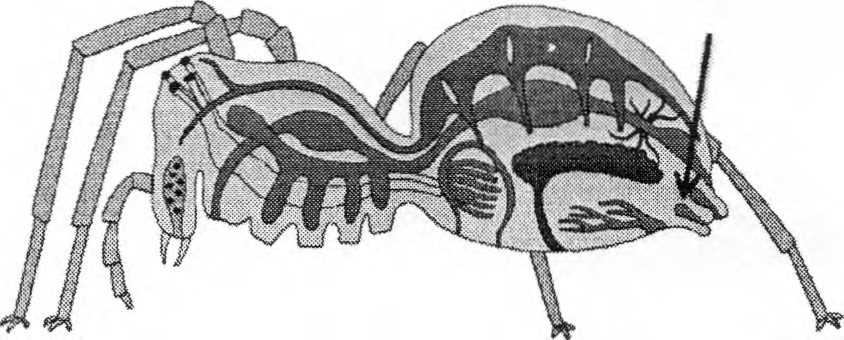
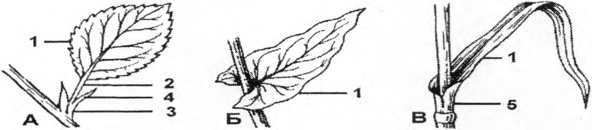
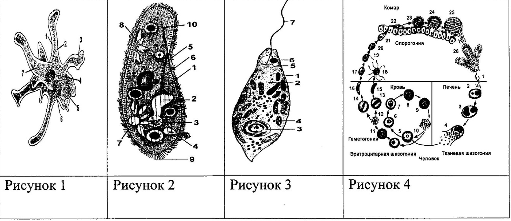
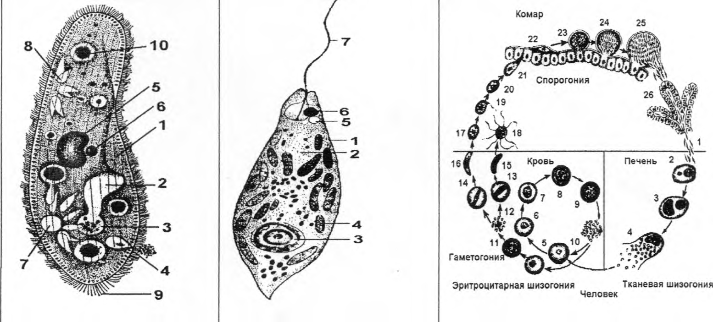

# Районный этап 2019, 8 класс — Районный этап · 2019 · 14 тестов, 15 вопросов по рисункам, 11 суждений

Олимпиада `r19` из тренажёра «Олимпиада под микроскопом». Вопросов: 21. Каждый вопрос: условие (с рисунками), ключ и допустимые ответы, эталонный ответ, разбор по шагам 3–8 (алгоритм, объяснение и разбор вариантов, ловушки, как запомнить, схема, олимпиадный горизонт). Схемы в разборах здесь заменены подписями; сами схемы — в PDF-версии.

---

### [r19-q1] № 1 · Тест 1 · Почему ель — голосеменное растение

Раздел: Часть I — Тесты. Тип: один ответ. ID: `r19-q1`. На сайте: `#r19-q1`.

**Условие.** Почему ель относят к отделу голосеменных:

Варианты:
- 1) отсутствует семенная кожура
- 2) листья видоизменены в иголки
- 3) семена лежат открыто на чешуйках шишек
- 4) семена расположены в сухих плодах

**Ключ:** 3) семена лежат открыто на чешуйках шишек

**Эталонный ответ (карточка «Правильный ответ» на сайте):**

**3) семена лежат открыто на чешуйках шишек.**

**Разбор (шаги 3–8):**
#### 3. Алгоритм олимпиадного мышления
**Маркеры в условии.** «**Почему** относят к отделу» — спрашивают о **главном признаке отдела**, а не о любой особенности ели. Само название отдела — подсказка: «**голо**-семенные» = «голые», ничем не прикрытые семена.

**Логическая цепочка:**

1. Чем голосеменные отличаются от покрытосеменных? У покрытосеменных семязачатки спрятаны в завязи пестика, а семена — в плоде.
2. У голосеменных нет цветка, нет завязи и нет плода → семязачатки и семена лежат **открыто** на чешуях шишки → «3».
3. Проверяем остальное: кожура у семени ели есть («1» — неверно), плодов нет («4» — неверно), хвоя — не признак отдела («2»).

#### 4. Послойное объяснение и разбор вариантов
**Суть в двух предложениях.** Отдел называется «голосеменные» потому, что семена не спрятаны внутри плода: они лежат открыто на поверхности семенных чешуй шишки. Это и есть определяющий признак, а хвоя — лишь приспособление многих хвойных к холоду и сухости.

**Механизм.** Женская шишка ели — укороченный побег с семенными чешуями. На верхней стороне каждой чешуи лежат **два семязачатка**. Пыльца, принесённая ветром, попадает прямо к ним, без рыльца и столбика. После оплодотворения семязачаток превращается в **семя** с кожурой и крылышком, а чешуи шишки лишь прикрывают семена, но не срастаются вокруг них в плод.

**Разбор неверных вариантов:**

- **1) отсутствует семенная кожура** — ошибка: у семени ели есть плотная **кожура** (она образуется из покрова семязачатка). Вариант построен на путанице «голое семя = семя без кожуры». Слово «голое» относится к отсутствию **плода**, а не кожуры.
- **2) листья видоизменены в иголки** — у ели действительно хвоя, но это не **признак отдела**: у голосеменного гинкго листья широкие, веерные, а у вельвичии — длинные лентовидные. С другой стороны, игловидные листья бывают и у цветковых (вереск). Было бы верно для вопроса «Как ель приспособлена к сухой зиме?».
- **4) семена расположены в сухих плодах** — у голосеменных **нет плодов** вообще. Сухие плоды (орех, зерновка, коробочка) бывают только у покрытосеменных. Ловушка: шишку часто ошибочно называют «плодом ели».

#### 5. Типичные ошибки и ловушки
- **«Голое» ≠ «без кожуры».** Кожура у семени есть, «голое» — значит не в плоде.
- **Шишка — не плод**, а видоизменённый укороченный побег со спороносными чешуями.
- **Исключения:** у можжевельника чешуи срастаются в мясистую «шишкоягоду», у тиса семя окружено красным присемянником — это похоже на плод, но плодом не является.

!

Запомни: у голосеменных **нет цветков и плодов** — семена лежат **открыто** на чешуях шишки.

#### 6. Как запомнить
**Этимология:** *Gymnospermae* — греч. *gymnos* «голый» + *sperma* «семя»; *Angiospermae* (покрытосеменные) — *angeion* «сосуд, вместилище» + *sperma*.

**Сравнительная мини-таблица:**

| Признак | Голосеменные (ель) | Покрытосеменные (вишня) |
|---|---|---|
| Где лежат семязачатки | открыто на чешуе шишки | в завязи пестика |
| Цветок | нет | есть |
| Плод | нет | есть |
| Семенная кожура | есть | есть |
| Оплодотворение | одинарное | двойное |

#### 7. Визуализация
[Схема в разборе: без подписи]
*Подпись к схеме: Семязачатки голосеменных лежат открыто на чешуе, у покрытосеменных — спрятаны в завязи.*

#### 8. Олимпиадный горизонт
- **Хвоя — пример приспособления к среде**, а не к систематике: у лиственницы хвоя опадает на зиму, а у сосны и ели живёт несколько лет.
- **Сосна и ель различаются:** у сосны хвоинки по две в пучке, у ели — по одной, четырёхгранные.
- [олимпиадный уровень]  У голосеменных гнетовых (вельвичия, эфедра) есть и сосуды в древесине, и подобие околоцветника — «мостик» к цветковым.

---

### [r19-q2] № 2 · Тест 2 · Что характерно для насекомых

Раздел: Часть I — Тесты. Тип: один ответ. ID: `r19-q2`. На сайте: `#r19-q2`.

**Условие.** Для насекомых характерно:

Варианты:
- 1) полость тела – миксоцель
- 2) дыхание осуществляется легкими и трахеями
- 3) сердце находится в груди

**Ключ:** 1) полость тела – миксоцель

**Эталонный ответ (карточка «Правильный ответ» на сайте):**

**1) полость тела — миксоцель.**

**Разбор (шаги 3–8):**
#### 3. Алгоритм олимпиадного мышления
**Маркеры в условии.** Три варианта — три разных системы органов: полость тела, дыхание, кровообращение. Проверяем каждую отдельно.

**Логическая цепочка:**

1. Полость тела у **всех членистоногих** — смешанная (миксоцель) → для насекомых верно.
2. Дыхание насекомых — **только трахеями**; «лёгкие и трахеи» — это паукообразные → «2» отпадает.
3. Сердце насекомых — трубка на спинной стороне **брюшка**; в груди проходит лишь аорта → «3» отпадает.

#### 4. Послойное объяснение и разбор вариантов
**Суть в двух предложениях.** У насекомых полость тела смешанная — миксоцель, и в ней свободно течёт гемолимфа. Дышат они трахеями, а сердце лежит в брюшке.

**Механизм.** Слово **миксоцель** означает «смешанная полость». У зародыша членистоногих закладываются зачатки вторичной полости (целома), но затем они сливаются с остатками первичной — получается одна общая полость. Именно поэтому кровеносная система у насекомых **незамкнутая**: гемолимфа выходит из сосуда прямо в эту полость и омывает органы. Сердце (спинной сосуд) лежит над кишечником в брюшке, всасывает гемолимфу через отверстия-**остии** и гонит её вперёд по аорте, через грудь — в голову.

**Разбор неверных вариантов:**

- **2) лёгкими и трахеями** — так дышат **паукообразные** (у паука — лёгочные мешки и трахеи). У насекомых лёгких нет: воздух входит через дыхальца по бокам тела и разносится трахеями прямо к клеткам. Ловушка — перенос признака соседнего класса.
- **3) сердце находится в груди** — в груди лежат мощные **мышцы** ног и крыльев, а сердце — в **брюшке**. Через грудь проходит лишь его продолжение — аорта. Ловушка: у человека сердце в грудной клетке, и рука «сама» выбирает этот вариант.

#### 5. Типичные ошибки и ловушки
- **«Грудь» у насекомых — отдел тела** с тремя парами ног и крыльями, а не «грудная клетка» человека.
- **Лёгкие + трахеи** — паукообразные; **жабры** — ракообразные; **только трахеи** — насекомые.
- **Исключение:** у водных личинок (подёнок, стрекоз) — трахейные жабры, но это всё равно часть трахейной системы.

!

Запомни: у насекомых **сердце — в брюшке, полость — миксоцель, дыхание — только трахеи.**

#### 6. Как запомнить
**Этимология:** *миксоцель* — греч. *mixis* «смешение» + *koilos* «полый»; *остии* — лат. *ostium* «вход, устье».

**Цепочка процесса:** гемолимфа из полости → остии сердца (брюшко) → аорта (через грудь) → голова → изливается в полость → омывает органы → снова к сердцу.

**Мнемоника:** «**Б**рюшко **б**ьётся» — сердце насекомого в **б**рюшке.

#### 7. Визуализация
[Схема в разборе: без подписи]
*Подпись к схеме: Внутреннее строение насекомого (схема, вид сбоку): сердце — в брюшке, на спинной стороне; трахеи начинаются дыхальцами.*

#### 8. Олимпиадный горизонт
- **У всех членистоногих** миксоцель и незамкнутая кровеносная система: у рака сердце в головогруди, у паука — в брюшке.
- **Трахеи насекомых и паукообразных** возникли независимо — это пример сходного решения в сходной среде (жизнь на суше), а не признак близкого родства  [олимпиадный уровень] .

---

### [r19-q3] № 3 · Тест 3 · Чего нет у речного рака

Раздел: Часть I — Тесты. Тип: один ответ. ID: `r19-q3`. На сайте: `#r19-q3`.

**Условие.** Для речного рака характерно все, кроме:

Варианты:
- 1) фасеточные глаза
- 2) две пары челюстей
- 3) три пары ногочелюстей
- 4) органы равновесия и слуха располагаются в основном членике антенул

**Ключ:** 2) две пары челюстей

**Эталонный ответ (карточка «Правильный ответ» на сайте):**

**2) две пары челюстей.** У рака челюстей **три** пары: одна пара верхних (жвалы) и две пары нижних.

**Разбор (шаги 3–8):**
#### 3. Алгоритм олимпиадного мышления
**Маркеры в условии.** «Всё, **кроме**» — ищем **неверное** утверждение. Три из четырёх вариантов содержат точные числа и названия — их надо пересчитать.

**Логическая цепочка:**

1. Фасеточные (сложные) глаза на подвижных стебельках у рака есть → «1» верно.
2. Ротовые конечности: **1 пара верхних челюстей + 2 пары нижних челюстей + 3 пары ногочелюстей** → «3» верно.
3. Значит, челюстей всего **три пары**, а не две → «2» неверно.
4. Статоцист (орган равновесия) лежит в основном членике коротких усиков — антеннул → «4» верно.

#### 4. Послойное объяснение и разбор вариантов
**Суть в двух предложениях.** Ротовой аппарат рака собран из шести пар видоизменённых конечностей: трёх пар челюстей и трёх пар ногочелюстей. Утверждение «две пары челюстей» не учитывает верхние челюсти (жвалы).

**Механизм.** У членистоногих части ротового аппарата — это **конечности**, которые «переучились» с ходьбы на обработку пищи. Жвалы (верхние челюсти) перетирают пищу; две пары нижних челюстей удерживают и проталкивают её; ногочелюсти подносят пищу ко рту и создают ток воды к жабрам. В основании антеннул находится **статоцист** — ямка с чувствительными волосками и песчинками: при наклоне тела песчинки давят на разные волоски, и рак «чувствует», где верх.

**Разбор вариантов (кроме ответа все верны):**

- **1) фасеточные глаза** — верно: у рака сложные глаза из тысяч фасеток на подвижных стебельках. Включено как «надёжный» верный признак.
- **3) три пары ногочелюстей** — верно; они принадлежат грудному отделу. Ловушка: число «3» рядом с «2» в соседнем варианте заставляет сомневаться.
- **4) органы равновесия и слуха в основном членике антеннул** — верно (статоцист). Выглядит подозрительно из-за слова «антеннулы» (это **короткие** усики) и «слуха» — но так и есть.
- **2)** — **ответ**. Утверждение было бы верным в формулировке «две пары **нижних** челюстей».

#### 5. Типичные ошибки и ловушки
- **«Челюсти» = верхние + нижние.** Не забудь жвалы.
- **Антеннулы — короткие усики** (статоцист), **антенны — длинные** (у их основания открываются зелёные железы — органы выделения).
- **Ногочелюсти — не челюсти**, а грудные конечности, приспособленные к захвату пищи.

!

Запомни: у рака **3 пары челюстей + 3 пары ногочелюстей + 5 пар ходильных ног.**

#### 6. Как запомнить
**Числовая лесенка рака:** «**1 + 2 + 3 + 5**» — 1 пара жвал, 2 пары нижних челюстей, 3 пары ногочелюстей, 5 пар ходильных ног.

**Этимология:** *статоцист* — греч. *statos* «стоящий» + *kystis* «пузырь»; *антеннула* — лат. «маленькая антенна»; *фасетка* — франц. *facette* «грань».

#### 7. Визуализация
[Схема в разборе: без подписи]
*Подпись к схеме: Конечности речного рака по отделам тела. Челюстей — три пары (обведены).*

#### 8. Олимпиадный горизонт
- **У насекомых** ротовой аппарат тоже из конечностей: верхняя губа, жвалы, нижние челюсти, нижняя губа (сросшаяся вторая пара нижних челюстей).
- **Статоцисты** есть и у моллюсков, и у медуз — орган равновесия возникал много раз независимо.
- **Креветки и крабы** — тоже десятиногие ракообразные: у них такой же набор конечностей.

---

### [r19-q4] № 4 · Тест 4 · Полное превращение

Раздел: Часть I — Тесты. Тип: один ответ. ID: `r19-q4`. На сайте: `#r19-q4`.

**Условие.** Полное превращение характерно для:

Варианты:
- 1) кузнечика
- 2) пилильщика
- 3) стрекозы
- 4) медведки

**Ключ:** 2) пилильщика

**Эталонный ответ (карточка «Правильный ответ» на сайте):**

**2) пилильщика.**

**Разбор (шаги 3–8):**
#### 3. Алгоритм олимпиадного мышления
**Маркеры в условии.** «**Полное** превращение» = есть стадия **куколки**. Определяем отряд каждого насекомого.

**Логическая цепочка:**

1. Кузнечик и медведка — **Прямокрылые**: неполное превращение.
2. Стрекоза — отряд **Стрекозы**: неполное превращение (личинка живёт в воде).
3. Пилильщик — отряд **Перепончатокрылые** (как пчёлы и осы): полное превращение → «2».

#### 4. Послойное объяснение и разбор вариантов
**Суть в двух предложениях.** При полном превращении личинка совсем не похожа на взрослое насекомое и проходит стадию неподвижной куколки. Пилильщик относится к перепончатокрылым, у которых превращение полное.

**Механизм.** **Полное превращение:** яйцо → личинка → **куколка** → имаго. Личинка питается и растёт, а в куколке её тело почти полностью перестраивается: распадаются личиночные органы и из особых групп клеток строятся органы взрослого. Личинка пилильщика — **ложногусеница**: похожа на гусеницу бабочки, но у неё больше пар брюшных ножек. **Неполное превращение:** яйцо → личинка (нимфа) → имаго; личинка похожа на взрослого и растёт, линяя, без стадии куколки.

**Разбор неверных вариантов:**

- **1) кузнечик** — прямокрылые, **неполное** превращение: личинка — маленький бескрылый «кузнечик». Включён как самый известный пример неполного превращения.
- **3) стрекоза** — **неполное** превращение. Ловушка: личинка стрекозы живёт в воде и совсем не похожа на взрослую — кажется, что превращение «полное». Но куколки нет: последняя личинка выползает на стебель и линяет сразу во взрослую.
- **4) медведка** — прямокрылые, как кузнечик, **неполное** превращение. Ловушка: медведка живёт в почве, как многие личинки жуков, и её путают с ними.

#### 5. Типичные ошибки и ловушки
- **Главный критерий — куколка**, а не то, насколько личинка похожа на взрослого (стрекоза!).
- **Пилильщик ≠ бабочка.** Его личинку называют ложногусеницей: у гусениц бабочек не больше 5 пар брюшных ножек, у ложногусениц — 6–8 пар.
- **Отряды с полным превращением:** Жесткокрылые, Чешуекрылые, Перепончатокрылые, Двукрылые, Блохи, Сетчатокрылые.

!

Запомни: **нет куколки — неполное превращение** (стрекоза, кузнечик, медведка, клопы, тараканы).

#### 6. Как запомнить
**Мнемоника полных:** «**Жук, Бабочка, Пчела и Муха куколкой сплелись**» — жесткокрылые, чешуекрылые, перепончатокрылые, двукрылые.

**Этимология:** *имаго* — лат. *imago* «образ» (окончательный облик); *метаморфоз* — греч. «перемена формы».

#### 7. Визуализация
[Схема в разборе: без подписи]
*Подпись к схеме: Два типа развития насекомых: главное различие — стадия куколки.*

#### 8. Олимпиадный горизонт
- **Плюс полного превращения:** личинка и взрослое насекомое питаются разной пищей и не конкурируют (гусеница грызёт листья, бабочка пьёт нектар).
- **Неполное превращение** у Прямокрылых, Стрекоз, Тараканов, Клопов (Полужесткокрылых), Вшей.
- [олимпиадный уровень]  Есть «промежуточные» случаи: у белокрылок и трипсов есть неподвижные стадии, похожие на куколку.

---

### [r19-q5] № 5 · Тест 5 · Растения влажных мест

Раздел: Часть I — Тесты. Тип: один ответ. ID: `r19-q5`. На сайте: `#r19-q5`.

**Условие.** Растения, предпочитающие влажные места обитания и с высокой влажностью воздуха

Варианты:
- 1) гидатофиты
- 2) гидрофиты
- 3) гигрофиты
- 4) склерофиты

**Ключ:** 3) гигрофиты

**Эталонный ответ (карточка «Правильный ответ» на сайте):**

**3) гигрофиты.**

**Разбор (шаги 3–8):**
#### 3. Алгоритм олимпиадного мышления
**Маркеры в условии.** «Влажные **места** и высокая влажность **воздуха**» — растение живёт **на суше**, а не в воде. Значит, водные группы отпадают.

**Логическая цепочка:**

1. Гидатофиты — **целиком погружены** в воду → не подходят.
2. Гидрофиты — **частично погружены** (корни и низ стебля в воде) → не подходят.
3. Склерофиты — растения **сухих** мест с жёсткими листьями → не подходят.
4. Остаются **гигрофиты** — растения сырой почвы и влажного воздуха → «3».

#### 4. Послойное объяснение и разбор вариантов
**Суть в двух предложениях.** Экологические группы растений по отношению к воде выстраиваются в ряд — от живущих в воде до живущих в пустыне. Гигрофиты стоят в этом ряду первыми **наземными**: им нужны сырая почва и влажный воздух.

**Механизм «строение → среда».** В сыром тенистом лесу или на болоте воздух почти насыщен паром, испарение слабое, и растению не нужно экономить воду. Поэтому у гигрофитов (калужница, кислица, недотрога, папоротники) **тонкие крупные листья** с тонкой кутикулой, много устьиц, слабые корни. Отбор не поддерживал защиту от высыхания там, где высыхания почти не бывает. Если пересадить такое растение на солнце, оно быстро вянет.

**Разбор неверных вариантов:**

- **1) гидатофиты** — полностью в воде (элодея, роголистник). Влажность воздуха для них не важна. Ловушка созвучия «гидат-/гигр-».
- **2) гидрофиты** — частично в воде, над водой — стебли и листья (тростник, рогоз, частуха). Включены, потому что «гидро-» связывают с влагой. Верно для «растения, укореняющиеся на дне водоёма, но выступающие над водой».
- **4) склерофиты** — растения засушливых мест с жёсткими кожистыми листьями (ковыль, олеандр). Это противоположный конец ряда.

#### 5. Типичные ошибки и ловушки
- **Три похожих корня:** *гидат-* (вода, целиком в ней), *гидр-* (вода, частично), *гигр-* (влага, сырость).
- **Склерофиты и суккуленты** — оба ксерофиты, но по-разному: первые терпят высыхание, вторые запасают воду (кактус, очиток).
- **Мезофиты** — средняя влажность (большинство наших растений: клевер, берёза).

!

Запомни: **гигро-** = влажность (как в «гигрометр»), **гидро-** = вода.

#### 6. Как запомнить
**Этимология:** *гигрофит* — греч. *hygros* «влажный» + *phyton* «растение»; *гидрофит* — *hydōr* «вода»; *гидатофит* — *hydatos* «воды» (родит. падеж); *склерофит* — *sklēros* «твёрдый»; *ксерофит* — *xēros* «сухой».

**Подсказка из жизни:** **гигро**метр измеряет влажность **воздуха** — значит, **гигро**фиты любят влажный **воздух**.

#### 7. Визуализация
[Схема в разборе: без подписи]
*Подпись к схеме: Экологические группы растений по отношению к воде: от полностью водных до засухоустойчивых.*

#### 8. Олимпиадный горизонт
- **По отношению к свету** тоже есть ряд: светолюбивые (гелиофиты), теневыносливые, тенелюбивые (сциофиты) — часто гигрофиты одновременно и тенелюбивы.
- **Одно растение — разные листья:** у стрелолиста подводные листья лентовидные, плавающие — овальные, надводные — стреловидные (разнолистность).

---

### [r19-q6] № 6 · Тест 6 · Самые мелкие ракообразные

Раздел: Часть I — Тесты. Тип: один ответ. ID: `r19-q6`. На сайте: `#r19-q6`.

**Условие.** К ракообразным, чьи размеры тела не превышают 1 - 3 мм, относятся:

Варианты:
- 1) омары и лангусты
- 2) дафнии и циклопы
- 3) морские желуди и морские уточки
- 4) крабы и креветки

**Ключ:** 2) дафнии и циклопы

**Эталонный ответ (карточка «Правильный ответ» на сайте):**

**2) дафнии и циклопы.**

**Разбор (шаги 3–8):**
#### 3. Алгоритм олимпиадного мышления
**Маркеры в условии.** «Не превышают **1–3 мм**» — размер с маковое зёрнышко. Ищем пару, где **обе** группы такие мелкие.

**Логическая цепочка:**

1. Омары и лангусты — до полуметра → нет.
2. Крабы и креветки — сантиметры и десятки сантиметров → нет.
3. Морские жёлуди и уточки — сидячие, с известковой раковиной в сантиметры → нет.
4. Дафнии и циклопы — планктонные рачки в пресной воде, видны как «точки» → «2».

#### 4. Послойное объяснение и разбор вариантов
**Суть в двух предложениях.** Дафнии и циклопы — мелкие рачки пресноводного планктона, их размеры измеряются миллиметрами. Это главный корм мальков рыб («живой корм» для аквариумов).

**Механизм.** Малый размер связан с жизнью в толще воды: мелкое тело почти не тонет, потому что сопротивление воды для него велико относительно массы. **Дафния** («водяная блоха») плавает рывками, взмахивая крупными ветвистыми антеннами; её грудные ножки фильтруют воду и отцеживают водоросли и бактерии. **Циклоп** назван по единственному глазку посередине головы (как одноглазый великан из мифов); у самки по бокам брюшка — два яйцевых мешка.

**Разбор неверных вариантов:**

- **1) омары и лангусты** — крупные морские десятиногие раки, длиной в десятки сантиметров. Вариант — «противоположность» правильному.
- **3) морские жёлуди и морские уточки** — **усоногие** ракообразные; взрослые сидят, прикрепившись к камням и днищам кораблей, в известковых домиках в несколько сантиметров. Ловушка — названия звучат «мелко» (жёлуди), да и личинки у них правда микроскопические, но речь о взрослых.
- **4) крабы и креветки** — от сантиметров до десятков сантиметров; японский краб-паук в размахе ног — до 3–4 м.

#### 5. Типичные ошибки и ловушки
- **Точные числа в условии — упрощение:** крупные дафнии достигают 5–6 мм. Олимпиада имеет в виду «миллиметровые» рачки.
- **«Морские уточки» — не птицы, а рачки**, «морские жёлуди» — не растения. Дарвин изучал их восемь лет и доказал, что это ракообразные.
- **Циклоп — промежуточный хозяин широкого лентеца** — частая связка в олимпиадных заданиях.

!

Запомни: **дафнии и циклопы — пресноводный «планктонный корм» размером 1–3 мм.**

#### 6. Как запомнить
**Мини-таблица размеров:**

| Ракообразные | Образ жизни | Размер |
|---|---|---|
| **Дафния, циклоп** | пресноводный планктон | **1–3 (до 5) мм** |
| Морской жёлудь, морская уточка | сидячие, в раковине | 1–8 см |
| Креветка | плавает у дна | 2–30 см |
| Краб | ползает по дну | от 1 см до 3–4 м в размахе ног |
| Омар, лангуст | донные | десятки сантиметров |

**Ассоциация:** «циклоп» — **один** глаз, как у великана Полифема. *Граница:* у циклопа-рачка глазок простой и очень маленький.

#### 8. Олимпиадный горизонт
- **Планктон — основа водных пищевых цепей:** водоросли → дафнии и циклопы → мальки рыб → хищные рыбы.
- **Дафнии** размножаются летом без оплодотворения (партеногенез), а осенью появляются самцы и «зимние» яйца в прочной оболочке.
- [олимпиадный уровень]  **Усоногие** — пример того, как сидячий образ жизни сильно меняет внешний вид: родство с раками доказали по личинке (науплиус), а не по взрослым.

---

### [r19-q7] № 7 · Тест 7 · Чего нет у акулы

Раздел: Часть I — Тесты. Тип: один ответ. ID: `r19-q7`. На сайте: `#r19-q7`.

**Условие.** У акулы в отличие от карася нет:

Варианты:
- а) плавников
- б) плавательного пузыря
- в) хвостового плавника
- г) чешуи

**Ключ:** б) плавательного пузыря

**Эталонный ответ (карточка «Правильный ответ» на сайте):**

**б) плавательного пузыря.**

**Разбор (шаги 3–8):**
#### 3. Алгоритм олимпиадного мышления
**Маркеры в условии.** «В **отличие от карася**» — ищем признак, который есть у костной рыбы (карась) и отсутствует у хрящевой (акула).

**Логическая цепочка:**

1. Плавники (в т. ч. хвостовой) есть у обеих → «а» и «в» отпадают.
2. Чешуя у акулы есть, только другая — **плакоидная** («зубчики») → «г» отпадает.
3. Плавательный пузырь — орган **костных** рыб; у хрящевых его нет → «б».

#### 4. Послойное объяснение и разбор вариантов
**Суть в двух предложениях.** Акула — хрящевая рыба, и у неё нет плавательного пузыря. Чтобы не тонуть, она постоянно плывёт, а плавучесть ей частично даёт огромная жирная печень.

**Механизм.** Плавательный пузырь костных рыб — мешок с газом: меняя объём газа, рыба «зависает» на нужной глубине без затрат сил. У акулы такого органа нет. Её тело плотнее воды, и она удерживается в толще воды за счёт:

- **жирной печени** (до четверти массы тела): жир легче воды;
- **подъёмной силы** от грудных плавников, расставленных как крылья самолёта;
- **неравнолопастного хвоста**, верхняя лопасть которого направляет тело вверх при каждом взмахе.

Многим акулам приходится плыть, чтобы и дышать: вода проходит через жаберные щели при движении.

**Разбор неверных вариантов:**

- **а) плавников** — у акулы есть все типы плавников: парные (грудные и брюшные) и непарные (спинные, анальный, хвостовой). Вариант для тех, кто совсем не знает строения рыб.
- **в) хвостового плавника** — есть, причём особый: **неравнолопастный** (гетероцеркальный), верхняя лопасть длиннее. У карася хвост равнолопастный. Ловушка — отличие есть, но в форме, а не в наличии.
- **г) чешуи** — есть: **плакоидная** чешуя из дентина, покрытого эмалью, — как маленькие зубы. Кожа акулы шершавая, как наждак. Ловушка — эту чешую не видно глазом.

#### 5. Типичные ошибки и ловушки
- **«Нет чешуи» — ловушка.** Плакоидная чешуя гомологична зубам: зубы акулы — это увеличенные чешуи на челюстях.
- **Хрящевые рыбы:** нет плавательного пузыря, нет жаберных крышек (5–7 жаберных щелей открыты наружу), скелет хрящевой, оплодотворение внутреннее.
- **Исключение среди костных:** у камбалы и некоторых глубоководных рыб плавательного пузыря тоже нет (вторично утрачен).

!

Запомни: у **хрящевых** рыб **нет плавательного пузыря и жаберных крышек**; чешуя — плакоидная.

#### 6. Как запомнить
**Сравнительная мини-таблица:**

| Признак | Акула (хрящевые) | Карась (костные) |
|---|---|---|
| Скелет | хрящевой | костный |
| Плавательный пузырь | **нет** | есть (2 камеры) |
| Жаберные крышки | нет, щели наружу | есть |
| Чешуя | плакоидная | костная |
| Хвост | неравнолопастный | равнолопастный |
| Оплодотворение | внутреннее | наружное |

**Этимология:** *плакоидная* — греч. *plax* «пластинка»; *гетероцеркальный* — *heteros* «другой» + *kerkos* «хвост».

#### 7. Визуализация
[Схема в разборе: без подписи]
*Подпись к схеме: Карась держится на плаву за счёт плавательного пузыря, акула — за счёт жирной печени и движения.*

#### 8. Олимпиадный горизонт
- **Плавательный пузырь и лёгкие** имеют общее происхождение: у двоякодышащих рыб пузырь работает как лёгкое  [олимпиадный уровень] .
- **Скаты** — тоже хрящевые рыбы: у них тоже нет пузыря, но они живут на дне и тонуть им не страшно.

---

### [r19-q8] № 8 · Тест 8 · Внутреннее строение паука

Раздел: Часть I — Тесты. Тип: один ответ. ID: `r19-q8`. На сайте: `#r19-q8`.

**Условие.** Что обозначено на рисунке «Внутреннее строение паука» цифрой 1?

(файл: `assets/img/r19-t08-pauk.png`, ссылка: https://raw.githubusercontent.com/metalinjector/biology-tests/claude/intelligent-heisenberg-9woyvy/assets/img/r19-t08-pauk.png)
*Рисунок из бланка (чёткая копия из PDF-бланка олимпиады): цифра 1 — у заднего конца брюшка.*

Варианты:
- 1) мальпигиевы сосуды
- 2) ядовитые железы
- 3) трахеи
- 4) паутинные железы

**Ключ:** 1) мальпигиевы сосуды

**Эталонный ответ (карточка «Правильный ответ» на сайте):**

**1) мальпигиевы сосуды.**

*Рисунок в бланке мелкий и нечёткий, поэтому ответ определён по расположению структуры (см. блок 3). Если ключ засчитает другой вариант — проверь именно этот пункт.*

**Разбор (шаги 3–8):**
#### 3. Алгоритм олимпиадного мышления
**Маркеры в условии.** Смотрим, **куда упирается** линия-выноска: в какой отдел тела и на какую сторону (спинную или брюшную).

**Логическая цепочка:**

1. Линия 1 входит в **брюшко**, в его **задний спинной** участок, рядом с концом кишечника → ядовитые железы отпадают: они лежат в **головогруди** и открываются в хелицерах.
2. Паутинные железы на рисунке — **полосатые** мешочки внизу брюшка, у паутинных бородавок; линия к ним не идёт.
3. Трахеи — тонкие трубочки, открываются **на брюшной стороне** у бородавок; линия указывает выше, на спинную сторону.
4. У задней кишки сверху лежат ветвящиеся **мальпигиевы сосуды** → «1».

#### 4. Послойное объяснение и разбор вариантов
**Суть в двух предложениях.** Мальпигиевы сосуды — органы выделения паука: тонкие слепые трубочки, которые впадают в заднюю часть кишечника. Поэтому на рисунках они изображаются в задней части брюшка, у конца кишки.

**Механизм.** Мальпигиевы сосуды омываются гемолимфой и забирают из неё конечные продукты обмена (у пауков — главным образом **гуанин**, у насекомых — мочевую кислоту). Эти вещества нерастворимы в воде, поэтому выводятся почти без потери воды — это важно для наземных животных. Содержимое сосудов попадает в кишку и выходит вместе с непереваренными остатками.

**Разбор неверных вариантов:**

- **2) ядовитые железы** — лежат в **головогруди**, а их протоки открываются на концах **хелицер** (челюстей паука). На рисунке они в передней части тела. Включены как «главная особенность» паука.
- **3) трахеи** — у паука есть и **лёгочные мешки** (внизу передней части брюшка), и **трахеи** (открываются на брюшной стороне у паутинных бородавок). Выноска к ним не подходит.
- **4) паутинные железы** — крупные, занимают низ задней части брюшка, их протоки открываются на **паутинных бородавках**. На рисунке это полосатые мешочки внизу; самый «соблазнительный» неверный вариант, потому что тоже лежит сзади.

#### 5. Типичные ошибки и ловушки
- **Положение, а не «похожесть».** Определяй структуру по отделу и стороне тела: голова/грудь или брюшко, спина или брюхо.
- **Мальпигиевы сосуды** есть и у пауков, и у насекомых — но возникли независимо  [олимпиадный уровень]  (у пауков — из средней кишки, у насекомых — из задней).
- **Исключение:** у некоторых мелких пауков лёгких нет — дышат только трахеями; у птицеедов, наоборот, только лёгкие.

!

Запомни: у паука **яд — в головогруди (хелицеры), паутина и выделение — в брюшке.**

#### 6. Как запомнить
**Этимология:** *мальпигиевы сосуды* — по имени итальянского учёного Марчелло **Мальпиги** (XVII в.), который их описал; *хелицеры* — греч. *chēlē* «клешня» + *keras* «рог».

**Карта паука «спереди назад»:** хелицеры с ядом → мозг и сосущий желудок (головогрудь) → лёгкие (низ брюшка спереди) → сердце (спина) → паутинные железы и трахеи (низ сзади) → мальпигиевы сосуды и анус (у конца кишки).

#### 7. Визуализация
[Схема в разборе: без подписи]
*Подпись к схеме: Внутреннее строение паука (схема). Ядовитые железы — в головогруди, мальпигиевы сосуды — у задней кишки.*

#### 8. Олимпиадный горизонт
- **Выделение у разных групп:** насекомые и пауки — мальпигиевы сосуды; ракообразные — зелёные железы; кольчатые черви — метанефридии (задание 14).
- **Паутина** — белок, который твердеет при вытягивании из бородавок; у одного паука бывает до 6–7 типов паутинных желёз для разных нитей.

---

### [r19-q9] № 9 · Тест 9 · Кто относится к паукообразным

Раздел: Часть I — Тесты. Тип: один ответ. ID: `r19-q9`. На сайте: `#r19-q9`.

**Условие.** Выберите животных, относящихся к классу Паукообразные:
(2 балла)

Пункты:
- 1) скорпион
- 2) собачий клещ
- 3) краб
- 4) каракурт
- 5) осьминог

Варианты:
- а) 1, 3, 5
- б) 2, 3, 4
- в) 3, 4
- г) 1, 2, 4

**Ключ:** г) 1, 2, 4

**Эталонный ответ (карточка «Правильный ответ» на сайте):**

**г) 1, 2, 4** — скорпион, собачий клещ, каракурт.

**Разбор (шаги 3–8):**
#### 3. Алгоритм олимпиадного мышления
**Маркеры в условии.** «Класс **Паукообразные**». Признаки класса: **4 пары ходильных ног**, головогрудь и брюшко, **нет усиков**, есть хелицеры и педипальпы.

**Логическая цепочка:**

1. Скорпион — 4 пары ног, клешни — это педипальпы → паукообразное.
2. Собачий клещ — 4 пары ног у взрослого, нет усиков → паукообразное.
3. Каракурт — ядовитый паук → паукообразное.
4. Краб — 5 пар ног, 2 пары усиков → ракообразное; осьминог — моллюск.
5. Ищем вариант «1, 2, 4» → «г».

#### 4. Послойное объяснение и разбор вариантов
**Суть в двух предложениях.** Паукообразные — это не только пауки, но и скорпионы, клещи, сенокосцы. Всех их объединяют четыре пары ходильных ног и отсутствие усиков.

**Механизм.** Тело паукообразных состоит из головогруди и брюшка (у клещей они слились в единое тело). На головогруди 6 пар конечностей: **хелицеры** (захват и яд), **педипальпы** (ощупывание; у скорпиона — мощные клешни) и **4 пары ходильных ног**. Клешни скорпиона похожи на клешни краба, но по происхождению это педипальпы — **аналогичные** органы.

**Разбор неверных вариантов:**

- **а) 1, 3, 5** — скорпион верно, но краб (ракообразное) и осьминог (моллюск) — нет. Ловушка «клешни = паук» и «восемь щупалец = восемь ног».
- **б) 2, 3, 4** — клещ и каракурт верно, но краб — ракообразное. Ловушка: краб «бочком» ходит на ногах, как паук.
- **в) 3, 4** — неполно и с ошибкой: краб лишний, а скорпион и клещ пропущены.

#### 5. Типичные ошибки и ловушки
- **Осьминог: 8 щупалец ≠ 8 ног.** Это моллюск, его щупальца — видоизменённая нога.
- **Клешни бывают у разных групп:** у краба — первая пара ходильных ног, у скорпиона — педипальпы.
- **Исключение:** у **личинок** клещей только **3 пары** ног — их можно спутать с насекомыми.

!

Запомни: **паукообразные — 4 пары ног, без усиков**: пауки, скорпионы, клещи, сенокосцы.

#### 6. Как запомнить
**Мнемоника отрядов:** «**П**оймал **С**корпион **К**леща на **С**ено» — **П**ауки, **С**корпионы, **К**лещи, **С**енокосцы.

**Этимология:** *каракурт* — тюрк. *кара* «чёрный» + *курт* «волк» (по другой версии — «червь»); *арахниды* (научное название класса) — по мифу о ткачихе **Арахне**, превращённой в паука.

#### 7. Визуализация
[Схема в разборе: без подписи]
*Подпись к схеме: Систематическое положение животных из задания 9.*

#### 8. Олимпиадный горизонт
- **Собачий клещ** — переносчик клещевого энцефалита и болезни Лайма (боррелиоза); после прогулки в лесу нужен осмотр.
- **Каракурт** опасен укусом самки; самцы мелкие и почти не ядовиты.
- **Скорпионы** живородящие: самка носит детёнышей на спине.

---

### [r19-q10] № 10 · Тест 10 · Отряды насекомых

Раздел: Часть I — Тесты. Тип: соответствие. ID: `r19-q10`. На сайте: `#r19-q10`.

**Условие.** Соотнесите отряд насекомых и его представителя:
(2 балла)
. Укажите соответствие для всех 5 вариантов ответа:

Левый столбец (Отряд):
- Двукрылые: Двукрылые
- Прямокрылые: Прямокрылые
- Чешуекрылые: Чешуекрылые
- Жесткокрылые: Жесткокрылые
- Полужесткокрылые: Полужесткокрылые

Правый столбец (Представитель):
- 1: Колорадский жук
- 2: Капустная белянка
- 3: Зелёный кузнечик
- 4: Ягодный клоп
- 5: Комнатная муха

**Ключ (соответствие):**
- Двукрылые: Двукрылые → 5: Комнатная муха
- Прямокрылые: Прямокрылые → 3: Зелёный кузнечик
- Чешуекрылые: Чешуекрылые → 2: Капустная белянка
- Жесткокрылые: Жесткокрылые → 1: Колорадский жук
- Полужесткокрылые: Полужесткокрылые → 4: Ягодный клоп

**Эталонный ответ (карточка «Правильный ответ» на сайте):**

**5** Двукрылые; **3** Прямокрылые; **2** Чешуекрылые; **1** Жесткокрылые; **4** Полужесткокрылые.

**Разбор (шаги 3–8):**
#### 3. Алгоритм олимпиадного мышления
**Маркеры в условии.** Названия отрядов «говорят» сами за себя — почти все образованы от **строения крыльев**.

**Логическая цепочка:**

1. **Двукрылые** — одна пара крыльев → муха (5).
2. **Чешуекрылые** — крылья в чешуйках-«пыльце» → бабочка белянка (2).
3. **Жесткокрылые** — передние крылья превращены в твёрдые **надкрылья** → жук (1).
4. **Полужесткокрылые** — передние крылья **наполовину** твёрдые → клоп (4).
5. **Прямокрылые** — прямые узкие передние крылья, прыгательные задние ноги → кузнечик (3).

#### 4. Послойное объяснение и разбор вариантов
**Суть в двух предложениях.** Отряды насекомых различают прежде всего по крыльям и ротовому аппарату. Каждое название отряда описывает крылья его представителей.

| Отряд | Представитель | Крылья | Ротовой аппарат | Превращение |
|---|---|---|---|---|
| Двукрылые | комнатная муха (5) | 1 пара; задние — жужжальца | лижущий | полное |
| Прямокрылые | зелёный кузнечик (3) | передние узкие плотные, задние веером | грызущий | неполное |
| Чешуекрылые | капустная белянка (2) | 2 пары в чешуйках | сосущий хоботок | полное |
| Жесткокрылые | колорадский жук (1) | передние — твёрдые надкрылья | грызущий | полное |
| Полужесткокрылые (Клопы) | ягодный клоп (4) | передние: основание твёрдое, вершина перепончатая | колюще-сосущий | неполное |

**Типичные ошибочные пары:**

- **клоп → Жесткокрылые.** Клопа путают с жуком из-за плотного тела, но у клопа надкрылья твёрдые только **наполовину**, а ротовой аппарат — хоботок.
- **кузнечик → Полужесткокрылые.** Ошибка из-за «плотных» передних крыльев; у кузнечика они по всей длине одинаковые и узкие, а задние ноги прыгательные.
- **муха → Чешуекрылые.** Невнимательность к числу крыльев: у мухи их всего одна пара.

#### 5. Типичные ошибки и ловушки
- **Задние крылья мухи** превратились в **жужжальца** — маленькие булавочки-«гироскопы» для равновесия в полёте.
- **Полужесткокрылые = Клопы** (в разных учебниках по-разному). Не путать клопов с жуками.
- **Исключение:** у некоторых жуков (нарывники, самки светляков) крылья недоразвиты; «бескрылые» насекомые всё равно относятся к своим отрядам.

!

Запомни: **название отряда = описание крыльев.**

#### 6. Как запомнить
**Этимология-подсказки:** *Diptera* (двукрылые) — греч. *dis* «дважды» + *pteron* «крыло»; *Lepidoptera* (чешуекрылые) — *lepis* «чешуя»; *Coleoptera* (жесткокрылые) — *koleos* «ножны, футляр»; *Orthoptera* (прямокрылые) — *orthos* «прямой»; *Hemiptera* (полужесткокрылые) — *hēmi-* «полу-».

**Ассоциация:** надкрылья жука — **футляр** для тонких задних крыльев. *Граница:* в полёте надкрылья не неподвижны, они приподнимаются и тоже создают подъёмную силу.

#### 8. Олимпиадный горизонт
- **Колорадский жук** — вредитель картофеля, завезён из Северной Америки; в Беларуси появился после Второй мировой войны.
- **Кузнечик и саранча** — оба Прямокрылые, но у кузнечика усики длинные (часто длиннее тела), у саранчи — короткие.
- **Ягодный клоп** выделяет пахучую жидкость из желёз на груди — отсюда «клоповый» привкус малины.

---

### [r19-q11] № 11 · Тест 11 · Особенности головоногих моллюсков

Раздел: Часть I — Тесты. Тип: один ответ. ID: `r19-q11`. На сайте: `#r19-q11`.

**Условие.** Особенности головоногих моллюсков:
(2 балла)
. Выберите несколько из 5 вариантов ответа:

Пункты:
- 1) имеют внутренний хрящевой скелет
- 2) имеют головной мозг
- 3) имеют чернильную железу
- 4) нет сердца
- 5) нога преобразована в щупальца

Варианты:
- а) 1, 2, 3, 5
- б) 2, 4
- в) 3, 4, 5

**Ключ:** а) 1, 2, 3, 5

**Эталонный ответ (карточка «Правильный ответ» на сайте):**

**а) 1, 2, 3, 5.**

**Разбор (шаги 3–8):**
#### 3. Алгоритм олимпиадного мышления
**Маркеры в условии.** Пять утверждений, ищем неверное. Самое «подозрительное» — **«нет сердца»**: у всех моллюсков сердце есть.

**Логическая цепочка:**

1. Проверяем «4»: у головоногих не просто есть сердце — их **три** → «4» неверно.
2. Варианты «б» и «в» содержат «4» → отпадают.
3. Остаётся «а» — проверяем остальные: хрящевая капсула вокруг мозга (1) ✓, крупный головной мозг (2) ✓, чернильная железа (3) ✓, щупальца — видоизменённая нога (5) ✓.

#### 4. Послойное объяснение и разбор вариантов
**Суть в двух предложениях.** Головоногие — самые сложно устроенные моллюски: у них крупный мозг в хрящевой «черепной коробке», три сердца и почти замкнутая кровеносная система. Нога превратилась в щупальца и воронку для реактивного движения.

**Механизм по пунктам:**

- **1) внутренний хрящевой скелет** — хрящевая **головная капсула** защищает мозг (аналог черепа), есть хрящи у основания плавников. У каракатицы внутри ещё и известковая «косточка» — остаток раковины.
- **2) головной мозг** — нервные узлы слились в крупный мозг; по относительной массе мозга осьминог — рекордсмен среди беспозвоночных, он решает задачи и учится.
- **3) чернильная железа** — выбрасывает тёмное облако, которое отвлекает хищника.
- **5) нога → щупальца** — у моллюсков «нога» — мускулистый вырост тела; у головоногих она разделилась на щупальца вокруг рта и **воронку**, через которую выталкивается вода.

**Разбор неверного утверждения:**

- **4) нет сердца** — грубая ошибка: есть **системное сердце** (желудочек и предсердия) и два **жаберных сердца**, которые прокачивают кровь через жабры. Включено как «ловушка-абсурд»; было бы верно для губок, кишечнополостных, плоских и круглых червей.

#### 5. Типичные ошибки и ловушки
- **Отбрось вариант по одному неверному пункту.** «Нет сердца» сразу убирает «б» и «в».
- **Исключения:** у **наутилуса** есть наружная раковина и нет чернильной железы; у глубоководных головоногих чернильной железы тоже часто нет.
- **Кровь** головоногих голубая — в ней гемоцианин с медью.

!

Запомни: у головоногих **три сердца, хрящевой «череп» и нога, ставшая щупальцами и воронкой.**

#### 6. Как запомнить
**Мнемоника «ХМЧЩ»:** **Х**рящ, **М**озг, **Ч**ернила, **Щ**упальца — четыре признака из ответа.

**Этимология:** *головоногие* (*Cephalopoda*) — греч. *kephalē* «голова» + *pous* «нога»: щупальца растут прямо вокруг головы.

#### 7. Визуализация
[Схема в разборе: без подписи]
*Подпись к схеме: Схема кровообращения головоногих: одно системное и два жаберных сердца.*

#### 8. Олимпиадный горизонт
- **Сравнение моллюсков:** брюхоногие и двустворчатые — незамкнутая система и одно сердце; головоногие — почти замкнутая система; у кальмаров, каракатиц и осьминогов три сердца (у наутилуса жаберных сердец нет). Причина — активная охота, требующая много кислорода.
- **Глаз осьминога** похож на глаз человека — пример конвергенции: возник независимо и устроен «правильнее» (нет слепого пятна)  [олимпиадный уровень] .

---

### [r19-q12] № 12 · Тест 12 · Польза дождевых червей

Раздел: Часть I — Тесты. Тип: один ответ. ID: `r19-q12`. На сайте: `#r19-q12`.

**Условие.** Положительная роль дождевых червей заключается в:
(2 балла)
. Выберите несколько из 4 вариантов ответа:

Пункты:
- 1) обогащении почвы перегноем
- 2) синтезе органических веществ
- 3) рыхлении почвы
- 4) выделении в почву кислорода

Варианты:
- а) 1, 2, 3
- б) 1, 3
- в) 2, 3, 4
- г) 1, 3, 5

**Ключ:** б) 1, 3

**Эталонный ответ (карточка «Правильный ответ» на сайте):**

**б) 1, 3.**

**Разбор (шаги 3–8):**
#### 3. Алгоритм олимпиадного мышления
**Маркеры в условии.** Дождевой червь — **животное**, гетеротроф. Всё, что делают только растения (синтез органики, выделение кислорода), к нему не относится.

**Логическая цепочка:**

1. «2) синтез органических веществ» и «4) выделение кислорода» — признаки фотосинтеза → неверно.
2. «1) перегной» и «3) рыхление» — верно.
3. Ищем «1, 3» → «б». Вариант «г» содержит несуществующий пункт «5» → отпадает.

#### 4. Послойное объяснение и разбор вариантов
**Суть в двух предложениях.** Дождевые черви перерабатывают опавшие листья в перегной и прокладывают ходы, рыхля почву. Органику и кислород они не создают — они их, наоборот, потребляют.

**Механизм.** Червь заглатывает землю вместе с полусгнившими остатками растений. В кишечнике органика перерабатывается, смешивается с минеральными частицами и слизью; наружу выходят **копролиты** — комочки, богатые гумусом и питательными для растений веществами. Ходы червей улучшают доступ **воздуха и воды** к корням, а перемешивание переносит органику вглубь. Ч. Дарвин посвятил этому последнюю книгу (1881) и подсчитал, что черви за год пропускают через себя тонны почвы на гектар.

**Разбор неверных вариантов:**

- **а) 1, 2, 3** — пункт «2» лишний: синтез органики из неорганических веществ — дело **автотрофов** (растений, некоторых бактерий). Червь лишь перерабатывает готовую органику.
- **в) 2, 3, 4** — две ошибки: синтез органики и выделение кислорода. Червь дышит и **поглощает** кислород.
- **г) 1, 3, 5** — пункта «5» в задании нет. Это опечатка составителей или ловушка на внимательность: вариант с несуществующим пунктом не может быть верным.

#### 5. Типичные ошибки и ловушки
- **«Выделение кислорода» — признак фотосинтеза**, а у животных кислород только расходуется.
- **«Перегной создают черви» — точнее: перерабатывают** остатки, ускоряя образование гумуса (вместе с бактериями и грибами).
- **Проверяй номера в вариантах:** номер, которого нет в условии, — сигнал отбросить вариант.

!

Запомни: черви **рыхлят и удобряют** почву, но **не создают органику и не выделяют кислород.**

#### 6. Как запомнить
**Цепочка процесса:** опавшие листья → кишечник червя → копролиты (гумус) → питание растений; ходы → воздух и вода к корням.

**Этимология:** *гумус* — лат. *humus* «земля, почва»; *копролит* — греч. *kopros* «помёт» + *lithos* «камень».

#### 8. Олимпиадный горизонт
- **Вермикомпост** (биогумус) — удобрение, которое производят калифорнийские красные черви на фермах.
- **Почвообразование** — общая работа «редуцентов»: бактерии, грибы, черви, клещи и ногохвостки разлагают органику.
- **Дождевые черви выползают после дождя**, — обычно это объясняют нехваткой кислорода в залитой водой почве (черви дышат всей поверхностью тела); по другой гипотезе, в сырую погоду им просто безопасно переселяться по поверхности.

---

### [r19-q13] № 13 · Тест 13 · Кто всегда без клыков

Раздел: Часть I — Тесты. Тип: один ответ. ID: `r19-q13`. На сайте: `#r19-q13`.

**Условие.** Клыки всегда отсутствуют в зубной системе:
(2 балла)

Пункты:
- 1) хоботных
- 2) парнокопытных
- 3) грызунов
- 4) непарнокопытных
- 5) зайцеобразных

Варианты:
- а) 1, 2, 3
- б) 1, 3, 5
- в) 1, 4, 5
- г) 2, 4, 5
- д) 2, 3, 4

**Ключ:** б) 1, 3, 5

**Эталонный ответ (карточка «Правильный ответ» на сайте):**

**б) 1, 3, 5** — хоботные, грызуны, зайцеобразные.

**Разбор (шаги 3–8):**
#### 3. Алгоритм олимпиадного мышления
**Маркеры в условии.** Слово-абсолют **«всегда»**: если хотя бы у одного представителя отряда клыки есть, отряд не подходит.

**Логическая цепочка:**

1. Хоботные: бивни слона — это **резцы**, клыков нет ✓.
2. Грызуны и зайцеобразные: между резцами и коренными — **диастема** (промежуток), клыков нет ✓.
3. Парнокопытные: у **свиней и кабанов** клыки огромные → «всегда» нарушено ✗.
4. Непарнокопытные: у **жеребцов** лошади клыки есть → ✗.
5. Ответ: 1, 3, 5 → «б».

#### 4. Послойное объяснение и разбор вариантов
**Суть в двух предложениях.** У растительноядных животных, которые грызут или перетирают растительную пищу, клыки часто исчезают, а на их месте остаётся щель — диастема. У хоботных, грызунов и зайцеобразных клыков нет никогда.

**Механизм (строение → функция).** Клыки нужны, чтобы схватить и удержать добычу. Растительноядным с ведущей ролью резцов (грызуны) или коренных (перетирание травы) клыки не дают преимущества, и в ходе эволюции они редуцировались. Зубная формула записывает число зубов **на одной половине** верхней (числитель) и нижней (знаменатель) челюсти: резцы (I), клыки (C), ложнокоренные (P), коренные (M).

| Животное | Зубная формула |
|---|---|
| Слон (хоботные) | I(1)/(0) C(0)/(0) P(3)/(3) M(3)/(3) |
| Мышь (грызуны) | I(1)/(1) C(0)/(0) P(0)/(0) M(3)/(3) |
| Заяц (зайцеобразные) | I(2)/(1) C(0)/(0) P(3)/(2) M(3)/(3) |
| Свинья (парнокопытные) | I(3)/(3) C(1)/(1) P(4)/(4) M(3)/(3) |
| Лошадь (непарнокопытные) | I(3)/(3) C(1)/(1) P(3)/(3) M(3)/(3) (клыки — у жеребцов) |

**Разбор неверных вариантов:**

- **а) 1, 2, 3** и **д) 2, 3, 4** — содержат **парнокопытных**: у свиньи, бегемота, кабарги клыки есть (у кабарги-самца — длинные клыки-«сабли»).
- **в) 1, 4, 5** и **д)** — содержат **непарнокопытных**: у жеребцов и у тапиров клыки есть.
- **г) 2, 4, 5** — две ошибки из трёх. Ловушка: у коровы верхних клыков нет, и кажется, что у всех копытных их нет.

#### 5. Типичные ошибки и ловушки
- **Бивень слона — резец**, бивень моржа — клык, бивни кабана — клыки. Слово «бивень» не говорит о типе зуба!
- **У коровы** верхних клыков нет, а нижние **похожи на резцы**  [олимпиадный уровень]  (резцевидные клыки). Поэтому «у жвачных нет клыков» — неточно.
- **Зайцеобразные — не грызуны:** у них **две пары** верхних резцов (вторая маленькая — позади первой).

!

Запомни: **клыков никогда нет у хоботных, грызунов и зайцеобразных.**

#### 6. Как запомнить
**Мнемоника:** «**Х**омяк, **З**аяц и **С**лон — **без клыков**» (хоботные, грызуны-хомяки, зайцеобразные).

**Этимология:** *диастема* — греч. *diastēma* «промежуток»; *резец* — потому что режет, *клык* — от «клевать, хватать».

#### 7. Визуализация
[Схема в разборе: без подписи]
*Подпись к схеме: Зубные ряды (схема одной половины челюсти): у грызунов, зайцеобразных и хоботных на месте клыков — промежуток.*

#### 8. Олимпиадный горизонт
- **Резцы грызунов растут всю жизнь** и стачиваются: эмаль только спереди, поэтому край остаётся острым, как долото.
- **У хищных** клыки крупные, а особые хищнические зубы режут мясо, как ножницы.
- **Однородные зубы** — у зубатых китов (дельфинов) и, например, у броненосцев — см. суждение III-8.

---

### [r19-q14] № 14 · Тест 14 · Органы выделения беспозвоночных

Раздел: Часть I — Тесты. Тип: соответствие. ID: `r19-q14`. На сайте: `#r19-q14`.

**Условие.** Соотнесите названия систематических групп беспозвоночных животных (1–5) с характерными для них органами выделения (А–Д):
(2,5 балла)

Левый столбец (Группа):
- 1: Кольчатые черви
- 2: Речной рак
- 3: Плоские черви
- 4: Иглокожие
- 5: Насекомые

Правый столбец (Органы выделения):
- А: протонефридии
- Б: мальпигиевы сосуды
- В: метанефридии
- Г: органы выделения отсутствуют
- Д: зелёные железы

**Ключ (соответствие):**
- 1: Кольчатые черви → В: метанефридии
- 2: Речной рак → Д: зелёные железы
- 3: Плоские черви → А: протонефридии
- 4: Иглокожие → Г: органы выделения отсутствуют
- 5: Насекомые → Б: мальпигиевы сосуды

**Эталонный ответ (карточка «Правильный ответ» на сайте):**

**1 – В, 2 – Д, 3 – А, 4 – Г, 5 – Б.**

**Разбор (шаги 3–8):**
#### 3. Алгоритм олимпиадного мышления
**Маркеры в условии.** Пять групп и пять органов — каждая буква используется один раз. Начинаем с **уникальных** пар, где ошибиться трудно.

**Логическая цепочка:**

1. Зелёные железы — только у ракообразных → **2 – Д**.
2. Мальпигиевы сосуды — у наземных членистоногих → **5 – Б**.
3. **Прото**нефридии («первые», самые простые) — у плоских червей → **3 – А**.
4. **Мета**нефридии (с воронкой в целоме) — у кольчатых червей → **1 – В**.
5. Осталось: иглокожие — особых органов нет → **4 – Г**.

#### 4. Послойное объяснение и разбор вариантов
**Суть в двух предложениях.** В эволюции беспозвоночных органы выделения усложнялись: от слепых канальцев плоских червей до парных трубочек в каждом сегменте кольчатых. Членистоногие «изобрели» свои органы — зелёные железы в воде и мальпигиевы сосуды на суше.

| Группа | Орган | Как работает |
|---|---|---|
| Плоские черви | **протонефридии** | ветвящиеся канальцы, на концах — **пламенные клетки** с пучком ресничек; они «мерцают», как пламя, и гонят жидкость к порам |
| Кольчатые черви | **метанефридии** | в каждом сегменте пара трубочек: **воронка** с ресничками открыта в целом, трубочка проходит через перегородку и открывается порой в **следующем** сегменте |
| Речной рак | **зелёные железы** | пара желёз в голове, открываются у основания **длинных усиков** |
| Насекомые | **мальпигиевы сосуды** | слепые трубочки, впадают в кишечник на границе средней и задней кишки |
| Иглокожие | **нет** | продукты обмена выходят через кожные жабры, амбулакральные ножки и уносятся клетками-амёбоцитами |

**Типичные ошибочные пары:**

- **«1 – А» и «3 – В»** — перестановка прото/мета. Подсказка: *прото-* — «первый», это самое простое и древнее; *мета-* — «после», более сложное.
- **«2 – Б»** — мальпигиевы сосуды у рака. У водных ракообразных их нет, это «изобретение» наземных членистоногих.
- **«4 – А»** — иглокожим приписывают простые черви органы. Иглокожие — вторичноротые, как и хордовые, но специальных органов выделения у них нет.

#### 5. Типичные ошибки и ловушки
- **Прото- (плоские) → мета- (кольчатые):** порядок как в эволюции.
- **Мальпигиевы сосуды — и у паукообразных** (см. задание 8).
- **Исключение:** у **круглых червей** — не нефридии, а **шейная железа** или боковые выделительные каналы  [олимпиадный уровень] .

!

Запомни: **плоские — протонефридии, кольчатые — метанефридии, рак — зелёные железы, насекомые — мальпигиевы сосуды, иглокожие — нет органов.**

#### 6. Как запомнить
**Этимология:** *нефридий* — греч. *nephros* «почка»; *прото-* — «первый»; *мета-* — «после, следующий».

**Мнемоника «по росту сложности»:** **П**лоские → **П**рото; **К**ольчатые → **М**ета (в каждом **кольце**); **Р**ак → **з**елёные (рак зелёный, пока не сварен!); **Н**асекомые → **М**альпиги.

#### 7. Визуализация
[Схема в разборе: без подписи]
*Подпись к схеме: Основные типы органов выделения беспозвоночных (схемы).*

#### 8. Олимпиадный горизонт
- **У позвоночных** органы выделения — почки; их единица (нефрон)  [олимпиадный уровень]  по принципу работы напоминает метанефридий: тоже фильтрует жидкость и возвращает полезное обратно.
- **Пресноводные** животные выделяют много жидкой мочи (откачивают лишнюю воду), наземные — бережливо: насекомые выводят почти сухую мочевую кислоту.

---

### [r19-q15] № II.1 · Часть II · пункты 1–9 · Части листа и жилкование

Раздел: Часть II — Рисунки: лист и протисты. Тип: термины по определениям / по рисунку. ID: `r19-q15`. На сайте: `#r19-q15`.

**Условие.** Ответ (1 или 2 слова или цифру) впиши рядом с номером пункта.

(файл: `assets/img/r19-ch2-list.png`, ссылка: https://raw.githubusercontent.com/metalinjector/biology-tests/claude/intelligent-heisenberg-9woyvy/assets/img/r19-ch2-list.png)
*Рисунок из бланка: листья А, Б и В (полная копия из PDF-бланка; в разборе рисунок был обрезан справа).*

Пункты:
- 1) У растения, обозначенного на рисунке буквой А, жилкование …
- 2) У растения, обозначенного на рисунке буквой В, жилкование …
- 3) Часть листа, обозначенная на рисунке цифрой 1, называется …
- 4) Часть листа, обозначенная на рисунке цифрой 2, называется …
- 5) Часть стебля, обозначенная на рисунке цифрой 3, называется …
- 6) Часть листа, обозначенная на рисунке цифрой 4, называется …
- 7) Часть листа, обозначенная на рисунке цифрой 5, называется …
- 8) Растение, чей лист обозначен на рисунке буквой В, относится к классу …
- 9) Растение, чей лист обозначен на рисунке буквой А, относится к отделу …

- пункт 1: У растения, обозначенного на рисунке буквой А, жилкование … → **сетчатое** (принимаются шаблоны ['^(перисто )?(сетчат|перист)'])
- пункт 2: У растения, обозначенного на рисунке буквой В, жилкование … → **параллельное** (принимаются шаблоны ['^параллельн'])
- пункт 3: Часть листа, обозначенная на рисунке цифрой 1, называется … → **листовая пластинка** (принимаются шаблоны ['^(листовая )?пластинк'])
- пункт 4: Часть листа, обозначенная на рисунке цифрой 2, называется … → **черешок** (принимаются шаблоны ['^череш(ок|ка)$'])
- пункт 5: Часть стебля, обозначенная на рисунке цифрой 3, называется … → **основание листа** (принимаются шаблоны ['^(основание( листа)?|узел|узла)$'])
- пункт 6: Часть листа, обозначенная на рисунке цифрой 4, называется … → **прилистники** (принимаются шаблоны ['^прилистник'])
- пункт 7: Часть листа, обозначенная на рисунке цифрой 5, называется … → **влагалище** (принимаются шаблоны ['^влагалищ'])
- пункт 8: Растение, чей лист обозначен на рисунке буквой В, относится к классу … → **однодольные** (принимаются шаблоны ['^однодольн'])
- пункт 9: Растение, чей лист обозначен на рисунке буквой А, относится к отделу … → **покрытосеменные** (принимаются шаблоны ['^(покрытосеменн|цветков)'])

**Эталонный ответ (карточка «Правильный ответ» на сайте):**

| № | Ответ |
|---|---|
| 1 | **сетчатое** (перистое) |
| 2 | **параллельное** |
| 3 | **листовая пластинка** |
| 4 | **черешок** |
| 5 | **основание листа** |
| 6 | **прилистники** |
| 7 | **влагалище** |
| 8 | **Однодольные** |
| 9 | **Покрытосеменные** (Цветковые) |

*К пункту 5:* в бланке написано «часть **стебля**», но на этом рисунке из учебника цифрой 3 обозначено **основание листа** — место, которым лист прикрепляется к стеблю (в **узле**). Если учитель настаивает именно на части стебля, это **узел**.

**Разбор (шаги 3–8):**
#### 3. Алгоритм олимпиадного мышления
**Маркеры в условии.** Три рисунка — три типа листьев: **А** — черешковый, **Б** — сидячий, **В** — влагалищный (злак). Цифры 1–5 — части листа.

**Логическая цепочка:**

1. Лист А: зазубренная пластинка с ветвящимися жилками → **сетчатое** жилкование; есть черешок и прилистники → двудольное **цветковое** растение.
2. Лист В: длинный узкий, жилки идут **параллельно**, нижняя часть **обхватывает стебель трубкой** → влагалище → злак → класс **Однодольные**.
3. Цифры: 1 — всегда плоская часть → пластинка; 2 — «ножка» между пластинкой и стеблем → черешок; 4 — маленькие листовидные выросты у основания → прилистники; 3 — нижняя часть листа у стебля → основание; 5 — трубка вокруг стебля → влагалище.

#### 4. Послойное объяснение и разбор вариантов
**Суть в двух предложениях.** Лист состоит из пластинки, черешка (бывает не всегда) и основания, у которого часто есть прилистники или влагалище. Тип жилкования связан с классом: у двудольных — сетчатое, у однодольных — параллельное или дуговое.

**Механизм «строение → функция».**

- **Пластинка** — главная фотосинтезирующая часть; плоская форма даёт большую площадь для света и газообмена.
- **Черешок** подставляет пластинку под свет и смягчает удары ветра (см. суждение III-1).
- **Основание листа** — место прикрепления к стеблю в **узле**; у многих растений на нём сидят **прилистники**, которые защищают молодой лист в почке (у гороха они крупные и фотосинтезируют).
- **Влагалище** у злаков обхватывает стебель, укрепляет его и защищает зону роста междоузлия (вставочную меристему).

**Типичные ошибки:**

- **Пункт 1 «дуговое»** — дуговое жилкование у подорожника и ландыша (однодольные и некоторые двудольные), а у листа А жилки ветвятся сеткой.
- **Пункт 5 «черешок» или «стебель»** — на рисунке 3 указывает на самый низ листа, где он сидит на стебле.
- **Пункт 8 «Злаки»** — это семейство, а спрашивают **класс** — Однодольные.
- **Пункт 9 «Двудольные»** — это класс, а спрашивают **отдел** — Покрытосеменные (Цветковые).

#### 5. Типичные ошибки и ловушки
- **Уровни систематики:** отдел (Покрытосеменные) → класс (Однодольные/Двудольные) → семейство (Злаки). Отвечай на тот уровень, о котором спрашивают.
- **Жилкование — не абсолютный признак класса:** у вороньего глаза и аронника (однодольные) жилкование сетчатое, у подорожника (двудольное) — дуговое.
- **Сидячий лист (Б)** — тоже может быть у двудольных (лён, гвоздика), черешок — не признак класса.

!

Запомни: **сетчатое — двудольные, параллельное или дуговое — однодольные** (с исключениями); **влагалище — злаки.**

#### 6. Как запомнить
**Мини-таблица типов листьев:**

| Тип | Признак | Пример |
|---|---|---|
| Черешковый (А) | есть черешок | берёза, вишня |
| Сидячий (Б) | пластинка сразу на стебле | лён, тысячелистник |
| Влагалищный (В) | основание охватывает стебель | пшеница, кукуруза |

**Этимология:** *прилистник* — «при листе»; *влагалище* — от «влагать» (вкладывать): стебель как будто вложен в трубку листа.

**Порядок слов «отдел → класс → семейство»:** «**О**сень **К**расит **С**ад» — **О**тдел, **К**ласс, **С**емейство.

#### 7. Визуализация
[Схема в разборе: без подписи]
*Подпись к схеме: Части листа: 1 — листовая пластинка, 2 — черешок, 3 — основание листа, 4 — прилистники, 5 — влагалище.*

#### 8. Олимпиадный горизонт
- **Видоизменения листа:** усики у гороха (часть листа), колючки у барбариса, колючки-прилистники у белой акации, чешуи луковицы.
- **Узел и междоузлие** — части **стебля**: узел — место прикрепления листа, междоузлие — участок между узлами.
- **Листорасположение:** очерёдное (берёза), супротивное (сирень), мутовчатое (вороний глаз) — тоже частая тема заданий с рисунками.

---

### [r19-q16] № II.2 · Часть II · пункты 10–15 · Протисты на рисунках

Раздел: Часть II — Рисунки: лист и протисты. Тип: термины по определениям / по рисунку. ID: `r19-q16`. На сайте: `#r19-q16`.

**Условие.** Рисунки 1–4. Ответ (1 или 2 слова или цифру) впиши рядом с номером пункта.

(файл: `assets/img/r19-ch2-protisty.png`, ссылка: https://raw.githubusercontent.com/metalinjector/biology-tests/claude/intelligent-heisenberg-9woyvy/assets/img/r19-ch2-protisty.png)
*Рисунки 1–4 из бланка.*

(файл: `assets/img/r19-ch2-protisty-pdf.png`, ссылка: https://raw.githubusercontent.com/metalinjector/biology-tests/claude/intelligent-heisenberg-9woyvy/assets/img/r19-ch2-protisty-pdf.png)
*Те же рисунки 2–4 крупнее — чёткая копия из PDF-бланка (на ней лучше видны цифры).*

Пункты:
- 10) Миксотрофный тип питания имеет живое существо, изображённое на рисунке под номером …
- 11) На рисунке под номером 2 цифрой 7 обозначена …
- 12) У существа, изображённого на рисунке под номером 2, диплоидный набор хромосом имеет …
- 13) Существо, изображённое на рисунке под номером 4, является возбудителем …
- 14) Существо, изображённое на рисунке под номером 2, имеет половой процесс, называемый …
- 15) Существа, изображённые на рисунке под номерами 1 и 3, относятся к царству …

- пункт 10: Миксотрофный тип питания имеет живое существо, изображённое на рисунке под номером … → **3** (принимаются шаблоны ['^(3|три|третий|рисунок 3|на рисунке 3|эвглена( зеленая)?)$'])
- пункт 11: На рисунке под номером 2 цифрой 7 обозначена … → **сократительная вакуоль** (принимаются шаблоны ['^сократительн(ая|ой)( вакуол[ья])?$'])
- пункт 12: У существа, изображённого на рисунке под номером 2, диплоидный набор хромосом имеет … → **малое ядро** (принимаются шаблоны ['^(мало|микронуклеус)'])
- пункт 13: Существо, изображённое на рисунке под номером 4, является возбудителем … → **малярии** (принимаются шаблоны ['^маляри'])
- пункт 14: Существо, изображённое на рисунке под номером 2, имеет половой процесс, называемый … → **конъюгация** (принимаются шаблоны ['^конъюгаци'])
- пункт 15: Существа, изображённые на рисунке под номерами 1 и 3, относятся к царству … → **протисты** (принимаются шаблоны ['^протист'])

**Эталонный ответ (карточка «Правильный ответ» на сайте):**

| № | Ответ |
|---|---|
| 10 | **3** (эвглена зелёная) |
| 11 | **сократительная вакуоль** *(уточнено, см. ниже)* |
| 12 | **малое ядро** (микронуклеус) |
| 13 | **малярии** |
| 14 | **конъюгация** |
| 15 | **Протисты** |

*К пункту 15:* в старых учебниках амёбу и эвглену относили к царству Животные (подцарство Простейшие); по действующему белорусскому учебнику — царство **Протисты**.

*Уточнение к пункту 11.* В исходном разборе указана «порошица», но по чёткой копии рисунка из PDF-бланка видно: цифра 5 — большое ядро, 6 — малое ядро, а у цифры 4 наружу выходит облачко непереваренных остатков — это и есть порошица. Цифра 7 указывает на пузырёк в задней части клетки, к которому лучами сходятся веретеновидные приводящие канальцы, то есть на **сократительную вакуоль**. Поэтому в тренажёре засчитывается «сократительная вакуоль».

**Разбор (шаги 3–8):**
#### !. Уточнение к ключу
*Уточнение к пункту 11.* В исходном разборе указана «порошица», но по чёткой копии рисунка из PDF-бланка видно: цифра 5 — большое ядро, 6 — малое ядро, а у цифры 4 наружу выходит облачко непереваренных остатков — это и есть порошица. Цифра 7 указывает на пузырёк в задней части клетки, к которому лучами сходятся веретеновидные приводящие канальцы, то есть на **сократительную вакуоль**. Поэтому в тренажёре засчитывается «сократительная вакуоль».

#### 3. Алгоритм олимпиадного мышления
**Маркеры в условии.** Сначала узнаём организмы на рисунках: **1** — амёба (ложноножки), **2** — инфузория-туфелька (реснички, форма туфли), **3** — эвглена зелёная (жгутик, хлоропласты), **4** — цикл малярийного плазмодия (подписи «комар», «печень», «кровь»).

**Логическая цепочка:**

1. **Миксотроф** — и фотосинтезирует, и питается готовой органикой → только эвглена (у неё хлоропласты) → **3**.
2. У туфельки **два ядра**: большое (управляет обменом веществ) и малое (наследственность, половой процесс). Диплоидное — **малое** ядро.
3. Половой процесс инфузорий — обмен малыми ядрами между двумя особями → **конъюгация**.
4. Рисунок 4 — плазмодий → **малярия**.
5. Амёба и эвглена — одноклеточные эукариоты → царство **Протисты**.

#### 4. Послойное объяснение и разбор вариантов
**Суть в двух предложениях.** На рисунках — четыре протиста с разными способами жизни: хищная амёба, ресничная туфелька, миксотрофная эвглена и паразит плазмодий. Вопросы проверяют типы питания, ядерный аппарат инфузорий и половой процесс.

**Механизм по пунктам:**

- **10. Эвглена** на свету фотосинтезирует хлоропластами, а в темноте всасывает растворённую органику всей поверхностью. Красный **глазок** (стигма) и жгутик помогают ей плыть к свету.
- **11. Сократительная вакуоль** — пузырёк, к которому сходятся лучами приводящие канальцы. Она собирает лишнюю воду, которая по осмосу поступает в клетку из пресной воды, и выталкивает её наружу. У туфельки две сократительные вакуоли — в передней и задней части тела. Не путай с **порошицей** (на этом рисунке — цифра 4): через неё выбрасываются непереваренные остатки пищи.
- **12. Малое ядро (микронуклеус)** — **диплоидное** (2*n*), хранит наследственную информацию и участвует в половом процессе. **Большое ядро (макронуклеус)** — **полиплоидное** (много копий хромосом), управляет повседневной жизнью клетки.  [олимпиадный уровень]
- **13. Плазмодий** — возбудитель **малярии**: размножается в печени и эритроцитах человека, вызывая приступы лихорадки.
- **14. Конъюгация:** две туфельки сближаются, их малые ядра делятся мейозом, особи **обмениваются** гаплоидными ядрами и расходятся. Число особей не увеличивается, но наследственность обновляется.
- **15. Протисты** — одноклеточные (и простые многоклеточные) эукариоты, которых нельзя отнести к растениям, животным или грибам.

**Типичные ошибки:**

- **10 → «1»:** амёба — гетеротроф (захватывает пищу ложноножками).
- **12 → «большое ядро»:** большое ядро многохромосомное (полиплоидное), а не диплоидное.
- **14 → «копуляция»:** копуляция — слияние двух клеток в одну (у плазмодия в комаре), а у инфузорий клетки после обмена расходятся.
- **15 → «Простейшие»:** это подцарство в старой системе, а спрашивают **царство**.

#### 5. Типичные ошибки и ловушки
- **«Миксотроф» ≠ «автотроф».** Эвглена переключается между двумя типами питания.
- **Два ядра у туфельки — разные по плоидности:** малое 2*n*, большое — полиплоидное.
- **Конъюгация бывает разной:** у инфузорий — обмен ядрами, у спирогиры — слияние содержимого клеток, у бактерий — передача ДНК.

!

Запомни: **эвглена — миксотроф; у туфельки малое ядро диплоидное, половой процесс — конъюгация; плазмодий — возбудитель малярии.**

#### 6. Как запомнить
**Этимология:** *миксотроф* — греч. *mixis* «смешение» + *trophē* «питание»; *нуклеус* — лат. *nucleus* «ядро» (*micro-* — малый, *macro-* — большой); *конъюгация* — лат. *conjugatio* «соединение»; *малярия* — итал. *mala aria* «дурной воздух» (раньше думали, что болезнь от болотных испарений).

**Мини-таблица протистов:**

| Рис. | Протист | Движение | Питание |
|---|---|---|---|
| 1 | амёба | ложноножки | гетеротроф (фагоцитоз) |
| 2 | инфузория-туфелька | реснички | гетеротроф (клеточный рот) |
| 3 | эвглена зелёная | жгутик | **миксотроф** |
| 4 | малярийный плазмодий | — (паразит) | гетеротроф-паразит |

**Формула ядер туфельки:** малое ядро — 2*n*, большое ядро — полиплоидное (много наборов хромосом).

#### 7. Визуализация
[Схема в разборе: без подписи]
*Подпись к схеме: Жизненный цикл малярийного плазмодия (упрощённо): половой процесс идёт в комаре, поэтому комар — окончательный хозяин.*

#### 8. Олимпиадный горизонт
- **Малярия** до сих пор — одна из самых опасных инфекций в тропиках; хинин из коры хинного дерева был первым лекарством от неё.
- **Хлоропласты эвглены**  [олимпиадный уровень]  получены от поглощённой зелёной водоросли — пример «вторичного» симбиоза: у них три мембраны.
- **У растений** миксотрофы тоже есть: росянка фотосинтезирует и ловит насекомых.

---

### [r19-q17] № III · Часть III · суждения 1–11 · Да или нет

Раздел: Часть III — Суждения «да» или «нет». Тип: соответствие. ID: `r19-q17`. На сайте: `#r19-q17`.

**Условие.** Согласись с каждым суждением или отклони его: «да» или «нет».

Левый столбец (Суждение):
- 1: 1.
Черешок ориентирует листовую пластинку относительно света.
- 2: 2.
В древесине сосны отсутствуют настоящие сосуды.
- 3: 3.
Во время покоя у семян процессы жизнедеятельности не прекращаются.
- 4: 4.
Гельминтами называют всех червей, паразитирующих в организме животных и человека.
- 5: 5.
Взрослый овод питается кровью теплокровных животных, прежде всего, крупного рогатого скота.
- 6: 6.
Характерной особенностью всех млекопитающих является живорождение.
- 7: 7.
У птиц хорошо развиты передний мозг и мозжечок.
- 8: 8.
У всех млекопитающих зубы дифференцированы.
- 9: 9.
Плаунам для оплодотворения нужна вода.
- 10: 10.
Удаление плодового тела трутовика со ствола дерева избавляет растение от паразита.
- 11: 11.
Иглокожие, как и кишечнополостные, относятся к животным с радиальным типом симметрии.

Правый столбец (Ответ):
- да: да
- нет: нет

**Ключ (соответствие):**
- 1: 1. Черешок ориентирует листовую пластинку относительно света. → да: да
- 2: 2. В древесине сосны отсутствуют настоящие сосуды. → да: да
- 3: 3. Во время покоя у семян процессы жизнедеятельности не прекращаются. → да: да
- 4: 4. Гельминтами называют всех червей, паразитирующих в организме животных и человека. → да: да
- 5: 5. Взрослый овод питается кровью теплокровных животных, прежде всего, крупного рогатого скота. → нет: нет
- 6: 6. Характерной особенностью всех млекопитающих является живорождение. → нет: нет
- 7: 7. У птиц хорошо развиты передний мозг и мозжечок. → да: да
- 8: 8. У всех млекопитающих зубы дифференцированы. → нет: нет
- 9: 9. Плаунам для оплодотворения нужна вода. → да: да
- 10: 10. Удаление плодового тела трутовика со ствола дерева избавляет растение от паразита. → нет: нет
- 11: 11. Иглокожие, как и кишечнополостные, относятся к животным с радиальным типом симметрии. → да: да

**Эталонный ответ (карточка «Правильный ответ» на сайте):**

**Да:** 1, 2, 3, 4, 7, 9, 11. **Нет:** 5, 6, 8, 10.

**Разбор (шаги 3–8):**
#### 3. Алгоритм олимпиадного мышления
**Маркеры в условии.** В суждениях ищем **слова-абсолюты** («все», «всех») и **подменённые факты** (овод вместо слепня). Абсолют почти всегда требует проверки на исключение.

**Логическая цепочка:**

1. Суждения с «всех» (4, 6, 8): ищем исключение. Для 6 и 8 оно есть (утконос, дельфин) → «нет». Для 4 — это определение термина, исключения нет → «да».
2. Суждения о растениях и грибах (1, 2, 3, 9, 10): проверяем механизм — свет, сосуды, дыхание семян, вода для сперматозоидов, мицелий.
3. Суждения о животных (5, 7, 11): проверяем, не подменён ли объект (овод ↔ слепень) и не нарушено ли правило.

#### 4. Послойное объяснение и разбор вариантов
**Суть в двух предложениях.** Семь суждений верны, четыре содержат ошибку: подмену животного (5), абсолют с исключением (6, 8) или неверное представление о строении гриба (10). Каждое разобрано ниже.

| № | Ответ | Механизм | Ловушка / когда было бы иначе |
|---|---|---|---|
| 1 | да | Черешок изгибается и поворачивается, подставляя пластинку под свет (фототропизм); листья одного побега не затеняют друг друга — **листовая мозаика**. | Включено как «верное-якорь». У сидячих листьев эту роль берёт стебель. |
| 2 | да | Древесина сосны — почти целиком из **трахеид**: вытянутых мёртвых клеток с порами в стенках. Сосуды (трубки из члеников без поперечных стенок) — признак цветковых. | [олимпиадный уровень]  Исключение среди голосеменных — гнетовые (эфедра): у них сосуды есть. |
| 3 | да | В покоящемся семени обмен веществ резко **замедлен**, но идёт: семя дышит, расходует запасы. Поэтому семена теряют всхожесть со временем и «горят» во влажном зерне. | «Покой» звучит как «полная остановка» — но полная остановка = гибель. |
| 4 | да | Гельминты — общее название **паразитических червей** (плоских, круглых и др.), живущих в организме человека, животных и растений. | Абсолют «всех» здесь верен: это определение. Пиявки — **наружные** паразиты, к гельминтам не относятся. |
| 5 | нет | Взрослые **оводы не питаются** вообще: ротовой аппарат недоразвит, живут несколько дней за счёт запасов личинки. Личинки паразитируют под кожей или в носоглотке скота. | Подмена: кровью питаются самки **слепней**. Было бы верно для слепня. |
| 6 | нет | **Однопроходные** (утконос, ехидны) откладывают яйца. Общий признак всех млекопитающих — **вскармливание молоком**, а не живорождение. | Абсолют «всех» с известным исключением. |
| 7 | да | Полёт требует точной **координации** движений → крупный **мозжечок**; сложное поведение (гнездостроение, забота о потомстве) → развитый **передний мозг** (полушария). | Включено как «верное-якорь». |
| 8 | нет | У **зубатых китов** (дельфинов) зубы однородные, конические; у усатых китов, муравьедов, ехидн зубов нет вовсе. | Абсолют «всех». Для большинства млекопитающих — верно. |
| 9 | да | Плауны — **высшие споровые**: их сперматозоиды подвижны (со жгутиками) и плывут к яйцеклетке в капле воды. | Как у мхов, хвощей, папоротников. У семенных растений вода не нужна (пыльцевая трубка). |
| 10 | нет | Плодовое тело — лишь **орган спороношения**. Сам гриб — **мицелий** — пронизывает древесину и продолжает её разрушать; на месте срезанного вырастет новое плодовое тело. | Ловушка «видимая часть = весь организм». |
| 11 | да | Взрослые иглокожие (морская звезда, ёж) — **радиальная** (пятилучевая) симметрия, как у кишечнополостных — радиальная. | [олимпиадный уровень]  Нюанс: личинки иглокожих двусторонне-симметричны, радиальность у них **вторичная**. Для взрослых суждение верно. |

#### 5. Типичные ошибки и ловушки
- **Слова-абсолюты** «все», «всех», «всегда»: ищи хотя бы одно исключение — утконос, дельфин.
- **Овод ≠ слепень.** Слепни (самки) пьют кровь; оводы во взрослом состоянии не питаются.
- **Гриб — это мицелий**, а «гриб» в бытовом смысле — только плодовое тело.

!

Запомни: **общий признак млекопитающих — молоко, а не живорождение**; взрослые оводы **не питаются**.

#### 6. Как запомнить
**Этимология:** *гельминт* — греч. *helmins* «червь»; *трахеида* — от «трахея» + суфф. *-ида* «похожая на»; *иглокожие* (*Echinodermata*) — греч. *echinos* «ёж» + *derma* «кожа».

**Мини-таблица «овод или слепень»:**

| Признак | Овод | Слепень |
|---|---|---|
| Питание взрослых | **не питаются** | самки пьют кровь |
| Личинки | паразиты скота (под кожей, в желудке, носоглотке) | в почве и воде |
| Вред | повреждают кожу скота, снижают удои | укусы, переносят болезни |

**Список «да» (7 штук):** 1, 2, 3, 4, 7, 9, 11 — «все нечётные, кроме 5, плюс 2 и 4».

#### 7. Визуализация
[Схема в разборе: без подписи]
*Подпись к схеме: Трутовик: срезанное плодовое тело — лишь «спороносец», а сам гриб — мицелий внутри древесины.*

#### 8. Олимпиадный горизонт
- **Покой семян** бывает «вынужденный» (нет тепла и воды) и «глубокий» (нужна стратификация — выдержка на холоде, как у яблони).
- **Однопроходные** — пример «мостика» между пресмыкающимися и млекопитающими: клоака, яйца, но шерсть и молоко.
- **Трутовик настоящий** в природе — «санитар леса»: разлагает старые и ослабленные деревья, возвращая вещества в круговорот.

---

### [r19-q18] № 1 · Перенос знаний

Раздел: Бонус · Тренажёр на перенос знаний. Тип: один ответ. ID: `r19-t1`. На сайте: `#r19-q18`.

**Условие.** Полное превращение характерно для:

Варианты:
- а) таракана
- б) клопа-солдатика
- в) божьей коровки
- г) саранчи

**Ключ:** в) божьей коровки

**Эталонный ответ (карточка «Правильный ответ» на сайте):**

в) божьей коровки.
Это жук (Жесткокрылые) — с куколкой; таракан, клоп и саранча развиваются без куколки.

---

### [r19-q19] № 2 · Ловушка «все»

Раздел: Бонус · Тренажёр на перенос знаний. Тип: один ответ. ID: `r19-t2`. На сайте: `#r19-q19`.

**Условие.** Выберите
верное
суждение:

Варианты:
- а) все голосеменные имеют игловидные листья
- б) у всех паукообразных 4 пары ходильных ног во взрослом состоянии
- в) все млекопитающие имеют клыки
- г) все моллюски имеют одно сердце

**Ключ:** б) у всех паукообразных 4 пары ходильных ног во взрослом состоянии

**Эталонный ответ (карточка «Правильный ответ» на сайте):**

б).
У взрослых паукообразных всегда 4 пары ходильных ног (у личинок клещей — 3); у гинкго листья широкие, у грызунов нет клыков, у кальмаров и осьминогов три сердца.
Олимпиадная оговорка: у четырёхногих (галловых) клещей во взрослом состоянии всего 2 пары ног, так что строго «у всех» не выполняется и здесь. Но из предложенных вариантов «б» — единственный, который верен почти для всех паукообразных; остальные ошибочны грубо.

---

### [r19-q20] № 3 · Органы выделения

Раздел: Бонус · Тренажёр на перенос знаний. Тип: один ответ. ID: `r19-t3`. На сайте: `#r19-q20`.

**Условие.** У паука-крестовика органами выделения служат:

Варианты:
- а) зелёные железы
- б) метанефридии
- в) мальпигиевы сосуды
- г) протонефридии

**Ключ:** в) мальпигиевы сосуды

**Эталонный ответ (карточка «Правильный ответ» на сайте):**

в) мальпигиевы сосуды.
Как и у насекомых, но возникли независимо; зелёные железы — у рака.

---

### [r19-q21] № 4 · Уровни систематики

Раздел: Бонус · Тренажёр на перенос знаний. Тип: один ответ. ID: `r19-t4`. На сайте: `#r19-q21`.

**Условие.** Пшеница относится к:

Варианты:
- а) отделу Однодольные
- б) классу Однодольные
- в) классу Злаки
- г) отделу Голосеменные

**Ключ:** б) классу Однодольные

**Эталонный ответ (карточка «Правильный ответ» на сайте):**

б) классу Однодольные.
Отдел — Покрытосеменные, а Злаки — семейство.

---

## Памятки олимпиады

### Памятка: Как устроен разбор

**Главная мысль.** На районном этапе почти каждое задание проверяет одно: умеешь ли ты отличить **правило от исключения** и **сходство от родства**. Клешни есть у краба и у скорпиона, «бивни» — у слона и кабана, «восемь ног» — у паука и у осьминога, но это разные органы и разные группы. Спрашивай себя: **что это по происхождению** и **нет ли слова «все»/«всегда»**.

### Восемь шагов разбора

**1 Условие** / дословно

**2 Ответ** / для сверки

**3 Алгоритм** / как додуматься

**4 Объяснение** / и все варианты

**5 Ловушки** / и исключения

**6 Запоминание** / корни, мнемоники

**7 Схема** / если помогает

**8 Горизонт** / перенос знаний

Цвет заголовка показывает часть олимпиады: **зелёный** — часть I (тесты), **фиолетовый** — часть II (рисунки), **оранжевый** — часть III (суждения). Метка  [олимпиадный уровень]  отмечает факты сверх программы 8 класса.

### Памятка: Экспресс-шпаргалка

| Тема | Главное правило | Исключения и ловушки |
|---|---|---|
| Голосеменные | семена лежат открыто на чешуях шишки; нет цветков и плодов | «голое» семя — с кожурой; шишка — не плод |
| Насекомые | миксоцель, только трахеи, сердце — в брюшке | лёгкие + трахеи — у паукообразных |
| Речной рак | 3 пары челюстей (1 верхних + 2 нижних), 3 пары ногочелюстей, 5 пар ног | статоцист — в антеннулах; зелёные железы — у антенн |
| Превращение | полное = есть куколка (пилильщик, жуки, бабочки, мухи) | стрекоза — неполное, хотя личинка непохожа на взрослую |
| Вода и растения | гидатофиты (в воде) → гидрофиты (частично) → гигрофиты (сырость) → мезофиты → ксерофиты | гигро- = влажный воздух, гидро- = вода |
| Мелкие рачки | дафнии и циклопы — 1–3 мм | морские жёлуди и уточки — сидячие ракообразные |
| Акула | нет плавательного пузыря и жаберных крышек | чешуя есть (плакоидная); плавучесть — печень |
| Паук | яд — в головогруди; паутинные железы и мальпигиевы сосуды — в брюшке | лёгкие и трахеи — на брюшной стороне |
| Паукообразные | 4 пары ног, нет усиков: пауки, скорпионы, клещи, сенокосцы | краб — рак; осьминог — моллюск |
| Отряды насекомых | название отряда = описание крыльев | клоп — Полужесткокрылые, не жук |
| Головоногие | хрящевой «череп», мозг, чернила, щупальца из ноги, **три сердца** | у наутилуса нет чернильной железы |
| Дождевые черви | рыхлят почву, создают перегной | органику и кислород не создают |
| Клыки | никогда нет у хоботных, грызунов, зайцеобразных | бивень слона — резец; у свиней и жеребцов клыки есть |
| Выделение | плоские — прото-, кольчатые — метанефридии, рак — зелёные железы, насекомые — мальпигиевы сосуды | у иглокожих органов выделения нет |
| Лист | пластинка, черешок, основание, прилистники; у злаков — влагалище | вороний глаз — однодольное с сетчатым жилкованием |
| Протисты | эвглена — миксотроф; у туфельки малое ядро 2*n*, конъюгация | большое ядро — полиплоидное |
| Малярия | плазмодий; комар — окончательный, человек — промежуточный хозяин | половой процесс — в комаре |
| Суждения | молоко — признак всех млекопитающих; взрослые оводы не питаются | утконос откладывает яйца; дельфин — однородные зубы |
| Грибы-трутовики | гриб = мицелий в древесине | срезать плодовое тело бесполезно |

### Памятка: Словарь корней

| Термин | Корни | Перевод |
|---|---|---|
| голосеменные (*Gymnospermae*) | греч. *gymnos* «голый» + *sperma* «семя» | «голосемянные» |
| покрытосеменные (*Angiospermae*) | греч. *angeion* «сосуд» + *sperma* | «семя в сосуде» |
| миксоцель | греч. *mixis* «смешение» + *koilos* «полый» | смешанная полость тела |
| остии | лат. *ostium* «вход, устье» | отверстия сердца насекомых |
| статоцист | греч. *statos* «стоящий» + *kystis* «пузырь» | орган равновесия |
| антеннула | лат. «маленькая антенна» | короткий усик рака |
| имаго | лат. *imago* «образ» | взрослое насекомое |
| метаморфоз | греч. *meta* «пере-» + *morphē* «форма» | превращение |
| гигрофит | греч. *hygros* «влажный» + *phyton* «растение» | растение сырых мест |
| гидрофит / гидатофит | греч. *hydōr* / *hydatos* «вода» + *phyton* | водные растения |
| склерофит / ксерофит | греч. *sklēros* «твёрдый» / *xēros* «сухой» + *phyton* | растения сухих мест |
| плакоидная | греч. *plax* «пластинка» | (чешуя) акул |
| гетероцеркальный | греч. *heteros* «другой» + *kerkos* «хвост» | неравнолопастный хвост |
| хелицеры | греч. *chēlē* «клешня» + *keras* «рог» | ротовые придатки паукообразных |
| педипальпы | лат. *pes* «нога» + *palpare* «ощупывать» | ногощупальца |
| *Diptera* (двукрылые) | греч. *dis* «дважды» + *pteron* «крыло» | — |
| *Lepidoptera* (чешуекрылые) | греч. *lepis* «чешуя» + *pteron* | — |
| *Coleoptera* (жесткокрылые) | греч. *koleos* «ножны, футляр» + *pteron* | — |
| *Orthoptera* (прямокрылые) | греч. *orthos* «прямой» + *pteron* | — |
| *Hemiptera* (полужесткокрылые) | греч. *hēmi-* «полу-» + *pteron* | — |
| головоногие (*Cephalopoda*) | греч. *kephalē* «голова» + *pous* «нога» | — |
| гумус | лат. *humus* «земля» | перегной |
| копролит | греч. *kopros* «помёт» + *lithos* «камень» | комочки почвы из кишечника червя |
| диастема | греч. *diastēma* «промежуток» | щель на месте клыков |
| нефридий | греч. *nephros* «почка» | трубчатый орган выделения |
| прото- / мета- | греч. *prōtos* «первый» / *meta* «после» | — |
| миксотроф | греч. *mixis* + *trophē* «питание» | смешанное питание |
| микро- / макронуклеус | греч. *mikros* / *makros* + лат. *nucleus* «ядро» | малое / большое ядро |
| конъюгация | лат. *conjugatio* «соединение» | половой процесс инфузорий |
| малярия | итал. *mala aria* «дурной воздух» | — |
| гельминт | греч. *helmins* «червь» | паразитический червь |
| трахеида | «трахея» + *-ида* «похожая» | проводящая клетка древесины |
| иглокожие (*Echinodermata*) | греч. *echinos* «ёж» + *derma* «кожа» | — |

### Памятка: Карточки (лист для печати)

Распечатай, разрежь по пунктиру и сложи пополам: вопрос — на лицевой стороне, ответ — на обороте.

Семя ели «голое» — значит, у него нет кожуры?

Нет: кожура есть, «голое» — значит не спрятано в плоде.

Где у насекомого сердце?

На спинной стороне брюшка; через грудь проходит только аорта.

Сколько пар челюстей у речного рака?

Три: 1 пара верхних (жвал) и 2 пары нижних; плюс 3 пары ногочелюстей.

У стрекозы полное превращение? Ведь личинка совсем не похожа на взрослую.

Нет, неполное: стадии куколки нет.

Есть ли у акулы чешуя?

Есть — плакоидная (зубовидная). Нет плавательного пузыря.

Клешни скорпиона и краба — одно и то же?

Нет: у скорпиона это педипальпы, у краба — первая пара ходильных ног.

Сколько сердец у осьминога?

Три: системное и два жаберных.

Бивень слона — это клык?

Нет, видоизменённый резец; клыков у хоботных нет.

Какое ядро инфузории-туфельки диплоидное?

Малое (микронуклеус); большое — полиплоидное.

Чем питается взрослый овод?

Ничем: ротовой аппарат недоразвит. Кровь пьют самки слепней.

### Памятка: Ключ ответов

| Часть I |
|---|
| 1 | **3** | 8 | **1*** |
| 2 | **1** | 9 | **г** |
| 3 | **2** | 10 | 5, 3, 2, 1, 4** |
| 4 | **2** | 11 | **а** |
| 5 | **3** | 12 | **б** |
| 6 | **2** | 13 | **б** |
| 7 | **б** | 14 | 1–В, 2–Д, 3–А, 4–Г, 5–Б |
| * рисунок нечёткий — см. разбор задания 8 / ** по порядку отрядов в бланке: Двукрылые — 5, Прямокрылые — 3, Чешуекрылые — 2, Жесткокрылые — 1, Полужесткокрылые — 4 |
| Часть III — «да» или «нет» |
| **да:** 1, 2, 3, 4, 7, 9, 11 · **нет:** 5, 6, 8, 10 |

| Часть II |
|---|
| 1 | сетчатое (перистое) |
| 2 | параллельное |
| 3 | листовая пластинка |
| 4 | черешок |
| 5 | основание листа* |
| 6 | прилистники |
| 7 | влагалище |
| 8 | Однодольные |
| 9 | Покрытосеменные (Цветковые) |
| 10 | 3 (эвглена) |
| 11 | порошица* |
| 12 | малое ядро (микронуклеус) |
| 13 | малярии |
| 14 | конъюгация |
| 15 | Протисты |
| * пояснения к спорным пунктам — в разборе части II |

*Уточнение к пункту 11.* В исходном разборе указана «порошица», но по чёткой копии рисунка из PDF-бланка видно: цифра 5 — большое ядро, 6 — малое ядро, а у цифры 4 наружу выходит облачко непереваренных остатков — это и есть порошица. Цифра 7 указывает на пузырёк в задней части клетки, к которому лучами сходятся веретеновидные приводящие канальцы, то есть на **сократительную вакуоль**. Поэтому в тренажёре засчитывается «сократительная вакуоль».
